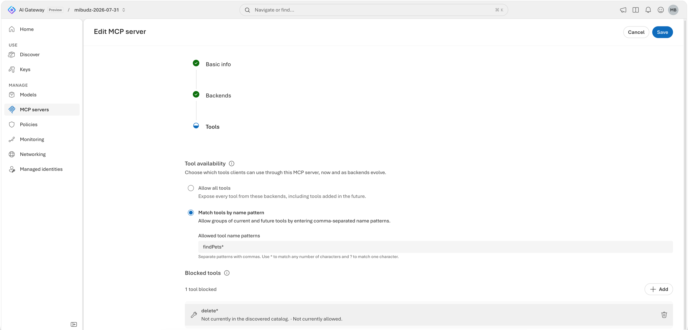

# Control which tools agents can call

The `learn` MCP server that you federated now publishes every tool from two backends. Your security team has
two requests: agents should **search** documentation but not fetch arbitrary pages, and the code sample tool
stays off until its review is done. Operations adds a third: a looping agent must not flood the backends. In
this lab you publish only the approved tools, block one explicitly, and give each caller a request budget.


<!-- widget: tool-patterns {"tools":["learn_microsoft_docs_search","learn_microsoft_code_sample_search","learn_microsoft_docs_fetch","docs_microsoft_docs_search","docs_microsoft_code_sample_search","docs_microsoft_docs_fetch"],"allow":["*_search"],"block":["*code_sample*"]} -->

## Before you begin

> [!TIP]
> On the **Bicep + azd** track, `azd up` creates its own gateway, the `learn` MCP server with its tool controls and
> request rate limit, and a key, so you can skip this section. You need only
> [Cloud Shell or the azd tools](../SETUP.md#choose-where-to-run-commands).

- Complete [Federate MCP tools behind one endpoint](../04-federate-mcp-tools/README.md). You need the `learn`
  MCP server with its `learn` and `docs` backends, and a runtime API key from **Access** › **Keys**.
- The Azure CLI with the [`aigateway` extension](../SETUP.md#install-the-aigateway-extension),
  [signed in](../SETUP.md#sign-in-to-azure), to set the variables below. The Bash snippets of the Azure CLI track also
  need `jq`.
- For the **Verify** scripts: `curl` and `jq` (Bash) or PowerShell 7 or later.
- Permission to change the gateway, for example **Contributor** on the resource group.
- For the scripts and samples: the labs repo, [cloned](../SETUP.md#clone-the-labs-repo). Run them from the lab
  folder, `~/ai-gateway/labs/05-mcp-tool-controls`.

Set these variables once. Every track and the **Verify** section reuse them.

```bash title="Bash"
export RG="<resource-group>"
export GATEWAY="<gateway>"

export AI_GATEWAY_URL="https://$(az aigateway show -g "$RG" -n "$GATEWAY" --query properties.frontend.defaultHostname -o tsv)"
# Paste the runtime key you created in Access › Keys. Don't commit it or write it to a file.
read -rsp "AI Gateway API key: " AI_GATEWAY_API_KEY && export AI_GATEWAY_API_KEY && echo
```

```powershell title="PowerShell"
$RG         = "<resource-group>"
$GATEWAY    = "<gateway>"

$env:AI_GATEWAY_URL = "https://$(az aigateway show -g $RG -n $GATEWAY --query properties.frontend.defaultHostname -o tsv)"
# Paste the runtime key you created in Access › Keys. Don't commit it or write it to a file.
$env:AI_GATEWAY_API_KEY = Read-Host "AI Gateway API key" -MaskInput
```

## How it works

An MCP server has three layers of tool control. The gateway applies all of them before it calls a backend.

| Control | Where | Effect |
|---|---|---|
| **Tool availability** | The server's **Tools** step | **Allow all tools** publishes every tool, including tools that backends add later. **Select exact tools** (a static list) or name patterns publish only matching tools. Tools that don't match aren't listed and can't be called. |
| **Blocked tools** | The server's **Tools** step | Names or patterns that the gateway refuses to run. Blocked patterns take precedence over the allow list. Blocked tools remain visible to clients, but the gateway blocks their execution. |
| **MCP server access** | The server's **Basic info** step, in edit mode | **Active** or **Blocked**. Blocked MCP servers can't be reached by clients, whatever their tool rules say. |
| **Request rate limit** policy | **Policies** | A number of **Calls** per **Renewal period** for each counter. Over the limit, the gateway answers `429` with `Retry-After`. |

Patterns use `*` for any number of characters and `?` for exactly one. This lab uses `*_search` to allow
both search tools and `*code_sample*` to block the code sample tool. Both patterns match whether or not you
include the namespace prefix, such as `learn_`, so they cover every backend of the server.

> [!NOTE]
> The `aigateway` extension doesn't set tool availability, blocked tools, or server access yet, so the Azure CLI
> track covers only the request rate limit. Configure the rest in the portal, or declare them with the
> **Bicep + azd** track: they're the MCP server's `allowList`, `blocked`, and `accessState` properties.

## Publish only approved tools

Pick one track. Both publish the same catalog on the `learn` server: the tools that match `*_search`, with
`*code_sample*` blocked. Make sure the patterns cover every tool that your agents legitimately need before you
save. Tools that don't match are no longer listed or callable.

<!-- track: portal | Portal -->

### Open the Tools step

Open the [AI Gateway portal](https://ai.gateway.azure.com) and select your gateway. Select **MCP servers**,
open `learn`, select **Edit**, and go to the **Tools** step.

### Allow the search tools by pattern

Under **Tool availability**, select **Match tools by name pattern**. Depending on your portal version, the
option is labeled **Use name patterns**, and **Select exact tools** is also offered. In
**Allowed tool name patterns**, enter `*_search`. If your portal shows **Add pattern**, use it to add each
pattern on its own row.

### Block the code sample tool

Under **Blocked tools**, select **Add blocked tool** (or **Add**). In **Tool name or pattern**, enter
`*code_sample*` and select **Add**. The pattern appears under **Blocked tools**, with a note on whether it
matches tools in the discovered catalog.



### Save the server

Select **Save**.

<!-- track: iac | Bicep + azd -->

**What you need:** [Cloud Shell or the azd tools](../SETUP.md#choose-where-to-run-commands) with the
[`aigateway` extension](../SETUP.md#install-the-aigateway-extension), [signed in](../SETUP.md#sign-in-to-azure). This
track doesn't use your gateway or `learn` server from lab 04: `azd up` creates a new gateway with its own `learn`
server, so it works on its own.

### Clone the lab

The lab is a small azd project in the
[`labs/05-mcp-tool-controls`](https://github.com/Azure/ai-gateway/tree/main/labs/05-mcp-tool-controls) folder.
[Clone the labs repo](../SETUP.md#clone-the-labs-repo) if you haven't yet, then move into the lab's folder.

```bash title="Bash or PowerShell"
cd ~/ai-gateway/labs/05-mcp-tool-controls
```

### Review the templates

`infra/main.bicep` creates the resource group `rg-<environment name>` and calls lab 01's
[gateway.bicep](../01-provision-gateway/infra/gateway.bicep) for a gateway with no model. Then it calls
`infra/controlled-tool-server.bicep` with the tool controls, which azd fills from environment values:

| Parameter | azd environment value | Default |
|---|---|---|
| `allowedTools` | `MCP_ALLOWED_TOOLS` | `["*_search"]` |
| `blockedTools` | `MCP_BLOCKED_TOOLS` | `["*code_sample*"]` |
| `serverAccess` | `MCP_SERVER_ACCESS` | `active` |
| `callsPerPeriod` | `REQUEST_RATE_LIMIT` | `5` |
| `periodSeconds` | `REQUEST_RATE_LIMIT_PERIOD` | `30` |
| `counterKey` | `REQUEST_RATE_LIMIT_COUNTER_KEY` | `["identity"]` |

<!-- include: infra/main.bicep -->

`infra/controlled-tool-server.bicep` declares the `learn` server of lab 04, with its `learn` and `docs` backends,
plus the tool controls: `allowList` is **Tool availability** (`["*"]` is **Allow all tools**), `blocked` is
**Blocked tools**, and `accessState` is **MCP server access**. Its `policies` array holds the request rate limit
of [Rate-limit the MCP server](#rate-limit-the-mcp-server). It also creates the `app-first-call` key.

<!-- include: infra/controlled-tool-server.bicep -->

> [!WARNING]
> A Bicep deployment sends a `PUT`, which replaces the whole MCP server, including backends, tool rules, and
> policies that you added in the portal. Keep the template as the only source of truth for this server, and change
> it with `azd provision`.

### Deploy with azd up

Create an azd environment named `aigw-lab05` in your current subscription, then provision everything. It takes
about three minutes.

```bash title="Bash"
azd env new aigw-lab05 --location eastus2 --subscription "$(az account show --query id --output tsv)"
azd up
```

```powershell title="PowerShell"
azd env new aigw-lab05 --location eastus2 --subscription (az account show --query id --output tsv)
azd up
```

For another region, use its name from [Find the available
regions](../SETUP.md#find-the-available-regions).

### Read the outputs and the key

Set the variables that the next sections and **Verify** use from azd's environment values, and read the key from
the gateway, so that it never shows on screen.

```bash title="Bash"
export RG="$(azd env get-value AZURE_RESOURCE_GROUP)"
export GATEWAY="$(azd env get-value AI_GATEWAY_NAME)"
export AI_GATEWAY_URL="$(azd env get-value AI_GATEWAY_URL)"
export AI_GATEWAY_API_KEY="$(az aigateway api-key list-secrets --ids "$(azd env get-value AI_GATEWAY_ID)/apiKeys/app-first-call" \
  --query primaryKey --output tsv)"
az aigateway mcp show -g "$RG" --gateway-name "$GATEWAY" -n learn --query "properties.{allowList:allowList,blocked:blocked}"
```

```powershell title="PowerShell"
$RG                     = azd env get-value AZURE_RESOURCE_GROUP
$GATEWAY                = azd env get-value AI_GATEWAY_NAME
$env:AI_GATEWAY_URL     = azd env get-value AI_GATEWAY_URL
$GATEWAY_ID             = azd env get-value AI_GATEWAY_ID
$env:AI_GATEWAY_API_KEY = az aigateway api-key list-secrets --ids "$GATEWAY_ID/apiKeys/app-first-call" `
  --query primaryKey --output tsv
az aigateway mcp show -g $RG --gateway-name $GATEWAY -n learn --query "properties.{allowList:allowList,blocked:blocked}"
```

> **Checkpoint**
> `azd up` ended with `SUCCESS`, and the last command printed `"allowList": ["*_search"]` and
> `"blocked": ["*code_sample*"]`.

The server already has the request rate limit, 5 calls per 30 seconds for each key, so wait 30 seconds between
script runs.

<!-- /tracks -->

<!-- steps -->

### Check the catalog

Run the script from [Federate MCP tools behind one endpoint](../04-federate-mcp-tools/README.md). This lab
includes a copy, so run it from this lab's folder. It lists the tools and calls an allowed one.

```bash title="Bash"
./infra/list-tools.sh learn learn_microsoft_docs_search "What is AI Gateway?"
```

```powershell title="PowerShell"
./infra/list-tools.ps1 -Server learn -Tool learn_microsoft_docs_search -Query "What is AI Gateway?"
```

On GitHub, open [list-tools.sh](infra/list-tools.sh) or [list-tools.ps1](infra/list-tools.ps1).

The list has four tools, the search tools and the code sample tools of both backends. The `*_fetch` tools are
gone because they don't match `*_search`. The code sample tools are still listed, because blocked tools stay
visible. The call to `learn_microsoft_docs_search` returns Microsoft Learn results.

<!-- /steps -->

> **Checkpoint**
> `tools/list` returns four tools and no `*_fetch` tool, and an allowed search tool still works.

## Take the whole server offline

Sometimes you need to stop all tool traffic at once, for example while you investigate a misbehaving backend.
Blocking the server keeps its backends, tool rules, and policies, so you can turn it back on in one step.

<!-- track: portal | Portal -->

### Block the server

On the `learn` details page, select **Edit**. On **Basic info**, set **MCP server access** to **Blocked**, then
select **Save**.

### Confirm that clients can't connect

```bash title="Bash"
./infra/list-tools.sh learn
```

```powershell title="PowerShell"
./infra/list-tools.ps1 -Server learn
```

The script stops at `initialize`. The gateway answers with HTTP `200` and a JSON-RPC error,
`Access to MCP server 'learn' is blocked.`, with the code `AccessBlockedByGateway`. No backend is called.

### Turn the server back on

Select **Edit** again, set **MCP server access** to **Active**, and select **Save**. Run the script again to
confirm that the four tools are back.

<!-- track: iac | Bicep + azd -->

### Block the server

Set `MCP_SERVER_ACCESS` to `blocked` and provision again. Only the MCP server changes.

```bash title="Bash"
azd env set MCP_SERVER_ACCESS blocked
azd provision
```

```powershell title="PowerShell"
azd env set MCP_SERVER_ACCESS blocked
azd provision
```

### Confirm that clients can't connect

```bash title="Bash"
./infra/list-tools.sh learn
```

```powershell title="PowerShell"
./infra/list-tools.ps1 -Server learn
```

The script stops at `initialize`. The gateway answers with HTTP `200` and a JSON-RPC error,
`Access to MCP server 'learn' is blocked.`, with the code `AccessBlockedByGateway`. No backend is called.

### Turn the server back on

```bash title="Bash"
azd env set MCP_SERVER_ACCESS active
azd provision
./infra/list-tools.sh learn
```

```powershell title="PowerShell"
azd env set MCP_SERVER_ACCESS active
azd provision
./infra/list-tools.ps1 -Server learn
```

The four tools are back.

<!-- /tracks -->

## Rate-limit the MCP server

A request rate limit counts calls instead of tokens. That suits tools, where one agent in a loop can send
hundreds of calls a minute. Pick one track. Each produces the same policy on the `learn` server: **5 calls per
30 seconds for each caller identity**. The limit is deliberately low so you can trigger it quickly.

<!-- widget: request-rate {"calls":5,"window":30} -->

<!-- track: portal | Portal -->

### Start the policy wizard

Select **Policies** › **Add policy**. On the **Type** step, under **Cost & Rate Limits**, select
**Request rate limit**, then **Next**.

### Choose the MCP server

On the **Scope** step, select **Individual assets** ("Apply only to selected models, aliases, or MCP servers").
Select the `learn` MCP server, then **Next**.

### Configure the limit

On the **Details** step (**Configure** in some portal versions), under **Parameters**, set:

| Field | Value |
|---|---|
| **Calls** | `5` |
| **Renewal period** | **30 seconds** |
| **Counter dimensions** | **Caller identity** |

The other renewal periods are **60 seconds**, **2 minutes**, and **5 minutes**. **Caller identity** gives each API
key, and each Entra caller, its own counter. If you select no counter dimension, all callers share one
counter. Select **Create**.

> **Checkpoint**
> **Policies** lists a **Request rate limit** with the `learn` MCP server as its scope.

<!-- track: cli | Azure CLI -->

### Read the current policies

Policies live inline in the MCP server's `properties.policies` array. `az aigateway mcp update --policies`
**replaces the whole array**, so always read it first and keep the policies you didn't mean to change.

The command is the same in Bash and PowerShell.

```bash
az aigateway mcp show -g "$RG" --gateway-name "$GATEWAY" -n learn --query properties.policies
```

The command prints nothing if the server has never had a policy, and `[]` if you removed its last one.

### Replace the request rate limit and keep everything else

```bash title="Bash"
az aigateway mcp show -g "$RG" --gateway-name "$GATEWAY" -n learn -o json | jq -c '
    [(.properties.policies // [])[] | select(.type != "requestRateLimit")]
    + [{type: "requestRateLimit", callsPerPeriod: 5, periodSeconds: 30, counterKey: ["identity"]}]' > policies.json
az aigateway mcp update -g "$RG" --gateway-name "$GATEWAY" -n learn --policies @policies.json \
  --query properties.policies
rm policies.json
```

```powershell title="PowerShell"
$current  = az aigateway mcp show -g $RG --gateway-name $GATEWAY -n learn -o json | ConvertFrom-Json
$policies = @($current.properties.policies | Where-Object { $_ -and $_.type -ne 'requestRateLimit' })
$policies += [pscustomobject]@{ type = 'requestRateLimit'; callsPerPeriod = 5; periodSeconds = 30; counterKey = @('identity') }

ConvertTo-Json -Depth 10 -Compress -InputObject $policies | Set-Content -Path policies.json
az aigateway mcp update -g $RG --gateway-name $GATEWAY -n learn --policies "@policies.json" `
  --query properties.policies
Remove-Item policies.json
```

The commands read the whole MCP server, not just `properties.policies`, because the array is missing until the
server has had a policy. `mcp update` changes only the properties you pass, so the backends and versions stay as
they are. `periodSeconds` is the renewal period in seconds. The portal offers `30`, `60`, `120`, and
`300`. `counterKey` is an array with `identity`, `ipAddress`, or both. An empty array gives all callers one
shared counter.

> [!TIP]
> The same read, merge, and replace pattern sets policies on models, aliases, and the `default` workspace.

> **Checkpoint**
> `mcp update` returns your other policies unchanged plus one entry like this:
>
> ```json
> {
>   "callsPerPeriod": 5,
>   "counterKey": ["identity"],
>   "periodSeconds": 30,
>   "scope": "resource",
>   "type": "requestRateLimit"
> }
> ```

<!-- track: iac | Bicep + azd -->

### Check the policy

`azd up` already added the request rate limit: the template's `policies` array holds one `requestRateLimit` entry
with `callsPerPeriod`, `periodSeconds`, and `counterKey`. The command is the same in Bash and PowerShell.

```bash
az aigateway mcp show -g "$RG" --gateway-name "$GATEWAY" -n learn --query properties.policies
```

> **Checkpoint**
> The command prints one policy with `"type": "requestRateLimit"`, `"callsPerPeriod": 5`, `"periodSeconds": 30`,
> `"counterKey": ["identity"]`, and `"scope": "resource"`.

### Change the limit

To count calls per client IP address instead of per key, set `REQUEST_RATE_LIMIT_COUNTER_KEY` to a JSON array and
provision again. `REQUEST_RATE_LIMIT` and `REQUEST_RATE_LIMIT_PERIOD` work the same way, and
`REQUEST_RATE_LIMIT` `0` removes the policy.

```bash title="Bash"
azd env set REQUEST_RATE_LIMIT_COUNTER_KEY '["ipAddress"]'
azd provision
```

```powershell title="PowerShell"
azd env set REQUEST_RATE_LIMIT_COUNTER_KEY '["ipAddress"]'
azd provision
```

Use `'["identity","ipAddress"]'` for both. Set it back to `'["identity"]'` before **Verify**.

<!-- /tracks -->

## Verify

The rate limit counts the calls you make while you verify, too. Every MCP request counts, including the two
handshake messages that each script run starts with. Wait 30 seconds between steps so each one starts with a
fresh window.

<!-- steps -->

### Call a blocked tool

The code sample tool is still listed, but the gateway refuses to run it:

```bash title="Bash"
./infra/list-tools.sh learn learn_microsoft_code_sample_search "Python MCP client"
```

```powershell title="PowerShell"
./infra/list-tools.ps1 -Server learn -Tool learn_microsoft_code_sample_search -Query "Python MCP client"
```

The tool list prints as before, and then the script reports that the `tools/call` request failed and prints
the gateway's error. The Learn backend never receives the call.

### Run the burst

Wait 30 seconds, then send a handshake followed by eight `tools/list` requests:

```bash title="Bash"
./infra/trigger-request-rate.sh learn 8
```

```powershell title="PowerShell"
./infra/trigger-request-rate.ps1 -Server learn -Requests 8
```

On GitHub, open [trigger-request-rate.sh](infra/trigger-request-rate.sh) or
[trigger-request-rate.ps1](infra/trigger-request-rate.ps1).

Expected output (your `Retry-After` values will differ):

```text
Request  Method                      Status  Retry-After
1        initialize                  200     -
2        notifications/initialized   202     -
3        tools/list                  200     -
4        tools/list                  200     -
5        tools/list                  200     -
6        tools/list                  200     -
7        tools/list                  200     -
8        tools/list                  429     4
9        tools/list                  429     3
10       tools/list                  429     2

Last response body:
{ "statusCode": 429, "message": "Rate limit is exceeded. Try again in 2 seconds." }
```

The counter is approximate, so the gateway can let a call or two beyond the limit through before the first
`429`. `Retry-After` counts down to the end of the current 30-second window, so it can be anything from 1 to 30
seconds.

### Inspect one throttled response

Right after the burst, while you're still throttled, send one raw request and look at the status line and
headers. If it returns `200`, the window has already renewed. Run the burst again, then this command.

```bash
curl -i "${AI_GATEWAY_URL%/}/default/toolservers/learn/mcp" \
  -H "api-key: $AI_GATEWAY_API_KEY" -H "Content-Type: application/json" \
  -H "Accept: application/json, text/event-stream" \
  -d '{"jsonrpc":"2.0","id":1,"method":"tools/list"}'
```

The status line is `HTTP/2 429`, the headers include `retry-after`, and the body is the same JSON error. The
`Retry-After` value tells the client how many seconds to wait. Agent frameworks should back
off for that long instead of retrying in a tight loop.

<!-- /steps -->

> **Checkpoint**
> The `*_fetch` tools are no longer listed, a call to the blocked code sample tool fails, an allowed search
> tool works, and calls over the limit in a 30-second window get `429` with `Retry-After`.

## Go further

- **Prefer exact names for sensitive servers.** Patterns also publish tools that a backend adds later. Where
  your portal offers **Select exact tools**, use it for servers whose new tools need a review first.
- **Block destructive operations everywhere.** For a server built from an OpenAPI spec, keep
  **Allow all tools** and add blocked patterns such as `*_delete_*` so new read operations appear
  automatically but deletions never run.
- **Set a default for every MCP server.** Add a **Request rate limit** with **Gateway** scope in
  [Set gateway-wide policy baselines](../09-gateway-baselines/README.md).
- **Inspect tool calls for attacks.** Add Agent 365 tool threat protection in
  [Protect tool calls with Agent 365 threat protection](../19-tool-threat-protection/README.md).

## Clean up

A 5-call limit will throttle real agents. Remove it, and open the tool catalog again, before you continue.

<!-- track: portal | Portal -->

### Remove the policy and restore the catalog

1. Select **Policies**, open the **Request rate limit** that's scoped to `learn`, and delete it.
2. Open **MCP servers** › `learn` › **Edit** › **Tools**. Select **Allow all tools**, remove the
   `*code_sample*` blocked pattern, and select **Save**.

<!-- track: cli | Azure CLI -->

### Remove the policy

```bash title="Bash"
az aigateway mcp show -g "$RG" --gateway-name "$GATEWAY" -n learn -o json \
  | jq -c '[(.properties.policies // [])[] | select(.type != "requestRateLimit")]' > policies.json
az aigateway mcp update -g "$RG" --gateway-name "$GATEWAY" -n learn --policies @policies.json \
  --query properties.policies
rm policies.json
```

```powershell title="PowerShell"
$current  = az aigateway mcp show -g $RG --gateway-name $GATEWAY -n learn -o json | ConvertFrom-Json
$policies = @($current.properties.policies | Where-Object { $_ -and $_.type -ne 'requestRateLimit' })
ConvertTo-Json -Depth 10 -Compress -InputObject $policies | Set-Content -Path policies.json
az aigateway mcp update -g $RG --gateway-name $GATEWAY -n learn --policies "@policies.json" `
  --query properties.policies
Remove-Item policies.json
```

Then restore the catalog in the portal: open **MCP servers** › `learn` › **Edit** › **Tools**, select
**Allow all tools**, remove the `*code_sample*` blocked pattern, and select **Save**.

<!-- track: iac | Bicep + azd -->

### Delete everything azd created

In the `ai-gateway/labs/05-mcp-tool-controls` folder, delete the resource group with the gateway, the `learn` MCP
server, and the key. [`--purge`](../SETUP.md#delete-what-azd-created) also purges soft-deleted resources. It takes
about ten minutes.

```bash
azd down --purge --force
```

To keep this gateway for other labs instead, skip `azd down`. Open the catalog and remove the limit:

```bash
azd env set MCP_ALLOWED_TOOLS '["*"]'
azd env set MCP_BLOCKED_TOOLS '[]'
azd env set REQUEST_RATE_LIMIT 0
azd provision
```

<!-- /tracks -->

Keep the gateway, the `learn` MCP server, and your key from lab 04. The next labs reuse them. `azd down` doesn't
touch them, because the Bicep + azd track created its own gateway.

## Troubleshooting

| Symptom | Likely cause | Fix |
|---|---|---|
| A tool you blocked still appears in `tools/list` | Expected. Blocked tools remain visible, but the gateway blocks their execution | Call the tool to confirm that it's blocked. To hide a tool, leave it out of the allow list instead. |
| `tools/list` returns no tools | The allow list matches nothing | Check the patterns against the exact tool names. |
| `initialize` returns `AccessBlockedByGateway` | The server access is **Blocked** | Set **MCP server access** to **Active**, or run `azd env set MCP_SERVER_ACCESS active` and `azd provision`. |
| An allowed tool is blocked | A blocked pattern also matches it. Blocked patterns take precedence | Make the blocked pattern narrower, for example `*code_sample*` instead of `*sample*`. |
| `429` on the first request of a run | The previous step used up the window, or a **Gateway** scope rate limit also applies | Wait for `Retry-After`, and review **Policies** for every limit that covers the MCP server. |
| Never `429` | The policy is on another asset, it was saved moments ago, or the burst spans two windows | Check the policy's scope, wait a minute after you save it, and run a longer burst, for example `./infra/trigger-request-rate.sh learn 12`. |
| Other policies vanished after `mcp update` | `--policies` replaces the whole `policies` array | Always read the current array, merge, then update, as shown in the Azure CLI track. |
| Tool rules or policies set in the portal vanished after `azd provision` | A Bicep deployment sends a `PUT`, which replaces the whole MCP server | Change the azd environment values and run `azd provision` instead of editing the server in the portal. |

## Next steps

- [Screen prompts and responses with content safety](../08-content-safety/README.md): screen tool inputs and
  responses, too.
- [Set gateway-wide policy baselines](../09-gateway-baselines/README.md): apply defaults to every model and
  MCP server.
- [Protect tool calls with Agent 365 threat protection](../19-tool-threat-protection/README.md): inspect tool
  calls for prompt injection and sensitive data.
- Docs: [Connect to MCP tools through AI Gateway](https://ai.gateway.azure.com/docs/mcp-access).
