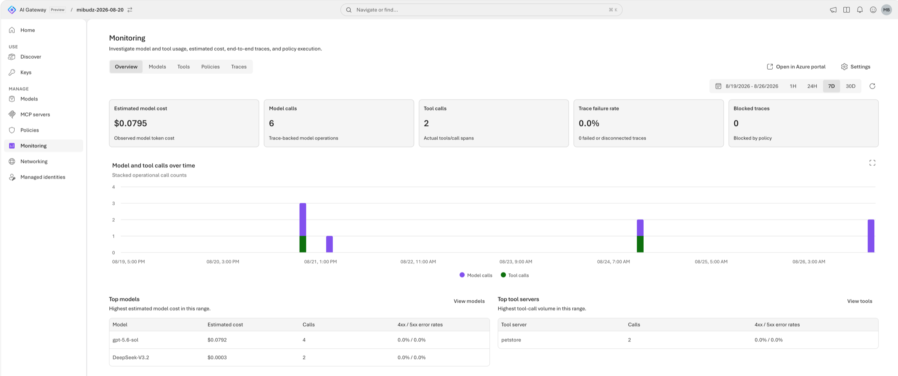

# Throttle tokens per caller with token limits

Your gateway now serves several apps from one model deployment. One batch job sends long prompts in a tight
loop and eats the deployment's tokens-per-minute (TPM) capacity, so every other app starts to fail. In this lab
you give each caller its own token allowance at the gateway, so a noisy neighbor gets a `429` with
`Retry-After` and everyone else keeps working.


<!-- widget: token-limit {"limit":1000,"period":"minute"} -->

## Before you begin

<!-- setup: tools sign-in extension clone -->

> [!TIP]
> On the **Bicep + azd** track, `azd up` creates its own gateway, model, and key, so you can skip this section. You
> need only the one-time setup above.

- Complete [Publish a Foundry model and make your first call](../02-first-model-call/README.md). You need a gateway, an imported
  model, a callable alias, and a runtime API key from **Access** › **Keys**.
- Permission to change the gateway, for example **Contributor** on the resource group.
- Run the scripts and samples from the lab's folder, `~/ai-gateway/labs/06-token-limits`.

Set these variables once. Every track and the **Verify** section reuse them.

```bash title="Bash"
# Name the resource group, the gateway, the model provider, and the model that you published in lab 02
export RG="<resource-group>"
export GATEWAY="<gateway>"                 # 24 characters or fewer
export PROVIDER="<provider-name>"          # for example foundry-models
export MODEL="<model-name>"                # the backend model name under that provider
echo "📝 Model $MODEL from $PROVIDER, on gateway $GATEWAY in $RG"

# Read the gateway's runtime URL
export AI_GATEWAY_URL="https://$(az aigateway show -g "$RG" -n "$GATEWAY" --query properties.frontend.defaultHostname -o tsv)"
echo "🌐 Runtime URL: $AI_GATEWAY_URL"

# Guess the alias from the model's deployment name
# Confirm it on the model's Aliases tab (lab 02), and replace it if it differs
export AI_GATEWAY_MODEL="$(az aigateway model show -g "$RG" --gateway-name "$GATEWAY" --provider-name "$PROVIDER" \
  -n "$MODEL" --query properties.deployment.modelName -o tsv)"
echo "🔖 Model alias: $AI_GATEWAY_MODEL"

# Paste the runtime key that you created in Access › Keys, without showing it
# Don't commit the key or write it to a file
read -rsp "AI Gateway API key: " AI_GATEWAY_API_KEY && export AI_GATEWAY_API_KEY && echo
echo "🔑 Key: in AI_GATEWAY_API_KEY (${#AI_GATEWAY_API_KEY} characters, not shown)"
```

```powershell title="PowerShell"
# Name the resource group, the gateway, the model provider, and the model that you published in lab 02
$RG         = "<resource-group>"
$GATEWAY    = "<gateway>"                 # 24 characters or fewer
$PROVIDER   = "<provider-name>"           # for example foundry-models
$MODEL      = "<model-name>"              # the backend model name under that provider
Write-Host "📝 Model $MODEL from $PROVIDER, on gateway $GATEWAY in $RG"

# Read the gateway's runtime URL
$env:AI_GATEWAY_URL = "https://$(az aigateway show -g $RG -n $GATEWAY --query properties.frontend.defaultHostname -o tsv)"
Write-Host "🌐 Runtime URL: $env:AI_GATEWAY_URL"

# Guess the alias from the model's deployment name
# Confirm it on the model's Aliases tab (lab 02), and replace it if it differs
$env:AI_GATEWAY_MODEL = az aigateway model show -g $RG --gateway-name $GATEWAY --provider-name $PROVIDER `
  -n $MODEL --query properties.deployment.modelName -o tsv
Write-Host "🔖 Model alias: $env:AI_GATEWAY_MODEL"

# Paste the runtime key that you created in Access › Keys, without showing it
# Don't commit the key or write it to a file
$env:AI_GATEWAY_API_KEY = Read-Host "AI Gateway API key" -MaskInput
Write-Host "🔑 Key: in AI_GATEWAY_API_KEY ($($env:AI_GATEWAY_API_KEY.Length) characters, not shown)"
```

> [!TIP]
> Not sure which alias your clients call? Open the model in **Models** and check its **Aliases** tab. The value
> in the request `model` field must match an alias exactly.

## How it works

A token limit is a policy that the gateway evaluates **before** it forwards a request. It keeps a counter of
the tokens that each caller consumed in the current window. While the counter is under the limit, the request
goes through and the tokens in the response are added to the counter. When the counter reaches the limit, the
gateway answers `429 Too Many Requests` with a `Retry-After` header and never calls the backend.

| Setting | Portal label | JSON field | Values |
|---|---|---|---|
| Allowance | **Allowed tokens** | `count` | Positive integer |
| Window | **Time period** | `period` | `minute` (TPM), `hour`, `day` (quota) |
| Who gets a counter | **Counter dimensions** | `counterKey` | An array: `["identity"]` (each API key, or each Entra tenant + object ID), `["ipAddress"]`, or both |

You can attach a token limit to a **model** (applies to every alias that targets it), to an **alias** (only
callers that use that name), or to the **gateway** (a default for every compatible model, including models you
add later). Every applicable policy is checked, and any one of them can block the request.

> [!NOTE]
> The backend deployment has its own capacity, shown as **Token rate limit (TPM)** on the model's details page.
> The gateway limit is how you *share* that capacity fairly. Set per-caller limits so that the sum of your busiest
> callers stays below the deployment's TPM.

<!-- widget: policy-layers -->

## Add a token limit to the model

Pick one track. Each track produces the same policy on your model: **1,000 tokens per minute for each caller
identity**. The limit is deliberately low so you can trigger it in a few requests. The IaC track takes a
different route, explained in its first step.

<!-- track: portal | Portal -->

### Start the policy wizard

Open the [AI Gateway portal](https://ai.gateway.azure.com) and select your gateway from the gateway switcher.
Select **Policies** › **Add policy**. On the **Type** step, under **Cost & Rate Limits**, select
**Token rate limit**, then **Next**.


### Choose where the limit applies

On the **Scope** step, select **Individual assets** ("Apply only to selected models, aliases, or MCP servers").
Select your model, then **Next**.

> [!TIP]
> **Gateway** scope applies the limit to every compatible asset, including models you add later. It's a good
> default for production. You'll try it in [Go further](#go-further).

### Configure the allowance

On the **Details** step (**Configure** in some portal versions), under **Parameters**, set:

| Field | Value |
|---|---|
| **Time period** | **Per minute** |
| **Allowed tokens** | `1000` |
| **Counter dimensions** | **Caller identity** |

Select **Create**. The policy appears in the **Policies** list with your model as its scope.

> **Checkpoint**
> **Policies** lists a **Token rate limit** for your model with 1,000 tokens per minute and the
> **Caller identity** counter.

<!-- track: cli | Azure CLI -->

### Set the token limit

Policies live in the model's `properties.policies` array. `az aigateway model policy set-token-limit` adds the
token limit, or replaces the one that's there, and keeps every other policy on the model.

```bash title="Bash"
# Add a token limit to the model: 1,000 tokens per minute, with its own counter for each caller identity
az aigateway model policy set-token-limit -g "$RG" --gateway-name "$GATEWAY" --provider-name "$PROVIDER" -n "$MODEL" \
  --token-limit 1000 --token-period minute --token-counter-key Identity &&
  echo "🔐 Token limit of 1,000 tokens per minute is on $MODEL"
```

```powershell title="PowerShell"
# Add a token limit to the model: 1,000 tokens per minute, with its own counter for each caller identity
az aigateway model policy set-token-limit -g $RG --gateway-name $GATEWAY --provider-name $PROVIDER -n $MODEL `
  --token-limit 1000 --token-period minute --token-counter-key Identity
if ($?) { Write-Host "🔐 Token limit of 1,000 tokens per minute is on $MODEL" }
```

The command prints the model's policies. `--token-period` accepts `minute` (the default), `hour`, or `day`.
`--token-counter-key` accepts `Identity` (the default), `IPAddress`, or both, as the portal's **Counter dimensions**
allows: `--token-counter-key Identity IPAddress` gives each caller identity and IP address its own counter.

### Confirm the policy

```bash title="Bash"
# List the model's policies, to check the token limit
echo "🔐 Policies on ${MODEL}:"
az aigateway model policy list -g "$RG" --gateway-name "$GATEWAY" --provider-name "$PROVIDER" -n "$MODEL" -o json
```

```powershell title="PowerShell"
# List the model's policies, to check the token limit
Write-Host "🔐 Policies on ${MODEL}:"
az aigateway model policy list -g $RG --gateway-name $GATEWAY --provider-name $PROVIDER -n $MODEL -o json
```

> **Checkpoint**
> The output contains `"type": "tokenLimit"` with `"count": 1000`, `"period": "minute"`,
> `"counterKey": ["identity"]`, and `"scope": "resource"`, which the service adds to every model policy.

<!-- track: rest | REST API -->

### Read the current policies

Policies live inline in the model's `properties.policies` array. A `PATCH` **replaces the whole array**, so
always read it first and keep the policies you didn't mean to change.

```bash
# Read your subscription ID, and build the model's management URL, with the API version
SUB="$(az account show --query id -o tsv)"
URL="https://management.azure.com/subscriptions/$SUB/resourceGroups/$RG/providers/Microsoft.ApiManagement/aigateways/$GATEWAY/workspaces/default/modelProviders/$PROVIDER/models/$MODEL?api-version=2025-09-01-preview"
echo "🆔 Subscription: $SUB"

# Read the model's policies, so that you can keep the ones you don't change
echo "🔐 Policies on ${MODEL}:"
az rest --method get --url "$URL" --query properties.policies
```

### Replace the token limit and keep everything else

```bash title="Bash"
# Read the model, keep every policy except the token limit, and add the new one:
# 1,000 tokens per minute, with its own counter for each caller identity
POLICIES="$(az rest --method get --url "$URL" | jq -c '
  [(.properties.policies // [])[] | select(.type != "tokenLimit")]
  + [{"type":"tokenLimit","count":1000,"period":"minute","counterKey":["identity"]}]')"
echo "📝 Policies to write: $(jq length <<< "$POLICIES"), including the token limit"

# Replace the model's whole policies array with the merged one
az rest --method patch --url "$URL" --body "{\"properties\":{\"policies\":$POLICIES}}" &&
  echo "🔐 Token limit of 1,000 tokens per minute is on $MODEL"
```

```powershell title="PowerShell"
# Read your subscription ID, and build the model's management URL, with the API version
$SUB = az account show --query id -o tsv
$URL = "https://management.azure.com/subscriptions/$SUB/resourceGroups/$RG/providers/Microsoft.ApiManagement/aigateways/$GATEWAY/workspaces/default/modelProviders/$PROVIDER/models/$MODEL`?api-version=2025-09-01-preview"
Write-Host "🆔 Subscription: $SUB"

# Read the model, keep every policy except the token limit, and add the new one:
# 1,000 tokens per minute, with its own counter for each caller identity
$current  = az rest --method get --url $URL | ConvertFrom-Json
$policies = @($current.properties.policies | Where-Object { $_ -and $_.type -ne 'tokenLimit' })
$policies += [pscustomobject]@{ type = 'tokenLimit'; count = 1000; period = 'minute'; counterKey = @('identity') }
Write-Host "📝 Policies to write: $($policies.Count), including the token limit"

# Write the request body to a file, which --body reads with the @ prefix, so that its quotes reach az intact
# Then replace the model's whole policies array, and delete the file
$body = @{ properties = @{ policies = $policies } } | ConvertTo-Json -Depth 10 -Compress
$body | Set-Content -Path patch.json
az rest --method patch --url $URL --body '@patch.json'
if ($?) { Write-Host "🔐 Token limit of 1,000 tokens per minute is on $MODEL" }
Remove-Item patch.json
```

> **Checkpoint**
> Running the `GET` again returns your other policies unchanged plus one `tokenLimit` entry with
> `"counterKey": ["identity"]` and `"scope": "resource"`.

<!-- track: iac | Bicep + azd -->

**What you need:** only the one-time setup from **Before you begin**. This track doesn't use your gateway from lab 02:
`azd up` creates a new one, so it works on its own.

### Choose what to declare

A Bicep deployment sends a `PUT`, which replaces the whole resource. Redeclaring a model you imported in the
portal risks dropping settings you didn't copy. Instead, this template **adds a new alias**,
`<model-name>-limited`, that targets the same backend model and carries its own token limit. Existing clients
keep calling the original alias. Callers that you move to the new alias get the allowance.

This is also a common production pattern: one backend model, several aliases, and a different limit for each
audience (for example `gpt-chat` for interactive apps and `gpt-batch` for offline jobs).

### Review the templates

`infra/main.bicep` creates the resource group `rg-<environment name>` and calls the quick start's
[resources.bicep](../quickstart/infra/resources.bicep) for the gateway, the Foundry model, its default alias, and the
`app-first-call` key. Then it calls `infra/limited-alias.bicep` with the token limit:

<!-- include: infra/main.bicep -->

`infra/limited-alias.bicep` adds the alias. It only references the gateway, the provider, and the model, so you can
also deploy it on its own to a gateway you already have, with `az deployment group create`:

<!-- include: infra/limited-alias.bicep -->

### Deploy with azd up

Move into the lab's folder, create an azd environment named `aigw-lab06` in your current subscription, then provision
everything. It takes about three minutes.

```bash title="Bash"
# Move into the lab's folder, which holds the azd project
cd ~/ai-gateway/labs/06-token-limits &&
  echo "📂 Lab folder: $(pwd)"

# Create an azd environment in your current subscription, so that azd doesn't prompt you
azd env new aigw-lab06 --location eastus2 --subscription "$(az account show --query id --output tsv)" &&
  echo "📝 azd environment aigw-lab06 deploys to eastus2"

# Provision the gateway, the Foundry model, its default alias, the limited alias with its token limit, and the key
azd up &&
  echo "🚀 Gateway deployed: $(azd env get-value AI_GATEWAY_URL)"
```

```powershell title="PowerShell"
# Move into the lab's folder, which holds the azd project
Set-Location ~/ai-gateway/labs/06-token-limits
if ($?) { Write-Host "📂 Lab folder: $(Get-Location)" }

# Create an azd environment in your current subscription, so that azd doesn't prompt you
azd env new aigw-lab06 --location eastus2 --subscription (az account show --query id --output tsv)
if ($?) { Write-Host "📝 azd environment aigw-lab06 deploys to eastus2" }

# Provision the gateway, the Foundry model, its default alias, the limited alias with its token limit, and the key
azd up
if ($?) { Write-Host "🚀 Gateway deployed: $(azd env get-value AI_GATEWAY_URL)" }
```

For another region, pick one where AI Gateway and the `gpt-6-luna` model are available, as in [Find the available
regions](../SETUP.md#find-the-available-regions).

### Read the outputs and the key

Set the variables that **Verify** uses from azd's environment values, and read the key from the gateway, so that it
never shows on screen.

```bash title="Bash"
# Read the template's outputs: the resource group, the gateway, the provider, the backend model, the runtime URL,
# and the limited alias that apps send in the model field
export RG="$(azd env get-value AZURE_RESOURCE_GROUP)"
export GATEWAY="$(azd env get-value AI_GATEWAY_NAME)"
export PROVIDER="$(azd env get-value AI_GATEWAY_PROVIDER)"
export MODEL="$(azd env get-value AI_GATEWAY_BACKEND_MODEL)"
export AI_GATEWAY_URL="$(azd env get-value AI_GATEWAY_URL)"
export AI_GATEWAY_MODEL="$(azd env get-value AI_GATEWAY_MODEL)"
echo "📝 Model $MODEL from $PROVIDER, on gateway $GATEWAY in $RG"
echo "🌐 Runtime URL: $AI_GATEWAY_URL"

# Read the key from the gateway, so that it never lands in a file or a deployment log
export AI_GATEWAY_API_KEY="$(az aigateway api-key list-secrets --ids "$(azd env get-value AI_GATEWAY_ID)/apiKeys/app-first-call" \
  --query primaryKey --output tsv)"
echo "🔑 Key: in AI_GATEWAY_API_KEY (${#AI_GATEWAY_API_KEY} characters, not shown)"
echo "🔖 Model alias: $AI_GATEWAY_MODEL"
```

```powershell title="PowerShell"
# Read the template's outputs: the resource group, the gateway, the provider, the backend model, the runtime URL,
# the limited alias that apps send in the model field, and the gateway's resource ID
$RG                     = azd env get-value AZURE_RESOURCE_GROUP
$GATEWAY                = azd env get-value AI_GATEWAY_NAME
$PROVIDER               = azd env get-value AI_GATEWAY_PROVIDER
$MODEL                  = azd env get-value AI_GATEWAY_BACKEND_MODEL
$env:AI_GATEWAY_URL     = azd env get-value AI_GATEWAY_URL
$env:AI_GATEWAY_MODEL   = azd env get-value AI_GATEWAY_MODEL
$GATEWAY_ID             = azd env get-value AI_GATEWAY_ID
Write-Host "📝 Model $MODEL from $PROVIDER, on gateway $GATEWAY in $RG"
Write-Host "🌐 Runtime URL: $env:AI_GATEWAY_URL"

# Read the key from the gateway, so that it never lands in a file or a deployment log
$env:AI_GATEWAY_API_KEY = az aigateway api-key list-secrets --ids "$GATEWAY_ID/apiKeys/app-first-call" `
  --query primaryKey --output tsv
Write-Host "🔑 Key: in AI_GATEWAY_API_KEY ($($env:AI_GATEWAY_API_KEY.Length) characters, not shown)"
Write-Host "🔖 Model alias: $env:AI_GATEWAY_MODEL"
```

> **Checkpoint**
> `azd up` ended with `SUCCESS`, and the last command printed the limited alias,
> `🔖 Model alias: gpt-6-luna-limited`. In the portal, **Models** shows it next to `gpt-6-luna`, and **Policies**
> lists a **Token rate limit** scoped to it.

### Change the limit

The parameters come from azd environment values, with the defaults in `infra/main.parameters.json`. To count tokens
per client IP address instead of per key, set `TOKEN_LIMIT_COUNTER_KEY` to a JSON array and provision again. Only
the alias changes. `TOKEN_LIMIT` and `TOKEN_LIMIT_PERIOD` work the same way.

```bash title="Bash"
# Count tokens per client IP address instead of per key, in the azd environment
azd env set TOKEN_LIMIT_COUNTER_KEY '["ipAddress"]' &&
  echo "📝 TOKEN_LIMIT_COUNTER_KEY is set to ipAddress"

# Provision again, which updates only the limited alias
azd provision &&
  echo "🔐 The token limit on the limited alias counts tokens per client IP address"
```

```powershell title="PowerShell"
# Count tokens per client IP address instead of per key, in the azd environment
azd env set TOKEN_LIMIT_COUNTER_KEY '["ipAddress"]'
if ($?) { Write-Host "📝 TOKEN_LIMIT_COUNTER_KEY is set to ipAddress" }

# Provision again, which updates only the limited alias
azd provision
if ($?) { Write-Host "🔐 The token limit on the limited alias counts tokens per client IP address" }
```

Use `'["identity","ipAddress"]'` for both. Set it back to `'["identity"]'` before **Verify**, which proves the
counter is per key.

<!-- /tracks -->

## Verify

Send a burst of requests that each use about 225 tokens. With a 1,000-token budget, the first few succeed, and
then the gateway starts answering `429`.

<!-- steps -->

### Run the burst

From the lab folder, run the script for your shell. For each request it prints the status, `Retry-After`, the
tokens used, and the backend deployment's own `x-ratelimit-remaining-tokens` header.

```bash title="Bash"
# Send eight chat completions to the alias, and print the status, Retry-After, and tokens of each one
echo "🚦 Expect 429 Too Many Requests once the 1,000-token allowance runs out:"
./infra/trigger-token-limit.sh "$AI_GATEWAY_MODEL" 8
```

```powershell title="PowerShell"
# Send eight chat completions to the alias, and print the status, Retry-After, and tokens of each one
Write-Host "🚦 Expect 429 Too Many Requests once the 1,000-token allowance runs out:"
./infra/trigger-token-limit.ps1 -Model $env:AI_GATEWAY_MODEL -Requests 8
```

On GitHub, open [trigger-token-limit.sh](infra/trigger-token-limit.sh) or
[trigger-token-limit.ps1](infra/trigger-token-limit.ps1).

Expected output (your token counts will differ):

```text
🚦 Expect 429 Too Many Requests once the 1,000-token allowance runs out:
Request  Status  Retry-After  Tokens used  Backend tokens left
1        200     -            231          9977
2        200     -            214          9977
3        200     -            220          9977
4        200     -            221          9977
5        200     -            223          9977
6        200     -            229          9977
7        429     1            -            -
8        200     -            222          9977
```

The gateway stops this caller once it passes 1,000 tokens, while the backend deployment still has most of its
capacity left: that's the point of a per-caller limit. `Retry-After` says how many seconds to wait, and a request sent
after that wait can succeed again, as request 8 shows. The gateway doesn't add its own remaining-tokens header, so
watch the status and `Retry-After`.

> [!NOTE]
> The gateway counts a request's tokens after the response, and its counters catch up within a few seconds, so a
> fast burst can go a few hundred tokens past the budget before the first `429`. A new or changed policy can also
> take up to a minute to apply. If every request returns `200`, wait a minute and run the burst again.

### Inspect one throttled response

Look at the full headers and body of a single throttled call:

```bash
# Send one raw chat completion while you're throttled, and show its status line, headers, and body
echo "🚦 Expect HTTP 429 with a Retry-After header:"
curl -i "${AI_GATEWAY_URL%/}/default/models/openai/v1/chat/completions" \
  -H "api-key: $AI_GATEWAY_API_KEY" -H "Content-Type: application/json" \
  -d "{\"model\":\"$AI_GATEWAY_MODEL\",\"messages\":[{\"role\":\"user\",\"content\":\"ping\"}]}"
```

The status line is `HTTP/1.1 429`, and `Retry-After` tells the client how many seconds to wait. Well-behaved
SDKs, including the OpenAI SDKs, honor `Retry-After` automatically when they retry.

### Prove the counter is per caller

Create a second runtime key in **Access** › **Keys**, set it as `AI_GATEWAY_API_KEY` in a new terminal, and
run the burst again while the first key is still throttled. The second key starts with a full allowance,
because **Caller identity** gives every key its own counter.

### Find the throttled calls in Monitoring

If you configured Application Insights in [Monitor usage, cost, and traces](../13-monitoring/README.md), open
**Monitoring**. The dashboard shows `429` outcomes and policy impact next to token consumption, and the
**Traces** tab shows the policy span that blocked each request.



<!-- /steps -->

> **Checkpoint**
> You saw `200` responses until the allowance ran out, then `429` with `Retry-After`. A second key wasn't
> affected, and the backend received no calls while the limit was active.

## Go further

- **Set a gateway-wide default.** Add a second **Token rate limit** with **Gateway** scope and a generous
  allowance, such as `100000` per minute. New models get a guardrail the moment you import them, and you keep
  the stricter model or alias limits on top.
- **Add a daily quota.** Combine a per-minute limit (smooths bursts) with a **Per day** limit (caps total use).
  Both are checked on every request.
- **Limit by IP address.** For a public demo with one shared key, use **Caller IP address** so each visitor
  gets their own counter.
- **Budget in dollars instead of tokens.** Token counts don't reflect model prices. To cap spend, continue
  with [Enforce cost budgets](../07-cost-budgets/README.md).

## Clean up

The policy doesn't cost anything, but a 1,000-token limit will throttle real traffic. Remove it, or raise it
to a production value, before you continue.

<!-- track: portal | Portal -->

### Remove the policy

Select **Policies**, open the **Token rate limit** you created, and delete it. If you created a second runtime
key for testing, revoke it in **Access** › **Keys**.

<!-- track: cli | Azure CLI -->

### Remove the policy

```bash title="Bash"
# Remove only the token limit from the model, and keep every other policy
az aigateway model policy remove -g "$RG" --gateway-name "$GATEWAY" --provider-name "$PROVIDER" -n "$MODEL" \
  --remove-token-limit true &&
  echo "🚮 Token limit is removed from $MODEL"
```

```powershell title="PowerShell"
# Remove only the token limit from the model, and keep every other policy
az aigateway model policy remove -g $RG --gateway-name $GATEWAY --provider-name $PROVIDER -n $MODEL `
  --remove-token-limit true
if ($?) { Write-Host "🚮 Token limit is removed from $MODEL" }
```

This removes only the token limit and keeps every other policy on the model. To keep a limit for real traffic
instead, run the **Set the token limit** step again with a production `count`, such as `100000`.

<!-- track: rest | REST API -->

### Remove the policy

```bash
# Read the model, and keep every policy except the token limit
POLICIES="$(az rest --method get --url "$URL" | jq -c '[(.properties.policies // [])[] | select(.type != "tokenLimit")]')"
echo "📝 Policies to keep: $(jq length <<< "$POLICIES")"

# Replace the model's whole policies array with the remaining policies
az rest --method patch --url "$URL" --body "{\"properties\":{\"policies\":$POLICIES}}" &&
  echo "🚮 Token limit is removed from $MODEL"
```

<!-- track: iac | Bicep + azd -->

### Delete everything azd created

In the `ai-gateway/labs/06-token-limits` folder, delete the resource group with the gateway, the Foundry account, and
the limited alias. [`--purge`](../SETUP.md#delete-what-azd-created) also purges the soft-deleted Foundry account. It
takes about ten minutes.

```bash
# Delete everything that azd up created, and purge the soft-deleted Foundry account
azd down --purge --force &&
  echo "🚮 Everything that azd up created is deleted"
```

To keep this gateway for other labs instead, skip `azd down` and raise the limit to a production value:
`azd env set TOKEN_LIMIT 100000`, then `azd provision`.

<!-- /tracks -->

Keep the gateway, model, and key from lab 02: the next labs reuse them. `azd down` doesn't touch them, because
the Bicep + azd track created its own gateway.

## Next steps

- [Enforce cost budgets with per-key overrides](../07-cost-budgets/README.md): cap spend in dollars per caller.
- [Monitor usage, cost, and traces](../13-monitoring/README.md): see which callers hit their limits.
- [Publish model aliases across providers](../03-multi-provider-aliases/README.md): give each audience its own alias and limit.
- Docs: [Policies in AI Gateway](https://ai.gateway.azure.com/docs/policies).
