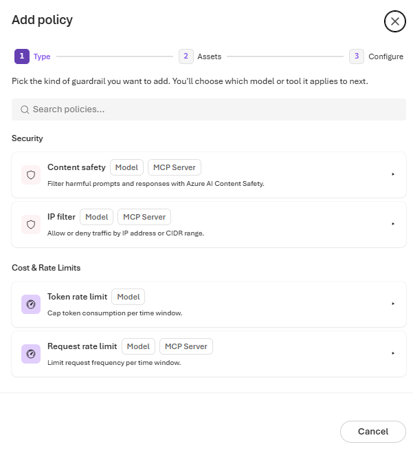

# Screen prompts and responses with content safety

Your gateway now serves a customer-facing assistant and several internal agents, on models from more than one
provider. Your responsible AI review asks for one consistent rule: every prompt and every response is screened
for harmful content, whichever model or tool handles it. In this lab you add a **content safety** policy at the
gateway, tune it per category, and see what a blocked call looks like to a client.


<!-- widget: request-lifecycle {"focus":"contentSafety"} -->

## Before you begin

> [!TIP]
> On the **Bicep + azd** track, `azd up` creates its own gateway, model, and key, so you can skip this section. You
> need only [Azure Cloud Shell](https://shell.azure.com), or the Azure Developer CLI (`azd`), the Azure CLI, and Git
> on your machine.

- Complete [Publish a Foundry model and make your first call](../02-first-model-call/README.md). You need a
  gateway, an imported model, a callable alias, and a runtime API key from **Access** › **Keys**.
- For the CLI and REST tracks: the [Azure CLI](https://learn.microsoft.com/cli/azure/install-azure-cli) 2.75
  or later, signed in with `az login`, the `aigateway` extension
  ([install it](../01-provision-gateway/README.md#before-you-begin)), and `jq` for the Bash snippets.
- For the **Verify** script: `curl` and `jq` (Bash) or PowerShell 7 or later.
- Permission to change the gateway, for example **Contributor** on the resource group.

Set these variables once. Every track and the **Verify** section reuse them.

```bash title="Bash"
export RG="<resource-group>"
export GATEWAY="<gateway>"                 # 24 characters or fewer
export PROVIDER="<provider-name>"          # for example foundry-models
export MODEL="<model-name>"                # the backend model name under that provider

export AI_GATEWAY_URL="https://$(az aigateway show -g "$RG" -n "$GATEWAY" --query properties.frontend.defaultHostname -o tsv)"
# For Foundry imports, the default alias matches the deployment's model name.
export AI_GATEWAY_MODEL="$(az aigateway model show -g "$RG" --gateway-name "$GATEWAY" --provider-name "$PROVIDER" \
  -n "$MODEL" --query properties.deployment.modelName -o tsv)"
# Paste the runtime key you created in Access › Keys. Don't commit it or write it to a file.
read -rsp "AI Gateway API key: " AI_GATEWAY_API_KEY && export AI_GATEWAY_API_KEY && echo
```

```powershell title="PowerShell"
$RG         = "<resource-group>"
$GATEWAY    = "<gateway>"                 # 24 characters or fewer
$PROVIDER   = "<provider-name>"           # for example foundry-models
$MODEL      = "<model-name>"              # the backend model name under that provider

$env:AI_GATEWAY_URL = "https://$(az aigateway show -g $RG -n $GATEWAY --query properties.frontend.defaultHostname -o tsv)"
# For Foundry imports, the default alias matches the deployment's model name.
$env:AI_GATEWAY_MODEL = az aigateway model show -g $RG --gateway-name $GATEWAY --provider-name $PROVIDER `
  -n $MODEL --query properties.deployment.modelName -o tsv
# Paste the runtime key you created in Access › Keys. Don't commit it or write it to a file.
$env:AI_GATEWAY_API_KEY = Read-Host "AI Gateway API key" -MaskInput
```

## How it works

A content safety policy screens prompts, tool inputs, and responses with Azure AI Content Safety. It rates
content in four categories: **Hate**, **Self-harm**, **Sexual**, and **Violence**. You set a severity threshold
for each category independently. When content reaches the threshold, the gateway blocks the call and returns
`400`. A blocked prompt never reaches the backend.

The threshold is the lowest severity that gets blocked, so a **lower** threshold blocks **more**:

| Portal label | CLI and REST value | What it blocks |
|---|---|---|
| **Strict** | `Low` | The most content: low, medium, and high severity |
| **Balanced** (default) | `Medium` | Medium and high severity |
| **Lenient** | `High` | Only the most concerning, high-severity content |
| **Off** | `None` | Nothing in this category |

You can attach content safety to **models** and **MCP servers**. On an MCP server, it screens the tool inputs
that agents send and the results that tools return. Every applicable policy is evaluated, and any one of them
can block the call.

> [!NOTE]
> Foundry deployments have their own **Content filter**, shown on the model's details page in **Models**. That
> filter runs inside Foundry, for that one deployment. The gateway policy runs before the backend, applies the
> same rules to models from any provider and to MCP tool traffic, and is managed by the platform team in one
> place. Keep both: a request has to pass each of them.

## Add content safety to the model

Pick one track. Each track produces the same policy: **Balanced** (`Medium`) for Hate, Self-harm, and Sexual,
and **Strict** (`Low`) for Violence. The portal, CLI, and REST tracks put it on your model. The Bicep + azd track
creates a new gateway and puts it on a new alias of the model. The stricter Violence threshold makes the test in
**Verify** more likely to show a block, using only a mild, non-graphic prompt.

<!-- track: portal | Portal -->

### Start the policy wizard

Open the [AI Gateway portal](https://ai.gateway.azure.com) and select your gateway from the gateway switcher.
Select **Policies** › **Add policy**. On the **Type** step, under **Security**, select **Content safety**, then
**Next**.



### Choose the model

On the **Scope** step, select **Individual assets** ("Apply only to selected models, aliases, or MCP servers").
Select your model, then **Next**.

### Set the thresholds

On the **Details** step (**Configure** in some portal versions), under **Parameters**, choose how strictly
each category is filtered:

| Field | Value |
|---|---|
| **Hate** | **Balanced** |
| **Violence** | **Strict** |
| **Self-harm** | **Balanced** |
| **Sexual** | **Balanced** |

Select **Create**. The policy appears in the **Policies** list with your model as its scope.

> **Checkpoint**
> **Policies** lists a **Content safety** policy for your model.

<!-- track: cli | Azure CLI -->

### Set the policy

Policies live in the model's `properties.policies` array. `az aigateway model policy set-content-safety` adds the
content safety policy, or replaces the one that's there, and keeps every other policy on the model.
`--content-safety` sets the threshold for all four categories, and `--violence-severity` overrides **Violence**.

```bash title="Bash"
az aigateway model policy set-content-safety -g "$RG" --gateway-name "$GATEWAY" --provider-name "$PROVIDER" -n "$MODEL" \
  --content-safety Medium --violence-severity Low
```

```powershell title="PowerShell"
az aigateway model policy set-content-safety -g $RG --gateway-name $GATEWAY --provider-name $PROVIDER -n $MODEL `
  --content-safety Medium --violence-severity Low
```

The command prints the model's policies. Each threshold accepts `None`, `Low`, `Medium`, or `High`. To override
another category, add `--hate-severity`, `--self-harm-severity`, or `--sexual-severity`.

### Confirm the policy

```bash title="Bash"
az aigateway model policy list -g "$RG" --gateway-name "$GATEWAY" --provider-name "$PROVIDER" -n "$MODEL" -o json
```

```powershell title="PowerShell"
az aigateway model policy list -g $RG --gateway-name $GATEWAY --provider-name $PROVIDER -n $MODEL -o json
```

> **Checkpoint**
> The output contains `"type": "contentSafety"` with `"violenceSeverity": "Low"`, `"Medium"` for the other
> three categories, and `"scope": "resource"`, which the service adds to every model policy.

<!-- track: rest | REST API -->

### Read the current policies

Policies live inline in the model's `properties.policies` array. A `PATCH` **replaces the whole array**, so
always read it first and keep the policies you didn't mean to change.

```bash
SUB="$(az account show --query id -o tsv)"
URL="https://management.azure.com/subscriptions/$SUB/resourceGroups/$RG/providers/Microsoft.ApiManagement/aigateways/$GATEWAY/workspaces/default/modelProviders/$PROVIDER/models/$MODEL?api-version=2025-09-01-preview"

az rest --method get --url "$URL" --query properties.policies
```

### Replace the content safety policy and keep everything else

```bash title="Bash"
POLICIES="$(az rest --method get --url "$URL" | jq -c '
  [(.properties.policies // [])[] | select(.type != "contentSafety")]
  + [{"type":"contentSafety","hateSeverity":"Medium","violenceSeverity":"Low","sexualSeverity":"Medium","selfHarmSeverity":"Medium"}]')"

az rest --method patch --url "$URL" --body "{\"properties\":{\"policies\":$POLICIES}}"
```

```powershell title="PowerShell"
$SUB = az account show --query id -o tsv
$URL = "https://management.azure.com/subscriptions/$SUB/resourceGroups/$RG/providers/Microsoft.ApiManagement/aigateways/$GATEWAY/workspaces/default/modelProviders/$PROVIDER/models/$MODEL`?api-version=2025-09-01-preview"

$current  = az rest --method get --url $URL | ConvertFrom-Json
$policies = @($current.properties.policies | Where-Object { $_ -and $_.type -ne 'contentSafety' })
$policies += [pscustomobject]@{
  type = 'contentSafety'; hateSeverity = 'Medium'; violenceSeverity = 'Low'; sexualSeverity = 'Medium'; selfHarmSeverity = 'Medium'
}

$body = @{ properties = @{ policies = $policies } } | ConvertTo-Json -Depth 10 -Compress
$body | Set-Content -Path patch.json
az rest --method patch --url $URL --body '@patch.json'
Remove-Item patch.json
```

> **Checkpoint**
> Running the `GET` again returns your other policies unchanged plus one `contentSafety` entry with
> `"violenceSeverity": "Low"` and `"scope": "resource"`.

<!-- track: iac | Bicep + azd -->

**What you need:** [Azure Cloud Shell](https://shell.azure.com), in Bash or PowerShell, or [azd](https://aka.ms/azd-install),
the Azure CLI with the `aigateway` extension, and Git on your machine, signed in with `azd auth login` and `az login`.
This track doesn't use your gateway from lab 02: `azd up` creates a new one, so it works on its own.

### Choose what to declare

A Bicep deployment sends a `PUT`, which replaces the whole resource. Redeclaring a model you imported in the
portal risks dropping settings you didn't copy. Instead, this template **adds a new alias**,
`<model-name>-safe`, that targets the same backend model and carries the content safety policy. Existing clients
keep calling the original alias. Callers that you move to the new alias get screened.

The policy is one `contentSafety` object with a threshold for each category: `hateSeverity`, `selfHarmSeverity`,
`sexualSeverity`, and `violenceSeverity`. Each accepts the API values from [How it works](#how-it-works): `Low`,
`Medium`, `High`, or `None`.

### Clone the lab

The lab is a small azd project in the
[`labs/08-content-safety`](https://github.com/Azure/ai-gateway/tree/main/labs/08-content-safety) folder of the GitHub
repo. Clone the repo and move into that folder. If you cloned it for the quick start, move into
`ai-gateway/labs/08-content-safety` instead.

```bash title="Bash"
git clone https://github.com/Azure/ai-gateway.git
cd ai-gateway/labs/08-content-safety
```

```powershell title="PowerShell"
git clone https://github.com/Azure/ai-gateway.git
Set-Location ai-gateway/labs/08-content-safety
```

### Review the templates

`infra/main.bicep` creates the resource group `rg-<environment name>` and calls the quick start's
[resources.bicep](../quickstart/infra/resources.bicep) for the gateway, the Foundry model, its default alias, and the
`app-first-call` key. Then it calls `infra/safe-alias.bicep` with the four thresholds:

<!-- include: infra/main.bicep -->

`infra/safe-alias.bicep` adds the alias. It only references the gateway, the provider, and the model, so you can
also deploy it on its own to a gateway you already have, with `az deployment group create`:

<!-- include: infra/safe-alias.bicep -->

### Deploy with azd up

Create an azd environment named `aigw-lab08` in your current subscription, then provision everything. It takes
about three minutes.

```bash title="Bash"
azd env new aigw-lab08 --location eastus2 --subscription "$(az account show --query id --output tsv)"
azd up
```

```powershell title="PowerShell"
azd env new aigw-lab08 --location eastus2 --subscription (az account show --query id --output tsv)
azd up
```

For Sweden Central, use `--location swedencentral`.

### Read the outputs and the key

Set the variables that **Verify** uses from azd's environment values, and read the key from the gateway, so that it
never shows on screen.

```bash title="Bash"
export RG="$(azd env get-value AZURE_RESOURCE_GROUP)"
export GATEWAY="$(azd env get-value AI_GATEWAY_NAME)"
export PROVIDER="$(azd env get-value AI_GATEWAY_PROVIDER)"
export MODEL="$(azd env get-value AI_GATEWAY_BACKEND_MODEL)"
export AI_GATEWAY_URL="$(azd env get-value AI_GATEWAY_URL)"
export AI_GATEWAY_MODEL="$(azd env get-value AI_GATEWAY_MODEL)"
export AI_GATEWAY_API_KEY="$(az aigateway api-key list-secrets --ids "$(azd env get-value AI_GATEWAY_ID)/apiKeys/app-first-call" \
  --query primaryKey --output tsv)"
echo "$AI_GATEWAY_MODEL"
```

```powershell title="PowerShell"
$RG                     = azd env get-value AZURE_RESOURCE_GROUP
$GATEWAY                = azd env get-value AI_GATEWAY_NAME
$PROVIDER               = azd env get-value AI_GATEWAY_PROVIDER
$MODEL                  = azd env get-value AI_GATEWAY_BACKEND_MODEL
$env:AI_GATEWAY_URL     = azd env get-value AI_GATEWAY_URL
$env:AI_GATEWAY_MODEL   = azd env get-value AI_GATEWAY_MODEL
$GATEWAY_ID             = azd env get-value AI_GATEWAY_ID
$env:AI_GATEWAY_API_KEY = az aigateway api-key list-secrets --ids "$GATEWAY_ID/apiKeys/app-first-call" `
  --query primaryKey --output tsv
$env:AI_GATEWAY_MODEL
```

> **Checkpoint**
> `azd up` ended with `SUCCESS`, and the last command printed the screened alias, `gpt-6-luna-safe`.
> `az aigateway model-alias show -g "$RG" --gateway-name "$GATEWAY" -n "$AI_GATEWAY_MODEL" --query properties.policies`
> returns one `contentSafety` entry with `"violenceSeverity": "Low"`, `"Medium"` for the other three categories,
> and `"scope": "resource"`.

### Change the thresholds

The parameters come from azd environment values, with the defaults in `infra/main.parameters.json`:
`CONTENT_SAFETY_HATE`, `CONTENT_SAFETY_SELF_HARM`, `CONTENT_SAFETY_SEXUAL`, and `CONTENT_SAFETY_VIOLENCE`. Change one
with `azd env set` and run `azd provision`: only the alias changes. **Verify** relaxes Violence this way.

<!-- /tracks -->

## Verify

Test the policy with **benign prompts only**. You don't need harmful content to see how the gateway behaves,
and you should never write it to test a filter.

<!-- steps -->

### Run the test prompts

From the lab folder, run the script for your shell. It sends two prompts: a neutral question, and a request
for a short, non-graphic scene from a historical novel. It prints the status and the start of the response or
the error for each one.

```bash title="Bash"
./infra/test-content-safety.sh "$AI_GATEWAY_MODEL"
```

```powershell title="PowerShell"
./infra/test-content-safety.ps1 -Model $env:AI_GATEWAY_MODEL
```

On GitHub, open [test-content-safety.sh](infra/test-content-safety.sh) or
[test-content-safety.ps1](infra/test-content-safety.ps1).

Example output:

```text
Prompt    Status  Finish reason   Response or error
neutral   200     stop            Teams put an API gateway in front of AI models to centralize access con
fiction   400     -               <the gateway's content safety error message>
```

The neutral prompt returns `200`. The fiction prompt can go either way, and your results will vary: Content
Safety rates both the prompt and the model's response, and a mild battle scene sits close to the **Strict**
Violence threshold. If it returns `400`, the gateway blocked it and the error message says why. If it returns
`200`, the content was rated below the threshold.

> [!IMPORTANT]
> If the fiction prompt passes, don't make it more graphic to force a block. The point of this test is to
> understand thresholds with safe input, not to probe the filter. Use **Monitoring** and real, representative
> traffic in a test environment to tune thresholds.

### Relax one category

Set **Violence** back to **Balanced** (`Medium`) with the track you used, then run the script again. For
example, from the command line, set all four categories to `Medium`. The other three already are, so only
**Violence** changes, and the command keeps every other policy on the model:

```bash title="Bash"
az aigateway model policy set-content-safety -g "$RG" --gateway-name "$GATEWAY" --provider-name "$PROVIDER" -n "$MODEL" \
  --content-safety Medium
```

```powershell title="PowerShell"
az aigateway model policy set-content-safety -g $RG --gateway-name $GATEWAY --provider-name $PROVIDER -n $MODEL `
  --content-safety Medium
```

On the Bicep + azd track, set the environment value and provision again instead:

```bash title="Bash"
azd env set CONTENT_SAFETY_VIOLENCE Medium
azd provision
```

```powershell title="PowerShell"
azd env set CONTENT_SAFETY_VIOLENCE Medium
azd provision
```

A prompt that **Strict** blocked is more likely to pass at **Balanced**. Prompts that passed before still pass.

### Check the Foundry content filter

Open **Models**, select your model, and find **Content filter** on its details page. That is the Foundry
deployment's own filter, separate from the gateway policy. When Foundry's filter acts instead of the gateway,
the error or the `finish_reason` comes from the backend, and it can mention `content_filter`.

### Find blocked calls in Monitoring

If you configured Application Insights in [Monitor usage, cost, and traces](../13-monitoring/README.md), open
**Monitoring** and look for `400` outcomes on your model. Review them before and after every threshold change.

<!-- /steps -->

> **Checkpoint**
> The neutral prompt returned `200`, you saw how the borderline prompt fared at **Strict** and at **Balanced**,
> and you can tell a gateway block (`400` from the content safety policy) from a Foundry content filter result.

## Go further

- **Screen tool traffic.** Add a **Content safety** policy to the `learn` MCP server from
  [Federate MCP tools behind one endpoint](../04-federate-mcp-tools/README.md). In the wizard, pick the MCP
  server on the **Scope** step. With REST, use the same `contentSafety` object on
  `.../workspaces/default/toolServers/learn`.
- **Make it the default.** Apply **Balanced** content safety to every model and MCP server, including future
  ones, in [Set gateway-wide policy baselines](../09-gateway-baselines/README.md).
- **Tune per category.** Start every category at **Balanced**, tighten the ones that matter most for your
  audience, and turn a category **Off** only with a documented exception.

## Clean up

A **Strict** threshold can block legitimate traffic. Remove the model policy before you continue. The next
lab sets a gateway-wide baseline instead.

<!-- track: portal | Portal -->

### Remove the policy

Select **Policies**, open the **Content safety** policy that's scoped to your model, and delete it.

<!-- track: cli | Azure CLI -->

### Remove the policy

```bash title="Bash"
az aigateway model policy remove -g "$RG" --gateway-name "$GATEWAY" --provider-name "$PROVIDER" -n "$MODEL" \
  --remove-content-safety true
```

```powershell title="PowerShell"
az aigateway model policy remove -g $RG --gateway-name $GATEWAY --provider-name $PROVIDER -n $MODEL `
  --remove-content-safety true
```

This removes only the content safety policy and keeps every other policy on the model.

<!-- track: rest | REST API -->

### Remove the policy

```bash
POLICIES="$(az rest --method get --url "$URL" | jq -c '[(.properties.policies // [])[] | select(.type != "contentSafety")]')"
az rest --method patch --url "$URL" --body "{\"properties\":{\"policies\":$POLICIES}}"
```

<!-- track: iac | Bicep + azd -->

### Delete everything azd created

In the `ai-gateway/labs/08-content-safety` folder, delete the resource group with the gateway, the Foundry account,
and the screened alias. `--purge` also purges the Foundry account, which would otherwise stay soft-deleted for 48
hours and keep counting against your quota. It takes about ten minutes.

```bash
azd down --purge --force
```

<!-- /tracks -->

Keep the gateway, model, and key from lab 02: the next labs reuse them. `azd down` doesn't touch them, because
the Bicep + azd track created its own gateway.

## Troubleshooting

| Symptom | Likely cause | Fix |
|---|---|---|
| Ordinary prompts return `400` | A threshold is too strict for your traffic, or another content safety policy, such as a **Gateway** scope policy, also applies | Review **Policies** for every content safety policy that covers the model. Move categories from **Strict** to **Balanced** and retest with representative prompts. |
| Nothing is ever blocked | The policy is on a different model or alias than the one you call, or a category is **Off** | Check the policy's scope and that the request `model` matches an alias of that model. |
| `400` that mentions `content_filter`, or `finish_reason` is `content_filter` | The Foundry deployment's **Content filter** acted, not the gateway | Review the deployment's content filter in Foundry. The gateway policy is managed separately. |
| `400` that isn't about content | The request itself is invalid, for example an unknown model alias | Read the error message, and check the request body and the alias. |
| `ValidationError` such as `contentSafety.violenceSeverity must be one of: Low, Medium, High, None.` | A severity uses a portal label such as `Strict` or `Balanced` | Use the API values from the table in [How it works](#how-it-works): `Low`, `Medium`, `High`, or `None`. |
| Other policies vanished after the `PATCH` | `PATCH` replaces the whole `policies` array | Always `GET`, merge, then `PATCH`, as shown in the CLI and REST tracks. |

## Next steps

- [Set gateway-wide policy baselines](../09-gateway-baselines/README.md): make content safety the default for
  every model and MCP server.
- [Control which tools agents can call](../05-mcp-tool-controls/README.md): limit which tools agents can reach.
- [Monitor usage, cost, and traces](../13-monitoring/README.md): find `400` outcomes and the policy that caused them.
- Docs: [Policies in AI Gateway](https://ai.gateway.azure.com/docs/policies).
