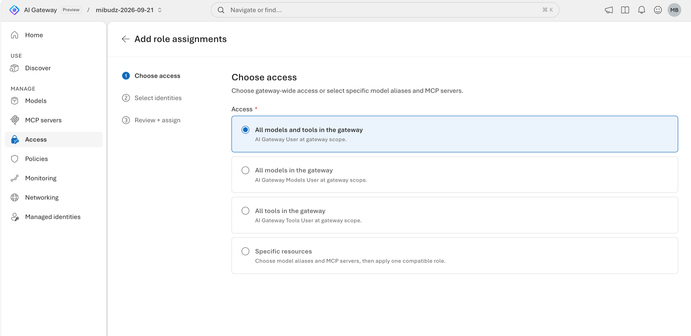

# Go keyless with Microsoft Entra ID and RBAC

A security review of your AI platform found runtime API keys in `.env` files, CI logs, and a shared notebook.
Every key grants every model and tool on the gateway, nobody can say which person is behind a key, and
rotation means chasing every team. The platform team wants callers to use **their own Microsoft Entra
identity** instead: access granted by Azure RBAC, scoped to one model alias or MCP server when needed, and
removed automatically when someone leaves a group. In this lab you grant a data-plane role, call a model with
an Entra token from the playground, the command line, and code, and see what the gateway answers when the role
is missing.


<!-- widget: request-lifecycle -->

## Before you begin

- Complete [Publish a Foundry model and make your first call](../02-first-model-call/README.md). You need a gateway with at least
  one model alias.
- The [Azure CLI](https://learn.microsoft.com/cli/azure/install-azure-cli) 2.75 or later, signed in with
  `az login` to the tenant that holds the gateway. The commands call the Azure Resource Manager REST API with
  `az rest`, because the `az aigateway` extension doesn't manage the new `aigateways` resource type yet.
- For the CLI track in Bash: [jq](https://jqlang.org/download/), which decodes the token and reads the reply.
- Permission to **create role assignments** on the gateway: **Owner**, **User Access Administrator**, or
  **Role Based Access Control Administrator**. **Contributor** can manage the gateway but can't grant roles.
  If you don't have one of these, ask an administrator to run the role assignment step for you.
- For the Code track, one of: Python 3.9 or later, Node.js 22.18 or later, or the .NET 8 SDK or later.

You don't need an API key in this lab. Set these variables once. Every track and the **Verify** section reuse
them.

```bash title="Bash"
export RG="<resource-group>"
export GATEWAY="<gateway>"
export PROVIDER="<provider-name>"          # for example foundry-models
export MODEL="<model-name>"                # the backend model name under that provider

export API="api-version=2025-09-01-preview"
export GATEWAY_ID="$(az resource show -g "$RG" -n "$GATEWAY" --resource-type Microsoft.ApiManagement/aigateways --query id -o tsv)"
export GW="https://management.azure.com$GATEWAY_ID"
export WS="$GW/workspaces/default"
export AI_GATEWAY_URL="https://$(az resource show --ids "$GATEWAY_ID" --query properties.frontend.defaultHostname -o tsv)"
# For Foundry imports, the default alias matches the deployment's model name.
export AI_GATEWAY_MODEL="$(az rest --url "$WS/modelProviders/$PROVIDER/models/$MODEL?$API" \
  --query properties.deployment.modelName -o tsv)"
export MY_OBJECT_ID="$(az ad signed-in-user show --query id -o tsv)"
# Prove that nothing in this lab uses a key.
unset AI_GATEWAY_API_KEY
```

```powershell title="PowerShell"
$RG       = "<resource-group>"
$GATEWAY  = "<gateway>"
$PROVIDER = "<provider-name>"              # for example foundry-models
$MODEL    = "<model-name>"                 # the backend model name under that provider

$API        = "api-version=2025-09-01-preview"
$GATEWAY_ID = az resource show -g $RG -n $GATEWAY --resource-type Microsoft.ApiManagement/aigateways --query id -o tsv
$GW         = "https://management.azure.com$GATEWAY_ID"
$WS         = "$GW/workspaces/default"
$env:AI_GATEWAY_URL = "https://$(az resource show --ids $GATEWAY_ID --query properties.frontend.defaultHostname -o tsv)"
# For Foundry imports, the default alias matches the deployment's model name.
$env:AI_GATEWAY_MODEL = az rest --url "$WS/modelProviders/$PROVIDER/models/${MODEL}?$API" `
  --query properties.deployment.modelName -o tsv
$MY_OBJECT_ID = az ad signed-in-user show --query id -o tsv
# Prove that nothing in this lab uses a key.
Remove-Item Env:AI_GATEWAY_API_KEY -ErrorAction SilentlyContinue
```

## How it works

Access to AI Gateway crosses two trust boundaries. **Inbound**, your app authenticates to the gateway
endpoint. **Outbound**, the gateway authenticates to each model or tool with its own credential, which you
set up in [Call backends with managed identities](../12-backend-identity/README.md).

For inbound Entra access, the caller gets an access token for the audience `https://azure-api.net/aigateway`
and sends it in the `Authorization: Bearer <token>` header. The gateway validates the token at its edge, then
checks the caller's Azure RBAC role assignments for the model alias or MCP server in the request. Without a
matching role, it answers `403` before any policy or backend runs. These roles grant **runtime** access only,
not gateway administration.

| Role | Role ID | Grants | Assignable at |
|---|---|---|---|
| AI Gateway User | `caad7a21-134e-43f4-a550-c5ffc17e051c` | List and invoke models, list and call MCP tools | Gateway, model alias, or MCP server |
| AI Gateway Models User | `a6b68e3d-a1f0-4c60-8678-237c050cf4ea` | List and invoke models | Gateway or model alias |
| AI Gateway Tools User | `dce03f8d-857f-4e40-a90d-67770fa6ecd2` | List and call tools within MCP servers | Gateway or MCP server |

| Caller | Token type | Scope to request |
|---|---|---|
| App that signs users in with MSAL | Delegated (on behalf of the user) | `https://azure-api.net/aigateway/Data.All` |
| Service principal, managed identity, or agent identity | App-only | `https://azure-api.net/aigateway/.default` |
| You, signed in to the Azure CLI | Delegated | `az account get-access-token --resource https://azure-api.net/aigateway` |

Policies that count by **Caller identity**, such as the token limits and budgets in labs 06 and 07, keep
working: for Entra callers, the gateway combines the token's tenant ID (`tid`) and object ID (`oid`), so each
principal gets its own counter.

## Grant a data-plane role

Grant yourself **AI Gateway Models User** on the whole gateway. Do this once, whichever track you follow to
call the gateway afterward. Role scopes are Azure resource IDs:

| Scope | Resource ID |
|---|---|
| Gateway | `/subscriptions/<subscription-id>/resourceGroups/<resource-group>/providers/Microsoft.ApiManagement/aigateways/<gateway>` |
| Model alias | `<gateway resource ID>/workspaces/default/aliases/<alias>` |
| MCP server | `<gateway resource ID>/workspaces/default/toolServers/<mcp-server-name>` |

<!-- track: portal | Portal -->

### Start a role assignment

Open the [AI Gateway portal](https://ai.gateway.azure.com), select your gateway, and select
**Access** › **Entra ID** › **Add role assignments**.

### Choose access

On **Choose access**, pick what the identities can use:

- **All models and tools in the gateway** grants **AI Gateway User** at the gateway.
- **All models in the gateway** grants **AI Gateway Models User** at the gateway.
- **All tools in the gateway** grants **AI Gateway Tools User** at the gateway.
- **Specific resources** lets you select model aliases and MCP servers under **Resources**, then choose one
  compatible **Role** for all of them.

Select **All models in the gateway**, then **Next**.



### Select identities

On **Select identities**, set **Assign access to** to **User, group, or service principal**, search for your
own account by name, and choose **Select**. In production, prefer an Entra group so membership controls
access. To grant an app running in Azure, set **Assign access to** to **Managed identity** and pick it by
subscription and resource type. You can also enter a principal object ID directly. Select **Next**.

### Review and assign

On **Review + assign**, confirm the role, identities, and scopes, then select **Assign**.

> **Checkpoint**
> Your account appears in **Access** › **Entra ID** with the **AI Gateway Models User** role on the gateway.

<!-- track: cli | Azure CLI -->

### Create the role assignment

`az role assignment create` needs the principal's object ID, the role ID, and the full scope:

```bash title="Bash"
az role assignment create \
  --assignee-object-id "$MY_OBJECT_ID" \
  --assignee-principal-type User \
  --role "a6b68e3d-a1f0-4c60-8678-237c050cf4ea" \
  --scope "$GATEWAY_ID"
```

```powershell title="PowerShell"
az role assignment create `
  --assignee-object-id $MY_OBJECT_ID `
  --assignee-principal-type User `
  --role "a6b68e3d-a1f0-4c60-8678-237c050cf4ea" `
  --scope $GATEWAY_ID
```

### Use the helper for other roles and scopes

The lab's helper script maps `user`, `models`, and `tools` to the role IDs, builds the scope for the gateway,
a model alias, or an MCP server, and defaults to the signed-in user:

```bash title="Bash"
./infra/assign-roles.sh models                              # AI Gateway Models User on the gateway
./infra/assign-roles.sh models "alias:$AI_GATEWAY_MODEL"    # ...on one model alias only
./infra/assign-roles.sh tools "mcp:<mcp-server-name>"       # AI Gateway Tools User on one MCP server
./infra/assign-roles.sh user gateway <group-object-id> Group
```

```powershell title="PowerShell"
./infra/assign-roles.ps1 -Role models
./infra/assign-roles.ps1 -Role models -Scope "alias:$env:AI_GATEWAY_MODEL"
./infra/assign-roles.ps1 -Role tools -Scope "mcp:<mcp-server-name>"
./infra/assign-roles.ps1 -Role user -PrincipalId <group-object-id> -PrincipalType Group
```

<!-- include: infra/assign-roles.sh -->

On GitHub, open [assign-roles.sh](infra/assign-roles.sh) or [assign-roles.ps1](infra/assign-roles.ps1).

For a managed identity, pass its **principal** (object) ID with the type `ServicePrincipal`, for example
from `az identity show -g <resource-group> -n <identity-name> --query principalId -o tsv`.

### Confirm the assignment

```bash title="Bash"
az role assignment list --scope "$GATEWAY_ID" \
  --query "[?principalId=='$MY_OBJECT_ID'].{Role:roleDefinitionName, Scope:scope}" -o table
```

```powershell title="PowerShell"
az role assignment list --scope $GATEWAY_ID `
  --query "[?principalId=='$MY_OBJECT_ID'].{Role:roleDefinitionName, Scope:scope}" -o table
```

> **Checkpoint**
> The list shows **AI Gateway Models User** with the gateway's resource ID as the scope.

<!-- /tracks -->

> [!IMPORTANT]
> Role assignments can take several minutes to apply. Until then, Entra calls return `403`. Wait a few
> minutes and retry before you change anything else.

## Call the gateway with a token

<!-- track: portal | Portal -->

### Open the playground with Entra ID

Select **Discover** and pick your model. In the playground toolbar, the **Authentication** list has a
**Token** group with **Microsoft Entra ID** ("Use your signed-in identity.") and an **API key** group with
your runtime keys. When your role allows invoking the model, the portal selects **Microsoft Entra ID** for you.
It checks your permissions through the control plane, so you also need `Microsoft.Authorization/permissions/read`
on the gateway, which **Reader** and higher roles include.

If **Microsoft Entra ID** is disabled, the tooltip tells you to grant access under **Access** › **Entra ID**.
Wait for the role to apply and refresh the page.

### Send a prompt

With **Microsoft Entra ID** selected, send `In one sentence, why use Microsoft Entra ID instead of API keys?`.
The playground's code examples follow the authentication method you select.

> **Checkpoint**
> The model answers, and the **Authentication** list shows **Microsoft Entra ID**, not a key name.

<!-- track: cli | Azure CLI -->

### Get a token

The Azure CLI can issue a token for the AI Gateway audience with your sign-in:

```bash title="Bash"
export AI_GATEWAY_TOKEN="$(az account get-access-token \
  --resource https://azure-api.net/aigateway --query accessToken -o tsv)"
```

```powershell title="PowerShell"
$env:AI_GATEWAY_TOKEN = az account get-access-token `
  --resource https://azure-api.net/aigateway --query accessToken -o tsv
```

Access tokens are short-lived, typically about an hour. Run the command again when you get a `401`.

### Look inside the token

Decode the token's payload (the middle segment) to see what the gateway checks:

```bash title="Bash"
jq -R 'split(".")[1] | gsub("-";"+") | gsub("_";"/") | @base64d | fromjson
  | {aud, tid, oid, scp, appid}' <<< "$AI_GATEWAY_TOKEN"
```

```powershell title="PowerShell"
$payload = ($env:AI_GATEWAY_TOKEN -split '\.')[1].Replace('-', '+').Replace('_', '/')
$payload = $payload.PadRight($payload.Length + (4 - $payload.Length % 4) % 4, '=')
[Text.Encoding]::UTF8.GetString([Convert]::FromBase64String($payload)) |
  ConvertFrom-Json | Select-Object aud, tid, oid, scp, appid
```

`aud` is `https://azure-api.net/aigateway`, `scp` includes `Data.All` because the CLI gets a delegated token
for you, and `tid` plus `oid` identify you to per-caller policies.

### Call the model with the bearer token

```bash title="Bash"
curl -sS "${AI_GATEWAY_URL%/}/default/models/openai/v1/chat/completions" \
  -H "Authorization: Bearer $AI_GATEWAY_TOKEN" \
  -H "Content-Type: application/json" \
  -d "{\"model\":\"$AI_GATEWAY_MODEL\",\"messages\":[{\"role\":\"user\",\"content\":\"Say hello in five words.\"}]}" \
  | jq -r '.choices[0].message.content'
```

```powershell title="PowerShell"
$body = @{
  model    = $env:AI_GATEWAY_MODEL
  messages = @(@{ role = "user"; content = "Say hello in five words." })
} | ConvertTo-Json -Depth 5
$response = Invoke-RestMethod -Method Post `
  -Uri "$($env:AI_GATEWAY_URL.TrimEnd('/'))/default/models/openai/v1/chat/completions" `
  -Headers @{ Authorization = "Bearer $env:AI_GATEWAY_TOKEN" } `
  -ContentType "application/json" -Body $body
$response.choices[0].message.content
```

> [!WARNING]
> Send a token or a key, never both. A request with an `Authorization` header and an `api-key` header gets `400`.

> **Checkpoint**
> The model replies, and no `api-key` header was sent.

<!-- track: code | Code -->

### Install the packages

Each sample uses `DefaultAzureCredential`, which uses your Azure CLI or IDE sign-in on a laptop and a managed
identity or workload identity when the code runs in Azure. No key or secret appears in code or config.

```bash title="Python"
cd infra
python -m venv .venv && source .venv/bin/activate     # Windows: .venv\Scripts\activate
pip install -r requirements.txt
```

```bash title="TypeScript"
cd infra
npm install
```

```bash title="C#"
cd infra
dotnet restore
```

### Review the sample

The only change from an API-key client is where the credential comes from:

```python title="Python"
from azure.identity import DefaultAzureCredential, get_bearer_token_provider
from openai import OpenAI

token_provider = get_bearer_token_provider(
    DefaultAzureCredential(), "https://azure-api.net/aigateway/.default")

client = OpenAI(
    base_url=f"{gateway_url}/default/models/openai/v1",
    api_key=token_provider,   # called before each request, sent as Authorization: Bearer <token>
)
```

```typescript title="TypeScript"
import { DefaultAzureCredential, getBearerTokenProvider } from "@azure/identity";
import OpenAI from "openai";

const getToken = getBearerTokenProvider(
  new DefaultAzureCredential(), "https://azure-api.net/aigateway/.default");

const client = new OpenAI({
  baseURL: `${gatewayUrl}/default/models/openai/v1`,
  apiKey: getToken,   // called before each request, sent as Authorization: Bearer <token>
});
```

```csharp title="C#"
var credential = new DefaultAzureCredential();
AccessToken token = await credential.GetTokenAsync(
    new TokenRequestContext(new[] { "https://azure-api.net/aigateway/.default" }));

request.Headers.Authorization = new AuthenticationHeaderValue("Bearer", token.Token);
```

The OpenAI SDKs for Python (1.106 or later) and TypeScript (5.18 or later) accept a function as the API key.
They call it before each request and send the result as `Authorization: Bearer <token>`, and the Azure
Identity token provider refreshes the token before it expires. The C# sample calls the REST endpoint with
`HttpClient` and asks the credential for a token before each call, which also returns a cached token until
it's close to expiry. Don't use an `AzureOpenAI` client here: the gateway exposes the OpenAI v1 API at
`/default/models/openai/v1`.

The complete samples add input checks and print the reply and token usage:

<!-- include: infra/call_with_entra.py -->

<!-- include: infra/call-with-entra.ts -->

<!-- include: infra/CallWithEntra.cs -->

On GitHub, open [call_with_entra.py](infra/call_with_entra.py), [call-with-entra.ts](infra/call-with-entra.ts),
and [CallWithEntra.cs](infra/CallWithEntra.cs) with [CallWithEntra.csproj](infra/CallWithEntra.csproj).

### Run it

```bash title="Python"
python call_with_entra.py
```

```bash title="TypeScript"
node call-with-entra.ts
```

```bash title="C#"
dotnet run
```

> **Checkpoint**
> The sample prints the model's reply and the tokens used, with `AI_GATEWAY_API_KEY` unset.

<!-- /tracks -->

## Verify

Prove that access now follows the role assignment, not a key.

<!-- steps -->

### Confirm the keyless call succeeds

Run the curl call or a code sample from the previous section. It returns `200` with a reply.

### Send a token for the wrong audience

A token for Azure Resource Manager is valid, but not for AI Gateway:

```bash
curl -sS -o /dev/null -w "%{http_code}\n" "${AI_GATEWAY_URL%/}/default/models/openai/v1/chat/completions" \
  -H "Authorization: Bearer $(az account get-access-token --query accessToken -o tsv)" \
  -H "Content-Type: application/json" \
  -d "{\"model\":\"$AI_GATEWAY_MODEL\",\"messages\":[{\"role\":\"user\",\"content\":\"ping\"}]}"
```

The gateway answers `401`: authentication failed, so the role was never checked.

### Remove the role and try again

Remove your assignment, wait a few minutes, get a fresh token, and repeat the curl call:

```bash
az role assignment delete --assignee "$MY_OBJECT_ID" \
  --role "a6b68e3d-a1f0-4c60-8678-237c050cf4ea" --scope "$GATEWAY_ID"
```

The gateway now answers `403`: you're authenticated, but no role allows you to invoke the model. In the
playground, the same error offers **Review access**, which opens the role assignments, and
**Copy access request**, which copies your identity, the suggested role, and the scope for an administrator.

### Restore access

Assign the role again (portal, `az role assignment create`, or `./infra/assign-roles.sh models`), wait for it
to apply, and confirm the call returns `200`.

<!-- /steps -->

> **Checkpoint**
> You called a model with no API key, got `401` for a token with the wrong audience, and `403` while your
> identity had no role.

## Go further

- **Narrow the scope.** Replace the gateway-wide assignment with **AI Gateway Models User** on a single alias
  (`./infra/assign-roles.sh models "alias:<alias>"`). Calls to other aliases now return `403`.
- **Grant tools only.** Give an agent **AI Gateway Tools User** on one MCP server from
  [Federate MCP tools](../04-federate-mcp-tools/README.md), so it can list and call those tools but not
  invoke models.
- **Run without a user.** Deploy the Python sample to an Azure service with a managed identity, assign the
  role to that identity's principal ID, and the same code runs with app-only tokens for the `.default` scope.
  Agent identities work the same way.
- **Budget per person.** Add a cost limit with **Identity** as the counter dimension and an override for one Entra identity in
  [Enforce cost budgets](../07-cost-budgets/README.md). Each `tid` and `oid` pair gets its own budget.
- **See who called.** In **Monitoring** › **Settings**, **Token claim attributes** exports claims such as
  `tid`, `oid`, `appid`, and `azp` as `azure.ai_gateway.identity.claims.<claim>` attributes on logs, traces,
  and metrics. See [Monitor usage, cost, and traces](../13-monitoring/README.md).

## Clean up

Role assignments don't cost anything. Keep yours if you'll continue with Entra-based labs. Otherwise remove
it, and revoke any runtime keys you no longer need in **Access** › **Keys**.

<!-- track: portal | Portal -->

### Remove the role assignment

Select **Access** › **Entra ID**, find your assignment, and remove it.

<!-- track: cli | Azure CLI -->

### Remove the role assignment

```bash title="Bash"
az role assignment delete --assignee "$MY_OBJECT_ID" \
  --role "a6b68e3d-a1f0-4c60-8678-237c050cf4ea" --scope "$GATEWAY_ID"
```

```powershell title="PowerShell"
az role assignment delete --assignee $MY_OBJECT_ID `
  --role "a6b68e3d-a1f0-4c60-8678-237c050cf4ea" --scope $GATEWAY_ID
```

<!-- track: code | Code -->

### Remove local files

Delete `infra/.venv`, `infra/node_modules`, or `infra/bin` and `infra/obj`. Then remove the role assignment
with the Portal or Azure CLI track.

<!-- /tracks -->

## Troubleshooting

| Symptom | Likely cause | Fix |
|---|---|---|
| `401` on every Entra call | The token is expired, or it was issued for another audience, such as Azure Resource Manager | Request a new token for `https://azure-api.net/aigateway` (`.default` for app-only callers). Check `aud` in the decoded token. |
| `403` right after you assigned the role | Role assignments take several minutes to apply | Wait and retry with a fresh token. In the playground, use **Back to playground** after reviewing access. |
| `403` for one model or MCP server only | The role is scoped to a different alias or MCP server, or the role doesn't cover it (Models User on an MCP server, Tools User on a model) | Assign a compatible role at the gateway or at that alias or MCP server. |
| `403` even though the role is correct | A gateway policy (for example a cost limit), the request proxy, or the backend rejected the call | Read the error code in the response body before changing permissions. `LlmCostQuotaExceeded` comes from a cost limit. |
| `AuthorizationFailed` when you create the assignment | You have **Contributor**, which can't write role assignments | Ask an **Owner**, **User Access Administrator**, or **Role Based Access Control Administrator** to assign the role. |
| `DefaultAzureCredential failed to retrieve a token` | No sign-in is available to the credential chain | Run `az login`, or sign in to the Azure extension in your IDE, then rerun the sample. |

## Next steps

- [Call backends with managed identities](../12-backend-identity/README.md): secure the outbound boundary.
- [Enforce cost budgets with per-caller overrides](../07-cost-budgets/README.md): budget each Entra identity.
- [Monitor usage, cost, and traces](../13-monitoring/README.md): attribute usage to `tid`, `oid`, and app claims.
- Docs: [Security and identity](https://ai.gateway.azure.com/docs/security-identity) and
  [Access models through AI Gateway](https://ai.gateway.azure.com/docs/model-access).
