# Use your gateway's models and tools in GitHub Copilot

GitHub Copilot can run on a model that you bring yourself: give it an OpenAI-compatible endpoint and a key, and it
sends every chat and agent request there. Make that endpoint your gateway, and Copilot's traffic gets the same
controls as your apps: a key that you can suspend, a token limit for each caller, and usage in Monitoring. Copilot
never sees a Foundry credential, because the gateway calls Foundry with its managed identity. In this lab you publish
`gpt-6-astra` for Copilot, then connect four Copilot surfaces to it: VS Code, the Copilot CLI, the Copilot SDK, and
the GitHub Copilot app. Then you publish the Microsoft Learn MCP server through the same gateway and give those
surfaces its tools, with the same key, so Copilot's tool calls get the same controls as its model calls.


## Before you begin

<!-- setup: tools sign-in extension clone -->

> [!TIP]
> On the **Bicep + azd** track, `azd up` creates its own gateway, Foundry account, `gpt-6-astra` alias, key, and
> `learn` MCP server, and the track sets the variables, so you can skip lab 02 and the variables below. You need the
> one-time setup above, plus quota for the model, a Copilot surface, and the practice project.

- Complete [Publish a Foundry model and make your first call](../02-first-model-call/README.md). You need a gateway
  with a Foundry provider, and permission to change it, for example **Contributor** on the resource group.
- Quota for `gpt-6-astra` (version `2026-09-03`) in the Foundry account behind your gateway. This lab deploys it
  with 100,000 tokens per minute (TPM), because coding agents send large prompts. Model inference is billed per use.
- At least one Copilot surface. You don't need all four:

  | Surface | Version tested | Needs |
  |---|---|---|
  | [VS Code](https://code.visualstudio.com/download) with GitHub Copilot | 1.143 | Nothing else. Chat and agent mode work with your own model without a GitHub sign-in. |
  | [GitHub Copilot CLI](https://docs.github.com/en/copilot/how-tos/set-up/install-copilot-cli) | 1.0.103 | Nothing else. A GitHub sign-in is optional with your own model. |
  | [GitHub Copilot SDK](https://github.com/github/copilot-sdk) | 1.0.26 (TypeScript), 1.0.22 (Python) | Node.js 22.18 or later, or Python 3.11 or later, and a clone of this repository. |
  | [GitHub Copilot app](https://docs.github.com/en/copilot/get-started/quickstart-copilot-app) | Public preview | A GitHub sign-in. A Copilot plan isn't required for your own models. |
- Run the scripts and samples from the lab's folder, `~/ai-gateway/labs/24-github-copilot-byok`.

> [!IMPORTANT]
> On Copilot Business or Copilot Enterprise, an administrator must allow custom models before VS Code and the
> Copilot app offer them. See
> [Enable custom models for your enterprise](https://docs.github.com/en/copilot/how-tos/administer-copilot/manage-for-enterprise/enable-custom-models).

Set these variables once. Every track and the **Verify** section reuse them.

```bash title="Bash"
# Name your gateway, the Foundry account behind it, and what this lab publishes on the gateway
export RG="<resource-group>"
export GATEWAY="<gateway>"
export FOUNDRY_RG="<foundry-resource-group>"      # resource group of the Foundry account behind the gateway
export FOUNDRY_ACCOUNT="<foundry-account-name>"   # the account name, not a project or deployment name
export PROVIDER="foundry-models"                  # the gateway's Foundry provider from lab 02
export MODEL="gpt-6-astra"                        # the deployment, the backend model, and the alias
export KEY_NAME="github-copilot"                  # the runtime key that Copilot uses

# Read the gateway's resource ID and runtime URL, and build the management URL that the az rest calls use
export API="api-version=2025-09-01-preview"
export GATEWAY_ID="$(az aigateway show -g "$RG" -n "$GATEWAY" --query id -o tsv)"
export GW="https://management.azure.com$GATEWAY_ID"
export AI_GATEWAY_URL="https://$(az aigateway show -g "$RG" -n "$GATEWAY" --query properties.frontend.defaultHostname -o tsv)"
export AI_GATEWAY_MODEL="$MODEL"
echo "📝 Gateway $GATEWAY in $RG, with Foundry account $FOUNDRY_ACCOUNT in $FOUNDRY_RG"
echo "🌐 Runtime URL: $AI_GATEWAY_URL"
echo "🔖 Model alias: $AI_GATEWAY_MODEL"
```

```powershell title="PowerShell"
# Name your gateway, the Foundry account behind it, and what this lab publishes on the gateway
$RG              = "<resource-group>"
$GATEWAY         = "<gateway>"
$FOUNDRY_RG      = "<foundry-resource-group>"     # resource group of the Foundry account behind the gateway
$FOUNDRY_ACCOUNT = "<foundry-account-name>"       # the account name, not a project or deployment name
$PROVIDER        = "foundry-models"               # the gateway's Foundry provider from lab 02
$MODEL           = "gpt-6-astra"                  # the deployment, the backend model, and the alias
$KEY_NAME        = "github-copilot"               # the runtime key that Copilot uses

# Read the gateway's resource ID and runtime URL, and build the management URL that the az rest calls use
$API        = "api-version=2025-09-01-preview"
$GATEWAY_ID = az aigateway show -g $RG -n $GATEWAY --query id -o tsv
$GW         = "https://management.azure.com$GATEWAY_ID"
$env:AI_GATEWAY_URL   = "https://$(az aigateway show -g $RG -n $GATEWAY --query properties.frontend.defaultHostname -o tsv)"
$env:AI_GATEWAY_MODEL = $MODEL
Write-Host "📝 Gateway $GATEWAY in $RG, with Foundry account $FOUNDRY_ACCOUNT in $FOUNDRY_RG"
Write-Host "🌐 Runtime URL: $env:AI_GATEWAY_URL"
Write-Host "🔖 Model alias: $env:AI_GATEWAY_MODEL"
```

> [!TIP]
> If you imported models in the portal in lab 02, your provider has another name. List the providers with
> `az aigateway model-provider list -g "$RG" --gateway-name "$GATEWAY" --query "[].name" -o tsv` and set `PROVIDER`
> to the one for your Foundry account.

Then create a small practice project with two deliberate problems: `add` subtracts, and `divide` doesn't guard against
zero. The VS Code and CLI sections ask Copilot to work on it. Create it outside any repository:

```bash title="Bash"
# Create the practice project's folder, and write calc.py with its two deliberate problems
mkdir -p ~/contoso-calc
cat > ~/contoso-calc/calc.py <<'EOF'
"""Tiny calculator used to try GitHub Copilot with a model from Azure AI Gateway."""


def add(a: float, b: float) -> float:
    return a - b


def divide(a: float, b: float) -> float:
    return a / b


if __name__ == "__main__":
    print(add(2, 3), divide(10, 2))
EOF
echo "📄 Practice project is ready: ~/contoso-calc/calc.py"
```

```powershell title="PowerShell"
# Create the practice project's folder, and write calc.py with its two deliberate problems
New-Item -ItemType Directory -Force -Path ~/contoso-calc | Out-Null
@'
"""Tiny calculator used to try GitHub Copilot with a model from Azure AI Gateway."""


def add(a: float, b: float) -> float:
    return a - b


def divide(a: float, b: float) -> float:
    return a / b


if __name__ == "__main__":
    print(add(2, 3), divide(10, 2))
'@ | Set-Content -Path ~/contoso-calc/calc.py
if ($?) { Write-Host "📄 Practice project is ready: ~/contoso-calc/calc.py" }
```

## How it works

Bring your own key (BYOK) replaces the model endpoint behind Copilot. Copilot still runs its agent loop on your
machine: it reads files, plans, calls tools, and asks before it edits or runs commands. Each model request goes to the
gateway instead of GitHub's model service. Every surface needs the same four settings:

| Setting | Value | Why |
|---|---|---|
| Base URL | `https://<gateway-host>/default/models/openai/v1` | The gateway's OpenAI-compatible endpoint. VS Code wants the full URL, with `/responses` at the end. |
| Model | `gpt-6-astra` | The alias. Copilot sends it in the request's `model` field, and the gateway routes by alias. When the alias has the model's well-known name, Copilot also applies the prompts and token sizes it uses for that model. |
| API | Responses | Copilot recommends the Responses API for GPT-5 and later models. The gateway serves both `/responses` and `/chat/completions` for this model. |
| API key | The `github-copilot` runtime key | Copilot sends it as `Authorization: Bearer`. The gateway also accepts an `api-key` header, but not both in one request. |

Two things differ from an app that calls the gateway:

- **You add the model by hand.** Clients often call `GET /models` to discover what an endpoint offers, but the
  gateway doesn't serve a model list. Each surface lets you type the model name instead.
- **Agents send big requests.** Every request carries Copilot's system prompt, its tool definitions, and the
  conversation so far. In testing, a one-line question from the Copilot CLI used 14,000 to 38,000 input tokens.
  That's why this lab gives each caller 100,000 tokens per minute, and why one key per tool or per developer makes
  usage easy to read.

Tools follow the same pattern. Later in this lab, the gateway also publishes the Microsoft Learn MCP server, and each
surface calls its tools with the same key.

## Publish gpt-6-astra for Copilot

Deploy `gpt-6-astra` in Foundry, publish it through the gateway under the alias `gpt-6-astra` with a token limit of
100,000 tokens per minute for each caller, and create the runtime key `github-copilot`. Pick a track.

<!-- track: portal | Portal -->

### Deploy the model in Foundry

In the [Foundry portal](https://ai.azure.com), open the Foundry account behind your gateway and deploy `gpt-6-astra`
with the deployment name `gpt-6-astra`. Or paste the command from the **Azure CLI** track's first step into
[Azure Cloud Shell](https://shell.azure.com).

### Import the deployment

1. Open the [AI Gateway portal](https://ai.gateway.azure.com) and select your gateway in the top bar.
2. Select **Models** › **Add** › **Models from Microsoft Foundry**.
3. Select the subscription and resource group of your Foundry account, then select the `gpt-6-astra` deployment.
   Keep **Managed identity** as the **Authentication method**.
4. Under **Aliases**, keep **Create an alias for each model** selected, then select **Add models**.

### Publish the gpt-6-astra alias

The import names its alias after the provider and the deployment, for example `<foundry-account-name>/gpt-6-astra`.
Copilot needs the plain model name, so add an alias called `gpt-6-astra`:

1. Select **Models** › **Aliases** › **Add alias**.
2. On **Basics**, set **Alias name** to `gpt-6-astra`. Select **Next**.
3. On **Select models**, select `gpt-6-astra` in **Available backend models**. Select **Next**.
4. Keep the defaults on **Priority and weights**, select **Next**, then select **Create** on **Review**.

### Add the token limit

1. Select **Policies** › **Add policy**. On the **Type** step, under **Cost & Rate Limits**, select
   **Token rate limit**, then **Next**.
2. On the **Scope** step, select **Individual assets**, select the `gpt-6-astra` alias, then **Next**.
3. On the **Details** step, set **Time period** to **Per minute**, **Allowed tokens** to `100000`, and
   **Counter dimensions** to **Caller identity**. Select **Create**.

### Create the key for Copilot

1. Select **Access** › **Keys** › **Create API key**.
2. In **Key name**, enter `github-copilot` and select **Create**.
3. Copy the value from **API key created successfully**, for example with **Copy & done**, and paste it into your
   shell without echoing it:

```bash title="Bash"
# Paste the key without showing it, and export it for the test calls and the Copilot surfaces
read -rsp "AI Gateway API key: " AI_GATEWAY_API_KEY && export AI_GATEWAY_API_KEY && echo
echo "🔑 Key: in AI_GATEWAY_API_KEY (${#AI_GATEWAY_API_KEY} characters, not shown)"
```

```powershell title="PowerShell"
# Paste the key without showing it, and keep it in an environment variable for the test calls and the Copilot surfaces
$env:AI_GATEWAY_API_KEY = Read-Host "AI Gateway API key" -MaskInput
Write-Host "🔑 Key: in AI_GATEWAY_API_KEY ($($env:AI_GATEWAY_API_KEY.Length) characters, not shown)"
```

> **Checkpoint**
> **Models** › **Aliases** lists `gpt-6-astra`, **Policies** lists a **Token rate limit** of 100,000 tokens per
> minute scoped to it, and **Access** › **Keys** lists `github-copilot`.

<!-- track: cli | Azure CLI -->

### Deploy the model in Foundry

If the command fails with `InsufficientQuota`, use `--sku-name DataZoneStandard`, or deploy in another region.

```bash title="Bash"
# Read the Foundry account's resource ID, which the gateway's model points at
export FOUNDRY_ID="$(az cognitiveservices account show -g "$FOUNDRY_RG" -n "$FOUNDRY_ACCOUNT" --query id -o tsv)"
echo "🆔 Foundry account: $FOUNDRY_ID"

# Deploy gpt-6-astra with 100,000 tokens per minute of Global Standard capacity, and show its state
echo "✨ Model deployment $MODEL in $FOUNDRY_ACCOUNT:"
az cognitiveservices account deployment create -g "$FOUNDRY_RG" -n "$FOUNDRY_ACCOUNT" \
  --deployment-name "$MODEL" --model-name "$MODEL" --model-version 2026-09-03 \
  --model-format OpenAI --sku-name GlobalStandard --sku-capacity 100 \
  --query "{name:name, state:properties.provisioningState}"
```

```powershell title="PowerShell"
# Read the Foundry account's resource ID, which the gateway's model points at
$FOUNDRY_ID = az cognitiveservices account show -g $FOUNDRY_RG -n $FOUNDRY_ACCOUNT --query id -o tsv
Write-Host "🆔 Foundry account: $FOUNDRY_ID"

# Deploy gpt-6-astra with 100,000 tokens per minute of Global Standard capacity, and show its state
Write-Host "✨ Model deployment $MODEL in ${FOUNDRY_ACCOUNT}:"
az cognitiveservices account deployment create -g $FOUNDRY_RG -n $FOUNDRY_ACCOUNT `
  --deployment-name $MODEL --model-name $MODEL --model-version 2026-09-03 `
  --model-format OpenAI --sku-name GlobalStandard --sku-capacity 100 `
  --query "{name:name, state:properties.provisioningState}"
```

### Register the model with its token limit

Register the deployment under the provider, then give the backend model a token limit of 100,000 tokens per minute
for each caller. `az aigateway model policy set-token-limit` keeps any other policy that's already on the model.

```bash title="Bash"
# Register the deployment as a model under the provider, with the Chat Completions and Responses endpoints
az aigateway model create -g "$RG" --gateway-name "$GATEWAY" --provider-name "$PROVIDER" -n "$MODEL" \
  --display-name "$MODEL" --api-format OpenAIChatCompletions \
  --supported-endpoints /openai/v1/chat/completions /openai/v1/responses \
  --deployment-config "{resourceId:$FOUNDRY_ID/deployments/$MODEL,modelName:$MODEL,modelVersion:2026-09-03}" -o none &&
  echo "✨ Model $MODEL is published through $PROVIDER"

# Give each caller 100,000 tokens per minute on the model, and show the model's policies
echo "🔐 Policies on $MODEL:"
az aigateway model policy set-token-limit -g "$RG" --gateway-name "$GATEWAY" --provider-name "$PROVIDER" -n "$MODEL" \
  --token-limit 100000
```

```powershell title="PowerShell"
# Register the deployment as a model under the provider, with the Chat Completions and Responses endpoints
az aigateway model create -g $RG --gateway-name $GATEWAY --provider-name $PROVIDER -n $MODEL `
  --display-name $MODEL --api-format OpenAIChatCompletions `
  --supported-endpoints /openai/v1/chat/completions /openai/v1/responses `
  --deployment-config "{resourceId:$FOUNDRY_ID/deployments/$MODEL,modelName:$MODEL,modelVersion:2026-09-03}" -o none
if ($?) { Write-Host "✨ Model $MODEL is published through $PROVIDER" }

# Give each caller 100,000 tokens per minute on the model, and show the model's policies
Write-Host "🔐 Policies on ${MODEL}:"
az aigateway model policy set-token-limit -g $RG --gateway-name $GATEWAY --provider-name $PROVIDER -n $MODEL `
  --token-limit 100000
```

### Publish the gpt-6-astra alias

```bash title="Bash"
# Publish (or update) the gpt-6-astra alias, which Copilot sends in the model field, and show its target model
echo "🔖 Alias $MODEL and its target model:"
az aigateway model-alias set -g "$RG" --gateway-name "$GATEWAY" -n "$MODEL" \
  --backend-model resource-id="$GATEWAY_ID/workspaces/default/modelProviders/$PROVIDER/models/$MODEL" \
  --query "{alias:properties.aliasName, target:properties.backendModels[0].resourceId}"
```

```powershell title="PowerShell"
# Publish (or update) the gpt-6-astra alias, which Copilot sends in the model field, and show its target model
Write-Host "🔖 Alias $MODEL and its target model:"
az aigateway model-alias set -g $RG --gateway-name $GATEWAY -n $MODEL `
  --backend-model resource-id="$GATEWAY_ID/workspaces/default/modelProviders/$PROVIDER/models/$MODEL" `
  --query "{alias:properties.aliasName, target:properties.backendModels[0].resourceId}"
```

`az aigateway model-alias set` creates the alias, or updates it if it exists, so you can run the step again. When
it creates the alias, it warns that the service doesn't enforce atomic alias creation. That's expected: it only
matters when two people create the same alias at the same time.

### Create the key for Copilot

`api-key create` returns metadata only. Read the value with `list-secrets` straight into a variable, so it never
appears on screen. The service assigns the key's display name itself, so any `--display-name` works.

```bash title="Bash"
# Create the runtime key that Copilot uses, and show its state
echo "🔑 API key github-copilot and its state:"
az aigateway api-key create -g "$RG" --gateway-name "$GATEWAY" -n "$KEY_NAME" --display-name "GitHub Copilot" \
  --query "{name:name, state:properties.state}"

# Read the key's value straight into a variable, so that it never shows on screen
AI_GATEWAY_API_KEY="$(az aigateway api-key list-secrets -g "$RG" --gateway-name "$GATEWAY" -n "$KEY_NAME" \
  --query primaryKey -o tsv)" && export AI_GATEWAY_API_KEY
echo "🔑 Key: in AI_GATEWAY_API_KEY (${#AI_GATEWAY_API_KEY} characters, not shown)"
```

```powershell title="PowerShell"
# Create the runtime key that Copilot uses, and show its state
Write-Host "🔑 API key github-copilot and its state:"
az aigateway api-key create -g $RG --gateway-name $GATEWAY -n $KEY_NAME --display-name "GitHub Copilot" `
  --query "{name:name, state:properties.state}"

# Read the key's value straight into an environment variable, so that it never shows on screen
$env:AI_GATEWAY_API_KEY = az aigateway api-key list-secrets -g $RG --gateway-name $GATEWAY -n $KEY_NAME `
  --query primaryKey -o tsv
Write-Host "🔑 Key: in AI_GATEWAY_API_KEY ($($env:AI_GATEWAY_API_KEY.Length) characters, not shown)"
```

> **Checkpoint**
> The model output shows one policy with `"type": "tokenLimit"` and `"count": 100000`, the alias output shows your
> model's ID as `target`, and the key output shows `github-copilot` as `active`.

<!-- track: iac | Bicep + azd -->

**What you need:** only the one-time setup from **Before you begin**. This track doesn't use your gateway from lab 02:
`azd up` creates a new one, so it works on its own.

### Review the templates

`infra/main.bicep` creates the resource group `rg-<environment name>` and calls the quick start's
[resources.bicep](../quickstart/infra/resources.bicep) for the gateway, a Foundry account with `gpt-6-luna`, and the
`foundry-models` provider. Then it calls `infra/copilot-model.bicep` to publish `gpt-6-astra` for Copilot, and lab
04's [tool-server.bicep](../04-federate-mcp-tools/infra/tool-server.bicep) to publish the Microsoft Learn MCP server
that [Publish Microsoft Learn tools for Copilot](#publish-microsoft-learn-tools-for-copilot) uses:

<!-- include: infra/main.bicep -->

`infra/copilot-model.bicep` deploys `gpt-6-astra` in the Foundry account with `infra/deployment.bicep`, registers it
under the provider with a limit of 100,000 tokens per minute for each caller, publishes the `gpt-6-astra` alias, and
creates the `github-copilot` key. It doesn't assign a role: the quick start's template already gave the gateway's
identity the **Foundry User** role on the account, which covers the new deployment. You can also deploy it on its own
to your gateway from lab 02.

<!-- include: infra/copilot-model.bicep -->

<!-- include: infra/deployment.bicep -->

### Deploy with azd up

Move into the lab's folder, create an azd environment named `aigw-lab24` in your current subscription, then provision
everything. It takes about four minutes.

```bash title="Bash"
# Move into the lab's folder, which holds the azd project
cd ~/ai-gateway/labs/24-github-copilot-byok &&
  echo "📂 Lab folder: $(pwd)"

# Create an azd environment in your current subscription, so that azd doesn't prompt you
azd env new aigw-lab24 --location eastus2 --subscription "$(az account show --query id --output tsv)" &&
  echo "📝 azd environment aigw-lab24 deploys to eastus2"

# Provision the gateway, Foundry with both models, the alias, the key, and the learn MCP server
azd up &&
  echo "🚀 Gateway deployed: $(azd env get-value AI_GATEWAY_URL)"
```

```powershell title="PowerShell"
# Move into the lab's folder, which holds the azd project
Set-Location ~/ai-gateway/labs/24-github-copilot-byok
if ($?) { Write-Host "📂 Lab folder: $(Get-Location)" }

# Create an azd environment in your current subscription, so that azd doesn't prompt you
azd env new aigw-lab24 --location eastus2 --subscription (az account show --query id --output tsv)
if ($?) { Write-Host "📝 azd environment aigw-lab24 deploys to eastus2" }

# Provision the gateway, Foundry with both models, the alias, the key, and the learn MCP server
azd up
if ($?) { Write-Host "🚀 Gateway deployed: $(azd env get-value AI_GATEWAY_URL)" }
```

For another region, pick one where AI Gateway and the `gpt-6-luna` and `gpt-6-astra` models are available, as in [Find
the available regions](../SETUP.md#find-the-available-regions). If the Foundry deployment fails
with `InsufficientQuota`, deploy `gpt-6-astra` with the Data Zone Standard SKU instead, and provision again:

```bash title="Bash"
# Deploy gpt-6-astra with the Data Zone Standard SKU instead of Global Standard
azd env set BYOK_MODEL_SKU DataZoneStandard &&
  echo "📝 BYOK_MODEL_SKU is DataZoneStandard"

# Provision again, with the new SKU
azd provision &&
  echo "🚀 Provisioning is done, with gpt-6-astra on Data Zone Standard"
```

```powershell title="PowerShell"
# Deploy gpt-6-astra with the Data Zone Standard SKU instead of Global Standard
azd env set BYOK_MODEL_SKU DataZoneStandard
if ($?) { Write-Host "📝 BYOK_MODEL_SKU is DataZoneStandard" }

# Provision again, with the new SKU
azd provision
if ($?) { Write-Host "🚀 Provisioning is done, with gpt-6-astra on Data Zone Standard" }
```

### Read the outputs and the key

Set the variables that the rest of the lab uses from azd's environment values, and read the `github-copilot` key from
the gateway, so that it never shows on screen.

```bash title="Bash"
# Read the names of what azd created, the model, and the key from azd's environment values
export RG="$(azd env get-value AZURE_RESOURCE_GROUP)"
export GATEWAY="$(azd env get-value AI_GATEWAY_NAME)"
export PROVIDER="$(azd env get-value AI_GATEWAY_PROVIDER)"
export MODEL="$(azd env get-value AI_GATEWAY_BACKEND_MODEL)"
export KEY_NAME="$(azd env get-value AI_GATEWAY_KEY_NAME)"

# Read the gateway's resource ID, runtime URL, and alias, and build the management URL that the az rest calls use
export API="api-version=2025-09-01-preview"
export GATEWAY_ID="$(azd env get-value AI_GATEWAY_ID)"
export GW="https://management.azure.com$GATEWAY_ID"
export AI_GATEWAY_URL="$(azd env get-value AI_GATEWAY_URL)"
export AI_GATEWAY_MODEL="$(azd env get-value AI_GATEWAY_MODEL)"

# Read the github-copilot key from the gateway, so that it never lands in a file or a deployment log
export AI_GATEWAY_API_KEY="$(az aigateway api-key list-secrets --ids "$GATEWAY_ID/apiKeys/$KEY_NAME" \
  --query primaryKey --output tsv)"
echo "📝 Gateway $GATEWAY in $RG, with provider $PROVIDER and model $MODEL"
echo "🌐 Runtime URL: $AI_GATEWAY_URL"
echo "🔖 Model alias: $AI_GATEWAY_MODEL"
echo "🔑 Key: in AI_GATEWAY_API_KEY (${#AI_GATEWAY_API_KEY} characters, not shown)"

# Print the base URL that Copilot needs
echo "🌐 Base URL for Copilot:"
azd env get-value AI_GATEWAY_MODEL_ENDPOINT
```

```powershell title="PowerShell"
# Read the names of what azd created, the model, and the key from azd's environment values
$RG                     = azd env get-value AZURE_RESOURCE_GROUP
$GATEWAY                = azd env get-value AI_GATEWAY_NAME
$PROVIDER               = azd env get-value AI_GATEWAY_PROVIDER
$MODEL                  = azd env get-value AI_GATEWAY_BACKEND_MODEL
$KEY_NAME               = azd env get-value AI_GATEWAY_KEY_NAME

# Read the gateway's resource ID, runtime URL, and alias, and build the management URL that the az rest calls use
$API                    = "api-version=2025-09-01-preview"
$GATEWAY_ID             = azd env get-value AI_GATEWAY_ID
$GW                     = "https://management.azure.com$GATEWAY_ID"
$env:AI_GATEWAY_URL     = azd env get-value AI_GATEWAY_URL
$env:AI_GATEWAY_MODEL   = azd env get-value AI_GATEWAY_MODEL

# Read the github-copilot key from the gateway, so that it never lands in a file or a deployment log
$env:AI_GATEWAY_API_KEY = az aigateway api-key list-secrets --ids "$GATEWAY_ID/apiKeys/$KEY_NAME" `
  --query primaryKey --output tsv
Write-Host "📝 Gateway $GATEWAY in $RG, with provider $PROVIDER and model $MODEL"
Write-Host "🌐 Runtime URL: $env:AI_GATEWAY_URL"
Write-Host "🔖 Model alias: $env:AI_GATEWAY_MODEL"
Write-Host "🔑 Key: in AI_GATEWAY_API_KEY ($($env:AI_GATEWAY_API_KEY.Length) characters, not shown)"

# Print the base URL that Copilot needs
Write-Host "🌐 Base URL for Copilot:"
azd env get-value AI_GATEWAY_MODEL_ENDPOINT
```

> **Checkpoint**
> `azd up` ended with `SUCCESS`, and the last command printed the base URL that Copilot needs, under
> `🌐 Base URL for Copilot:`, ending in `/default/models/openai/v1`. In the portal, **Models** › **Aliases** lists
> `gpt-6-astra`.

<!-- /tracks -->

### Test the endpoint

Before you configure Copilot, call the alias the way Copilot does: the Responses API with a bearer token.

```bash title="Bash"
# Call the alias the way Copilot does: the Responses API, with the key as a bearer token
curl -sS "${AI_GATEWAY_URL%/}/default/models/openai/v1/responses" \
  -H "Authorization: Bearer $AI_GATEWAY_API_KEY" -H "Content-Type: application/json" \
  -d "{\"model\":\"$AI_GATEWAY_MODEL\",\"input\":\"In one sentence, what is a code review for?\"}" \
  | jq -r 'if .output then "✨ Model: \(.model)",
      "🤖 \([.output[] | select(.type == "message") | .content[] | select(.type == "output_text") | .text] | join(""))"
    else "🚨 \(.error.message // .)" end'
```

```powershell title="PowerShell"
# Build the request: the alias in model, and one input
$body = @{ model = $env:AI_GATEWAY_MODEL; input = "In one sentence, what is a code review for?" } | ConvertTo-Json

# Call the alias the way Copilot does: the Responses API, with the key as a bearer token
$reply = Invoke-RestMethod -Method Post `
  -Uri "$($env:AI_GATEWAY_URL.TrimEnd('/'))/default/models/openai/v1/responses" `
  -Headers @{ Authorization = "Bearer $env:AI_GATEWAY_API_KEY" } -ContentType "application/json" -Body $body
if ($?) { Write-Host "✨ Model: $($reply.model)" }
if ($?) { Write-Host "🤖 $(($reply.output | Where-Object type -eq 'message').content.text -join '')" }
```

Expected output (your text differs):

```text
✨ Model: gpt-6-astra
🤖 A code review checks changes for bugs, clarity, and consistency before they're merged.
```

> [!NOTE]
> A new alias, policy, or key can take a minute to apply. If the call returns `401` or `404`, wait a minute and try
> again.

## Connect VS Code

VS Code adds your own models through a **Custom Endpoint** model group. It stores the key in its secret storage and
the rest in `chatLanguageModels.json`.

<!-- steps -->

### Add the gateway as a custom endpoint

1. Open the practice project in VS Code, for example with `code ~/contoso-calc`.
2. Open the Command Palette (<kbd>Ctrl</kbd>+<kbd>Shift</kbd>+<kbd>P</kbd>, or <kbd>Cmd</kbd>+<kbd>Shift</kbd>+<kbd>P</kbd>
   on macOS) and run **Chat: Manage Language Models**. The **Language Models** editor opens.

   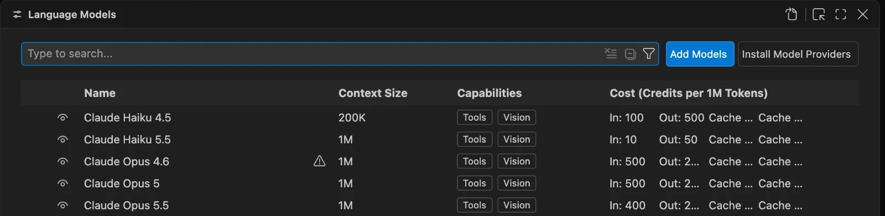

3. Select **Add Models** › **Custom Endpoint**, and enter `AI Gateway` as the group name.
4. Paste your `github-copilot` key into **AI Gateway: API Key** and press <kbd>Enter</kbd>. To copy it from the shell
   without printing it, run `printf %s "$AI_GATEWAY_API_KEY" | pbcopy` on macOS, or
   `Set-Clipboard $env:AI_GATEWAY_API_KEY` in PowerShell.

   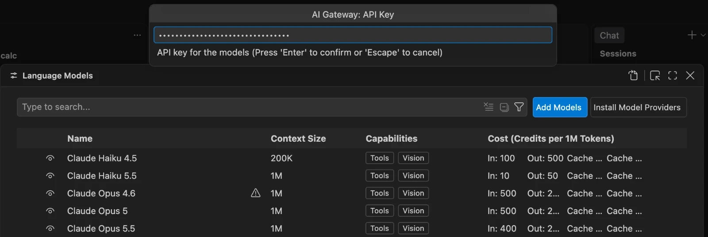

5. In **AI Gateway: API Type**, select **Responses**.

   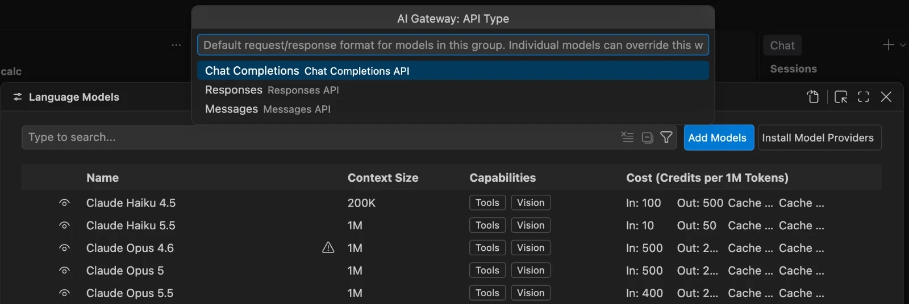

### Add gpt-6-astra to the group

VS Code opens `chatLanguageModels.json` with the new group. The gateway has no model list to discover, so add the
model to `models` yourself. Print the URL to paste:

```bash
# Print the full Responses URL on your gateway, to paste into chatLanguageModels.json
echo "🌐 Responses URL: ${AI_GATEWAY_URL%/}/default/models/openai/v1/responses"
```

Then make the group look like this. Keep the `apiKey` value that VS Code wrote: it points at the secret, not the key
itself.

```jsonc title="chatLanguageModels.json"
[
  {
    "name": "AI Gateway",
    "vendor": "customendpoint",
    "apiKey": "${input:chat.lm.secret.<id>}",
    "apiType": "responses",
    "models": [
      {
        "id": "gpt-6-astra",
        "name": "GPT-6 Astra (AI Gateway)",
        "url": "https://<gateway-host>/default/models/openai/v1/responses",
        "toolCalling": true,
        "vision": true,
        "maxInputTokens": 128000,
        "maxOutputTokens": 16000
      }
    ]
  }
]
```

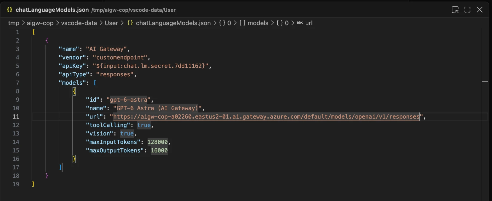

| Field | What it does |
|---|---|
| `id` | The alias, sent as `model` in each request. |
| `name` | The label in the model picker. Copilot already offers a built-in **GPT-6 Astra**, so a distinct name tells them apart. |
| `url` | The full Responses URL on your gateway. |
| `toolCalling` | Tells VS Code that the model can call tools, which agent mode needs. |
| `maxInputTokens`, `maxOutputTokens` | How much context VS Code sends and how long a reply it asks for. |

Save the file.

### Pick the model and run an agent task

1. Open the Chat view (<kbd>Ctrl</kbd>+<kbd>Alt</kbd>+<kbd>I</kbd>, or <kbd>Ctrl</kbd>+<kbd>Cmd</kbd>+<kbd>I</kbd> on
   macOS) and select **Agent**.
2. Open the model picker, select the **AI Gateway** tab, and select **GPT-6 Astra (AI Gateway)**. If the model isn't
   listed, run **Developer: Reload Window**.

   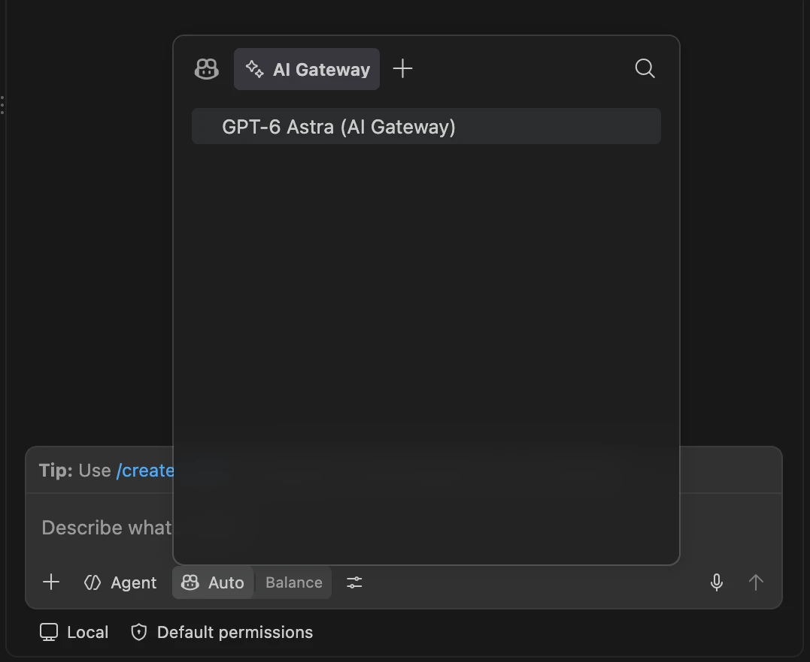

3. Send this prompt:

   ```text
   Fix the bug in calc.py and add a guard for division by zero
   ```

Copilot reads the file, changes `add` to return `a + b`, makes `divide` raise `ZeroDivisionError` when `b` is zero,
and checks its work. Review the diff and select **Keep**.

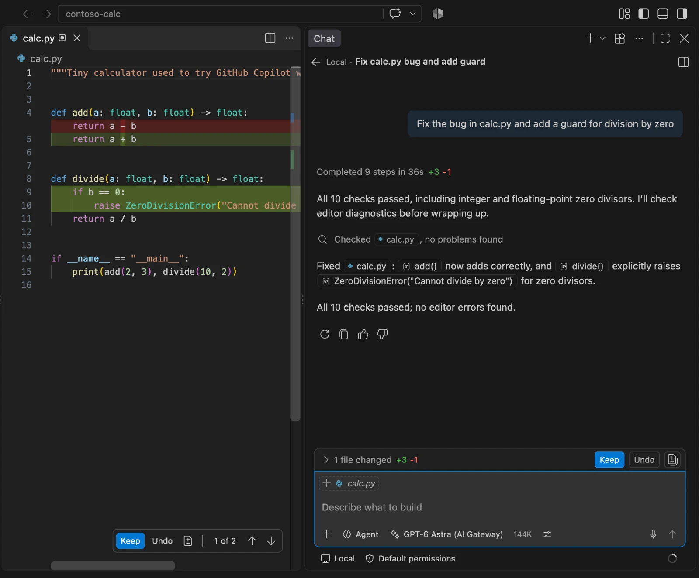

<!-- /steps -->

> **Checkpoint**
> The chat input shows **GPT-6 Astra (AI Gateway)**, and `calc.py` now adds correctly and refuses to divide by zero.

> [!TIP]
> Without a GitHub sign-in, VS Code asks you to pick utility models for chat titles, commit messages, and pull
> request descriptions. Set `chat.utilityModel` and `chat.utilitySmallModel` to your gateway model. Inline
> suggestions still need a GitHub sign-in.

## Connect the Copilot CLI

The Copilot CLI reads its provider from environment variables, so you can switch between the gateway and GitHub's
models per terminal.

<!-- steps -->

### Point the CLI at the gateway

| Variable | Value |
|---|---|
| `COPILOT_PROVIDER_BASE_URL` | `https://<gateway-host>/default/models/openai/v1`. Setting it turns on BYOK. |
| `COPILOT_PROVIDER_WIRE_API` | `responses`. The default is `completions`. |
| `COPILOT_PROVIDER_API_KEY` | Your `github-copilot` key, sent as a bearer token. |
| `COPILOT_MODEL` | `gpt-6-astra`, the alias. |
| `COPILOT_OFFLINE` | Optional. `true` also turns off the GitHub sign-in, telemetry, web tools, and the GitHub MCP server. |

```bash title="Bash"
# Point the Copilot CLI at the gateway's OpenAI-compatible base URL, over the Responses API
export COPILOT_PROVIDER_BASE_URL="${AI_GATEWAY_URL%/}/default/models/openai/v1"
export COPILOT_PROVIDER_WIRE_API="responses"

# Give the CLI the github-copilot key, which it sends as a bearer token, and the alias as its model
export COPILOT_PROVIDER_API_KEY="$AI_GATEWAY_API_KEY"
export COPILOT_MODEL="$AI_GATEWAY_MODEL"
echo "📝 Copilot CLI: $COPILOT_MODEL over the $COPILOT_PROVIDER_WIRE_API API"
echo "🌐 Base URL: $COPILOT_PROVIDER_BASE_URL"
echo "🔑 Key: in COPILOT_PROVIDER_API_KEY (${#COPILOT_PROVIDER_API_KEY} characters, not shown)"
```

```powershell title="PowerShell"
# Point the Copilot CLI at the gateway's OpenAI-compatible base URL, over the Responses API
$env:COPILOT_PROVIDER_BASE_URL = "$($env:AI_GATEWAY_URL.TrimEnd('/'))/default/models/openai/v1"
$env:COPILOT_PROVIDER_WIRE_API = "responses"

# Give the CLI the github-copilot key, which it sends as a bearer token, and the alias as its model
$env:COPILOT_PROVIDER_API_KEY  = $env:AI_GATEWAY_API_KEY
$env:COPILOT_MODEL             = $env:AI_GATEWAY_MODEL
Write-Host "📝 Copilot CLI: $env:COPILOT_MODEL over the $env:COPILOT_PROVIDER_WIRE_API API"
Write-Host "🌐 Base URL: $env:COPILOT_PROVIDER_BASE_URL"
Write-Host "🔑 Key: in COPILOT_PROVIDER_API_KEY ($($env:COPILOT_PROVIDER_API_KEY.Length) characters, not shown)"
```

These variables last for the current terminal. Run `copilot help environment` for the full list.

### Ask a quick question

`copilot -p` runs one prompt and exits:

```bash
# Move into the practice project
cd ~/contoso-calc &&
  echo "📂 Practice project: ~/contoso-calc"

# Run one prompt on the gateway's model, then exit
echo "🤖 Copilot CLI answer:"
copilot -p "Which model are you? Answer in one short sentence."
```

Expected output (your numbers differ):

```text
📂 Practice project: ~/contoso-calc
🤖 Copilot CLI answer:
I'm powered by gpt-6-astra (model ID: gpt-6-astra).

Changes    +0 -0
Duration   6s
Tokens     ↑ 14.4k (14.4k written) • ↓ 24
```

The **Tokens** line shows how much context even a short question carries.

### Run an agent task

Start an interactive session in the project, and select **Yes** when the CLI asks whether you trust the folder:

```bash
# Start an interactive Copilot CLI session in the practice project, on the gateway's model
echo "🚀 Starting the Copilot CLI on $COPILOT_MODEL (type /exit to leave)"
copilot
```

Send this prompt:

```text
Add a multiply function to calc.py and unittest tests in test_calc.py, then run them
```

Copilot plans the change and asks before it edits a file or runs a command. Select **Yes** to approve each step, or
**Yes, and don't ask again** to approve that kind of step for this folder.

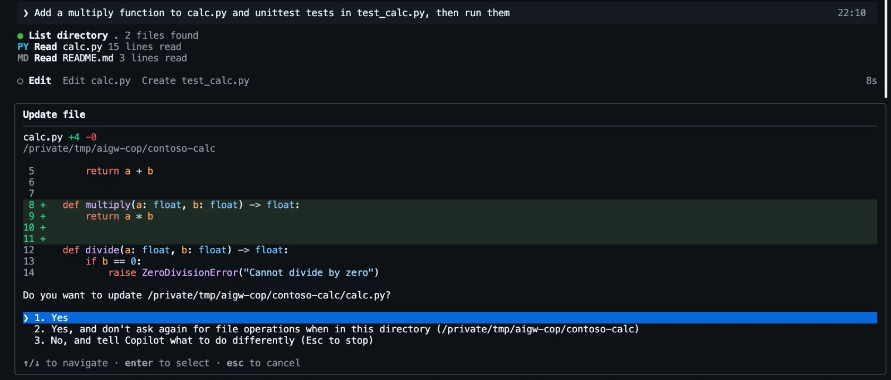

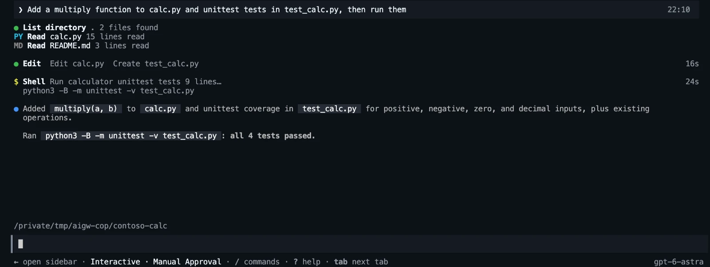

<!-- /steps -->

> **Checkpoint**
> The status bar shows `gpt-6-astra`, and the tests pass. If you skipped the VS Code section, Copilot may also fix
> `add` when the first test run fails. Type `/exit` to leave the session.

## Connect the Copilot SDK

The [GitHub Copilot SDK](https://github.com/github/copilot-sdk) runs the same agent as the CLI inside your own app.
Pass a `provider` when you create a session, and the session sends its model calls to the gateway. The SDK packages
bring the Copilot runtime with them, so you don't need to install the CLI. No GitHub sign-in is needed.

<!-- steps -->

### Review the samples

The samples read `AI_GATEWAY_URL`, `AI_GATEWAY_API_KEY`, and, optionally, `AI_GATEWAY_MODEL` from the environment,
then ask the agent which model it is and to list the files in the current folder. They also read
`AI_GATEWAY_MCP_URL`, which you set later in [Add the Learn tools to the Copilot SDK](#add-the-learn-tools-to-the-copilot-sdk). `approveAll` lets the agent run
tools without asking, which suits a sample. In an app, decide which tools to allow in `onPermissionRequest`.

<!-- include: infra/copilot-sdk.ts -->

<!-- include: infra/copilot_sdk.py -->

### Run a sample

Run the commands from the lab folder (`labs/24-github-copilot-byok`).

```bash title="TypeScript"
# Install the samples' dependencies in the infra folder: the Copilot SDK, which brings the Copilot runtime with it
cd infra
npm install          # @github/copilot-sdk
echo "📦 The Copilot SDK for TypeScript is installed"

# Run the sample: the agent says which model it is, and lists the files in the folder
echo "🤖 Agent reply:"
npm start            # runs copilot-sdk.ts on Node.js 22.18 or later
```

```bash title="Python"
# Install the samples' dependencies in the infra folder: the Copilot SDK, which brings the Copilot runtime with it
cd infra
pip install -r requirements.txt     # github-copilot-sdk
echo "📦 The Copilot SDK for Python is installed"

# Run the sample: the agent says which model it is, and lists the files in the folder
echo "🤖 Agent reply:"
python copilot_sdk.py
```

Expected output (your text differs):

```text
🤖 Agent reply:
I'm powered by gpt-6-astra (model ID: gpt-6-astra).

Files in this folder:
- copilot-model.bicep
- copilot-sdk.ts
- copilot_sdk.py
- deployment.bicep
- main.bicep
- main.parameters.json
- package.json
- requirements.txt
```

The samples print the agent's last message. If the agent answers in two messages, you see only the file list.

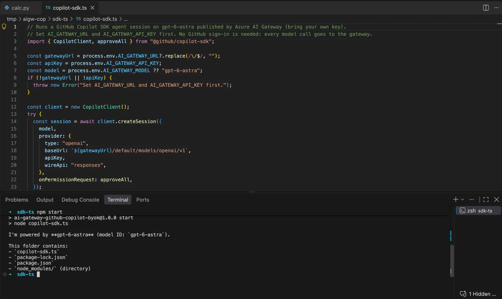

To send your own prompt, pass it as an argument, for example `npm start -- "Summarize package.json"` or
`python copilot_sdk.py "Summarize requirements.txt"`.

<!-- /steps -->

> **Checkpoint**
> The sample names `gpt-6-astra` and lists the folder's files.

## Connect the GitHub Copilot app

The [GitHub Copilot app](https://docs.github.com/en/copilot/get-started/quickstart-copilot-app) is a desktop app for
running Copilot agent sessions across your projects. It adds your own models as **model providers** and keeps their
keys in the system credential store.

> [!NOTE]
> The GitHub Copilot app is in public preview, and its screens change often. These steps follow
> [Use BYOK models in the GitHub Copilot app](https://docs.github.com/en/copilot/how-tos/github-copilot-app/use-byok-models).
> The picture below is an illustration, not a screenshot, so labels in your version can differ.


<!-- steps -->

### Add the gateway as a model provider

1. Open the GitHub Copilot app and sign in with your GitHub account.
2. Open the app settings and select **Model providers** › **Add provider**.
3. Select **Any OpenAI-compatible HTTP endpoint**. Don't pick **Azure OpenAI** or **Microsoft Foundry**: they expect
   those services' own URLs and keys.
4. Enter the provider details:

   | Field | Value |
   |---|---|
   | Display name | `AI Gateway` |
   | Base URL | `https://<gateway-host>/default/models/openai/v1` |
   | API key | Your `github-copilot` key |
   | Wire API, if shown | Responses |

5. The gateway doesn't serve a `/models` list, so the app can't discover its models. Add the model by hand with the
   model ID `gpt-6-astra`.
6. Select **Add provider**.

### Start a session on gpt-6-astra

The provider's models appear in the model picker next to GitHub's. Start a session on the `contoso-calc` folder,
select **gpt-6-astra** from the **AI Gateway** provider, and ask a question, for example
`Which model are you, and what does calc.py do?`.

<!-- /steps -->

> **Checkpoint**
> The reply names `gpt-6-astra`, and the request shows up in the gateway's Monitoring under the `github-copilot` key.

## Publish Microsoft Learn tools for Copilot

Copilot's agents call tools as well as models. Publish an MCP server through the same gateway, and Copilot's tool
calls get the same controls as its model calls: one key that you can suspend, one endpoint per tool server, and one
place to decide which tools agents see. Here, the gateway publishes the public Microsoft Learn MCP server as `learn`,
so Copilot can look up current Microsoft documentation while it codes on `gpt-6-astra`.

Each Copilot surface then has two connections to the gateway:

| | Model | MCP server |
|---|---|---|
| URL | `https://<gateway-host>/default/models/openai/v1` | `https://<gateway-host>/default/toolservers/learn/mcp` |
| How the key is sent | `Authorization: Bearer <key>` | An `api-key: <key>` header. The MCP endpoint rejects a bearer key with `401`. |
| Key | `github-copilot` | The same `github-copilot` key. It needs no extra setup. |

> [!NOTE]
> Learn results are large: one search returns 25 to 50 KB of text. Copilot keeps big results out of the prompt
> where it can, but tasks that use the tools still send more tokens. In testing, a one-shot question that used one
> search sent about 51,000 input tokens, and the agent task in the CLI section sent about 150,000 over seven minutes,
> within the 100,000 tokens-per-minute limit.

> [!TIP]
> If you did [Federate MCP tools behind one endpoint](../04-federate-mcp-tools/README.md), your gateway already
> has `learn`. Skip to [Test the MCP endpoint](#test-the-mcp-endpoint).

Create the `learn` server with one backend, `https://learn.microsoft.com/api/mcp`, under the namespace `learn`. The
Learn server is public, so the backend needs no credentials. Pick a track.

<!-- track: portal | Portal -->

### Register the Learn server

1. Open the [AI Gateway portal](https://ai.gateway.azure.com), select your gateway, and select **MCP servers** ›
   **Add MCP server**.
2. On **Basic info**, set **Name** to `learn`, **Display name** to `Microsoft Learn`, and **Description** to
   `Search and fetch official Microsoft documentation and code samples.` Select **Next**.
3. On **Backends**, select **Add backend** › **MCP server**. Set **URL** to `https://learn.microsoft.com/api/mcp`,
   **Namespace** to `learn`, and **Authentication** to **None**. Select **Next**.
4. On **Tools**, keep **Allow all tools**, and select **Create**.

[Register the Learn MCP server](../04-federate-mcp-tools/README.md#register-the-learn-mcp-server) in lab 04
explains each field.

### Copy the endpoint

When the server is ready, copy the **Endpoint URL** from its details page. It ends in
`/default/toolservers/learn/mcp`.

> **Checkpoint**
> **MCP servers** lists `learn` with one backend in the namespace `learn`.

<!-- track: cli | Azure CLI -->

### Register the Learn server

`az aigateway mcp create` registers the MCP server. `--endpoints` takes the backends as a JSON array.

```bash title="Bash"
# Register the public Microsoft Learn MCP server as learn, with one backend in the learn namespace and no credentials
MCP_ENDPOINT="$(az aigateway mcp create -g "$RG" --gateway-name "$GATEWAY" -n learn \
  --display-name "Microsoft Learn" \
  --description "Search and fetch official Microsoft documentation and code samples." \
  --endpoints '[{"kind": "mcp", "namespace": "learn", "required": true,
                 "mcp": {"url": "https://learn.microsoft.com/api/mcp", "transport": "streamableHttp"}}]' \
  --query "properties.gatewayEndpoints[0].url" -o tsv)" &&
  echo "🔌 MCP server learn is ready: $MCP_ENDPOINT"
```

```powershell title="PowerShell"
# Write the backend to a file: the public Microsoft Learn MCP server, in the learn namespace, with no credentials
ConvertTo-Json -Depth 10 -Compress -InputObject @(
  @{ kind = 'mcp'; namespace = 'learn'; required = $true
     mcp  = @{ transport = 'streamableHttp'; url = 'https://learn.microsoft.com/api/mcp' } }
) | Set-Content -Path endpoints.json

# Register the MCP server as learn with that backend, then remove the file
$MCP_ENDPOINT = az aigateway mcp create -g $RG --gateway-name $GATEWAY -n learn `
  --display-name "Microsoft Learn" `
  --description "Search and fetch official Microsoft documentation and code samples." `
  --endpoints "@endpoints.json" `
  --query "properties.gatewayEndpoints[0].url" -o tsv
if ($?) { Write-Host "🔌 MCP server learn is ready: $MCP_ENDPOINT" }
Remove-Item endpoints.json
```

If `learn` already exists, for example from lab 04, `mcp create` fails with the error
`This MCP registration already exists; use mcp update.` In that case, skip this step and print the existing endpoint
with `az aigateway mcp show -g "$RG" --gateway-name "$GATEWAY" -n learn --query "properties.gatewayEndpoints[0].url" -o tsv`.

> **Checkpoint**
> The command prints `🔌 MCP server learn is ready:` and the endpoint, ending in `/default/toolservers/learn/mcp`.

<!-- track: iac | Bicep + azd -->

### Check the Learn server

`azd up` already deployed it: `infra/main.bicep` calls lab 04's
[`tool-server.bicep`](../04-federate-mcp-tools/infra/tool-server.bicep), which references your gateway and declares
one `toolServers` resource, `learn`. Print its endpoint from the lab folder (`ai-gateway/labs/24-github-copilot-byok`):

```bash title="Bash"
# Print the endpoint of the learn MCP server that azd up deployed
echo "🔌 Endpoint of the learn MCP server:"
azd env get-value AI_GATEWAY_MCP_URL
```

```powershell title="PowerShell"
# Print the endpoint of the learn MCP server that azd up deployed
Write-Host "🔌 Endpoint of the learn MCP server:"
azd env get-value AI_GATEWAY_MCP_URL
```

> [!WARNING]
> `azd provision` replaces the whole MCP server, including backends and tool rules that you added in the portal.

> **Checkpoint**
> The commands print `🔌 Endpoint of the learn MCP server:` and the endpoint, ending in
> `/default/toolservers/learn/mcp`.

<!-- /tracks -->

### Test the MCP endpoint

Save the endpoint, then list its tools the way Copilot does: a JSON-RPC `tools/list` request with the key in the
`api-key` header.

```bash title="Bash"
# Save the endpoint of the learn MCP server on your gateway
export AI_GATEWAY_MCP_URL="${AI_GATEWAY_URL%/}/default/toolservers/learn/mcp"
echo "🔌 MCP endpoint: $AI_GATEWAY_MCP_URL"

# List the server's tools the way Copilot does: a JSON-RPC tools/list request, with the key in the api-key header
echo "🔧 Tools on the learn MCP server:"
curl -sS "$AI_GATEWAY_MCP_URL" \
  -H "api-key: $AI_GATEWAY_API_KEY" -H "Content-Type: application/json" \
  -H "Accept: application/json, text/event-stream" \
  -d '{"jsonrpc":"2.0","id":1,"method":"tools/list"}' | jq -r '.result.tools[].name'
```

```powershell title="PowerShell"
# Save the endpoint of the learn MCP server on your gateway
$env:AI_GATEWAY_MCP_URL = "$($env:AI_GATEWAY_URL.TrimEnd('/'))/default/toolservers/learn/mcp"
Write-Host "🔌 MCP endpoint: $env:AI_GATEWAY_MCP_URL"

# List the server's tools the way Copilot does: a JSON-RPC tools/list request, with the key in the api-key header
Write-Host "🔧 Tools on the learn MCP server:"
$reply = Invoke-RestMethod -Method Post -Uri $env:AI_GATEWAY_MCP_URL `
  -Headers @{ "api-key" = $env:AI_GATEWAY_API_KEY; Accept = "application/json, text/event-stream" } `
  -ContentType "application/json" -Body '{"jsonrpc":"2.0","id":1,"method":"tools/list"}'
$reply.result.tools.name
```

Expected output:

```text
🔌 MCP endpoint: https://<gateway-host>/default/toolservers/learn/mcp
🔧 Tools on the learn MCP server:
learn_microsoft_docs_search
learn_microsoft_code_sample_search
learn_microsoft_docs_fetch
```

Each name starts with the backend's namespace, `learn`. The Learn server can add tools over time, and **Allow all
tools** publishes them too.

## Add the Learn tools to VS Code

VS Code reads MCP servers from `.vscode/mcp.json` in the workspace. An `inputs` entry makes VS Code ask for the key
once and keep it in its secret storage, so the file holds no secret.

<!-- steps -->

### Add the server to the project

Print the endpoint to paste:

```bash
# Print the endpoint of the learn MCP server, to paste into .vscode/mcp.json
echo "🔌 MCP endpoint: $AI_GATEWAY_MCP_URL"
```

In VS Code, create `.vscode/mcp.json` in `contoso-calc` with this content, and replace the URL with yours:

```json title=".vscode/mcp.json"
{
  "inputs": [
    {
      "type": "promptString",
      "id": "aigw-key",
      "description": "AI Gateway key (github-copilot)",
      "password": true
    }
  ],
  "servers": {
    "ai-gateway-learn": {
      "type": "http",
      "url": "https://<gateway-host>/default/toolservers/learn/mcp",
      "headers": {
        "api-key": "${input:aigw-key}"
      }
    }
  }
}
```

### Start the server

1. Select **Start** above `ai-gateway-learn` in `mcp.json`.
2. Paste your `github-copilot` key into the **AI Gateway key (github-copilot)** prompt, and press <kbd>Enter</kbd>.

   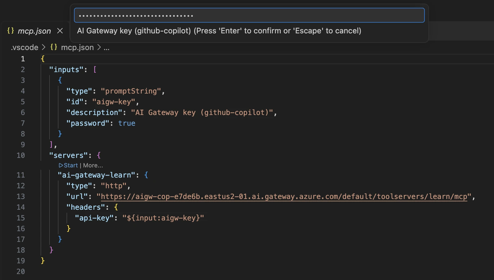

3. The line above the server changes to **Running** with **3 tools**.

   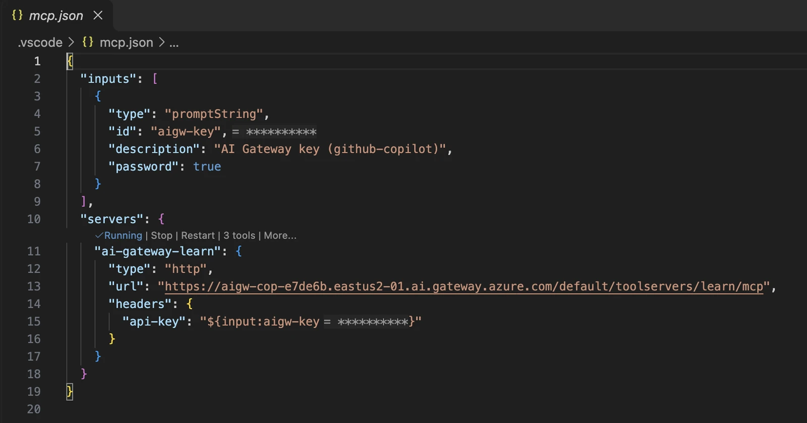

### Check the tools

Open the Chat view, select **Agent** and **GPT-6 Astra (AI Gateway)**, and select **Configure Tools** (the tools
icon in the chat input). `ai-gateway-learn` lists the three Learn tools. VS Code shows the name that the gateway
reports for itself, **Azure API Management**, next to the server name.

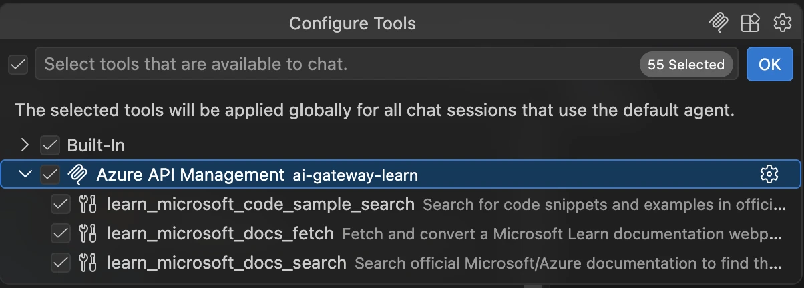

### Run a task with the tools

Send this prompt:

```text
Use the Microsoft Learn tools to look up the Azure Functions Python v2 programming model, then add function_app.py that exposes add() from calc.py as an HTTP-triggered function. Cite the Learn page you used.
```

VS Code asks before each tool call and shows the tool's input. Select **Allow in this Session** to trust the Learn
tools for the rest of this chat.

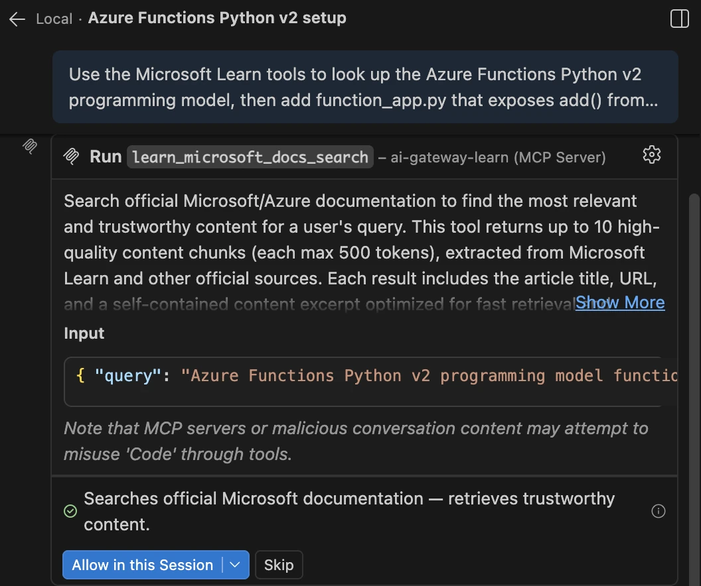

Copilot searches Learn, fetches the page it needs, writes `function_app.py` with the v2 decorators, and cites the
page. Review the diff and select **Keep**.

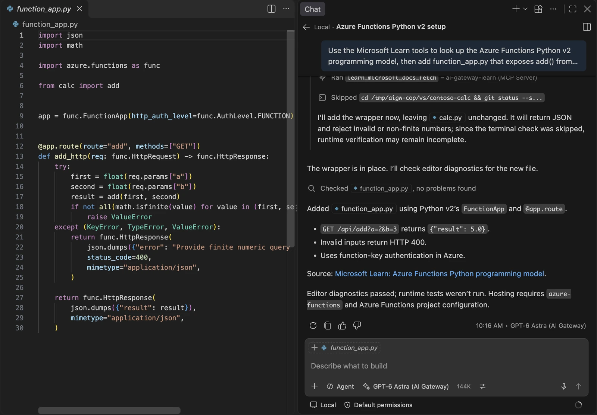

<!-- /steps -->

> **Checkpoint**
> `function_app.py` exposes `add` as an HTTP function, and the chat answer links to a Microsoft Learn page.

## Add the Learn tools to the Copilot CLI

The Copilot CLI keeps MCP servers in `~/.copilot/mcp-config.json`, and the GitHub Copilot app reads the same file.
Header values can refer to environment variables, so the file doesn't need to hold the key.

<!-- steps -->

### Add the server

Keep the single quotes around the header. They stop the shell from expanding `${AI_GATEWAY_API_KEY}`, so the file
stores the reference, and the CLI reads the key from its environment each time it connects.

```bash title="Bash"
# Add the gateway's learn MCP server to the Copilot CLI, with a header that reads the key from the environment
copilot mcp add --transport http --header 'api-key: ${AI_GATEWAY_API_KEY}' ai-gateway-learn "$AI_GATEWAY_MCP_URL" &&
  echo "🔌 MCP server ai-gateway-learn is ready in the Copilot CLI"

# List the MCP servers that the Copilot CLI uses
echo "🔌 MCP servers in the Copilot CLI:"
copilot mcp list
```

```powershell title="PowerShell"
# Add the gateway's learn MCP server to the Copilot CLI, with a header that reads the key from the environment
copilot mcp add --transport http --header 'api-key: ${AI_GATEWAY_API_KEY}' ai-gateway-learn $env:AI_GATEWAY_MCP_URL
if ($?) { Write-Host "🔌 MCP server ai-gateway-learn is ready in the Copilot CLI" }

# List the MCP servers that the Copilot CLI uses
Write-Host "🔌 MCP servers in the Copilot CLI:"
copilot mcp list
```

Expected output:

```text
Added server "ai-gateway-learn"

ai-gateway-learn
  Type: http
  URL: https://<gateway-host>/default/toolservers/learn/mcp
  Headers:
    api-key: ***
  Tools: * (all)
  Source: User
🔌 MCP server ai-gateway-learn is ready in the Copilot CLI
🔌 MCP servers in the Copilot CLI:
User servers:
  ai-gateway-learn (http)
```

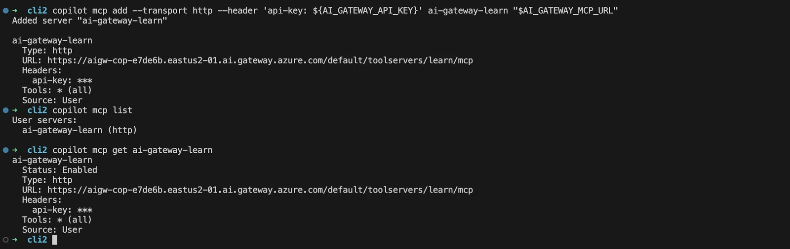

The file now holds the reference, not the key:

```json title="~/.copilot/mcp-config.json"
{
  "mcpServers": {
    "ai-gateway-learn": {
      "tools": ["*"],
      "type": "http",
      "url": "https://<gateway-host>/default/toolservers/learn/mcp",
      "headers": {
        "api-key": "${AI_GATEWAY_API_KEY}"
      }
    }
  }
}
```

### Check the tools in a session

The `copilot` session needs the BYOK variables from [Connect the Copilot CLI](#connect-the-copilot-cli) and
`AI_GATEWAY_API_KEY`. If you did the VS Code section, remove its result first, so the CLI starts from the same
files:

```bash
# Move into the practice project, and remove the files that the VS Code section added, if any
cd ~/contoso-calc && rm -f function_app.py host.json requirements.txt &&
  echo "📂 Practice project is ready: ~/contoso-calc"

# Start an interactive Copilot CLI session, on the gateway's model and with the gateway's Learn tools
echo "🚀 Starting the Copilot CLI with the Learn tools (type /exit to leave)"
copilot
```

The CLI reports **MCP Servers reloaded: 1 server connected**. Run `/mcp show ai-gateway-learn` to list the tools,
then press <kbd>Esc</kbd> twice to close the list.

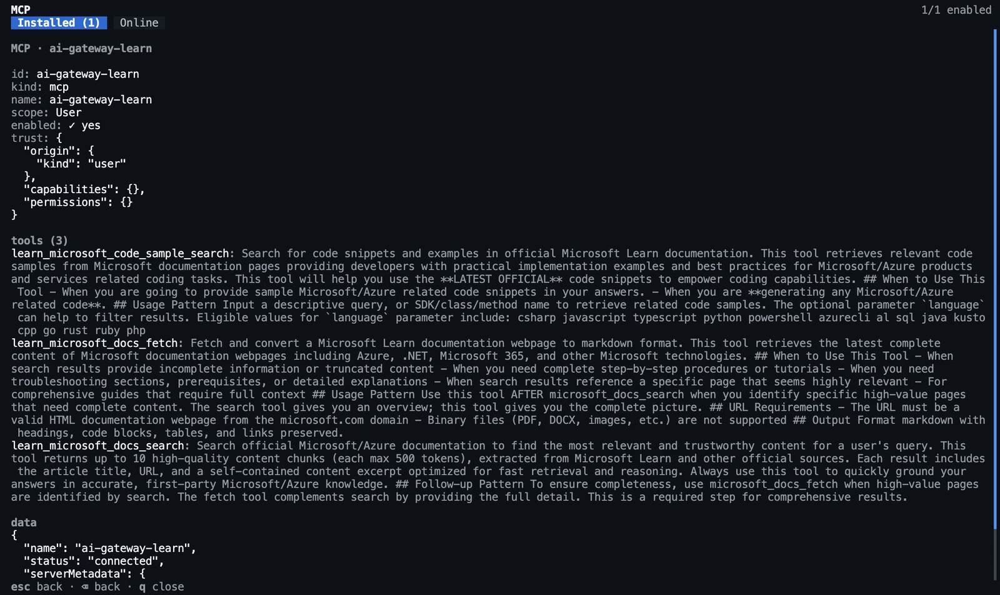

### Run a task with the tools

Send the same prompt as in VS Code:

```text
Use the Microsoft Learn tools to look up the Azure Functions Python v2 programming model, then add function_app.py that exposes add() from calc.py as an HTTP-triggered function. Cite the Learn page you used.
```

The CLI asks before it uses each tool. Select **Yes, and don't ask again** for the Learn tools that you trust. The
tool lines show **(MCP: ai-gateway-learn)**.

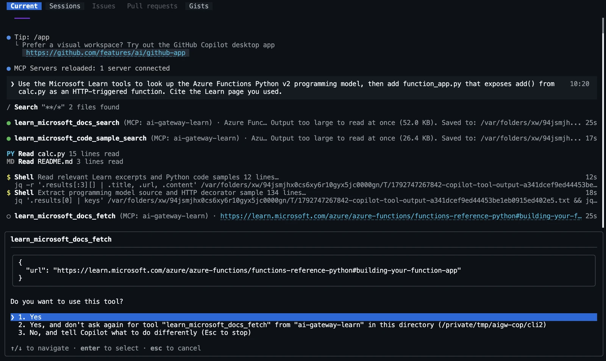

Copilot writes `function_app.py`, and may add `requirements.txt` and `host.json`, then summarizes the change and
cites the Learn page.

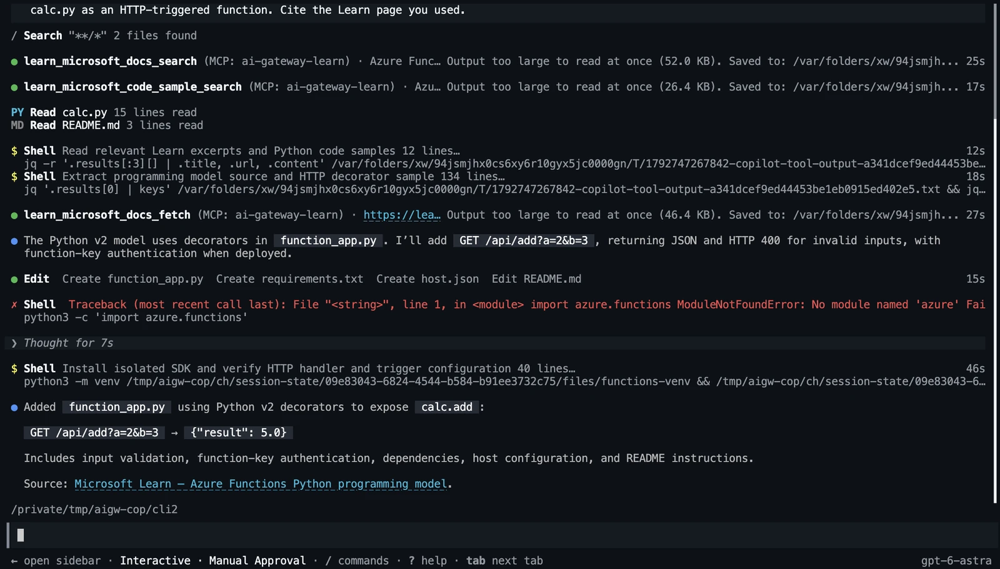

Type `/exit` to leave the session.

### Use the tools in one-shot mode

`copilot -p` can't ask for approval, so allow the server's tools up front with `--allow-tool`:

```bash
# Run one prompt that needs the Learn tools, and allow the server's tools up front, because -p can't ask
echo "🤖 Copilot CLI answer, with the Learn tools:"
copilot -p "Search Microsoft Learn: how do I run a Python function app locally with Azure Functions Core Tools? Answer in two sentences with a link." --allow-tool='ai-gateway-learn'
```

Expected output (shortened, your text differs):

```text
🤖 Copilot CLI answer, with the Learn tools:
● learn_microsoft_docs_search (MCP: ai-gateway-learn) · run Python Azure Functions app locally Core…
  └ Output too large to read at once (52.0 KB). Saved to: /var/folders/…

Install Azure Functions Core Tools v4 and a supported Python version, activate your project's virtual environment,
and install dependencies with `pip install -r requirements.txt`. From the project root, run `func start`, then open
the HTTP function URL printed in the terminal; see [Microsoft Learn](https://learn.microsoft.com/azure/azure-functions/functions-run-local#start-the-functions-runtime).

Changes    +0 -0
Duration   18s
Tokens     ↑ 50.8k (30.4k cached, 20.4k written) • ↓ 204
```

Compare the **Tokens** line with the 14,400 tokens of the plain question in
[Ask a quick question](#ask-a-quick-question): the search result made up most of the difference.

<!-- /steps -->

> **Checkpoint**
> `/mcp show` lists three tools, the tool lines show `(MCP: ai-gateway-learn)`, and the answer cites a Learn page.

> [!TIP]
> `COPILOT_OFFLINE=true` turns off the built-in GitHub MCP server, but not the servers you add: the Learn tools keep
> working.

## Add the Learn tools to the Copilot SDK

The samples already handle MCP. When `AI_GATEWAY_MCP_URL` is set, they add the server to the session as
`ai-gateway-learn`, with the key in the `api-key` header and `tools: ["*"]` to offer every tool:

```ts title="copilot-sdk.ts"
const mcpServers: Record<string, MCPServerConfig> = mcpUrl
  ? { "ai-gateway-learn": { type: "http", url: mcpUrl, headers: { "api-key": apiKey }, tools: ["*"] } }
  : {};
```

The session gets them with `mcpServers` in TypeScript and `mcp_servers=` in Python. `approveAll` lets the agent call
the tools without asking.

<!-- steps -->

### Run a sample with the tools

Run the commands from `labs/24-github-copilot-byok/infra`, in the shell where you set `AI_GATEWAY_MCP_URL`.

```bash title="TypeScript"
# Run copilot-sdk.ts with a prompt that asks the agent to use the gateway's Learn tools
echo "🤖 Agent reply, with the Learn tools:"
npm start -- "Use the Microsoft Learn tools to answer: how do I run a Python function app locally with Azure Functions Core Tools? Answer in two sentences and cite the Learn page."
```

```bash title="Python"
# Run copilot_sdk.py with a prompt that asks the agent to use the gateway's Learn tools
echo "🤖 Agent reply, with the Learn tools:"
python copilot_sdk.py "Use the Microsoft Learn tools to answer: how do I run a Python function app locally with Azure Functions Core Tools? Answer in two sentences and cite the Learn page."
```

Expected output (your text differs):

```text
🤖 Agent reply, with the Learn tools:
Install Azure Functions Core Tools, activate your Python virtual environment, install your app's dependencies, and
run `func start` from the project root, as described in [Microsoft Learn](https://learn.microsoft.com/en-us/azure/azure-functions/functions-run-local?pivots=programming-language-python#start-the-functions-runtime).
For an HTTP-triggered function, open the localhost URL printed in the terminal (usually on port 7071) or call it
with an HTTP client.
```

<!-- /steps -->

> **Checkpoint**
> The answer cites a `learn.microsoft.com` page that the agent found through the gateway.

## Add the Learn tools to the GitHub Copilot app

The GitHub Copilot app loads the MCP servers that you configured for the Copilot CLI. If you did the CLI section,
`ai-gateway-learn` is already there.

<!-- steps -->

### Give the app the key

The server's header reads `${AI_GATEWAY_API_KEY}` from the app's environment, not from your terminal. Make the
variable available to the app, then quit and reopen it. For example, export it in your shell profile on macOS or
Linux, or set it as a user environment variable on Windows. Prefer a command that reads the key from a secret store
over the key itself in plain text.

If you'd rather not set a variable, replace `${AI_GATEWAY_API_KEY}` in `~/.copilot/mcp-config.json` with the key. The
file then holds the key in plain text, so keep it private.

### Check the server

Select **Customize** in the app sidebar, then **MCP** › **Installed**. The list includes `ai-gateway-learn`. If you
skipped the CLI section, run its `copilot mcp add` command, or add a custom server here with the endpoint URL and an
`api-key` header.

### Run a task with the tools

Sessions load MCP servers when they start, so start a new session on the `contoso-calc` folder. Select
**gpt-6-astra** from the **AI Gateway** provider, and send:

```text
Use the Microsoft Learn tools to find how to run calc.py as an Azure Functions app locally, and summarize the steps with a link.
```

The session's agent sees each tool with the server name in front, such as
`ai-gateway-learn-learn_microsoft_docs_search`.

<!-- /steps -->

> **Checkpoint**
> The reply cites a Microsoft Learn page, and the session shows calls to `ai-gateway-learn` tools.

> [!NOTE]
> The GitHub Copilot app is in public preview, and its screens change often. These steps follow
> [Customizing the GitHub Copilot app](https://docs.github.com/en/copilot/how-tos/github-copilot-app/customize-github-copilot-app).

## Verify

Every surface you connected sends its requests with the `github-copilot` key. Use it to see the traffic and to switch
Copilot off.

<!-- steps -->

### See Copilot's usage by key

If you set up Monitoring in [Monitor usage, cost, and traces](../13-monitoring/README.md), open **Monitoring** ›
**Models** in the AI Gateway portal. `gpt-6-astra` lists the calls and the input and output tokens from your Copilot
sessions, and **Model usage by caller identity** shows them under the `github-copilot` key. The input tokens are far
higher than the output tokens: that's the context that the agent sends with every request.

### Cut Copilot off by suspending the key

Suspend the key, then run the CLI again. The settings are unchanged, but the gateway now rejects the key. The
`aigateway` extension doesn't change a key's state yet, so call the Azure Resource Manager REST API with `az rest`:

```bash title="Bash"
# Suspend the github-copilot key with the Azure Resource Manager REST API
STATE="$(az rest --method patch --url "$GW/apiKeys/$KEY_NAME?$API" \
  --body '{"properties":{"state":"suspended"}}' --query properties.state -o tsv)" &&
  echo "🔑 API key github-copilot is $STATE"

# Give the gateway time to apply the change
echo "⏳ Waiting 30 seconds for the key change to apply"
sleep 30

# Ask the Copilot CLI again, with the same settings: the gateway now rejects the key
echo "🚦 Expect HTTP 401 from the gateway, after two retries:"
cd ~/contoso-calc && copilot -p "Say hi"
```

```powershell title="PowerShell"
# Suspend the github-copilot key with the Azure Resource Manager REST API, with the body in a file to keep its quotes
'{"properties":{"state":"suspended"}}' | Set-Content keystate.json
$STATE = az rest --method patch --url "$GW/apiKeys/$KEY_NAME`?$API" --body "@keystate.json" --query properties.state -o tsv
if ($?) { Write-Host "🔑 API key github-copilot is $STATE" }

# Give the gateway time to apply the change
Write-Host "⏳ Waiting 30 seconds for the key change to apply"
Start-Sleep 30

# Ask the Copilot CLI again, with the same settings: the gateway now rejects the key
Write-Host "🚦 Expect HTTP 401 from the gateway, after two retries:"
Set-Location ~/contoso-calc; copilot -p "Say hi"
```

Expected output, after the CLI retries twice:

```text
🔑 API key github-copilot is suspended
⏳ Waiting 30 seconds for the key change to apply
🚦 Expect HTTP 401 from the gateway, after two retries:
Request failed due to a transient API error. Retrying...
Request failed due to a transient API error. Retrying...
Authentication failed with provider at https://<gateway-host>/default/models/openai/v1 (HTTP 401).
```

VS Code, the SDK, and the app get the same `401`. One key change cuts off every Copilot surface that uses the key, on
every machine, without touching their settings.

The key guards the tools too. While it's suspended, the MCP endpoint also answers `401 Unauthorized`: run the request
from [Test the MCP endpoint](#test-the-mcp-endpoint) without `| jq …` to see it, and the Learn tools fail to connect
in every surface.

### Turn Copilot back on

```bash title="Bash"
# Turn the github-copilot key back on
STATE="$(az rest --method patch --url "$GW/apiKeys/$KEY_NAME?$API" \
  --body '{"properties":{"state":"active"}}' --query properties.state -o tsv)" &&
  echo "🔑 API key github-copilot is $STATE"

# Give the gateway time to apply the change
echo "⏳ Waiting 30 seconds for the key change to apply"
sleep 30

# Ask the Copilot CLI again: it answers through the gateway
echo "🤖 Copilot CLI answer:"
copilot -p "Say hi in three words"
```

```powershell title="PowerShell"
# Turn the github-copilot key back on, then remove the body file
'{"properties":{"state":"active"}}' | Set-Content keystate.json
$STATE = az rest --method patch --url "$GW/apiKeys/$KEY_NAME`?$API" --body "@keystate.json" --query properties.state -o tsv
if ($?) { Write-Host "🔑 API key github-copilot is $STATE" }
Remove-Item keystate.json

# Give the gateway time to apply the change
Write-Host "⏳ Waiting 30 seconds for the key change to apply"
Start-Sleep 30

# Ask the Copilot CLI again: it answers through the gateway
Write-Host "🤖 Copilot CLI answer:"
copilot -p "Say hi in three words"
```

<!-- /steps -->

> **Checkpoint**
> The CLI failed with `HTTP 401` while the key was suspended, and answered again after
> `🔑 API key github-copilot is active`.

## Go further

- **Choose which Learn tools Copilot sees.** Publish only `learn_microsoft_docs_search`, block a tool, or cap tool
  calls per caller in [Control which tools agents can call](../05-mcp-tool-controls/README.md). Copilot picks up the
  change the next time it lists tools, with no change on the clients.
- **Give Copilot more tools from one endpoint.** Add more backends to the server, such as an OpenAPI spec or a
  built-in connector, as in [Federate MCP tools behind one endpoint](../04-federate-mcp-tools/README.md). Each
  backend's namespace keeps the tool names apart.
- **Sign in with Microsoft Entra ID instead of a key.** If the gateway accepts Entra tokens, as in
  [Authorize callers with Microsoft Entra ID](../11-entra-rbac/README.md), set `COPILOT_PROVIDER_BEARER_TOKEN` for the
  CLI, or pass a bearer token in the SDK's `provider` settings. Tokens expire, so refresh them for long sessions.
- **Fetch the key when it's needed.** `COPILOT_PROVIDER_API_KEY_COMMAND` runs a command for each request and uses its
  output as the key, for example `az keyvault secret show --vault-name <vault> -n github-copilot --query value -o tsv`.
  The key then never sits in your shell profile, and a rotated key takes effect right away.
- **Give each developer or tool its own key.** Keys are cheap, and per-key usage in Monitoring shows who uses how
  much. Rotate or revoke them with [Manage runtime API keys](../10-api-keys/README.md).
- **Route Copilot across models.** Point the `gpt-6-astra` alias at several backend models, as in
  [Route by priority and weight](../22-model-routing/README.md). VS Code chains Responses API turns with
  `previous_response_id` by default; if the backends don't share state, set `"statefulResponses": false` on the model
  in `chatLanguageModels.json`.
- **Offer more models.** Publish more aliases and add each one to `models` in VS Code, or to the provider in the app.
  For the CLI, set `COPILOT_MODEL` to a different alias. If an alias doesn't have a well-known model name, set
  `COPILOT_PROVIDER_MODEL_ID` to the model it serves, so the CLI picks the right prompts and token sizes.

## Clean up

Remove the gateway from each Copilot surface you configured, and delete the practice project:

- **VS Code:** delete the **AI Gateway** group from `chatLanguageModels.json`, or remove it in the
  **Language Models** editor. Delete `.vscode/mcp.json` from `contoso-calc`.
- **Copilot CLI:** run `copilot mcp remove ai-gateway-learn`. Then close the terminal, or run
  `unset COPILOT_PROVIDER_BASE_URL COPILOT_PROVIDER_WIRE_API COPILOT_PROVIDER_API_KEY COPILOT_MODEL`
  (Bash) or `Remove-Item Env:COPILOT_PROVIDER_*, Env:COPILOT_MODEL` (PowerShell).
- **GitHub Copilot app:** remove the **AI Gateway** provider in **Model providers**. `copilot mcp remove` also
  removes `ai-gateway-learn` from the app. Remove `AI_GATEWAY_API_KEY` from your profile or environment if you set
  it for the app.
- **Practice project:** run `rm -rf ~/contoso-calc` (Bash) or `Remove-Item -Recurse -Force ~/contoso-calc`
  (PowerShell).

Then delete what you created on the gateway. Pick a track.

<!-- track: portal | Portal -->

### Delete the key, the model, and the Learn server

1. Delete `github-copilot` in **Access** › **Keys**.
2. If you don't need `gpt-6-astra` any more, delete its alias and its backend model in **Models**, then its
   deployment in Foundry. If you imported the model in the portal, also delete its `<foundry-account-name>/gpt-6-astra`
   alias. Keep the gateway and the provider: the other labs reuse them.
3. Keep the `learn` MCP server if you continue with
   [Control which tools agents can call](../05-mcp-tool-controls/README.md), which builds on it. Otherwise, delete it
   in **MCP servers**.

<!-- track: cli | Azure CLI -->

### Delete the key, the model, and the Learn server

Delete the key:

```bash title="Bash"
# Delete the github-copilot key: every Copilot surface that still uses it stops working
az aigateway api-key delete -g "$RG" --gateway-name "$GATEWAY" -n "$KEY_NAME" --yes &&
  echo "🚮 API key github-copilot is deleted"
```

```powershell title="PowerShell"
# Delete the github-copilot key: every Copilot surface that still uses it stops working
az aigateway api-key delete -g $RG --gateway-name $GATEWAY -n $KEY_NAME --yes
if ($?) { Write-Host "🚮 API key github-copilot is deleted" }
```

If you don't need `gpt-6-astra` any more, also delete the alias, the backend model, and the Foundry deployment:

```bash title="Bash"
# Delete the gpt-6-astra alias first, so that nothing points at the model
az aigateway model-alias delete -g "$RG" --gateway-name "$GATEWAY" -n "$MODEL" --yes &&
  echo "🚮 Alias $MODEL is deleted"

# Delete the backend model from the provider
az aigateway model delete -g "$RG" --gateway-name "$GATEWAY" --provider-name "$PROVIDER" -n "$MODEL" --yes &&
  echo "🚮 Model $MODEL is deleted from $PROVIDER"

# Delete the gpt-6-astra deployment from the Foundry account
az cognitiveservices account deployment delete -g "$FOUNDRY_RG" -n "$FOUNDRY_ACCOUNT" --deployment-name "$MODEL" &&
  echo "🚮 Model deployment $MODEL is deleted from $FOUNDRY_ACCOUNT"
```

```powershell title="PowerShell"
# Delete the gpt-6-astra alias first, so that nothing points at the model
az aigateway model-alias delete -g $RG --gateway-name $GATEWAY -n $MODEL --yes
if ($?) { Write-Host "🚮 Alias $MODEL is deleted" }

# Delete the backend model from the provider
az aigateway model delete -g $RG --gateway-name $GATEWAY --provider-name $PROVIDER -n $MODEL --yes
if ($?) { Write-Host "🚮 Model $MODEL is deleted from $PROVIDER" }

# Delete the gpt-6-astra deployment from the Foundry account
az cognitiveservices account deployment delete -g $FOUNDRY_RG -n $FOUNDRY_ACCOUNT --deployment-name $MODEL
if ($?) { Write-Host "🚮 Model deployment $MODEL is deleted from $FOUNDRY_ACCOUNT" }
```

Keep the gateway and the provider: the other labs reuse them. Keep the `learn` MCP server if you continue with
[Control which tools agents can call](../05-mcp-tool-controls/README.md), which builds on it. Otherwise, delete it:

```bash title="Bash"
# Delete the learn MCP server from the gateway
az aigateway mcp delete -g "$RG" --gateway-name "$GATEWAY" -n learn --yes &&
  echo "🚮 MCP server learn is deleted"
```

```powershell title="PowerShell"
# Delete the learn MCP server from the gateway
az aigateway mcp delete -g $RG --gateway-name $GATEWAY -n learn --yes
if ($?) { Write-Host "🚮 MCP server learn is deleted" }
```

<!-- track: iac | Bicep + azd -->

### Delete everything azd created

In the `ai-gateway/labs/24-github-copilot-byok` folder, delete the resource group with the gateway, the `gpt-6-astra`
alias, the `github-copilot` key, the `learn` MCP server, and the Foundry account with its two deployments.
[`--purge`](../SETUP.md#delete-what-azd-created) also purges the soft-deleted Foundry account. It takes about ten
minutes.

```bash
# Delete everything that azd up created, and purge the Foundry account
azd down --purge --force &&
  echo "🚮 Everything that azd up created is deleted"
```

<!-- /tracks -->

`azd down` doesn't touch the gateway, provider, and key from lab 02, because the Bicep + azd track created its own
gateway.

## Next steps

- [Manage runtime API keys](../10-api-keys/README.md): rotate, suspend, and revoke the keys that tools use.
- [Throttle tokens per caller with token limits](../06-token-limits/README.md): tune the limit for agent traffic.
- [Monitor usage, cost, and traces](../13-monitoring/README.md): see Copilot's usage by key next to your apps.
- [Federate MCP tools behind one endpoint](../04-federate-mcp-tools/README.md) and
  [Control which tools agents can call](../05-mcp-tool-controls/README.md): grow and govern the tools that Copilot
  calls.
- [Build on your gateway with coding agents](../17-coding-agent-plugin/README.md): let a coding agent write the client
  code for your gateway.
- [Use BYOK models in the GitHub Copilot CLI](https://docs.github.com/en/copilot/how-tos/copilot-cli/customize-copilot/use-byok-models),
  [the Copilot SDK](https://github.com/github/copilot-sdk/blob/main/docs/auth/byok.md), and
  [VS Code](https://code.visualstudio.com/docs/copilot/customization/language-models).
- [Add MCP servers to the Copilot CLI](https://docs.github.com/en/copilot/how-tos/copilot-cli/customize-copilot/add-mcp-servers)
  and [VS Code](https://code.visualstudio.com/docs/copilot/customization/mcp-servers).
