# Your first model call in 5 minutes

Azure AI Gateway gives your apps and agents one governed endpoint for models and tools. In five minutes you create a
gateway, put a Microsoft Foundry model behind it, and call that model the way an app does: with the gateway's URL, an
alias in the `model` field, and a runtime API key. Click through the AI Gateway portal, paste a few Azure CLI
commands into Azure Cloud Shell, or clone a Bicep template and deploy it with one `azd up`.


## Before you begin

You need an Azure subscription where you can create resources and role assignments, for example **Owner**, or
**Contributor** plus **Role Based Access Control Administrator**. The gateway gets a role on your Foundry account, so
that it can call the model with its own identity. Each track lists the tools that it needs at its start.

The Azure CLI and Bicep + azd tracks take a location: `eastus2`, or another region from
[Find the available regions](../SETUP.md#find-the-available-regions). They also create the Foundry account in that
region, so pick one where `gpt-6-luna` is available too. Each track includes every setup step that it needs, so you
can paste it into Cloud Shell as it is. The [Setup guide](../SETUP.md) explains these steps, and the later labs
link to it.

## How it works

Every call that goes through AI Gateway uses the same building blocks. In this quick start you create one of each.

| Building block | What it does | In this quick start |
| :-- | :-- | :-- |
| **Gateway** | The Azure resource (`Microsoft.ApiManagement/aigateways`) that gives your apps one runtime URL for models and tools | Your gateway, at `https://<gateway>.<location>-01.ai.gateway.azure.com` |
| **Model provider** | A connection to a backend. The gateway signs in to it with its own managed identity, so your apps never hold a backend key | Your Foundry account. The Azure CLI and Bicep tracks name the provider `foundry-models` |
| **Model** | A backend deployment that the gateway can route to | The Foundry deployment `gpt-6-luna` |
| **Alias** | The name that apps send in the `model` field. The gateway routes the alias to one or more models | `<foundry-account-name>/gpt-6-luna` in the portal, `gpt-6-luna` in the Azure CLI and Bicep tracks |
| **Runtime API key** | Identifies the app that calls the gateway, for limits, cost, and monitoring | `app-first-call` |

Your app calls the OpenAI-compatible base URL `<gateway URL>/default/models/openai/v1`, so any OpenAI SDK works with
a different base URL and the runtime key. For the full tour, watch the 3-minute video in
[How Azure AI Gateway works](../00-how-ai-gateway-works/README.md).

## Create a gateway and make your first call

Pick one track. Each one creates the same building blocks, makes your first call through the gateway, and ends with
how to clean up.

<!-- track: portal | Portal -->

**What you need:** a browser, and a model deployment in a Microsoft Foundry account, for example `gpt-6-luna`.

<details>
<summary>No Foundry deployment yet? Create one in Cloud Shell.</summary>

Open [Azure Cloud Shell](https://shell.azure.com) in Bash and paste these commands. They create a Foundry account with
a `gpt-6-luna` deployment in a new resource group, in a minute or two. Then create the gateway in the same resource
group, so that you can clean up with one command. Model inference is billed per use.

```bash title="Bash"
# Name the resource group, and give the Foundry account a random, globally unique name
RG="rg-aigw-quickstart"; FOUNDRY="aigw$(openssl rand -hex 3)"

# Create the resource group that holds the Foundry account and, later, the gateway
az group create --name "$RG" --location eastus2 --output none &&
  echo "📦 Resource group $RG is ready in eastus2"

# Create the Foundry account, with a custom subdomain so that the gateway can sign in with Microsoft Entra ID
az cognitiveservices account create --resource-group "$RG" --name "$FOUNDRY" --location eastus2 \
  --kind AIServices --sku S0 --custom-domain "$FOUNDRY" --yes --output none &&
  echo "🏭 Foundry account $FOUNDRY is ready"

# Deploy gpt-6-luna with 10,000 tokens per minute of Global Standard capacity
az cognitiveservices account deployment create --resource-group "$RG" --name "$FOUNDRY" \
  --deployment-name gpt-6-luna --model-name gpt-6-luna --model-version 2026-09-22 --model-format OpenAI \
  --sku-name GlobalStandard --sku-capacity 10 --output none &&
  echo "🧠 Model deployment gpt-6-luna is ready"
echo "✅ Create the gateway in $RG, and import gpt-6-luna from $FOUNDRY"
```

</details>

### Create the gateway

1. Open the [AI Gateway portal](https://ai.gateway.azure.com) and sign in. For your first gateway, the portal opens
   **Create AI gateway** right away. Otherwise, open the gateway switcher in the top bar and select
   **Create new gateway**.

   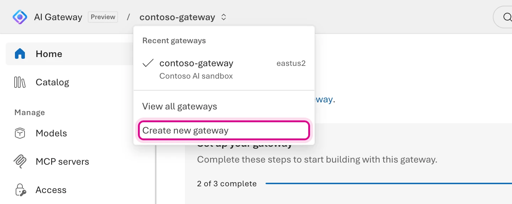

2. Enter a **Name**, or select **Generate a new name**. Then choose your **Subscription**, a **Resource group**, and
   a **Region**. For the resource group, select **New**, or select **Existing** and pick the resource group of your
   Foundry account, so that you can clean up both with one command.

   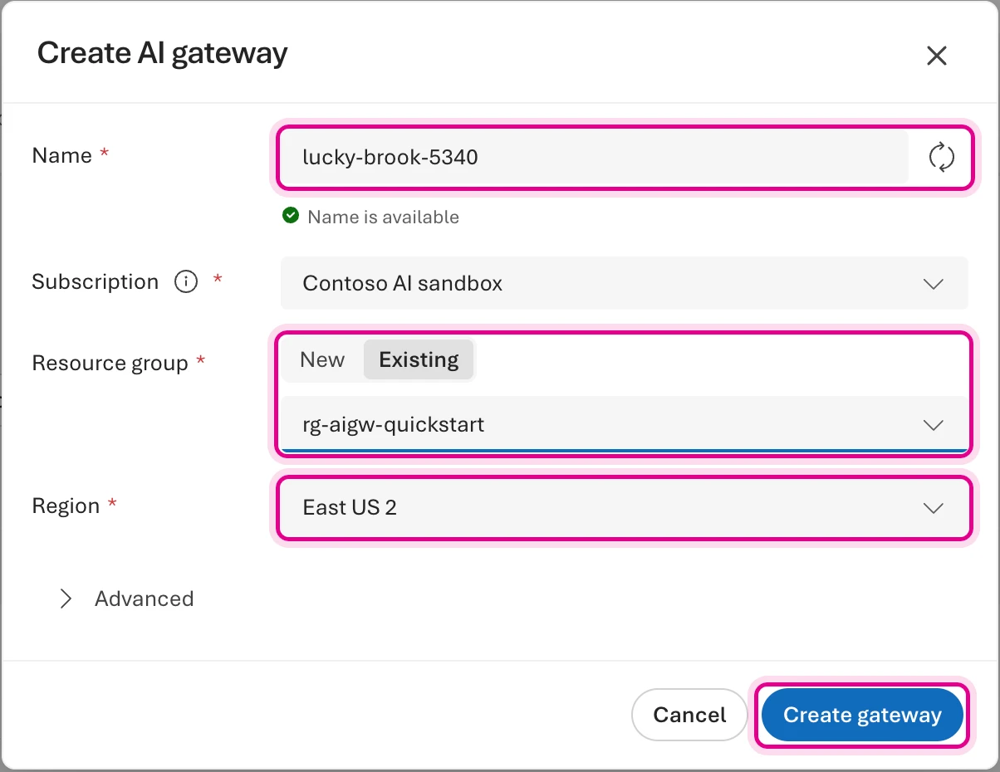

3. Keep the **Advanced** defaults and select **Create gateway**. **All gateways** opens and shows the provisioning
   status, which moves from **Activating** to **Succeeded** in a few minutes. Then the portal selects your new
   gateway.

   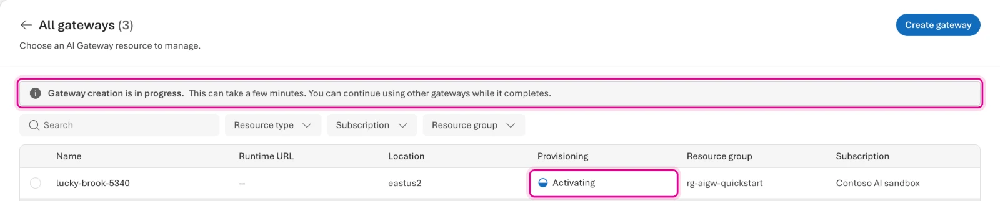

### Import the model from Foundry

1. **Home** opens with the **Set up your gateway** guide. Under **Add a model**, select
   **Add from Microsoft Foundry**.

   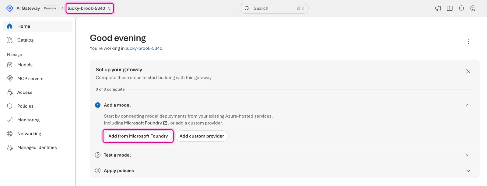

   You can also start from **Models** › **Add** › **Models from Microsoft Foundry**.

   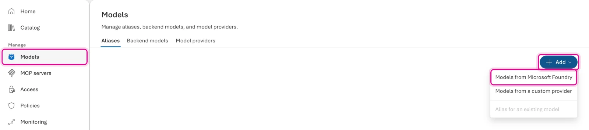

2. **Add models from Microsoft Foundry** discovers the model deployments in your subscriptions and selects all of
   them. In **Resource groups**, select only the resource group of your Foundry account. Then check that **Models**
   selects only your Foundry account with `gpt-6-luna`.
3. Keep **Managed identity** as the **Authentication method**, with the system-assigned managed identity, and keep
   **Create an alias for each model** selected. Then select **Add models**.

   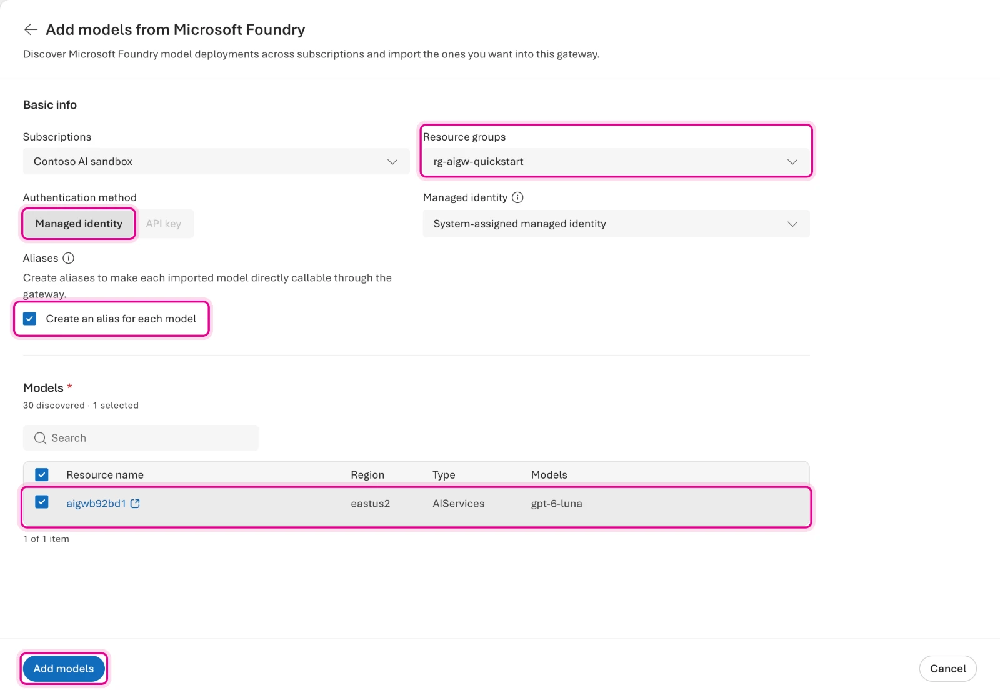

4. **Models** opens. The **Backend models** tab lists `gpt-6-luna`, and the **Aliases** tab shows the alias that
   apps call: `<foundry-account-name>/gpt-6-luna`. Note the alias.

   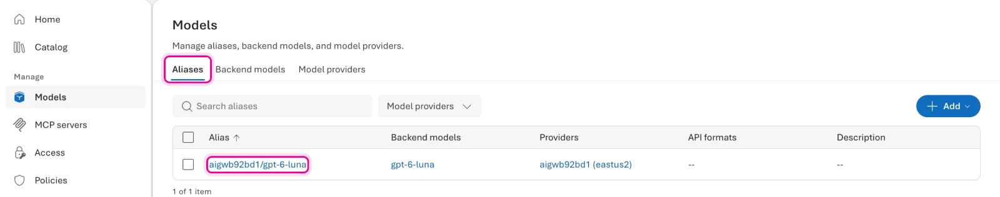

### Create a runtime API key

1. Select **Access**, then the **Keys** tab, then **Create API key**.

   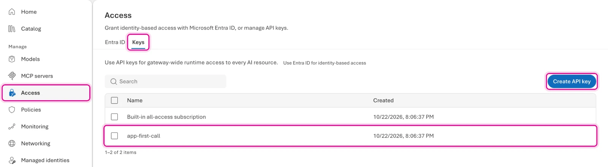

2. Enter `app-first-call` as the **Key name**, then select **Create**.

   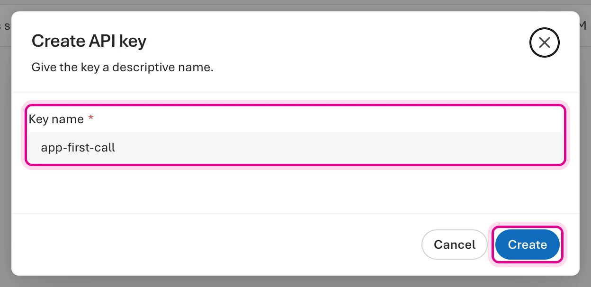

3. In **API key created successfully**, select **Copy & done** to copy the key. Keep it somewhere safe: you paste it
   in the next steps. You can view, rotate, or delete it later in **Access** › **Keys**.

   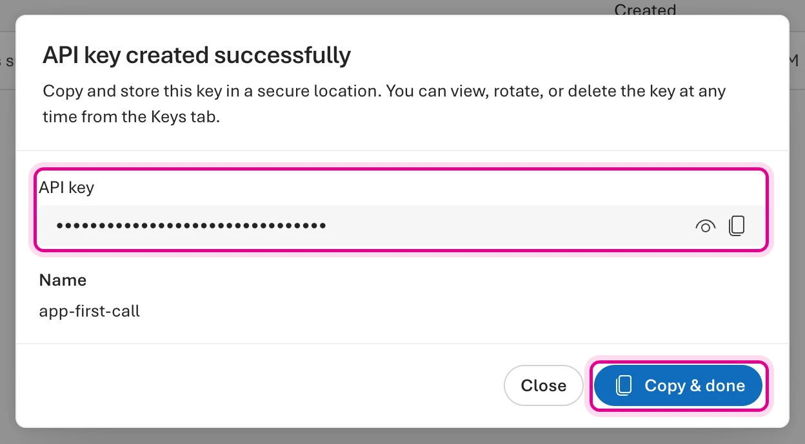

### Make your first call

Call the model through the gateway in the playground, with your new key, the way an app does.

1. Select **Catalog**, then select your model.

   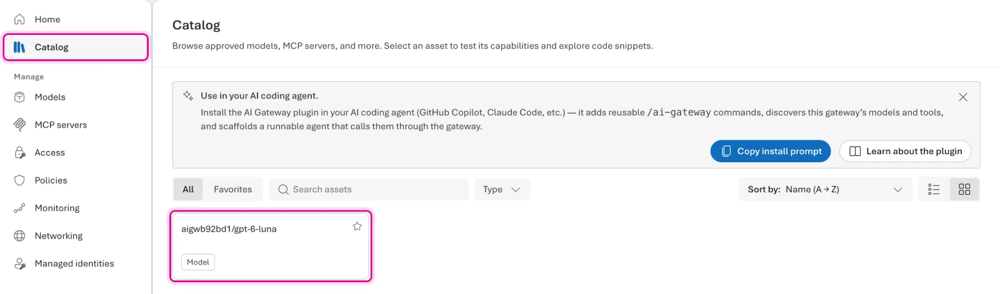

2. Under **Authentication**, choose `app-first-call` as the **API key**, so that the playground calls the gateway
   with your new key. Then send a prompt, for example `In one sentence, what does an AI gateway do?`.

   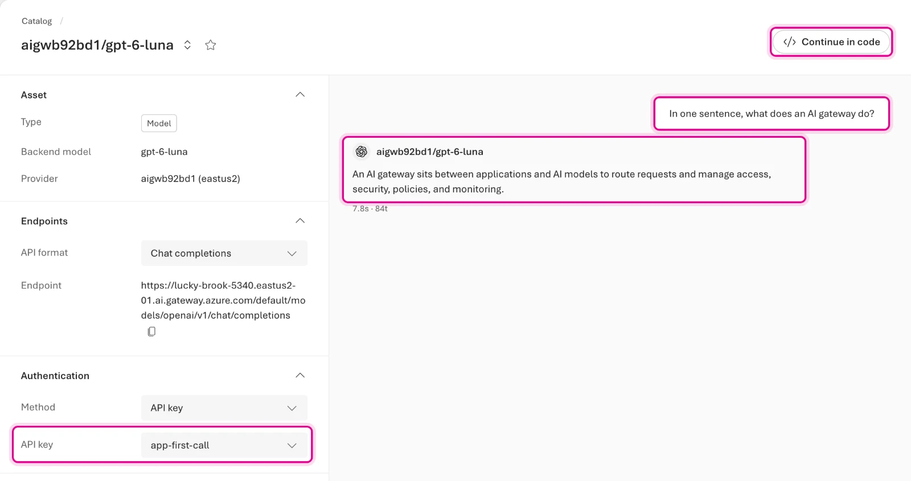

3. Optional: to make the same call from code, select **Continue in code**. It shows the endpoint URL and snippets
   for cURL, the OpenAI SDK, LangChain, Vercel AI, the GitHub Copilot SDK, and Microsoft Agent Framework, plus a
   prompt that installs the AI Gateway plugin in your coding agent.

   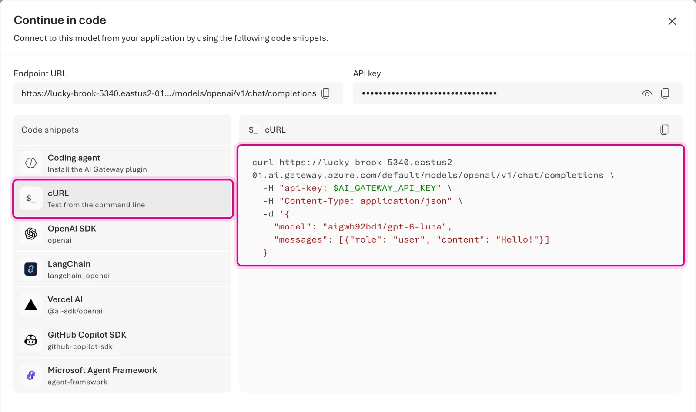

To run the cURL snippet, open [Azure Cloud Shell](https://shell.azure.com) in Bash, paste your key at this prompt so
that it never shows on screen, and then paste the snippet:

```bash title="Bash"
# Read the key without showing it, and export it for the snippet
read -rsp "AI Gateway API key: " AI_GATEWAY_API_KEY && export AI_GATEWAY_API_KEY && echo
echo "🔑 Key: in AI_GATEWAY_API_KEY (${#AI_GATEWAY_API_KEY} characters, not shown)"
```

> **Checkpoint:** the playground answered with the key `app-first-call`. Your gateway is live, and your app never
> needs a Foundry key: only the gateway's managed identity calls Foundry.

### Clean up

To keep exploring, skip this step: [lab 03](../03-multi-provider-aliases/README.md) and the labs after it work on this
gateway. On the labs site, save the resource group and the gateway name in **Your values**. Otherwise, delete the
gateway.

1. Open the gateway switcher in the top bar and select **View all gateways**.

2. On your gateway's row, select **More actions** (**⋮**), and then select **Delete**.

   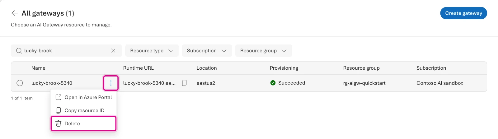

3. To confirm, select **Delete** in the dialog. The row shows **Deleting** until Azure removes the gateway, in about
   five minutes.

   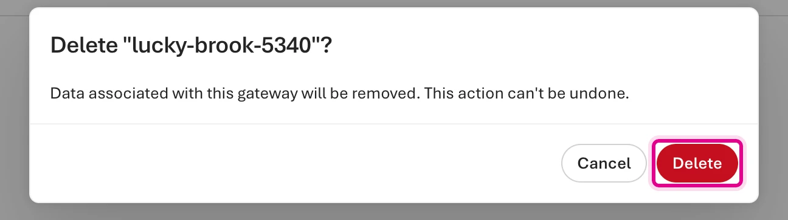

Deleting the gateway keeps its resource group and your Foundry account. If you created them in Cloud Shell for this
quick start, delete the resource group and purge the Foundry account there too: deleted Foundry accounts stay
soft-deleted for 48 hours and keep counting against your quota until you purge them.

```bash title="Bash"
# Find the Foundry account in the resource group, so that you can purge it after the delete
FOUNDRY="$(az cognitiveservices account list --resource-group rg-aigw-quickstart --query "[0].name" --output tsv)"
echo "🏭 Foundry account: $FOUNDRY"

# Delete the resource group, with everything in it
az group delete --name rg-aigw-quickstart --yes &&
  echo "🧹 Resource group rg-aigw-quickstart is deleted"

# Purge the deleted Foundry account, so that it stops counting against your quota
az cognitiveservices account purge --name "$FOUNDRY" --resource-group rg-aigw-quickstart --location eastus2 &&
  echo "🧹 Foundry account $FOUNDRY is purged"
```

> **Checkpoint:** after you refresh the page, **All gateways** no longer lists your gateway.

<!-- track: cli | Azure CLI -->

**What you need:** [Azure Cloud Shell](https://shell.azure.com), in Bash or PowerShell. It's already signed in and has
the Azure CLI, `curl`, and `jq`. A local Azure CLI 2.75 or later, signed in with `az login`, works too. The track
installs the `aigateway` CLI extension and creates the Foundry deployment for you.

### Set your variables

Paste the block for your shell. It installs or upgrades the `aigateway` extension, then sets the names. A random
suffix keeps the gateway and Foundry account names globally unique.

```bash title="Bash"
# Install or upgrade the aigateway extension of the Azure CLI
curl -fsSL https://aka.ms/aigateway-cli-install | sh &&
  echo "🧩 aigateway extension $(az extension show --name aigateway --query version --output tsv) is installed"

# Name the resources: the random suffix keeps the gateway and Foundry account names globally unique
export RG="rg-aigw-quickstart"
export LOCATION="eastus2"                     # or another region from Find the available regions
SUFFIX="$(openssl rand -hex 3)"
export GATEWAY="aigw-$SUFFIX"                 # part of the runtime URL
export FOUNDRY="aigw$SUFFIX"                  # the Foundry account and its subdomain
export DEPLOYMENT="gpt-6-luna"
export PROVIDER="foundry-models"

# Read your subscription ID, and build the gateway's resource ID that later commands use
export SUBSCRIPTION_ID="$(az account show --query id --output tsv)"
export GATEWAY_ID="/subscriptions/$SUBSCRIPTION_ID/resourceGroups/$RG/providers/Microsoft.ApiManagement/aigateways/$GATEWAY"
echo "📝 Gateway $GATEWAY and Foundry account $FOUNDRY, in $RG ($LOCATION)"
echo "🆔 Subscription: $SUBSCRIPTION_ID"
```

```powershell title="PowerShell"
# Install or upgrade the aigateway extension of the Azure CLI
irm https://aka.ms/aigateway-cli-install-ps | iex
if ($?) { Write-Host "🧩 aigateway extension $(az extension show --name aigateway --query version --output tsv) is installed" }

# Name the resources: the random suffix keeps the gateway and Foundry account names globally unique
$RG         = "rg-aigw-quickstart"
$LOCATION   = "eastus2"                       # or another region from Find the available regions
$SUFFIX     = [guid]::NewGuid().ToString("N").Substring(0, 6)
$GATEWAY    = "aigw-$SUFFIX"                  # part of the runtime URL
$FOUNDRY    = "aigw$SUFFIX"                   # the Foundry account and its subdomain
$DEPLOYMENT = "gpt-6-luna"
$PROVIDER   = "foundry-models"

# Read your subscription ID, and build the gateway's resource ID that later commands use
$SUBSCRIPTION_ID = az account show --query id --output tsv
$GATEWAY_ID      = "/subscriptions/$SUBSCRIPTION_ID/resourceGroups/$RG/providers/Microsoft.ApiManagement/aigateways/$GATEWAY"
Write-Host "📝 Gateway $GATEWAY and Foundry account $FOUNDRY, in $RG ($LOCATION)"
Write-Host "🆔 Subscription: $SUBSCRIPTION_ID"
```

### Start creating the gateway

Register the resource providers, which is a one-time step for each subscription, create a resource group, and start
creating the gateway. With `--no-wait`, Azure keeps provisioning the gateway in the background, so you can move on
right away. The portal and the Bicep template also create a companion connector gateway for connector-based MCP
tools. The quick start doesn't use connectors, so this track skips it.

```bash title="Bash"
# Register the resource providers for AI Gateway and Foundry (once per subscription)
for ns in Microsoft.ApiManagement Microsoft.CognitiveServices; do az provider register --namespace "$ns" --wait && echo "🧩 $ns is registered"; done

# Create the resource group that holds the gateway and the Foundry account
az group create --name "$RG" --location "$LOCATION" --output none &&
  echo "📦 Resource group $RG is ready in $LOCATION"

# Start creating the gateway, with a system-assigned managed identity; --no-wait returns right away
az aigateway create --resource-group "$RG" --name "$GATEWAY" --location "$LOCATION" --system-assigned true --no-wait &&
  echo "⏳ Gateway $GATEWAY is provisioning in the background"
```

```powershell title="PowerShell"
# Register the resource providers for AI Gateway and Foundry (once per subscription)
foreach ($ns in "Microsoft.ApiManagement", "Microsoft.CognitiveServices") { az provider register --namespace $ns --wait; if ($?) { Write-Host "🧩 $ns is registered" } }

# Create the resource group that holds the gateway and the Foundry account
az group create --name $RG --location $LOCATION --output none
if ($?) { Write-Host "📦 Resource group $RG is ready in $LOCATION" }

# Start creating the gateway, with a system-assigned managed identity; --no-wait returns right away
az aigateway create --resource-group $RG --name $GATEWAY --location $LOCATION --system-assigned true --no-wait
if ($?) { Write-Host "⏳ Gateway $GATEWAY is provisioning in the background" }
```

### Deploy the model in Foundry

While the gateway provisions, create a Foundry account with a `gpt-6-luna` deployment. Then give the gateway's
managed identity the **Foundry User** role on the account. The gateway calls the model with this identity, so your
apps never hold a Foundry key.

```bash title="Bash"
# Create the Foundry account, with a custom subdomain so that the gateway can sign in with Microsoft Entra ID
az cognitiveservices account create --resource-group "$RG" --name "$FOUNDRY" --location "$LOCATION" \
  --kind AIServices --sku S0 --custom-domain "$FOUNDRY" --yes --output none &&
  echo "🏭 Foundry account $FOUNDRY is ready"

# Deploy gpt-6-luna with 10,000 tokens per minute of Global Standard capacity
az cognitiveservices account deployment create --resource-group "$RG" --name "$FOUNDRY" \
  --deployment-name "$DEPLOYMENT" --model-name gpt-6-luna --model-version 2026-09-22 --model-format OpenAI \
  --sku-name GlobalStandard --sku-capacity 10 --output none &&
  echo "🧠 Model deployment $DEPLOYMENT is ready"

# Read the Foundry account's resource ID and the principal ID of the gateway's managed identity
export FOUNDRY_ID="$(az cognitiveservices account show --resource-group "$RG" --name "$FOUNDRY" --query id --output tsv)"
PRINCIPAL_ID="$(az aigateway show --resource-group "$RG" --name "$GATEWAY" --query identity.principalId --output tsv)"
echo "🪪 Gateway identity: $PRINCIPAL_ID"

# Give the gateway's identity the Foundry User role on the account, so that it can call the model
az role assignment create --assignee-object-id "$PRINCIPAL_ID" --assignee-principal-type ServicePrincipal \
  --role "53ca6127-db72-4b80-b1b0-d745d6d5456d" --scope "$FOUNDRY_ID" --output none &&
  echo "🛡️ The gateway's identity has the Foundry User role on $FOUNDRY"
```

```powershell title="PowerShell"
# Create the Foundry account, with a custom subdomain so that the gateway can sign in with Microsoft Entra ID
az cognitiveservices account create --resource-group $RG --name $FOUNDRY --location $LOCATION `
  --kind AIServices --sku S0 --custom-domain $FOUNDRY --yes --output none
if ($?) { Write-Host "🏭 Foundry account $FOUNDRY is ready" }

# Deploy gpt-6-luna with 10,000 tokens per minute of Global Standard capacity
az cognitiveservices account deployment create --resource-group $RG --name $FOUNDRY `
  --deployment-name $DEPLOYMENT --model-name gpt-6-luna --model-version 2026-09-22 --model-format OpenAI `
  --sku-name GlobalStandard --sku-capacity 10 --output none
if ($?) { Write-Host "🧠 Model deployment $DEPLOYMENT is ready" }

# Read the Foundry account's resource ID and the principal ID of the gateway's managed identity
$FOUNDRY_ID   = az cognitiveservices account show --resource-group $RG --name $FOUNDRY --query id --output tsv
$PRINCIPAL_ID = az aigateway show --resource-group $RG --name $GATEWAY --query identity.principalId --output tsv
Write-Host "🪪 Gateway identity: $PRINCIPAL_ID"

# Give the gateway's identity the Foundry User role on the account, so that it can call the model
az role assignment create --assignee-object-id $PRINCIPAL_ID --assignee-principal-type ServicePrincipal `
  --role "53ca6127-db72-4b80-b1b0-d745d6d5456d" --scope $FOUNDRY_ID --output none
if ($?) { Write-Host "🛡️ The gateway's identity has the Foundry User role on $FOUNDRY" }
```

### Publish the model

Wait for the gateway, then publish the deployment in three steps: a provider that points at the Foundry account and
signs in with the managed identity, a model for the deployment, and an alias that apps send in the `model` field.

```bash title="Bash"
# Wait until the gateway finishes provisioning
az aigateway wait --resource-group "$RG" --name "$GATEWAY" --created &&
  echo "🚀 Gateway $GATEWAY is ready"

# Add a model provider that points at the Foundry account and signs in with the gateway's managed identity
az aigateway model-provider create --resource-group "$RG" --gateway-name "$GATEWAY" --name "$PROVIDER" --output none \
  --kind Foundry --display-name "Foundry models" \
  --foundry "$(jq -cn --arg e "https://$FOUNDRY.cognitiveservices.azure.com/" --arg id "$FOUNDRY_ID" '{endpoint: $e,
      resourceIds: [$id], authentication: {kind: "ManagedIdentity", managedIdentity: {resource: "https://cognitiveservices.azure.com/"}}}')" &&
  echo "🔌 Model provider $PROVIDER points at $FOUNDRY"

# Add a model for the deployment, with the endpoints that apps can call
az aigateway model create --resource-group "$RG" --gateway-name "$GATEWAY" --provider-name "$PROVIDER" --name "$DEPLOYMENT" \
  --api-format OpenAIChatCompletions --supported-endpoints /openai/v1/chat/completions /openai/v1/responses \
  --deployment-config "{resourceId:$FOUNDRY_ID/deployments/$DEPLOYMENT,modelName:$DEPLOYMENT}" --output none &&
  echo "🧠 Model $DEPLOYMENT is published through $PROVIDER"

# Add the alias that apps send in the model field
ALIAS="$(az aigateway model-alias create --resource-group "$RG" --gateway-name "$GATEWAY" --name "$DEPLOYMENT" --only-show-errors \
  --backend-model resource-id="$GATEWAY_ID/workspaces/default/modelProviders/$PROVIDER/models/$DEPLOYMENT" \
  --query properties.aliasName --output tsv)" &&
  echo "🏷️ Alias $ALIAS is ready"
```

```powershell title="PowerShell"
# Wait until the gateway finishes provisioning
az aigateway wait --resource-group $RG --name $GATEWAY --created
if ($?) { Write-Host "🚀 Gateway $GATEWAY is ready" }

# Add a model provider that points at the Foundry account and signs in with the gateway's managed identity
@{ endpoint       = "https://$FOUNDRY.cognitiveservices.azure.com/"
   resourceIds    = @($FOUNDRY_ID)
   authentication = @{ kind = "ManagedIdentity"; managedIdentity = @{ resource = "https://cognitiveservices.azure.com/" } } } |
  ConvertTo-Json -Depth 10 -Compress | Set-Content foundry.json
az aigateway model-provider create --resource-group $RG --gateway-name $GATEWAY --name $PROVIDER --output none `
  --kind Foundry --display-name "Foundry models" --foundry "@foundry.json"
if ($?) { Write-Host "🔌 Model provider $PROVIDER points at $FOUNDRY" }

# Add a model for the deployment, with the endpoints that apps can call
az aigateway model create --resource-group $RG --gateway-name $GATEWAY --provider-name $PROVIDER --name $DEPLOYMENT `
  --api-format OpenAIChatCompletions --supported-endpoints /openai/v1/chat/completions /openai/v1/responses `
  --deployment-config "{resourceId:$FOUNDRY_ID/deployments/$DEPLOYMENT,modelName:$DEPLOYMENT}" --output none
if ($?) { Write-Host "🧠 Model $DEPLOYMENT is published through $PROVIDER" }

# Add the alias that apps send in the model field
$ALIAS = az aigateway model-alias create --resource-group $RG --gateway-name $GATEWAY --name $DEPLOYMENT --only-show-errors `
  --backend-model resource-id="$GATEWAY_ID/workspaces/default/modelProviders/$PROVIDER/models/$DEPLOYMENT" `
  --query properties.aliasName --output tsv
if ($?) { Write-Host "🏷️ Alias $ALIAS is ready" }
Remove-Item foundry.json
```

### Create a runtime API key

Create a key for your app. Then read the key, the gateway URL, and the alias into environment variables, so that
the key never shows on screen.

```bash title="Bash"
# Create a runtime API key for your app
az aigateway api-key create --resource-group "$RG" --gateway-name "$GATEWAY" --name app-first-call \
  --display-name app-first-call --output none &&
  echo "🔑 API key app-first-call is ready"

# Read the key, the gateway's runtime URL, and the alias into environment variables
export AI_GATEWAY_API_KEY="$(az aigateway api-key list-secrets --resource-group "$RG" --gateway-name "$GATEWAY" \
  --name app-first-call --query primaryKey --output tsv)"
export AI_GATEWAY_URL="https://$(az aigateway show --resource-group "$RG" --name "$GATEWAY" --query properties.frontend.defaultHostname --output tsv)"
export AI_GATEWAY_MODEL="$DEPLOYMENT"
echo "🔑 Key: in AI_GATEWAY_API_KEY (${#AI_GATEWAY_API_KEY} characters, not shown)"
echo "🌐 Runtime URL: $AI_GATEWAY_URL"
echo "🏷️ Model alias: $AI_GATEWAY_MODEL"
```

```powershell title="PowerShell"
# Create a runtime API key for your app
az aigateway api-key create --resource-group $RG --gateway-name $GATEWAY --name app-first-call `
  --display-name app-first-call --output none
if ($?) { Write-Host "🔑 API key app-first-call is ready" }

# Read the key, the gateway's runtime URL, and the alias into environment variables
$env:AI_GATEWAY_API_KEY = az aigateway api-key list-secrets --resource-group $RG --gateway-name $GATEWAY `
  --name app-first-call --query primaryKey --output tsv
$env:AI_GATEWAY_URL     = "https://" + (az aigateway show --resource-group $RG --name $GATEWAY --query properties.frontend.defaultHostname --output tsv)
$env:AI_GATEWAY_MODEL   = $DEPLOYMENT
Write-Host "🔑 Key: in AI_GATEWAY_API_KEY ($($env:AI_GATEWAY_API_KEY.Length) characters, not shown)"
Write-Host "🌐 Runtime URL: $env:AI_GATEWAY_URL"
Write-Host "🏷️ Model alias: $env:AI_GATEWAY_MODEL"
```

> **Checkpoint:** the commands printed `🏷️ Alias gpt-6-luna is ready` and your gateway's runtime URL, for example
> `🌐 Runtime URL: https://aigw-abc123.eastus2-01.ai.gateway.azure.com`.

### Make your first call

Send a Chat Completions request to the gateway's OpenAI-compatible base URL, the way an app does: the alias in the
`model` field and the key in the `api-key` header.

```bash title="Bash"
# Call the model through the gateway, the way an app does: the alias in model, and the key in the api-key header
curl -sS "$AI_GATEWAY_URL/default/models/openai/v1/chat/completions" \
  -H "api-key: $AI_GATEWAY_API_KEY" -H "Content-Type: application/json" \
  -d "{\"model\":\"$AI_GATEWAY_MODEL\",\"messages\":[{\"role\":\"user\",\"content\":\"In one sentence, what does an AI gateway do?\"}]}" \
  | jq -r 'if .choices then "🤖 \(.choices[0].message.content)" else "⚠️ \(.error.message // .)" end'
```

```powershell title="PowerShell"
# Build the request: the alias in model, and one user message
$body = @{
  model    = $env:AI_GATEWAY_MODEL
  messages = @(@{ role = "user"; content = "In one sentence, what does an AI gateway do?" })
} | ConvertTo-Json -Depth 5

# Call the model through the gateway, the way an app does: with the key in the api-key header
$reply = Invoke-RestMethod -Method Post -Uri "$env:AI_GATEWAY_URL/default/models/openai/v1/chat/completions" `
  -Headers @{ "api-key" = $env:AI_GATEWAY_API_KEY } -ContentType "application/json" -Body $body
if ($?) { Write-Host "🤖 $($reply.choices[0].message.content)" }
```

> **Checkpoint:** the model answers in one sentence. Your gateway is live, and your app never needed a Foundry key:
> only the gateway's managed identity calls Foundry. If you get `403` or `404` in the first minute, the gateway's new
> role on the Foundry account is still taking effect. Wait a minute and run the call again.

To see what you created, open the [AI Gateway portal](https://ai.gateway.azure.com) and select your gateway in the top
bar: **Models**, **Access** › **Keys**, and the **Catalog** playground.

### Clean up

To keep exploring, skip this step: [lab 03](../03-multi-provider-aliases/README.md) and the labs after it work on this
gateway. On the labs site, save the resource group and the gateway name (`$RG` and `$GATEWAY`) in **Your values**.
Otherwise, delete the resource group, which holds the gateway and the Foundry account. Then purge the Foundry account:
deleted Foundry accounts stay soft-deleted for 48 hours and keep counting against your quota until you purge them.

```bash title="Bash"
# Delete the resource group, with the gateway and the Foundry account in it
az group delete --name "$RG" --yes &&
  echo "🧹 Resource group $RG is deleted"

# Purge the deleted Foundry account, so that it stops counting against your quota
az cognitiveservices account purge --name "$FOUNDRY" --resource-group "$RG" --location "$LOCATION" &&
  echo "🧹 Foundry account $FOUNDRY is purged"
```

```powershell title="PowerShell"
# Delete the resource group, with the gateway and the Foundry account in it
az group delete --name $RG --yes
if ($?) { Write-Host "🧹 Resource group $RG is deleted" }

# Purge the deleted Foundry account, so that it stops counting against your quota
az cognitiveservices account purge --name $FOUNDRY --resource-group $RG --location $LOCATION
if ($?) { Write-Host "🧹 Foundry account $FOUNDRY is purged" }
```

If Cloud Shell timed out, set `RG`, `FOUNDRY`, and `LOCATION` again with the names that you used: the suffix in
**Set your variables** is random.

> **Checkpoint:** `az group exists --name $RG` prints `false`.

<!-- track: iac | Bicep + azd -->

**What you need:** [Azure Cloud Shell](https://shell.azure.com), in Bash or PowerShell. It's already signed in and has
the Azure Developer CLI (`azd`), the Azure CLI, Git, `curl`, and `jq`. Locally,
[install azd](https://aka.ms/azd-install), the Azure CLI, and Git, and sign in with `azd auth login` and `az login`.
The template creates the Foundry deployment for you.

### Clone the template

The template is a small azd project in the
[`labs/quickstart`](https://github.com/Azure/ai-gateway/tree/main/labs/quickstart) folder of the GitHub repo: an
`azure.yaml` and a Bicep file for each scope. Clone the repo, then move into that folder. The clone also gets the
other labs, which you can use next.

```bash title="Bash"
# Clone the labs repo, which has the quick start's azd template and the other labs
git clone https://github.com/Azure/ai-gateway.git &&
  echo "📂 The labs are in $(pwd)/ai-gateway"

# Move into the quick start's template
cd ai-gateway/labs/quickstart &&
  echo "📂 Template folder: $(pwd)"
```

```powershell title="PowerShell"
# Clone the labs repo, which has the quick start's azd template and the other labs
git clone https://github.com/Azure/ai-gateway.git
if ($?) { Write-Host "📂 The labs are in $(Join-Path (Get-Location) ai-gateway)" }

# Move into the quick start's template
Set-Location ai-gateway/labs/quickstart
if ($?) { Write-Host "📂 Template folder: $(Get-Location)" }
```

`infra/main.bicep` creates the resource group `rg-<environment name>` and passes unique names to
`infra/resources.bicep`, which creates the building blocks in the same order as the other tracks:

<!-- include: infra/resources.bicep -->

### Deploy with azd up

Create an azd environment named `aigw-quickstart` in your current subscription, so that azd doesn't prompt you. Then
provision everything with one command. It takes about three minutes.

```bash title="Bash"
# Create an azd environment in your current subscription, so that azd doesn't prompt you
azd env new aigw-quickstart --location eastus2 --subscription "$(az account show --query id --output tsv)" &&
  echo "📝 azd environment aigw-quickstart deploys to eastus2"

# Provision the gateway, the Foundry deployment, the provider, the model, the alias, and the key
azd up &&
  echo "🚀 Gateway deployed: $(azd env get-value AI_GATEWAY_URL)"
```

```powershell title="PowerShell"
# Create an azd environment in your current subscription, so that azd doesn't prompt you
azd env new aigw-quickstart --location eastus2 --subscription (az account show --query id --output tsv)
if ($?) { Write-Host "📝 azd environment aigw-quickstart deploys to eastus2" }

# Provision the gateway, the Foundry deployment, the provider, the model, the alias, and the key
azd up
if ($?) { Write-Host "🚀 Gateway deployed: $(azd env get-value AI_GATEWAY_URL)" }
```

For another region, use its name from [Find the available regions](../SETUP.md#find-the-available-regions).
azd saves the template's outputs, like the gateway URL and the alias, as environment values. The API key isn't an
output, so it never lands in a file or a deployment log.

### Read the URL, the alias, and the key

Read the outputs, and read the key from the gateway into an environment variable, so that it never shows on screen.

```bash title="Bash"
# Read the template's outputs: the gateway's runtime URL and the alias
export AI_GATEWAY_URL="$(azd env get-value AI_GATEWAY_URL)"
export AI_GATEWAY_MODEL="$(azd env get-value AI_GATEWAY_MODEL)"

# Read the key from the gateway, so that it never lands in a file or a deployment log
export AI_GATEWAY_API_KEY="$(az aigateway api-key list-secrets --ids "$(azd env get-value AI_GATEWAY_ID)/apiKeys/app-first-call" \
  --query primaryKey --output tsv)"
echo "🌐 Runtime URL: $AI_GATEWAY_URL"
echo "🏷️ Model alias: $AI_GATEWAY_MODEL"
echo "🔑 Key: in AI_GATEWAY_API_KEY (${#AI_GATEWAY_API_KEY} characters, not shown)"
```

```powershell title="PowerShell"
# Read the template's outputs: the gateway's runtime URL, the alias, and the gateway's resource ID
$env:AI_GATEWAY_URL     = azd env get-value AI_GATEWAY_URL
$env:AI_GATEWAY_MODEL   = azd env get-value AI_GATEWAY_MODEL
$GATEWAY_ID             = azd env get-value AI_GATEWAY_ID

# Read the key from the gateway, so that it never lands in a file or a deployment log
$env:AI_GATEWAY_API_KEY = az aigateway api-key list-secrets --ids "$GATEWAY_ID/apiKeys/app-first-call" `
  --query primaryKey --output tsv
Write-Host "🌐 Runtime URL: $env:AI_GATEWAY_URL"
Write-Host "🏷️ Model alias: $env:AI_GATEWAY_MODEL"
Write-Host "🔑 Key: in AI_GATEWAY_API_KEY ($($env:AI_GATEWAY_API_KEY.Length) characters, not shown)"
```

> **Checkpoint:** `azd up` ended with `SUCCESS`, and the last commands printed your gateway's runtime URL, for example
> `🌐 Runtime URL: https://aigw-abc123.eastus2-01.ai.gateway.azure.com`.

### Make your first call

Send a Chat Completions request to the gateway's OpenAI-compatible base URL, the way an app does: the alias in the
`model` field and the key in the `api-key` header.

```bash title="Bash"
# Call the model through the gateway, the way an app does: the alias in model, and the key in the api-key header
curl -sS "$AI_GATEWAY_URL/default/models/openai/v1/chat/completions" \
  -H "api-key: $AI_GATEWAY_API_KEY" -H "Content-Type: application/json" \
  -d "{\"model\":\"$AI_GATEWAY_MODEL\",\"messages\":[{\"role\":\"user\",\"content\":\"In one sentence, what does an AI gateway do?\"}]}" \
  | jq -r 'if .choices then "🤖 \(.choices[0].message.content)" else "⚠️ \(.error.message // .)" end'
```

```powershell title="PowerShell"
# Build the request: the alias in model, and one user message
$body = @{
  model    = $env:AI_GATEWAY_MODEL
  messages = @(@{ role = "user"; content = "In one sentence, what does an AI gateway do?" })
} | ConvertTo-Json -Depth 5

# Call the model through the gateway, the way an app does: with the key in the api-key header
$reply = Invoke-RestMethod -Method Post -Uri "$env:AI_GATEWAY_URL/default/models/openai/v1/chat/completions" `
  -Headers @{ "api-key" = $env:AI_GATEWAY_API_KEY } -ContentType "application/json" -Body $body
if ($?) { Write-Host "🤖 $($reply.choices[0].message.content)" }
```

> **Checkpoint:** the model answers in one sentence. Your gateway is live, and your app never needed a Foundry key:
> only the gateway's managed identity calls Foundry. If you get `403` or `404` in the first minute, the gateway's new
> role on the Foundry account is still taking effect. Wait a minute and run the call again.

To see what you created, open the [AI Gateway portal](https://ai.gateway.azure.com) and select your gateway in the top
bar: **Models**, **Access** › **Keys**, and the **Catalog** playground.

### Clean up

To keep exploring, skip this step: [lab 03](../03-multi-provider-aliases/README.md) and the labs after it work on this
gateway. Otherwise, in the `ai-gateway/labs/quickstart` folder, delete everything that `azd up` created. `--purge` also purges
the Foundry account, which would otherwise stay soft-deleted for 48 hours and keep counting against your quota. It
takes about ten minutes.

```bash title="Bash"
# Delete everything that azd up created, and purge the Foundry account
azd down --purge --force &&
  echo "🧹 Everything that azd up created is deleted"
```

```powershell title="PowerShell"
# Delete everything that azd up created, and purge the Foundry account
azd down --purge --force
if ($?) { Write-Host "🧹 Everything that azd up created is deleted" }
```

> **Checkpoint:** `azd down` ended with `SUCCESS`. The resource group `rg-aigw-quickstart` is gone, and you can delete
> the `ai-gateway` folder.

<!-- /tracks -->

## Troubleshooting

For the errors you might hit in the quick start, with their likely causes and fixes, see
[Troubleshooting](../TROUBLESHOOTING.md#quick-start).

## Next steps

- [How Azure AI Gateway works](../00-how-ai-gateway-works/README.md): a 3-minute video and a guided tour of every building block.
- [Provision your AI Gateway](../01-provision-gateway/README.md) and [Publish a Foundry model and make your first call](../02-first-model-call/README.md): the same setup in depth, with Bicep, the Responses API, and more SDKs.
- [Publish models from any provider behind stable aliases](../03-multi-provider-aliases/README.md): put models from several providers behind names your apps keep.
- [Throttle tokens per caller with token limits](../06-token-limits/README.md): give every app its own allowance.
