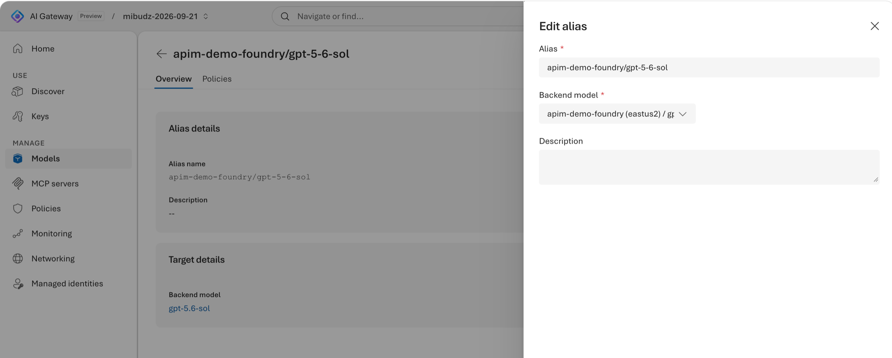

<!--
title: How Azure AI Gateway works
summary: A 20-minute visual tour of the AI Gateway tier of Azure API Management. Follow one request through the gateway, meet models, aliases, MCP servers, policies, and identities, and pick the learning path that fits your role.
category: foundations
level: Beginner
duration: 20
tracks: [portal]
order: 0
illustration: diagrams/architecture.svg
tags: [concepts, architecture, overview, aliases, MCP, policies, OpenTelemetry]
objectives:
  - Describe what the AI Gateway tier does and where it sits between your apps, agents, models, and tools
  - Follow a request through authentication, policies, alias routing, the backend, and telemetry
  - Explain the difference between a backend model, an alias, and an MCP server
  - Predict which policies apply to a request and which status code a blocked request returns
  - Choose the learning path that matches your role
-->
<!-- gh:begin nav: generated by "npm run sync" from the metadata, do not edit -->
[AI Gateway labs](../README.md) › [Foundations](../README.md#foundations) › Lab 00
<!-- gh:end -->

# How Azure AI Gateway works

<!-- gh:begin intro: generated by "npm run sync" from the metadata, do not edit -->
> A 20-minute visual tour of the AI Gateway tier of Azure API Management. Follow one request through the gateway, meet models, aliases, MCP servers, policies, and identities, and pick the learning path that fits your role.

| ⏱️ Time | 📶 Level | 🧭 Tracks | ✅ Before you start |
| :-- | :-- | :-- | :-- |
| 20 min | Beginner | Portal | Nothing, start here |

**You'll learn to**

- Describe what the AI Gateway tier does and where it sits between your apps, agents, models, and tools
- Follow a request through authentication, policies, alias routing, the backend, and telemetry
- Explain the difference between a backend model, an alias, and an MCP server
- Predict which policies apply to a request and which status code a blocked request returns
- Choose the learning path that matches your role

**Follow along:** 🌐 [Interactive version](https://azure.github.io/ai-gateway/labs/00-how-ai-gateway-works/) with your own values filled in

**On this page:** [Before you begin](#before-you-begin) · [How it works](#how-it-works) · [Follow one request](#follow-one-request) · [Models and aliases](#models-and-aliases) · [MCP servers and tools](#mcp-servers-and-tools) · [Policies and scopes](#policies-and-scopes) · [Identities on both sides](#identities-on-both-sides) · [Observability](#observability) · [Take a portal tour](#take-a-portal-tour) · [Verify](#verify) · [Clean up](#clean-up) · [Troubleshooting](#troubleshooting) · [Next steps](#next-steps)
<!-- gh:end -->

Every team that ships generative AI hits the same questions. Which models may we call, and with which keys?
Who spent the tokens? How do we stop one agent from starving everyone else, or from calling a tool it should
never touch? The **AI Gateway tier** of Azure API Management answers them in one place: apps and agents call one
gateway, and the gateway decides who gets in, which model or tool answers, what each call may cost, and what gets
recorded.

> [!NOTE]
> The AI Gateway tier is in public preview in **East US 2** and **Sweden Central**. The gateway itself is free
> during the preview. Connected services, such as Microsoft Foundry inference and Application Insights, are billed
> normally.

## Before you begin

This lab is a guided reading. You don't need to deploy anything.

- If you already have a gateway, open the [AI Gateway portal](https://ai.gateway.azure.com) in another tab and
  follow the portal tour at the end.
- If you don't have one yet, read on. You create your first gateway in
  [Provision your first AI gateway](../01-provision-gateway/README.md).

## How it works

The gateway sits on the path of every model call and every tool call. It has two faces:

- **Data plane**: the runtime endpoints your code calls, at `https://<gateway>.eastus2-01.ai.gateway.azure.com`.
- **Control plane**: the product portal at [ai.gateway.azure.com](https://ai.gateway.azure.com) and the Azure
  Resource Manager API for the `Microsoft.ApiManagement/aigateways` resource type, which you call with
  `az rest`, Bicep, or any REST client.

| Building block | What it is | Example |
|---|---|---|
| **Gateway** | An AI Gateway resource (`Microsoft.ApiManagement/aigateways`) in your subscription | `https://<gateway>.eastus2-01.ai.gateway.azure.com` |
| **Backend model** | A model at a provider, such as a Foundry deployment or an Anthropic model | `gpt-4.1-mini` at Microsoft Foundry |
| **Alias** | The stable, gateway-wide name clients send in the `model` field | `chat` |
| **MCP server** | One governed MCP endpoint that federates tools from one or more sources | `/default/toolservers/<server-name>/mcp` |
| **Policy** | A rule on the gateway or on one asset: limits, budgets, safety, filters | Token rate limit, Cost limit |
| **Access** | How callers authenticate: API keys or Microsoft Entra ID roles | `api-key` header or Entra token |
| **Managed identity** | How the gateway authenticates to backends | Foundry User role on the Foundry account |
| **Monitoring** | OpenTelemetry metrics, logs, and traces for every call | Application Insights or any OTLP endpoint |

Model calls use protocols developers already know. The OpenAI-compatible base URL is
`https://<gateway-host>/default/models/openai/v1` (append `/responses` or `/chat/completions`), and
Anthropic Messages lives at `/default/models/anthropic/v1/messages`. The gateway passes requests through without
translating between OpenAI and Anthropic formats, so call each model on an interface it advertises.

## Follow one request

Press **Play** to send a request through the gateway. Then switch scenarios to see where each policy stops a
request and which status code the caller gets back.

<!-- widget: request-lifecycle -->
<!-- gh:begin widget: generated by "npm run sync" from the metadata, do not edit -->
> 🎛️ **Interactive:** try the request lifecycle explorer in the [web version of this lab](https://azure.github.io/ai-gateway/labs/00-how-ai-gateway-works/).
<!-- gh:end -->

Three rules explain almost every response you'll see in these labs:

1. **Policies run before the backend.** If any applicable policy blocks a request, the gateway answers right away
   and never calls the backend.
2. **Each block has a predictable status.** `401` for missing or invalid credentials, `403` for IP filters and
   cost limits (`LlmCostQuotaExceeded`), `429` with `Retry-After` for token and request rate limits, and `400` for
   content safety.
3. **Everything is recorded.** Allowed and blocked calls both show up in **Monitoring**, along with the policies
   that affected them.

## Models and aliases

A **backend model** is what a provider serves. An **alias** is what your clients call. Microsoft Foundry imports
create an alias for each model by default, and you can add more. Because clients only know the alias, you can move
it to a newer or cheaper model without a code change, and the alias keeps its own policies.

<!-- widget: alias-retarget -->
<!-- gh:begin widget: generated by "npm run sync" from the metadata, do not edit -->
> 🎛️ **Interactive:** try the alias retargeting demo in the [web version of this lab](https://azure.github.io/ai-gateway/labs/00-how-ai-gateway-works/).
<!-- gh:end -->

You can put models from Microsoft Foundry, Azure OpenAI, OpenAI, Anthropic, AWS Bedrock, Google Vertex AI, and
custom OpenAI-compatible endpoints behind aliases. You try it in
[Route models from several providers behind aliases](../03-multi-provider-aliases/README.md).

## MCP servers and tools

Agents need tools as much as models. An **MCP server** on the gateway gives agents one endpoint and one credential
for tools from remote MCP servers, OpenAPI specifications, built-in connectors, and Foundry Toolbox. Tool names are
namespaced per source, and **tool availability** decides which tools clients can see and call.

## Policies and scopes

You add a policy at **gateway scope**, where it applies to every compatible asset including assets you add later,
or to **individual assets**: a backend model, an alias, or an MCP server. Pick an asset below to see every policy
that applies to it.

<!-- widget: policy-layers -->
<!-- gh:begin widget: generated by "npm run sync" from the metadata, do not edit -->
> 🎛️ **Interactive:** try the policy layers explorer in the [web version of this lab](https://azure.github.io/ai-gateway/labs/00-how-ai-gateway-works/).
<!-- gh:end -->

| Policy | Applies to | When it blocks |
|---|---|---|
| **Token rate limit** | Models and aliases | `429` with `Retry-After` |
| **Request rate limit** | Models, aliases, and MCP servers | `429` with `Retry-After` |
| **Cost limit** | Models and aliases | `403` `LlmCostQuotaExceeded` |
| **Content safety** | Models, aliases, and MCP servers | `400` |
| **IP filter** | Models, aliases, and MCP servers | `403` |
| **Agent 365 tool threat protection** | MCP servers | Denies the tool call |

At gateway scope, the policy type decides which assets are relevant. A gateway-scope cost limit, for example,
tracks one budget across all models.

## Identities on both sides

The gateway separates **who is calling** from **how the gateway reaches the backend**. Callers use an API key or a
Microsoft Entra token with one of the AI Gateway data-plane roles. The gateway uses its own managed identity, or a
provider key it stores, to call backends. Callers never see backend credentials.

## Observability

The gateway emits OpenTelemetry metrics, logs, and traces for model calls, tool calls, and policy decisions. Send
them to Application Insights to light up the built-in **Monitoring** dashboard, or to any OTLP endpoint.

## Take a portal tour

If you have a gateway, walk through the portal now. Otherwise, use the screenshots and come back after
[lab 01](../01-provision-gateway/README.md).

<!-- steps -->

### Open your gateway

Go to [ai.gateway.azure.com](https://ai.gateway.azure.com) and sign in. Use the gateway switcher in the top bar to
pick a gateway. The left rail lists **Home**, **Discover**, **Access**, **Models**, **MCP servers**, **Policies**,
**Monitoring**, **Networking**, and **Managed identities**. Press <kbd>Ctrl</kbd>+<kbd>K</kbd> to open the
command palette from anywhere.

### Browse models and aliases

Select **Models**. Each backend model lists its provider and the aliases that point to it.

### Look at an MCP server

Select **MCP servers** and open a server. The tool availability settings decide which tools clients can see.

### Start a policy

Select **Policies** › **Add policy**. The wizard asks for a **Type**, then a **Scope** (**Gateway** or
**Individual assets**), then the settings. Close the wizard without saving.

### Open Monitoring

Select **Monitoring**. When Application Insights is connected, the **Overview**, **Models**, **Tools**,
**Policies**, and **Traces** tabs show live traffic.

<!-- /steps -->

## Verify

Check your understanding before you move on.

An app sends <code>"model": "chat"</code>. What must <code>chat</code> be?

A callable **alias** on the gateway. The `model` field must exactly match an alias, not a provider deployment name.

A caller exceeds a token rate limit. Is the backend called?

No. The gateway answers `429 Too Many Requests` with `Retry-After` and never forwards the request.

You add an IP filter at gateway scope, then add a new model next week. Is the new model protected?

Yes. Gateway-scope policies apply to every compatible asset, including assets you add later.

Which credential does the gateway use to call a Microsoft Foundry model?

Its own managed identity, which needs the **Foundry User** role on the Foundry account. The caller's key or token
is never forwarded.

> **Checkpoint**
> You can explain the request lifecycle, the difference between a backend model and an alias, and where gateway
> and asset policies apply.

## Clean up

Nothing to clean up. This lab doesn't create resources.

## Troubleshooting

| Symptom | Cause | Fix |
|---|---|---|
| A model call says the model can't be found | The `model` field doesn't match an alias | Copy the alias from **Models**, or from the code sample in **Discover** |
| An Anthropic call fails on the OpenAI endpoint | The gateway doesn't translate between protocols | Call `/default/models/anthropic/v1/messages` with `anthropic-version: 2023-06-01` |
| You can't create a gateway in your region | The preview runs in two regions | Use East US 2 or Sweden Central |
| Monitoring is empty | No telemetry destination | Connect Application Insights in **Monitoring** › **Settings** |

## Next steps

Pick the path that fits your role. Each path is a sequence of labs, and your progress is saved in this browser.

| Path | Start with | You'll learn to |
|---|---|---|
| **30-minute quickstart** | [Provision a gateway](../01-provision-gateway/README.md) | Create a gateway, call a model, and add MCP tools |
| **Platform engineer** | [Provision a gateway](../01-provision-gateway/README.md) | Build a governed, multi-provider gateway with code |
| **App & agent developer** | [First model call](../02-first-model-call/README.md) | Call models and tools from SDKs, agents, and hosted agents |
| **Security & compliance** | [API keys](../10-api-keys/README.md) | Control access, content, tools, and threats |
| **FinOps & operations** | [Token limits](../06-token-limits/README.md) | Cap tokens, set budgets, and charge back usage |

- Docs: [AI Gateway documentation](https://ai.gateway.azure.com/docs)
- Microsoft Learn: [AI gateway in Azure API Management](https://learn.microsoft.com/azure/api-management/ai-gateway-overview)

<!-- gh:begin footer: generated by "npm run sync" from the metadata, do not edit -->

---

| ⬅️ Previous | 🏠 | Next ➡️ |
| :-- | :-: | --: |
|   | [All labs](../README.md) | [01 · Provision a gateway](../01-provision-gateway/README.md) |

Learning paths: [30-minute quickstart](../README.md#learning-paths) (1 of 4)
<!-- gh:end -->
