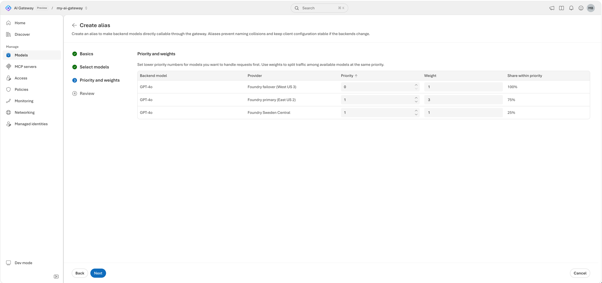

<!--
title: Publish models from any provider behind stable aliases
summary: Connect Anthropic or another non-Azure provider with a credential that stays in the gateway, publish its models behind callable aliases, call Claude with the native Messages API, and retarget an alias to a different backend model without changing a single client.
category: models
level: Intermediate
duration: 30
tracks: [portal, cli, iac]
order: 3
illustration: diagrams/aliases.svg
tags: [model alias, custom provider, Anthropic, OpenAI, AWS Bedrock, Google Vertex AI, Anthropic Messages, retarget]
objectives:
  - Add a custom model provider whose API key stays in the gateway
  - Publish backend models behind gateway-wide callable aliases
  - Call an Anthropic model through the gateway with the native Messages API
  - Give one backend model several aliases, each with its own token limit
  - Retarget an alias to another backend model without changing clients or losing its policies
  - Declare the provider, its models, and the aliases with Bicep and azd, with the provider key as a secure parameter
prereqs:
  - 02-first-model-call
-->
<!-- gh:begin nav: generated by "npm run sync" from the metadata, do not edit -->
[AI Gateway labs](../README.md) › [Models & routing](../README.md#models--routing) › Lab 03
<!-- gh:end -->

# Publish models from any provider behind stable aliases

<!-- gh:begin intro: generated by "npm run sync" from the metadata, do not edit -->
> Connect Anthropic or another non-Azure provider with a credential that stays in the gateway, publish its models behind callable aliases, call Claude with the native Messages API, and retarget an alias to a different backend model without changing a single client.

| ⏱️ Time | 📶 Level | 🧭 Tracks | ✅ Before you start |
| :-- | :-- | :-- | :-- |
| 30 min | Intermediate | Portal · Azure CLI · Bicep + azd | [02 · First model call](../02-first-model-call/README.md) |

**You'll learn to**

- Add a custom model provider whose API key stays in the gateway
- Publish backend models behind gateway-wide callable aliases
- Call an Anthropic model through the gateway with the native Messages API
- Give one backend model several aliases, each with its own token limit
- Retarget an alias to another backend model without changing clients or losing its policies
- Declare the provider, its models, and the aliases with Bicep and azd, with the provider key as a secure parameter

**Follow along:** 🌐 [Interactive version](https://azure.github.io/ai-gateway/labs/03-multi-provider-aliases/) with your own values filled in · 📁 [Lab files](infra/)

**On this page:** [Before you begin](#before-you-begin) · [How it works](#how-it-works) · [Add Anthropic as a custom provider](#add-anthropic-as-a-custom-provider) · [Call Claude through the gateway](#call-claude-through-the-gateway) · [Give one backend model two aliases](#give-one-backend-model-two-aliases) · [Retarget an alias without touching clients](#retarget-an-alias-without-touching-clients) · [Verify](#verify) · [Go further](#go-further) · [Clean up](#clean-up) · [Troubleshooting](#troubleshooting) · [Next steps](#next-steps)
<!-- gh:end -->

The support team wants to try Claude, and the batch team wants the same model for nightly summaries. You don't
want either team to hold an Anthropic key, and you don't want to edit their code every time you switch models.
In this lab you add Anthropic as a provider whose key only the gateway knows, publish two Claude models behind
aliases such as `support-chat`, and then point `support-chat` at a bigger model while the clients keep sending
the same name.


<!-- widget: alias-retarget {"alias":"team-chat","targets":[{"provider":"Microsoft Foundry","model":"gpt-6-luna","note":"Lower cost","logo":"microsoft-foundry"},{"provider":"Microsoft Foundry","model":"gpt-6.1-sol","note":"Higher quality","logo":"microsoft-foundry"},{"provider":"OpenAI","model":"gpt-6-luna","note":"Custom provider","logo":"openai"}]} -->
<!-- gh:begin widget: generated by "npm run sync" from the metadata, do not edit -->
> 🎛️ **Interactive:** try the alias retargeting demo in the [web version of this lab](https://azure.github.io/ai-gateway/labs/03-multi-provider-aliases/).
<!-- gh:end -->

## Before you begin

> [!TIP]
> On the **Bicep + azd** track, `azd up` creates its own gateway, Foundry model, and key, so you can skip this
> section, except for the Anthropic key. You need only that key and
> [Cloud Shell or the azd tools](../SETUP.md#choose-where-to-run-commands).

- Complete [Publish a Foundry model and make your first call](../02-first-model-call/README.md). You need the
  gateway, a runtime API key, and the Foundry alias you created there.
- An API key from the [Claude Console](https://console.anthropic.com) that can call two models, for example
  `claude-haiku-5-5` and `claude-sonnet-5-5`. To use another provider instead, see the values in
  [Add Anthropic as a custom provider](#add-anthropic-as-a-custom-provider).
- Permission to change the gateway, for example **Contributor** on its resource group.
- For the CLI track and the **Verify** scripts: the Azure CLI with the
  [`aigateway` extension](../SETUP.md#install-the-aigateway-extension), [signed in](../SETUP.md#sign-in-to-azure), and
  `jq` for the Bash snippets and scripts. The PowerShell scripts need PowerShell 7 or later.
- For the scripts and samples: the labs repo, [cloned](../SETUP.md#clone-the-labs-repo). Run them from the lab
  folder, `~/ai-gateway/labs/03-multi-provider-aliases`.

Set these variables once. Every track and the **Verify** section reuse them.

<details open><summary>Bash</summary> <!-- gh -->

```bash title="Bash"
# Name your gateway, the provider that you create in this lab, and the two Anthropic models
export RG="<resource-group>"
export GATEWAY="<gateway>"
export PROVIDER="anthropic"               # the gateway provider you create in this lab
export FAST_MODEL="claude-haiku-5-5"      # two models that your Anthropic key can call
export SMART_MODEL="claude-sonnet-5-5"
echo "📝 Gateway $GATEWAY in $RG, provider $PROVIDER, models $FAST_MODEL and $SMART_MODEL"

# Read the gateway's runtime URL, which apps call
export AI_GATEWAY_URL="https://$(az aigateway show -g "$RG" -n "$GATEWAY" --query properties.frontend.defaultHostname -o tsv)"
echo "🌐 Runtime URL: $AI_GATEWAY_URL"

# Paste the gateway runtime key from lab 02, not the Anthropic key. Don't commit it or write it to a file.
read -rsp "AI Gateway API key: " AI_GATEWAY_API_KEY && export AI_GATEWAY_API_KEY && echo
echo "🔑 Key: in AI_GATEWAY_API_KEY (${#AI_GATEWAY_API_KEY} characters, not shown)"
```
</details> <!-- gh -->

<details><summary>PowerShell</summary> <!-- gh -->

```powershell title="PowerShell"
# Name your gateway, the provider that you create in this lab, and the two Anthropic models
$RG          = "<resource-group>"
$GATEWAY     = "<gateway>"
$PROVIDER    = "anthropic"                # the gateway provider you create in this lab
$FAST_MODEL  = "claude-haiku-5-5"         # two models that your Anthropic key can call
$SMART_MODEL = "claude-sonnet-5-5"
Write-Host "📝 Gateway $GATEWAY in $RG, provider $PROVIDER, models $FAST_MODEL and $SMART_MODEL"

# Read the gateway's runtime URL, which apps call
$env:AI_GATEWAY_URL = "https://$(az aigateway show -g $RG -n $GATEWAY --query properties.frontend.defaultHostname -o tsv)"
Write-Host "🌐 Runtime URL: $env:AI_GATEWAY_URL"

# Paste the gateway runtime key from lab 02, not the Anthropic key. Don't commit it or write it to a file.
$env:AI_GATEWAY_API_KEY = Read-Host "AI Gateway API key" -MaskInput
Write-Host "🔑 Key: in AI_GATEWAY_API_KEY ($($env:AI_GATEWAY_API_KEY.Length) characters, not shown)"
```
</details> <!-- gh -->

## How it works

The gateway publishes models in three layers:

| Object | What it holds | Unique within | Example |
|---|---|---|---|
| **Model provider** | A backend endpoint and the credential the gateway uses to call it | The gateway | `anthropic`, key sent in `x-api-key` |
| **Backend model** | A model that the provider serves, and the interfaces it supports | Its provider | `claude-haiku-5-5` |
| **Alias** | The callable name that clients put in the `model` field. It points to one or more backend models and can carry its own policies. | The gateway | `support-chat` |

Clients only ever see the gateway URL, their runtime key, and the alias. The provider key stays in the gateway.
In this lab each alias points to one backend model. To split traffic across several backend models by priority
and weight, see [Route an alias across models by priority and weight](../22-model-routing/README.md).

Each interface has its own route under `https://<gateway>.eastus2-01.ai.gateway.azure.com/default/models`:

| Interface | Route |
|---|---|
| OpenAI Chat Completions | `/openai/v1/chat/completions` |
| OpenAI Responses | `/openai/v1/responses` |
| Anthropic Messages | `/anthropic/v1/messages` |

Every model runs in passthrough mode. The gateway keeps the provider's request and response format and doesn't
translate between OpenAI and Anthropic, so call each model on an interface it advertises, and retarget an
alias only to a model that supports the same interface.

## Add Anthropic as a custom provider

The gateway connects to these providers. Microsoft Foundry and Azure OpenAI can use the gateway's managed
identity. Every other provider is a custom provider, and the gateway stores its API key.

| | Provider | How you add it | Gateway authenticates with |
|---|---|---|---|
|  | Microsoft Foundry | **Models from Microsoft Foundry** | Managed identity (recommended) or API key |
|  | Azure OpenAI | **Models from Microsoft Foundry** | Managed identity (recommended) or API key |
|  | OpenAI | **Models from a custom provider** | API key |
|  | Anthropic | **Models from a custom provider** | API key |
|  | AWS Bedrock | **Models from a custom provider** | API key |
|  | Google Vertex AI | **Models from a custom provider** | API key |
|  | Any other OpenAI-compatible endpoint | **Models from a custom provider** | API key |

Pick one track. Every track creates the same result: a provider named `anthropic`, two backend models, and two
aliases. `support-chat` points to the fast model, and `anthropic/claude-sonnet-5-5` points to the bigger one. The
Bicep + azd track also declares the `batch-chat` alias and the token limits of the next section.

<!-- track: portal | Portal -->
<details open><summary><b>🖥️ Portal</b></summary> <!-- gh -->

### Start the custom provider wizard

Open the [AI Gateway portal](https://ai.gateway.azure.com) and select your gateway from the gateway switcher.
Select **Models** › **Add** › **Models from a custom provider**. **Add custom provider** in the
**Set up your gateway** guide on **Home** opens the same wizard.

On the **Provider** step, select **Create new provider** and fill in **Basic info**:

| Field | Value |
|---|---|
| **Display name** | `Anthropic` |
| **Provider name** | `anthropic` (used in the resource ID; you can't change it later) |
| **Description** | Optional |

Select **Next**.

### Connect the endpoint

On the **Endpoint** step, fill in **Endpoint and authentication**:

| Field | Value for Anthropic |
|---|---|
| **Base endpoint URL** | `https://api.anthropic.com` |
| **Header name** | `x-api-key` |
| **API key** | Your Anthropic API key |
| **Authentication scheme** | Leave **Include Bearer in the authorization header value** cleared. Anthropic expects the raw key. |

The wizard lists the provider's models by calling `<base endpoint URL>/v1/models`, so leave `/v1` off the base
URL. The key is stored in the gateway. Apps that call the gateway never receive it.

For other providers, change these values:

| Provider | Base endpoint URL | Header name | Authentication scheme |
|---|---|---|---|
| OpenAI | `https://api.openai.com` | `Authorization` | Selected, so the gateway sends `Bearer <key>` |
| Other OpenAI-compatible endpoints | The URL in front of `/v1/...` | The header the endpoint expects | As the endpoint expects |
| AWS Bedrock, Google Vertex AI | The provider's OpenAI-compatible endpoint, without the `/v1/...` path | The header that the provider's API key goes in | As the provider expects |

Select **Next**.

### Choose the models and their aliases

The **Models** step shows **Discovering available models…** while it calls the provider. Then select **Add** ›
**Individual model** and add each model:

| Field | First model | Second model |
|---|---|---|
| **Backend model** | `claude-haiku-5-5` | `claude-sonnet-5-5` |
| **Supported endpoints** | **Anthropic messages** | **Anthropic messages** |
| **Callable alias** | Change it to `support-chat` | Keep the default, `anthropic/claude-sonnet-5-5` |

If discovery fails or times out, you can still add the models by hand. Select **Add models**.

> **Checkpoint**
> **Models** lists the two Claude models of the `Anthropic` provider and the aliases `support-chat` and
> `anthropic/claude-sonnet-5-5`. Open a model: its **Overview** shows the Anthropic Messages endpoint,
> `https://<gateway>.eastus2-01.ai.gateway.azure.com/default/models/anthropic/v1/messages`.

</details> <!-- gh -->
<!-- track: cli | Azure CLI -->
<details><summary><b>⌨️ Azure CLI</b></summary> <!-- gh -->

### Check the variables

The provider, its models, and the aliases are child resources of the gateway's `default` workspace. You set
`RG`, `GATEWAY`, `WS` (the workspace URL), and `API` in [Before you begin](#before-you-begin). Check that they
point at your gateway by listing its model providers. The command is the same in Bash and PowerShell.

```bash
# List the gateway's model providers, to check that the variables point at your gateway
echo "🔌 Model providers on your gateway:"
az aigateway model-provider list -g "$RG" --gateway-name "$GATEWAY" -o table
```

The table lists the provider from lab 02, of kind `Foundry`. If the command fails, set the variables again.

### Create the provider

The command reads the Anthropic key from a hidden prompt, so it never lands in your shell history. The command
output, like `az aigateway model-provider show`, never includes the key.

<details open><summary>Bash</summary> <!-- gh -->

```bash title="Bash"
# Read the Anthropic key from a hidden prompt, so that it never lands in your shell history
read -rsp "Anthropic API key: " ANTHROPIC_API_KEY && echo
echo "🔑 Anthropic key: in ANTHROPIC_API_KEY (${#ANTHROPIC_API_KEY} characters, not shown)"

# Add Anthropic as a custom provider: the gateway stores the key and sends it in the x-api-key header
az aigateway model-provider create -g "$RG" --gateway-name "$GATEWAY" -n "$PROVIDER" \
  --kind Custom --display-name "Anthropic" \
  --custom "$(jq -cn --arg key "$ANTHROPIC_API_KEY" '{
      endpoint: "https://api.anthropic.com",
      authentication: {kind: "ApiKey", apiKey: {headerName: "x-api-key", value: $key}}}')" \
  --query "{name:name,kind:properties.kind,endpoint:properties.custom.endpoint}" &&
  echo "🔌 Model provider $PROVIDER is ready, and its key stays in the gateway"

# Clear the key from your shell, now that the gateway stores it
unset ANTHROPIC_API_KEY &&
  echo "🧹 ANTHROPIC_API_KEY is cleared from this shell"
```
</details> <!-- gh -->

<details><summary>PowerShell</summary> <!-- gh -->

```powershell title="PowerShell"
# Read the Anthropic key from a hidden prompt, so that it never lands in your shell history
$key = Read-Host "Anthropic API key" -MaskInput
Write-Host "🔑 Anthropic key: in the key variable ($($key.Length) characters, not shown)"

# Write the provider settings to a file: the endpoint, and the key that the gateway sends in the x-api-key header
@{
  endpoint       = 'https://api.anthropic.com'
  authentication = @{ kind = 'ApiKey'; apiKey = @{ headerName = 'x-api-key'; value = $key } }
} | ConvertTo-Json -Depth 10 -Compress | Set-Content -Path custom.json

# Add Anthropic as a custom provider: the gateway stores the key, and apps never receive it
az aigateway model-provider create -g $RG --gateway-name $GATEWAY -n $PROVIDER `
  --kind Custom --display-name "Anthropic" --custom '@custom.json' `
  --query "{name:name,kind:properties.kind,endpoint:properties.custom.endpoint}"
if ($?) { Write-Host "🔌 Model provider $PROVIDER is ready, and its key stays in the gateway" }

# Delete the file and the variable right away, because they held the key
Remove-Item custom.json; Remove-Variable key
if ($?) { Write-Host "🧹 custom.json and the key variable are deleted" }
```
</details> <!-- gh -->

For OpenAI, use `https://api.openai.com`, the header `Authorization`, and the value `Bearer <key>`.

### Register the backend models

A backend model names one of the provider's models. Its name (`--name`) may only contain lowercase letters, digits,
and hyphens. If the provider's model ID contains other characters, replace them with `-` in `--name` and keep the
real ID in `modelName`.

<details open><summary>Bash</summary> <!-- gh -->

```bash title="Bash"
# Register both Claude models as backend models of the provider, on the Anthropic Messages path, /v1/messages
for MODEL in "$FAST_MODEL" "$SMART_MODEL"; do
  az aigateway model create -g "$RG" --gateway-name "$GATEWAY" --provider-name "$PROVIDER" -n "$MODEL" \
    --display-name "$MODEL" --supported-endpoints /v1/messages --deployment-config "{modelName:$MODEL}" \
    --query "{name:name,endpoints:properties.supportedEndpoints}" -o json &&
    echo "🧠 Backend model $MODEL is published through $PROVIDER"
done
```
</details> <!-- gh -->

<details><summary>PowerShell</summary> <!-- gh -->

```powershell title="PowerShell"
# Register both Claude models as backend models of the provider, on the Anthropic Messages path, /v1/messages
foreach ($model in $FAST_MODEL, $SMART_MODEL) {
  az aigateway model create -g $RG --gateway-name $GATEWAY --provider-name $PROVIDER -n $model `
    --display-name $model --supported-endpoints /v1/messages --deployment-config "{modelName:$model}" `
    --query "{name:name,endpoints:properties.supportedEndpoints}" -o json
  if ($?) { Write-Host "🧠 Backend model $model is published through $PROVIDER" }
}
```
</details> <!-- gh -->

> [!NOTE]
> The provider settings and model bodies mirror what the portal sends. For custom providers, `supportedEndpoints`
> holds the provider path: `/v1/messages` for Anthropic, `/v1/chat/completions` or `/v1/responses` for
> OpenAI-compatible endpoints. Leave out `--api-format` for custom providers. If the service rejects either
> command, create the provider and models with the **Portal** tab, then continue here with the aliases.

### Create the aliases

An alias lists its backend models by resource ID in `properties.backendModels`. Here each alias has one. The
callable name goes in `properties.aliasName`, which `--routing-name` sets, and `-n` sets the resource name.
Callable names may contain `/`, but resource names can't, so the script derives the resource name the same way
the portal does: `anthropic/claude-sonnet-5-5` is stored as `anthropic-claude-sonnet-5-5`.

<details open><summary>Bash</summary> <!-- gh -->

```bash title="Bash"
# Create the support-chat alias on the fast model
./infra/alias.sh put support-chat "$PROVIDER" "$FAST_MODEL" &&
  echo "🏷️ Alias support-chat is ready"

# Create an alias for the bigger model, named after the provider and the model, as the portal does
./infra/alias.sh put "$PROVIDER/$SMART_MODEL" "$PROVIDER" "$SMART_MODEL" &&
  echo "🏷️ Alias $PROVIDER/$SMART_MODEL is ready"
```
</details> <!-- gh -->

<details><summary>PowerShell</summary> <!-- gh -->

```powershell title="PowerShell"
# Create the support-chat alias on the fast model
./infra/alias.ps1 -ResourceGroup $RG -Gateway $GATEWAY put support-chat $PROVIDER $FAST_MODEL
if ($?) { Write-Host "🏷️ Alias support-chat is ready" }

# Create an alias for the bigger model, named after the provider and the model, as the portal does
./infra/alias.ps1 -ResourceGroup $RG -Gateway $GATEWAY put "$PROVIDER/$SMART_MODEL" $PROVIDER $SMART_MODEL
if ($?) { Write-Host "🏷️ Alias $PROVIDER/$SMART_MODEL is ready" }
```
</details> <!-- gh -->

On GitHub, open [alias.sh](infra/alias.sh) or [alias.ps1](infra/alias.ps1). For a new alias, each `put` runs a
command like this. For an alias that already exists, it runs `az aigateway model-alias update` with the same
arguments.

```text
az aigateway model-alias create -g <resource-group> --gateway-name <gateway> -n support-chat \
  --routing-name support-chat \
  --backend-model resource-id=.../workspaces/default/modelProviders/anthropic/models/claude-haiku-5-5 \
  --policies '[]' --only-show-errors -o none
```

> **Checkpoint**
> `./infra/alias.sh list` shows `support-chat` → `anthropic/claude-haiku-5-5` and
> `anthropic/claude-sonnet-5-5` → `anthropic/claude-sonnet-5-5`, next to your Foundry alias from lab 02.

</details> <!-- gh -->
<!-- track: iac | Bicep + azd -->
<details><summary><b>🏗️ Bicep + azd</b></summary> <!-- gh -->

**What you need:** [Cloud Shell or the azd tools](../SETUP.md#choose-where-to-run-commands) with the
[`aigateway` extension](../SETUP.md#install-the-aigateway-extension), [signed in](../SETUP.md#sign-in-to-azure). This
track doesn't use your gateway from earlier labs: `azd up` creates a new one, so it works on its own.

### Choose what to declare

The provider, its models, and the aliases are child resources of the gateway's `default` workspace:
`modelProviders`, `modelProviders/models`, and `aliases`. The template declares the same bodies as the Azure CLI
track. The Anthropic key is a `@secure()` parameter: the gateway stores it, and it never shows in the deployment
history, the outputs, or the `az aigateway model-provider show` output.

| azd environment value | Parameter | Default |
|---|---|---|
| `ANTHROPIC_API_KEY` | `anthropicApiKey` | None. `azd up` asks for it if you don't set it. |
| `FAST_MODEL` | `fastModel` | `claude-haiku-5-5` |
| `SMART_MODEL` | `smartModel` | `claude-sonnet-5-5` |
| `SUPPORT_CHAT_MODEL` | `supportChatModel` | The fast model |
| `SUPPORT_CHAT_TOKENS_PER_MINUTE` | `supportChatTokensPerMinute` | `20000` |
| `BATCH_CHAT_TOKENS_PER_MINUTE` | `batchChatTokensPerMinute` | `2000` |

### Clone the lab

The lab is a small azd project in the
[`labs/03-multi-provider-aliases`](https://github.com/Azure/ai-gateway/tree/main/labs/03-multi-provider-aliases)
folder. [Clone the labs repo](../SETUP.md#clone-the-labs-repo) if you haven't yet, then move into the lab's folder.

```bash title="Bash or PowerShell"
# Move into the lab's folder, which holds the azd project
cd ~/ai-gateway/labs/03-multi-provider-aliases &&
  echo "📂 Lab folder: ~/ai-gateway/labs/03-multi-provider-aliases"
```

### Review the templates

`infra/main.bicep` creates the resource group `rg-<environment name>` and calls the quick start's
[resources.bicep](../quickstart/infra/resources.bicep) for the gateway, the Foundry model, its default alias, and the
runtime key. Then it calls `infra/anthropic-aliases.bicep` with the Anthropic key and the model names:

<!-- include: infra/main.bicep -->
<!-- gh:begin include: generated by "npm run sync" from the metadata, do not edit -->
📄 [`infra/main.bicep`](infra/main.bicep)

<details><summary>Show all 81 lines</summary>

```bicep
// Lab 03 with azd: "azd up" creates the resource group rg-<environment name>, the quick start's gateway, Foundry
// model, default alias, and runtime API key, then an Anthropic provider with two Claude models behind three
// aliases. The Anthropic key comes from ANTHROPIC_API_KEY in the azd environment and is never an output.
targetScope = 'subscription'

@description('azd environment name. The resource group is rg-<environmentName>.')
@minLength(1)
@maxLength(60)
param environmentName string

@description('Region for every resource. Pick one where AI Gateway and the lab\'s Foundry models are available. List them with az provider show --namespace Microsoft.ApiManagement (Setup guide, Find the available regions).')
@metadata({ azd: { type: 'location' } })
param location string

@secure()
@description('The Anthropic API key. azd reads it from ANTHROPIC_API_KEY.')
param anthropicApiKey string

@description('A fast model that your Anthropic key can call. azd reads it from FAST_MODEL.')
param fastModel string = 'claude-haiku-5-5'

@description('A bigger model that your Anthropic key can call. azd reads it from SMART_MODEL.')
param smartModel string = 'claude-sonnet-5-5'

@description('The backend model behind support-chat: empty for fastModel, or smartModel. azd reads it from SUPPORT_CHAT_MODEL.')
param supportChatModel string = ''

@description('Per-caller tokens per minute for support-chat. azd reads it from SUPPORT_CHAT_TOKENS_PER_MINUTE.')
@minValue(1)
param supportChatTokensPerMinute int = 20000

@description('Per-caller tokens per minute for batch-chat. azd reads it from BATCH_CHAT_TOKENS_PER_MINUTE.')
@minValue(1)
param batchChatTokensPerMinute int = 2000

var suffix = take(uniqueString(subscription().id, environmentName, location), 6)
var tags = { 'azd-env-name': environmentName }

resource rg 'Microsoft.Resources/resourceGroups@2024-03-01' = {
  name: 'rg-${environmentName}'
  location: location
  tags: tags
}

// The quick start's template: a gateway, a Foundry model behind the default alias, and the app-first-call key.
module base '../../quickstart/infra/resources.bicep' = {
  name: 'aigw-base'
  scope: rg
  params: {
    location: location
    tags: tags
    gatewayName: 'aigw-${suffix}'
    foundryName: 'aigw${suffix}'
  }
}

module anthropic 'anthropic-aliases.bicep' = {
  name: 'aigw-anthropic-aliases'
  scope: rg
  params: {
    gatewayName: base.outputs.gatewayName
    anthropicApiKey: anthropicApiKey
    fastModel: fastModel
    smartModel: smartModel
    supportChatModel: empty(supportChatModel) ? fastModel : supportChatModel
    supportChatTokensPerMinute: supportChatTokensPerMinute
    batchChatTokensPerMinute: batchChatTokensPerMinute
  }
}

output AZURE_RESOURCE_GROUP string = rg.name
output AI_GATEWAY_NAME string = base.outputs.gatewayName
output AI_GATEWAY_ID string = base.outputs.gatewayId
output AI_GATEWAY_URL string = base.outputs.gatewayUrl
output AI_GATEWAY_PROVIDER string = base.outputs.providerName
output AI_GATEWAY_BACKEND_MODEL string = base.outputs.modelName
output AI_GATEWAY_MODEL string = base.outputs.aliasName
output FOUNDRY_ACCOUNT_NAME string = base.outputs.foundryName
output ANTHROPIC_PROVIDER string = anthropic.outputs.providerName
output ANTHROPIC_FAST_MODEL string = anthropic.outputs.fastModel
output ANTHROPIC_SMART_MODEL string = anthropic.outputs.smartModel
```

</details>
<!-- gh:end -->

`infra/anthropic-aliases.bicep` declares the provider, the two backend models, and the three aliases, each with its
callable name in `aliasName` and its token limit in `policies`. It only references the gateway, so you can also
deploy it on its own to a gateway you already have, with `az deployment group create`:

<!-- include: infra/anthropic-aliases.bicep -->
<!-- gh:begin include: generated by "npm run sync" from the metadata, do not edit -->
📄 [`infra/anthropic-aliases.bicep`](infra/anthropic-aliases.bicep)

<details><summary>Show all 130 lines</summary>

```bicep
// Adds Anthropic to an existing AI Gateway as a custom provider, registers two Claude models, and publishes them
// behind three callable aliases: support-chat and batch-chat, each with its own per-caller token limit, and
// anthropic/<smart model>. main.bicep calls it after the quick start's template, and you can also deploy it on its
// own to a gateway you already have. The Anthropic key is a secure parameter: the gateway stores it, it never
// appears in the deployment history or the outputs, and clients never receive it.

@description('Name of the existing AI Gateway (Microsoft.ApiManagement/aigateways).')
param gatewayName string

@description('Name of the custom provider to create. It\'s part of the resource ID, so you can\'t change it later.')
param providerName string = 'anthropic'

@secure()
@description('The Anthropic API key that the gateway sends to Anthropic in the x-api-key header.')
param anthropicApiKey string

@description('A fast model that your Anthropic key can call.')
param fastModel string = 'claude-haiku-5-5'

@description('A bigger model that your Anthropic key can call.')
param smartModel string = 'claude-sonnet-5-5'

@description('The backend model behind the support-chat alias: fastModel or smartModel.')
param supportChatModel string = fastModel

@description('Per-caller tokens per minute for the support-chat alias.')
@minValue(1)
param supportChatTokensPerMinute int = 20000

@description('Per-caller tokens per minute for the batch-chat alias.')
@minValue(1)
param batchChatTokensPerMinute int = 2000

#disable-next-line BCP081
resource gateway 'Microsoft.ApiManagement/aigateways@2025-09-01-preview' existing = {
  name: gatewayName
}

#disable-next-line BCP081
resource workspace 'Microsoft.ApiManagement/aigateways/workspaces@2025-09-01-preview' existing = {
  parent: gateway
  name: 'default'
}

// Leave /v1 off the endpoint. Anthropic expects the raw key in x-api-key, with no "Bearer" scheme.
#disable-next-line BCP081
resource provider 'Microsoft.ApiManagement/aigateways/workspaces/modelProviders@2025-09-01-preview' = {
  parent: workspace
  name: providerName
  properties: {
    kind: 'Custom'
    displayName: 'Anthropic'
    custom: {
      endpoint: 'https://api.anthropic.com'
      authentication: {
        kind: 'ApiKey'
        apiKey: {
          headerName: 'x-api-key'
          value: anthropicApiKey
        }
      }
    }
  }
}

// Custom providers list the provider path in supportedEndpoints and leave out apiFormat. Names may only contain
// lowercase letters, digits, and hyphens; modelName keeps the provider's real model ID.
#disable-next-line BCP081
resource models 'Microsoft.ApiManagement/aigateways/workspaces/modelProviders/models@2025-09-01-preview' = [for name in [ fastModel, smartModel ]: {
  parent: provider
  name: name
  properties: {
    displayName: name
    supportedEndpoints: [ '/v1/messages' ]
    deployment: {
      modelName: name
    }
  }
}]

var fastModelId = models[0].id
var smartModelId = models[1].id

// The callable name goes in aliasName and can contain "/". The resource name can't, so it uses "-" instead.
var aliases = [
  {
    name: 'support-chat'
    aliasName: 'support-chat'
    modelId: supportChatModel == smartModel ? smartModelId : fastModelId
    tokensPerMinute: supportChatTokensPerMinute
  }
  {
    name: 'batch-chat'
    aliasName: 'batch-chat'
    modelId: fastModelId
    tokensPerMinute: batchChatTokensPerMinute
  }
  {
    name: '${providerName}-${smartModel}'
    aliasName: '${providerName}/${smartModel}'
    modelId: smartModelId
    tokensPerMinute: 0
  }
]

#disable-next-line BCP081
resource aliasResources 'Microsoft.ApiManagement/aigateways/workspaces/aliases@2025-09-01-preview' = [for alias in aliases: {
  parent: workspace
  name: alias.name
  properties: {
    aliasName: alias.aliasName
    backendModels: [
      { resourceId: alias.modelId }
    ]
    policies: alias.tokensPerMinute > 0 ? [
      {
        type: 'tokenLimit'
        count: alias.tokensPerMinute
        period: 'minute'
        counterKey: [ 'identity' ]
      }
    ] : []
  }
}]

output providerName string = provider.name
output fastModel string = models[0].name
output smartModel string = models[1].name
output aliasNames array = [for (alias, i) in aliases: aliasResources[i].properties.aliasName]
output messagesUrl string = 'https://${gateway.properties.frontend.defaultHostname}/default/models/anthropic/v1/messages'
```

</details>
<!-- gh:end -->

### Deploy with azd up

Create an azd environment named `aigw-lab03` in your current subscription, and give it the Anthropic key from a
hidden prompt, so that it never lands in your shell history. Then provision everything. It takes about three
minutes.

<details open><summary>Bash</summary> <!-- gh -->

```bash title="Bash"
# Create an azd environment in your current subscription, so that azd doesn't prompt you
azd env new aigw-lab03 --location eastus2 --subscription "$(az account show --query id --output tsv)" &&
  echo "📝 azd environment aigw-lab03 deploys to eastus2"

# Read the Anthropic key from a hidden prompt, so that it never lands in your shell history
read -rsp "Anthropic API key: " ANTHROPIC_API_KEY && echo
echo "🔑 Anthropic key: in ANTHROPIC_API_KEY (${#ANTHROPIC_API_KEY} characters, not shown)"

# Store the key in the azd environment, which passes it to the template's secure parameter
azd env set ANTHROPIC_API_KEY "$ANTHROPIC_API_KEY" &&
  echo "📝 ANTHROPIC_API_KEY is set in the azd environment"

# Clear the key from your shell, now that the azd environment holds it
unset ANTHROPIC_API_KEY &&
  echo "🧹 ANTHROPIC_API_KEY is cleared from this shell"

# Provision the gateway, the Foundry model, the key, the Anthropic provider, its models, and the aliases
azd up &&
  echo "🚀 Gateway deployed: $(azd env get-value AI_GATEWAY_URL)"
```
</details> <!-- gh -->

<details><summary>PowerShell</summary> <!-- gh -->

```powershell title="PowerShell"
# Create an azd environment in your current subscription, so that azd doesn't prompt you
azd env new aigw-lab03 --location eastus2 --subscription (az account show --query id --output tsv)
if ($?) { Write-Host "📝 azd environment aigw-lab03 deploys to eastus2" }

# Read the Anthropic key from a hidden prompt, so that it never lands in your shell history
$key = Read-Host "Anthropic API key" -MaskInput
Write-Host "🔑 Anthropic key: in the key variable ($($key.Length) characters, not shown)"

# Store the key in the azd environment, which passes it to the template's secure parameter
azd env set ANTHROPIC_API_KEY $key
if ($?) { Write-Host "📝 ANTHROPIC_API_KEY is set in the azd environment" }

# Clear the key from your shell, now that the azd environment holds it
Remove-Variable key
if ($?) { Write-Host "🧹 The key variable is cleared from this shell" }

# Provision the gateway, the Foundry model, the key, the Anthropic provider, its models, and the aliases
azd up
if ($?) { Write-Host "🚀 Gateway deployed: $(azd env get-value AI_GATEWAY_URL)" }
```
</details> <!-- gh -->

For another region, pick one where AI Gateway and the `gpt-6-luna` model are available, as in [Find the available
regions](../SETUP.md#find-the-available-regions). azd keeps the key in `.azure/aigw-lab03/.env`,
which `.azure/.gitignore` keeps out of Git. If your Claude Console key can't call the default models, set `FAST_MODEL`
and `SMART_MODEL` with `azd env set` before `azd up`.

### Read the outputs and the key

Set the variables that the next sections and **Verify** use from azd's environment values, and read the gateway's
runtime key, not the Anthropic key, from the gateway, so that it never shows on screen.

<details open><summary>Bash</summary> <!-- gh -->

```bash title="Bash"
# Read the template's outputs: the gateway, the provider, the two models, and the runtime URL
export RG="$(azd env get-value AZURE_RESOURCE_GROUP)"
export GATEWAY="$(azd env get-value AI_GATEWAY_NAME)"
export PROVIDER="$(azd env get-value ANTHROPIC_PROVIDER)"
export FAST_MODEL="$(azd env get-value ANTHROPIC_FAST_MODEL)"
export SMART_MODEL="$(azd env get-value ANTHROPIC_SMART_MODEL)"
export AI_GATEWAY_URL="$(azd env get-value AI_GATEWAY_URL)"
echo "📝 Gateway $GATEWAY in $RG, provider $PROVIDER, models $FAST_MODEL and $SMART_MODEL"
echo "🌐 Runtime URL: $AI_GATEWAY_URL"

# Read the gateway's runtime key from the gateway, so that it never lands in a file or a deployment log
export AI_GATEWAY_API_KEY="$(az aigateway api-key list-secrets \
  --ids "$(azd env get-value AI_GATEWAY_ID)/apiKeys/app-first-call" --query primaryKey --output tsv)"
echo "🔑 Key: in AI_GATEWAY_API_KEY (${#AI_GATEWAY_API_KEY} characters, not shown)"

# List the aliases that azd up created, with their backend models and token limits
echo "🏷️ Aliases on $GATEWAY:"
./infra/alias.sh list
```
</details> <!-- gh -->

<details><summary>PowerShell</summary> <!-- gh -->

```powershell title="PowerShell"
# Read the template's outputs: the gateway, the provider, the two models, and the runtime URL
$RG                     = azd env get-value AZURE_RESOURCE_GROUP
$GATEWAY                = azd env get-value AI_GATEWAY_NAME
$PROVIDER               = azd env get-value ANTHROPIC_PROVIDER
$FAST_MODEL             = azd env get-value ANTHROPIC_FAST_MODEL
$SMART_MODEL            = azd env get-value ANTHROPIC_SMART_MODEL
$env:AI_GATEWAY_URL     = azd env get-value AI_GATEWAY_URL
Write-Host "📝 Gateway $GATEWAY in $RG, provider $PROVIDER, models $FAST_MODEL and $SMART_MODEL"
Write-Host "🌐 Runtime URL: $env:AI_GATEWAY_URL"

# Read the gateway's runtime key from the gateway, so that it never lands in a file or a deployment log
$env:AI_GATEWAY_API_KEY = az aigateway api-key list-secrets `
  --ids "$(azd env get-value AI_GATEWAY_ID)/apiKeys/app-first-call" --query primaryKey --output tsv
Write-Host "🔑 Key: in AI_GATEWAY_API_KEY ($($env:AI_GATEWAY_API_KEY.Length) characters, not shown)"

# List the aliases that azd up created, with their backend models and token limits
Write-Host "🏷️ Aliases on ${GATEWAY}:"
./infra/alias.ps1 -ResourceGroup $RG -Gateway $GATEWAY list
```
</details> <!-- gh -->

> **Checkpoint**
> `azd up` ended with `SUCCESS`. The list shows `support-chat` → `anthropic/claude-haiku-5-5`, `batch-chat` →
> `anthropic/claude-haiku-5-5`, and `anthropic/claude-sonnet-5-5` → `anthropic/claude-sonnet-5-5`, next to the
> quick start's `gpt-6-luna` → `foundry-models/gpt-6-luna`.

</details> <!-- gh -->
<!-- /tracks -->

## Call Claude through the gateway

Send a native Anthropic Messages request to the gateway's Anthropic route. Three things differ from a direct
call to Anthropic: the URL is the gateway's, the `api-key` header carries your gateway runtime key, and `model`
is the alias. Keep the `anthropic-version` header that the Messages API expects.

<details open><summary>Bash</summary> <!-- gh -->

```bash title="Bash"
# Call support-chat with the native Messages API: your runtime key in api-key, and the alias in model
curl -sS "${AI_GATEWAY_URL%/}/default/models/anthropic/v1/messages" \
  -H "api-key: $AI_GATEWAY_API_KEY" \
  -H "anthropic-version: 2023-06-01" \
  -H "Content-Type: application/json" \
  -d '{"model": "support-chat", "max_tokens": 1024,
       "messages": [{"role": "user", "content": "In one sentence, what is an AI gateway?"}]}' \
  | jq -r 'if .content then
             "🧠 Backend model: \(.model)",
             "🤖 \([.content[] | select(.type == "text") | .text] | join(""))",
             "📊 Usage: \(.usage | tojson)"
           else "⚠️ \(.error.message // .)" end'
```
</details> <!-- gh -->

<details><summary>PowerShell</summary> <!-- gh -->

```powershell title="PowerShell"
# Build the request: your runtime key in api-key, the Messages API version, and the alias in model
$headers = @{ 'api-key' = $env:AI_GATEWAY_API_KEY; 'anthropic-version' = '2023-06-01' }
$body = @{
  model      = 'support-chat'
  max_tokens = 1024
  messages   = @(@{ role = 'user'; content = 'In one sentence, what is an AI gateway?' })
} | ConvertTo-Json -Depth 5

# Call support-chat on the gateway's Anthropic route, and print the backend model, the reply, and the usage
$r = Invoke-RestMethod -Method Post -Uri "$($env:AI_GATEWAY_URL.TrimEnd('/'))/default/models/anthropic/v1/messages" `
  -Headers $headers -ContentType 'application/json' -Body $body
if ($?) {
  Write-Host "🧠 Backend model: $($r.model)"
  Write-Host "🤖 $((@($r.content) | Where-Object type -eq 'text' | ForEach-Object text) -join '')"
  Write-Host "📊 Usage: $($r.usage | ConvertTo-Json -Compress)"
}
```
</details> <!-- gh -->

The response uses Anthropic's own format, with `content` blocks, `stop_reason`, and `usage.input_tokens`. It
doesn't use OpenAI's `choices`. The `model` field names the backend model that answered, for example
`claude-haiku-5-5`. Claude Sonnet 5.5 and Haiku 5.5 think adaptively by default, so `content` can start
with a `thinking` block, and thinking counts toward `max_tokens`. Read the `text` blocks and leave headroom in
`max_tokens`.

> **Checkpoint**
> The call prints a `🤖` Claude reply and `🧠 Backend model: claude-haiku-5-5`. Your app never sent an Anthropic
> key.

## Give one backend model two aliases

The batch team's nightly job shouldn't be able to use up the capacity that the support app needs. Point a second
alias, `batch-chat`, at the same fast model and give each alias its own per-caller token limit: 2,000 tokens per
minute for `batch-chat` and 20,000 for `support-chat`. Alias policies apply only to callers that use that name.
Policies on the backend model apply to every alias that targets it.

<!-- track: portal | Portal -->
<details open><summary><b>🖥️ Portal</b></summary> <!-- gh -->

### Add the batch-chat alias

Select **Models** › **Aliases** › **Add alias**. The **Create alias** wizard has four steps:

| Step | What to do |
|---|---|
| **Basics** | Set **Alias name** to `batch-chat` and **Description** to `Nightly batch summaries`. |
| **Select models** | Under **Available backend models**, select `claude-haiku-5-5` from the `Anthropic` provider. |
| **Priority and weights** | Keep the defaults, priority `0` and weight `1`. With one backend model, it gets all requests. |
| **Review** | Check the summary. |

Select **Create**. You can also start from **Models** › **Add** › **Alias for an existing model**.

### Limit each alias

Select **Policies** › **Add policy**. On the **Type** step, select **Token rate limit**, then **Next**. On the
**Scope** step, select **Individual assets**, select the `batch-chat` alias, then **Next**. On the
**Configure** step, set **Time period** to **Per minute**, **Allowed tokens** to `2000`, and **Counter
dimensions** to **Caller identity**. Select **Create**.

Repeat for the `support-chat` alias with `20000` **Allowed tokens**.

> **Checkpoint**
> **Policies** lists two **Token rate limit** policies, one scoped to `batch-chat` and one scoped to
> `support-chat`.

</details> <!-- gh -->
<!-- track: cli | Azure CLI -->
<details><summary><b>⌨️ Azure CLI</b></summary> <!-- gh -->

### Put both aliases with their limits

The optional fourth argument adds a per-caller token limit to the alias. It's the same `tokenLimit` policy
object that models use.

<details open><summary>Bash</summary> <!-- gh -->

```bash title="Bash"
# Create batch-chat on the fast model, with a per-caller limit of 2,000 tokens per minute
./infra/alias.sh put batch-chat   "$PROVIDER" "$FAST_MODEL" 2000 &&
  echo "🛡️ Token limit of 2,000 tokens per minute is on batch-chat"

# Give support-chat, on the same model, its own per-caller limit of 20,000 tokens per minute
./infra/alias.sh put support-chat "$PROVIDER" "$FAST_MODEL" 20000 &&
  echo "🛡️ Token limit of 20,000 tokens per minute is on support-chat"
```
</details> <!-- gh -->

<details><summary>PowerShell</summary> <!-- gh -->

```powershell title="PowerShell"
# Create batch-chat on the fast model, with a per-caller limit of 2,000 tokens per minute
./infra/alias.ps1 -ResourceGroup $RG -Gateway $GATEWAY put batch-chat   $PROVIDER $FAST_MODEL 2000
if ($?) { Write-Host "🛡️ Token limit of 2,000 tokens per minute is on batch-chat" }

# Give support-chat, on the same model, its own per-caller limit of 20,000 tokens per minute
./infra/alias.ps1 -ResourceGroup $RG -Gateway $GATEWAY put support-chat $PROVIDER $FAST_MODEL 20000
if ($?) { Write-Host "🛡️ Token limit of 20,000 tokens per minute is on support-chat" }
```
</details> <!-- gh -->

The command now passes a policy in `--policies`:

```json
[ { "type": "tokenLimit", "count": 2000, "period": "minute", "counterKey": ["identity"] } ]
```

`put` replaces the alias's whole `policies` list, so a `put` without a limit removes it. To change only the
target, use `retarget` in the next section.

> **Checkpoint**
> Each command prints the alias with `tokenLimit 2000/minute` or `tokenLimit 20000/minute`.

</details> <!-- gh -->
<!-- track: iac | Bicep + azd -->
<details><summary><b>🏗️ Bicep + azd</b></summary> <!-- gh -->

### Check the declared limits

`azd up` already created `batch-chat` and both limits: `anthropic-aliases.bicep` declares each alias with a
`tokenLimit` policy, the same object that the Azure CLI track passes in `--policies`. Show the `batch-chat` alias.

<details open><summary>Bash</summary> <!-- gh -->

```bash title="Bash"
# Show the policies that the template declared on the batch-chat alias
echo "🛡️ Policies on batch-chat:"
./infra/alias.sh show batch-chat | jq '.properties.policies'
```
</details> <!-- gh -->

<details><summary>PowerShell</summary> <!-- gh -->

```powershell title="PowerShell"
# Show the policies that the template declared on the batch-chat alias
Write-Host "🛡️ Policies on batch-chat:"
(./infra/alias.ps1 -ResourceGroup $RG -Gateway $GATEWAY show batch-chat | ConvertFrom-Json).properties.policies
```
</details> <!-- gh -->

To change a limit, set `BATCH_CHAT_TOKENS_PER_MINUTE` or `SUPPORT_CHAT_TOKENS_PER_MINUTE` with `azd env set`, then
run `azd provision`.

> **Checkpoint**
> The output lists one `tokenLimit` policy with `"count": 2000`, `"period": "minute"`, and
> `"counterKey": ["identity"]`.

</details> <!-- gh -->
<!-- /tracks -->

## Retarget an alias without touching clients

The support team wants better answers. Point `support-chat` at the bigger model. The clients keep sending
`"model": "support-chat"`, and the alias keeps its 20,000-token limit.

<!-- track: portal | Portal -->
<details open><summary><b>🖥️ Portal</b></summary> <!-- gh -->

### Edit the alias

In **Models** › **Aliases**, open the `support-chat` alias and select **Edit**. **Edit alias** has the same
steps as **Create alias**. On **Select models**, clear `claude-haiku-5-5` and select `claude-sonnet-5-5` from
the `Anthropic` provider. Keep the defaults on **Priority and weights**, select **Next** until you reach
**Review**, then select **Save**. New requests use the selected backend model immediately.



### Check that the policy stayed

On the `support-chat` alias page, select the **Policies** tab.

> **Checkpoint**
> The alias page shows `claude-sonnet-5-5` on the **Backend models** tab, and the **Policies** tab still lists the
> 20,000-token **Token rate limit**.

</details> <!-- gh -->
<!-- track: cli | Azure CLI -->
<details><summary><b>⌨️ Azure CLI</b></summary> <!-- gh -->

### Update only the backend model

`retarget` runs `az aigateway model-alias update` with only `--backend-model`. The command changes only the
properties you pass, so the alias name, description, and policies stay as they are.

<details open><summary>Bash</summary> <!-- gh -->

```bash title="Bash"
# Point support-chat at the bigger model, and keep its name, description, and token limit
./infra/alias.sh retarget support-chat "$PROVIDER" "$SMART_MODEL" &&
  echo "🏷️ Alias support-chat now points to $PROVIDER/$SMART_MODEL"
```
</details> <!-- gh -->

<details><summary>PowerShell</summary> <!-- gh -->

```powershell title="PowerShell"
# Point support-chat at the bigger model, and keep its name, description, and token limit
./infra/alias.ps1 -ResourceGroup $RG -Gateway $GATEWAY retarget support-chat $PROVIDER $SMART_MODEL
if ($?) { Write-Host "🏷️ Alias support-chat now points to $PROVIDER/$SMART_MODEL" }
```
</details> <!-- gh -->

```text
az aigateway model-alias update -g <resource-group> --gateway-name <gateway> -n support-chat \
  --backend-model resource-id=.../modelProviders/anthropic/models/claude-sonnet-5-5 --only-show-errors -o none
```

> **Checkpoint**
> The output shows `support-chat` → `anthropic/claude-sonnet-5-5` and still `tokenLimit 20000/minute`.

</details> <!-- gh -->
<!-- track: iac | Bicep + azd -->
<details><summary><b>🏗️ Bicep + azd</b></summary> <!-- gh -->

### Change the backend model in the environment

The template points `support-chat` at the model in `SUPPORT_CHAT_MODEL`, and the fast model when it's empty. Set it
to the bigger model and provision again. The deployment replaces the whole alias, but the template declares the
policy with it, so the limit stays.

<details open><summary>Bash</summary> <!-- gh -->

```bash title="Bash"
# Point support-chat at the bigger model in the azd environment
azd env set SUPPORT_CHAT_MODEL "$SMART_MODEL" &&
  echo "📝 SUPPORT_CHAT_MODEL is $SMART_MODEL"

# Deploy the template again: it replaces the alias, with the new backend model and the same token limit
azd provision &&
  echo "🚀 Alias support-chat is deployed on $SMART_MODEL"

# List the aliases, to check the backend model and the token limit of support-chat
echo "🏷️ Aliases on $GATEWAY:"
./infra/alias.sh list
```
</details> <!-- gh -->

<details><summary>PowerShell</summary> <!-- gh -->

```powershell title="PowerShell"
# Point support-chat at the bigger model in the azd environment
azd env set SUPPORT_CHAT_MODEL $SMART_MODEL
if ($?) { Write-Host "📝 SUPPORT_CHAT_MODEL is $SMART_MODEL" }

# Deploy the template again: it replaces the alias, with the new backend model and the same token limit
azd provision
if ($?) { Write-Host "🚀 Alias support-chat is deployed on $SMART_MODEL" }

# List the aliases, to check the backend model and the token limit of support-chat
Write-Host "🏷️ Aliases on ${GATEWAY}:"
./infra/alias.ps1 -ResourceGroup $RG -Gateway $GATEWAY list
```
</details> <!-- gh -->

> **Checkpoint**
> The output shows `support-chat` → `anthropic/claude-sonnet-5-5` and still `tokenLimit 20000/minute`.

</details> <!-- gh -->
<!-- /tracks -->

> [!NOTE]
> Retarget only between backend models that support the same interface. An alias that clients call with the
> Anthropic Messages API must keep pointing to a model that supports Anthropic Messages.

## Verify

<!-- steps -->

### List the aliases

<details open><summary>Bash</summary> <!-- gh -->

```bash title="Bash"
# List the aliases, with their backend models and token limits
echo "🏷️ Aliases on $GATEWAY:"
./infra/alias.sh list
```
</details> <!-- gh -->

<details><summary>PowerShell</summary> <!-- gh -->

```powershell title="PowerShell"
# List the aliases, with their backend models and token limits
Write-Host "🏷️ Aliases on ${GATEWAY}:"
./infra/alias.ps1 -ResourceGroup $RG -Gateway $GATEWAY list
```
</details> <!-- gh -->

Expected output (the order and your Foundry alias differ):

```text
🏷️ Aliases on <gateway>:
ALIAS                        PROVIDER/BACKEND MODEL       ALIAS POLICIES
anthropic/claude-sonnet-5-5  anthropic/claude-sonnet-5-5  -
batch-chat                   anthropic/claude-haiku-5-5   tokenLimit 2000/minute
contoso-ai/gpt-6-luna        contoso-ai/gpt-6-luna        -
support-chat                 anthropic/claude-sonnet-5-5  tokenLimit 20000/minute
```

Your Foundry and Anthropic models sit side by side behind one gateway. In the portal, **Models** shows the same
list.

### Call both aliases

The script sends a Messages request and prints the status, the backend model that answered, and the reply.

<details open><summary>Bash</summary> <!-- gh -->

```bash title="Bash"
# Call each alias with the same Messages request, and print the backend model that answered
echo "🤖 Replies through support-chat and batch-chat:"
./infra/call-anthropic.sh support-chat
./infra/call-anthropic.sh batch-chat
```
</details> <!-- gh -->

<details><summary>PowerShell</summary> <!-- gh -->

```powershell title="PowerShell"
# Call each alias with the same Messages request, and print the backend model that answered
Write-Host "🤖 Replies through support-chat and batch-chat:"
./infra/call-anthropic.ps1 -Alias support-chat
./infra/call-anthropic.ps1 -Alias batch-chat
```
</details> <!-- gh -->

On GitHub, open [call-anthropic.sh](infra/call-anthropic.sh) or [call-anthropic.ps1](infra/call-anthropic.ps1).

Expected output (the replies differ):

```text
🤖 Replies through support-chat and batch-chat:
Alias:   support-chat
Status:  200
Model:   claude-sonnet-5-5
Reply:   An AI gateway is a control point between applications and AI models that ...
Alias:   batch-chat
Status:  200
Model:   claude-haiku-5-5
Reply:   An AI gateway sits between your apps and AI models to ...
```

> **Checkpoint**
> `support-chat` now answers with Sonnet and `batch-chat` with Haiku, and you didn't change the client request.

### Confirm the alias kept its policy

<details open><summary>Bash</summary> <!-- gh -->

```bash title="Bash"
# Show the policies on support-chat, which kept its token limit when you retargeted it
echo "🛡️ Policies on support-chat:"
./infra/alias.sh show support-chat | jq '.properties.policies'
```
</details> <!-- gh -->

<details><summary>PowerShell</summary> <!-- gh -->

```powershell title="PowerShell"
# Show the policies on support-chat, which kept its token limit when you retargeted it
Write-Host "🛡️ Policies on support-chat:"
(./infra/alias.ps1 -ResourceGroup $RG -Gateway $GATEWAY show support-chat | ConvertFrom-Json).properties.policies
```
</details> <!-- gh -->

The output lists the `tokenLimit` policy with `"count": 20000` and `"counterKey": ["identity"]`. In the portal,
open `support-chat` and select **Policies**.

<!-- /steps -->

## Go further

- **Use the Anthropic SDK.** Point the SDK at the gateway's Anthropic base URL. The SDK appends `/v1/messages`
  itself and sends `anthropic-version` for you.

  ```python
  import os
  from anthropic import Anthropic  # pip install anthropic

  client = Anthropic(
      base_url=os.environ["AI_GATEWAY_URL"].rstrip("/") + "/default/models/anthropic",
      api_key="unused",  # required by the SDK; the gateway reads the api-key header
      default_headers={"api-key": os.environ["AI_GATEWAY_API_KEY"]},
  )
  message = client.messages.create(
      model="support-chat",
      max_tokens=1024,
      messages=[{"role": "user", "content": "Hello"}],
  )
  print(message.model, "".join(block.text for block in message.content if block.type == "text"))
  ```

- **Move one alias between providers.** Add OpenAI as a second custom provider with the values from the
  provider table, and register `gpt-6-luna` with **OpenAI chat completions**. Create an alias such as
  `team-chat` on your Foundry `gpt-6-luna`, then retarget it to the OpenAI model. Both speak Chat Completions,
  so clients don't notice the switch.
- **Layer the limits.** Add a token limit to the `claude-haiku-5-5` backend model as in
  [Throttle tokens per caller with token limits](../06-token-limits/README.md). It applies to every alias that
  targets the model, on top of each alias's own limit.

## Clean up

Keep the gateway, the runtime key, and the Foundry model from lab 02. Later labs use them.

<!-- track: portal | Portal -->
<details open><summary><b>🖥️ Portal</b></summary> <!-- gh -->

### Delete the aliases, models, and provider

Remove what you added in this lab in this order: aliases, then backend models, then the provider. Open each of the
`support-chat`, `batch-chat`, and `anthropic/claude-sonnet-5-5` aliases in **Models** and delete them. Then delete
the two Claude backend models and the `Anthropic` provider.

</details> <!-- gh -->
<!-- track: cli | Azure CLI -->
<details><summary><b>⌨️ Azure CLI</b></summary> <!-- gh -->

### Delete the aliases, models, and provider

Remove what you added in this lab in this order: aliases, then backend models, then the provider.

<details open><summary>Bash</summary> <!-- gh -->

```bash title="Bash"
# Delete the three aliases first, because an alias points to a backend model
for ALIAS in support-chat batch-chat "$PROVIDER/$SMART_MODEL"; do ./infra/alias.sh delete "$ALIAS" && echo "🧹 Alias $ALIAS is deleted"; done

# Delete the two Claude backend models, then the provider that publishes them
for MODEL in "$FAST_MODEL" "$SMART_MODEL"; do
  az aigateway model delete -g "$RG" --gateway-name "$GATEWAY" --provider-name "$PROVIDER" -n "$MODEL" --yes &&
    echo "🧹 Backend model $MODEL is deleted"
done
az aigateway model-provider delete -g "$RG" --gateway-name "$GATEWAY" -n "$PROVIDER" --yes &&
  echo "🧹 Model provider $PROVIDER is deleted"
```
</details> <!-- gh -->

<details><summary>PowerShell</summary> <!-- gh -->

```powershell title="PowerShell"
# Delete the three aliases first, because an alias points to a backend model
foreach ($alias in 'support-chat', 'batch-chat', "$PROVIDER/$SMART_MODEL") {
  ./infra/alias.ps1 -ResourceGroup $RG -Gateway $GATEWAY delete $alias
  if ($?) { Write-Host "🧹 Alias $alias is deleted" }
}

# Delete the two Claude backend models, then the provider that publishes them
foreach ($model in $FAST_MODEL, $SMART_MODEL) {
  az aigateway model delete -g $RG --gateway-name $GATEWAY --provider-name $PROVIDER -n $model --yes
  if ($?) { Write-Host "🧹 Backend model $model is deleted" }
}
az aigateway model-provider delete -g $RG --gateway-name $GATEWAY -n $PROVIDER --yes
if ($?) { Write-Host "🧹 Model provider $PROVIDER is deleted" }
```
</details> <!-- gh -->

</details> <!-- gh -->
<!-- track: iac | Bicep + azd -->
<details><summary><b>🏗️ Bicep + azd</b></summary> <!-- gh -->

### Delete everything azd created

In the `ai-gateway/labs/03-multi-provider-aliases` folder, delete the resource group with the gateway, the Foundry
account, and the Anthropic provider. [`--purge`](../SETUP.md#delete-what-azd-created) also purges the soft-deleted
Foundry account. It takes about ten minutes. Then remove the azd environment, so that the Anthropic key doesn't stay
in `.azure/aigw-lab03/.env`.

```bash
# Delete the resource group with everything that azd up created, and purge the Foundry account
azd down --purge --force &&
  echo "🧹 Everything that azd up created is deleted"

# Remove the azd environment, with the Anthropic key in its .env file
azd env remove aigw-lab03 --force &&
  echo "🧹 azd environment aigw-lab03 is removed"
```

`azd down` doesn't touch the gateway from earlier labs, because the Bicep + azd track created its own gateway.

</details> <!-- gh -->
<!-- /tracks -->

Deleting the provider removes the stored Anthropic key from the gateway. It doesn't revoke the key itself. If
you created the key only for this lab, delete it in the Claude Console.

## Troubleshooting

For the errors you might hit in this lab, with their likely causes and fixes, see
[Troubleshooting](../TROUBLESHOOTING.md#lab-03-multi-provider-aliases).

## Next steps

- [Route an alias across models by priority and weight](../22-model-routing/README.md): canary a new model or prefer
  purchased capacity behind one alias.
- [Throttle tokens per caller with token limits](../06-token-limits/README.md)
- [Enforce cost budgets with per-caller overrides](../07-cost-budgets/README.md)
- [Monitor usage, cost, and traces](../13-monitoring/README.md)

<!-- gh:begin footer: generated by "npm run sync" from the metadata, do not edit -->

---

| ⬅️ Previous | 🏠 | Next ➡️ |
| :-- | :-: | --: |
| [02 · First model call](../02-first-model-call/README.md) | [All labs](../README.md) | [22 · Priority & weighted routing](../22-model-routing/README.md) |

<sub>Learning paths: [Platform engineer](../README.md#learning-paths) (3 of 9) · [App & agent developer](../README.md#learning-paths) (2 of 9)</sub>
<!-- gh:end -->
