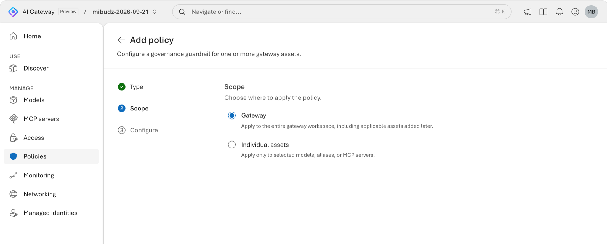

<!--
title: Set gateway-wide policy baselines
summary: Apply a baseline of token limit, request rate limit, content safety, and IP filter policies at Gateway scope so every model and MCP server, including the ones you add later, starts with the same guardrails, then layer stricter asset policies on top.
category: governance
level: Intermediate
duration: 25
tracks: [portal, rest, iac]
order: 9
illustration: diagrams/policy-scopes.svg
tags: [Gateway scope, baseline, tokenLimit, requestRateLimit, contentSafety, ipFilter, "403", policy as code]
objectives:
  - Explain how Gateway scope policies and asset policies layer, and why any applicable policy can block a call
  - Apply a token limit, request rate limit, content safety, and IP filter baseline at Gateway scope
  - Keep the baseline in a reviewed policy file and apply it with a merge-safe script
  - Verify the baseline from your own IP address and see a stricter model policy take effect on top of it
prereqs:
  - 06-token-limits
  - 08-content-safety
-->
<!-- gh:begin nav: generated by "npm run sync" from the metadata, do not edit -->
[AI Gateway labs](../README.md) › [Governance & cost](../README.md#governance--cost) › Lab 09
<!-- gh:end -->

# Set gateway-wide policy baselines

<!-- gh:begin intro: generated by "npm run sync" from the metadata, do not edit -->
> Apply a baseline of token limit, request rate limit, content safety, and IP filter policies at Gateway scope so every model and MCP server, including the ones you add later, starts with the same guardrails, then layer stricter asset policies on top.

| ⏱️ Time | 📶 Level | 🧭 Tracks | ✅ Before you start |
| :-- | :-- | :-- | :-- |
| 25 min | Intermediate | Portal · REST API · Policy as code | [06 · Token limits](../06-token-limits/README.md)<br>[08 · Content safety](../08-content-safety/README.md) |

**You'll learn to**

- Explain how Gateway scope policies and asset policies layer, and why any applicable policy can block a call
- Apply a token limit, request rate limit, content safety, and IP filter baseline at Gateway scope
- Keep the baseline in a reviewed policy file and apply it with a merge-safe script
- Verify the baseline from your own IP address and see a stricter model policy take effect on top of it

**Follow along:** 🌐 [Interactive version](https://azure.github.io/ai-gateway/labs/09-gateway-baselines/) with your own values filled in · 📁 [Lab files](infra/)

**On this page:** [Before you begin](#before-you-begin) · [How it works](#how-it-works) · [Apply the baseline](#apply-the-baseline) · [Verify](#verify) · [Go further](#go-further) · [Clean up](#clean-up) · [Troubleshooting](#troubleshooting) · [Next steps](#next-steps)
<!-- gh:end -->

Your gateway now serves several models and MCP servers, and teams add new ones every week. Some assets have
carefully tuned policies, and some have none at all. The platform and security teams agree on a baseline that
every asset gets by default: a generous token limit, a request rate limit, **Balanced** content safety, and
runtime access only from approved networks. In this lab you apply that baseline once, at **Gateway** scope,
and keep tighter asset policies on top of it.


<!-- widget: policy-layers -->
<!-- gh:begin widget: generated by "npm run sync" from the metadata, do not edit -->
> 🎛️ **Interactive:** try the policy layers explorer in the [web version of this lab](https://azure.github.io/ai-gateway/labs/09-gateway-baselines/).
<!-- gh:end -->

## Before you begin

- Complete [Throttle tokens per caller with token limits](../06-token-limits/README.md) and
  [Screen prompts and responses with content safety](../08-content-safety/README.md), including their
  **Clean up** sections. You need a gateway, an imported model, a callable alias, and a runtime API key from
  **Access** › **Keys**.
- The Azure CLI with the [`aigateway` extension](../SETUP.md#install-the-aigateway-extension),
  [signed in](../SETUP.md#sign-in-to-azure), and `jq` (Bash) or PowerShell 7 or later.
- For **Verify**: `curl` (Bash) or PowerShell 7 or later.
- Permission to change the gateway, for example **Contributor** on the resource group.
- The public IP addresses or CIDR ranges your callers use. Once the IP filter is on, calls from anywhere else get
  `403`.
- For the scripts and samples: the labs repo, [cloned](../SETUP.md#clone-the-labs-repo). Run them from the lab
  folder, `~/ai-gateway/labs/09-gateway-baselines`.

Set these variables once. Every track and the **Verify** section reuse them.

<details open><summary>Bash</summary> <!-- gh -->

```bash title="Bash"
# Name your gateway, its model provider, and the backend model that the Verify section calls
export RG="<resource-group>"
export GATEWAY="<gateway>"                 # 24 characters or fewer
export PROVIDER="<provider-name>"          # for example foundry-models
export MODEL="<model-name>"                # the backend model name under that provider

# Read the gateway's runtime URL, which apps call
export AI_GATEWAY_URL="https://$(az aigateway show -g "$RG" -n "$GATEWAY" --query properties.frontend.defaultHostname -o tsv)"
echo "🌐 Runtime URL: $AI_GATEWAY_URL"

# Read the alias that apps send in the model field: for Foundry imports, it matches the deployment's model name
export AI_GATEWAY_MODEL="$(az aigateway model show -g "$RG" --gateway-name "$GATEWAY" --provider-name "$PROVIDER" \
  -n "$MODEL" --query properties.deployment.modelName -o tsv)"
echo "🏷️ Model alias: $AI_GATEWAY_MODEL"

# Paste the runtime key you created in Access › Keys, without showing it: don't commit it or write it to a file
read -rsp "AI Gateway API key: " AI_GATEWAY_API_KEY && export AI_GATEWAY_API_KEY && echo
echo "🔑 Key: in AI_GATEWAY_API_KEY (${#AI_GATEWAY_API_KEY} characters, not shown)"

# Read the public IP address that this machine uses on the internet
export MY_IP="$(curl -s https://api.ipify.org)"
echo "🌐 Public IP address: $MY_IP"

# Set the ranges that the IP filter allows
export ALLOWED_CIDRS="$MY_IP/32"           # comma-separated, for example "$MY_IP/32,198.51.100.0/24"
echo "📝 Ranges the IP filter allows: $ALLOWED_CIDRS"
```
</details> <!-- gh -->

<details><summary>PowerShell</summary> <!-- gh -->

```powershell title="PowerShell"
# Name your gateway, its model provider, and the backend model that the Verify section calls
$RG         = "<resource-group>"
$GATEWAY    = "<gateway>"                 # 24 characters or fewer
$PROVIDER   = "<provider-name>"           # for example foundry-models
$MODEL      = "<model-name>"              # the backend model name under that provider

# Read the gateway's runtime URL, which apps call
$env:AI_GATEWAY_URL = "https://$(az aigateway show -g $RG -n $GATEWAY --query properties.frontend.defaultHostname -o tsv)"
Write-Host "🌐 Runtime URL: $env:AI_GATEWAY_URL"

# Read the alias that apps send in the model field: for Foundry imports, it matches the deployment's model name
$env:AI_GATEWAY_MODEL = az aigateway model show -g $RG --gateway-name $GATEWAY --provider-name $PROVIDER `
  -n $MODEL --query properties.deployment.modelName -o tsv
Write-Host "🏷️ Model alias: $env:AI_GATEWAY_MODEL"

# Paste the runtime key you created in Access › Keys, without showing it: don't commit it or write it to a file
$env:AI_GATEWAY_API_KEY = Read-Host "AI Gateway API key" -MaskInput
Write-Host "🔑 Key: in AI_GATEWAY_API_KEY ($($env:AI_GATEWAY_API_KEY.Length) characters, not shown)"

# Read the public IP address that this machine uses on the internet
$env:MY_IP = Invoke-RestMethod https://api.ipify.org
Write-Host "🌐 Public IP address: $env:MY_IP"

# Set the ranges that the IP filter allows
$env:ALLOWED_CIDRS = "$($env:MY_IP)/32"    # comma-separated, for example "$($env:MY_IP)/32,198.51.100.0/24"
Write-Host "📝 Ranges the IP filter allows: $env:ALLOWED_CIDRS"
```
</details> <!-- gh -->

## How it works

A policy with **Gateway** scope is stored on the gateway's `default` workspace instead of on one asset. It
applies to every compatible model, alias, and MCP server, including assets you add later, without another
policy update. Asset policies keep working alongside it. The gateway evaluates every applicable policy before
it forwards a request, and if any one of them blocks, the client gets an error and the backend is never
called. So an asset policy can make the rules **tighter** for one asset, but it can't loosen the baseline.

This lab's baseline:

| Policy | Applies to | Baseline value | Blocked calls get |
|---|---|---|---|
| **Token rate limit** | Models | 100,000 tokens per minute, per caller identity | `429` with `Retry-After` |
| **Request rate limit** | Models and MCP servers | 600 calls per 60 seconds, per caller identity | `429` with `Retry-After` |
| **Content safety** | Models and MCP servers | **Balanced** (`Medium`) for all four categories | `400` |
| **IP filter** | Models and MCP servers | **Allow listed IPs only**: your CIDR ranges | `403` |

A Gateway scope **Cost limit** is one budget across all models; you can add it in
[Enforce cost budgets with per-caller overrides](../07-cost-budgets/README.md). Agent 365 tool threat
protection can't be set at Gateway scope; it applies to individual MCP servers.

> [!WARNING]
> The IP filter applies to **runtime** calls. You keep managing the gateway in the portal and with the Azure
> CLI, so you can always fix the list. But every caller outside it gets `403`: teammates, CI pipelines, hosted
> agents, and your own machine when you switch networks or VPN. Remove it in [Clean up](#clean-up).

## Apply the baseline

Pick one track. Each track creates the same four policies at **Gateway** scope. The `aigateway` extension
doesn't set Gateway scope policies yet, so both scripted tracks call the Azure Resource Manager REST API with
`az rest` against the gateway's `default` workspace.

<!-- track: portal | Portal -->
<details open><summary><b>🖥️ Portal</b></summary> <!-- gh -->

### Add the token rate limit

Open the [AI Gateway portal](https://ai.gateway.azure.com) and select your gateway from the gateway switcher.
Select **Policies** › **Add policy**. On the **Type** step, select **Token rate limit**, then **Next**.

On the **Scope** step, select **Gateway** ("Apply to the entire gateway workspace, including applicable assets
added later."), then **Next**.



On the **Details** step (**Configure** in some portal versions), under **Parameters**, set:

| Field | Value |
|---|---|
| **Time period** | **Per minute** |
| **Allowed tokens** | `100000` |
| **Counter dimensions** | **Caller identity** |

Select **Create**.

### Add the request rate limit

Select **Add policy** again. Select **Request rate limit**, then **Gateway** scope, and set:

| Field | Value |
|---|---|
| **Calls** | `600` |
| **Renewal period** | **60 seconds** |
| **Counter dimensions** | **Caller identity** |

Select **Create**.

### Add content safety

Select **Add policy**. Under **Security**, select **Content safety**, then **Gateway** scope. Set **Hate**,
**Violence**, **Self-harm**, and **Sexual** to **Balanced**, then select **Create**.

### Add the IP filter

Select **Add policy**. Under **Security**, select **IP filter**, then **Gateway** scope, and set:

| Field | Value |
|---|---|
| **Action** | **Allow listed IPs only** |
| **IP addresses / CIDR ranges** | Your `ALLOWED_CIDRS` value, for example `198.51.100.7/32` |

Use CIDR notation for every entry: `/32` for a single IPv4 address. Check the value against `echo "$MY_IP"`
before you select **Create**.

> **Checkpoint**
> **Policies** lists four policies whose scope is **Gateway**: **Token rate limit**, **Request rate limit**,
> **Content safety**, and **IP filter**.

</details> <!-- gh -->
<!-- track: rest | REST API -->
<details><summary><b>🔗 REST API</b></summary> <!-- gh -->

### Read the Gateway scope policies

Gateway scope policies live inline in the `properties.policies` array of the gateway's `default` workspace.
A `PATCH` **replaces the whole array**, so always read it first and keep the policies you didn't mean to
change.

<details open><summary>Bash</summary> <!-- gh -->

```bash title="Bash"
# Read your subscription ID, and build the management URL of the gateway's default workspace
SUB="$(az account show --query id -o tsv)"
URL="https://management.azure.com/subscriptions/$SUB/resourceGroups/$RG/providers/Microsoft.ApiManagement/aigateways/$GATEWAY/workspaces/default?api-version=2025-09-01-preview"
echo "🆔 Subscription: $SUB"

# Read the Gateway scope policies, so that you know what the merge must keep
echo "🛡️ Gateway scope policies on $GATEWAY:"
az rest --method get --url "$URL" --query properties.policies
```
</details> <!-- gh -->

<details><summary>PowerShell</summary> <!-- gh -->

```powershell title="PowerShell"
# Read your subscription ID, and build the management URL of the gateway's default workspace
$SUB = az account show --query id -o tsv
$URL = "https://management.azure.com/subscriptions/$SUB/resourceGroups/$RG/providers/Microsoft.ApiManagement/aigateways/$GATEWAY/workspaces/default`?api-version=2025-09-01-preview"
Write-Host "🆔 Subscription: $SUB"

# Read the Gateway scope policies, so that you know what the merge must keep
Write-Host "🛡️ Gateway scope policies on ${GATEWAY}:"
az rest --method get --url $URL --query properties.policies
```
</details> <!-- gh -->

### Merge the baseline and keep everything else

The baseline replaces any existing policy of the same four types and keeps every other entry, such as a
Gateway scope cost limit.

<details open><summary>Bash</summary> <!-- gh -->

```bash title="Bash"
# Build the four baseline policies, with your ranges in the IP filter
BASELINE="$(jq -cn --arg cidrs "$ALLOWED_CIDRS" '[
  {"type":"tokenLimit","count":100000,"period":"minute","counterKey":["identity"],"scope":"workspace"},
  {"type":"requestRateLimit","callsPerPeriod":600,"periodSeconds":60,"counterKey":["identity"],"scope":"workspace"},
  {"type":"contentSafety","hateSeverity":"Medium","violenceSeverity":"Medium","sexualSeverity":"Medium","selfHarmSeverity":"Medium"},
  {"type":"ipFilter","action":"Allow","cidrRanges":($cidrs | split(",") | map(gsub("\\s"; "")) | map(select(length > 0)))}
]')"

# Check the allowed ranges before you apply
echo "🛡️ IP filter in the baseline:"
jq '.[] | select(.type == "ipFilter")' <<<"$BASELINE"

# Read the policies, drop any policy of the four baseline types, and add the baseline
POLICIES="$(az rest --method get --url "$URL" | jq -c --argjson baseline "$BASELINE" '
  [(.properties.policies // [])[] | select(.type | IN($baseline[].type) | not)] + $baseline')"

# Send the merged array back: a PATCH replaces the whole policies array
az rest --method patch --url "$URL" --body "{\"properties\":{\"policies\":$POLICIES}}" --output none &&
  echo "🛡️ Baseline of four policies is on $GATEWAY at Gateway scope"
```
</details> <!-- gh -->

<details><summary>PowerShell</summary> <!-- gh -->

```powershell title="PowerShell"
# Build the four baseline policies, with your ranges in the IP filter
$baseline = @(
  [pscustomobject]@{ type = 'tokenLimit'; count = 100000; period = 'minute'; counterKey = @('identity'); scope = 'workspace' }
  [pscustomobject]@{ type = 'requestRateLimit'; callsPerPeriod = 600; periodSeconds = 60; counterKey = @('identity'); scope = 'workspace' }
  [pscustomobject]@{ type = 'contentSafety'; hateSeverity = 'Medium'; violenceSeverity = 'Medium'; sexualSeverity = 'Medium'; selfHarmSeverity = 'Medium' }
  [pscustomobject]@{ type = 'ipFilter'; action = 'Allow'; cidrRanges = @($env:ALLOWED_CIDRS -split ',' | ForEach-Object { $_.Trim() } | Where-Object { $_ }) }
)

# Check the allowed ranges before you apply
Write-Host "🛡️ IP filter in the baseline:"
$baseline | Where-Object type -eq 'ipFilter' | ConvertTo-Json

# Read the policies, drop any policy of the four baseline types, and add the baseline
$current  = az rest --method get --url $URL | ConvertFrom-Json
$policies = @($current.properties.policies | Where-Object { $_ -and $_.type -notin $baseline.type })
$policies += $baseline

# Send the merged array back from a file, which keeps the JSON quotes intact: a PATCH replaces the whole array
$body = @{ properties = @{ policies = $policies } } | ConvertTo-Json -Depth 10 -Compress
$body | Set-Content -Path patch.json
az rest --method patch --url $URL --body '@patch.json' --output none
if ($?) { Write-Host "🛡️ Baseline of four policies is on $GATEWAY at Gateway scope" }
Remove-Item patch.json
```
</details> <!-- gh -->

> [!NOTE]
> When you create a token or request rate limit at **Gateway** scope, the portal writes `"scope": "workspace"`
> into the policy object. The REST and Policy as code tracks include the same field so that every track creates
> the same policy. `counterKey` is an array: `["identity"]` gives each API key or Entra caller its own counter.
> If the API rejects a field, create the policy once in the portal, then copy its shape from the `GET` response.

> **Checkpoint**
> Running the `GET` again returns your other policies unchanged plus `tokenLimit` and `requestRateLimit` entries
> with `"counterKey": ["identity"]` and `"scope": "workspace"`, and `contentSafety` and `ipFilter` entries
> with your ranges in `cidrRanges`. The service adds `"scope": "resource"` to the last two.

</details> <!-- gh -->
<!-- track: iac | Policy as code -->
<details><summary><b>🏗️ Policy as code</b></summary> <!-- gh -->

### Choose what to declare

Gateway scope policies live on the gateway's `default` workspace. The sample Bicep templates only reference
that workspace as `existing`. Declaring it in your own template would send a `PUT` that replaces the whole
workspace resource, including settings that the template doesn't list. Instead, keep the baseline in a policy
file that goes through code review, and apply it with a script that does the same `GET`, merge, and `PATCH` as
the REST track.

### Review the policy file

<!-- include: infra/baseline-policies.json -->
<!-- gh:begin include: generated by "npm run sync" from the metadata, do not edit -->
📄 [`infra/baseline-policies.json`](infra/baseline-policies.json)

```json
[
  {
    "type": "tokenLimit",
    "count": 100000,
    "period": "minute",
    "counterKey": ["identity"],
    "scope": "workspace"
  },
  {
    "type": "requestRateLimit",
    "callsPerPeriod": 600,
    "periodSeconds": 60,
    "counterKey": ["identity"],
    "scope": "workspace"
  },
  {
    "type": "contentSafety",
    "hateSeverity": "Medium",
    "violenceSeverity": "Medium",
    "sexualSeverity": "Medium",
    "selfHarmSeverity": "Medium"
  },
  {
    "type": "ipFilter",
    "action": "Allow",
    "cidrRanges": ["203.0.113.10/32"]
  }
]
```
<!-- gh:end -->

On GitHub, open [infra/baseline-policies.json](infra/baseline-policies.json).

The `ipFilter` entry holds a placeholder from the `203.0.113.0/24` documentation range. The script never applies
it: it replaces `cidrRanges` with your `ALLOWED_CIDRS` value and stops if that value is missing or isn't in CIDR
notation.

### Preview the change

From the lab folder, print the merged policy array without changing anything:

<details open><summary>Bash</summary> <!-- gh -->

```bash title="Bash"
# Print the merged policy array, without changing anything on the gateway
./infra/apply-baseline.sh --dry-run &&
  echo "💡 Nothing is applied yet: review the policies above, then apply them"
```
</details> <!-- gh -->

<details><summary>PowerShell</summary> <!-- gh -->

```powershell title="PowerShell"
# Print the merged policy array, without changing anything on the gateway
./infra/apply-baseline.ps1 -ResourceGroup $RG -Gateway $GATEWAY -DryRun
if ($?) { Write-Host "💡 Nothing is applied yet: review the policies above, then apply them" }
```
</details> <!-- gh -->

The PowerShell script reads `$env:ALLOWED_CIDRS` unless you pass `-AllowedCidrs`.

### Apply it

<details open><summary>Bash</summary> <!-- gh -->

```bash title="Bash"
# Merge the baseline into the Gateway scope policies, and keep every other policy
./infra/apply-baseline.sh &&
  echo "🛡️ Baseline of four policies is on $GATEWAY at Gateway scope"
```
</details> <!-- gh -->

<details><summary>PowerShell</summary> <!-- gh -->

```powershell title="PowerShell"
# Merge the baseline into the Gateway scope policies, and keep every other policy
./infra/apply-baseline.ps1 -ResourceGroup $RG -Gateway $GATEWAY
if ($?) { Write-Host "🛡️ Baseline of four policies is on $GATEWAY at Gateway scope" }
```
</details> <!-- gh -->

<!-- include: infra/apply-baseline.sh -->
<!-- gh:begin include: generated by "npm run sync" from the metadata, do not edit -->
📄 [`infra/apply-baseline.sh`](infra/apply-baseline.sh)

<details><summary>Show all 78 lines</summary>

```sh
#!/usr/bin/env bash
# Applies the policy baseline in baseline-policies.json at Gateway scope (the gateway's default
# workspace). It reads the current Gateway scope policies, replaces the entries whose type is in
# the baseline, keeps every other policy, and patches the workspace.
#
# Usage:
#   export RG="<resource-group>" GATEWAY="<gateway>"
#   export ALLOWED_CIDRS="198.51.100.7/32"   # comma-separated CIDR ranges for the IP filter
#   ./apply-baseline.sh              # apply the baseline
#   ./apply-baseline.sh --dry-run    # print the merged policies without changing anything
#   ./apply-baseline.sh --remove     # remove the baseline policy types from Gateway scope
#
# Set BASELINE_FILE to use a different policy file. Requires the Azure CLI (az login) with the
# aigateway extension, and jq.
set -euo pipefail

MODE="apply"
case "${1:-}" in
  "") ;;
  --dry-run) MODE="dry-run" ;;
  --remove) MODE="remove" ;;
  *) echo "Unknown option: $1. Use --dry-run or --remove." >&2; exit 2 ;;
esac

: "${RG:?Set RG to your resource group}"
: "${GATEWAY:?Set GATEWAY to your gateway name}"

SCRIPT_DIR="$(cd "$(dirname "${BASH_SOURCE[0]}")" && pwd)"
BASELINE_FILE="${BASELINE_FILE:-$SCRIPT_DIR/baseline-policies.json}"
BASELINE="$(jq -c '.' "$BASELINE_FILE")"

# The file holds a placeholder address for the IP filter. Never apply it: replace it with ALLOWED_CIDRS.
if [ "$MODE" != "remove" ] && jq -e 'any(.[]; .type == "ipFilter")' >/dev/null <<<"$BASELINE"; then
  : "${ALLOWED_CIDRS:?Set ALLOWED_CIDRS to the comma-separated CIDR ranges to allow, for example \"\$(curl -s https://api.ipify.org)/32\"}"
  BASELINE="$(jq -c --arg cidrs "$ALLOWED_CIDRS" '
    map(if .type == "ipFilter"
        then .cidrRanges = ($cidrs | split(",") | map(gsub("\\s"; "")) | map(select(length > 0)))
        else . end)' <<<"$BASELINE")"
  if ! jq -e 'all(.[] | select(.type == "ipFilter"); (.cidrRanges | length) > 0)' >/dev/null <<<"$BASELINE"; then
    echo "ALLOWED_CIDRS doesn't contain any CIDR ranges." >&2
    exit 2
  fi
  INVALID="$(jq -r '[.[] | select(.type == "ipFilter") | .cidrRanges[] | select(contains("/") | not)] | join(", ")' <<<"$BASELINE")"
  if [ -n "$INVALID" ]; then
    echo "Use CIDR notation with a prefix length, for example $INVALID/32 for a single address." >&2
    exit 2
  fi
fi

# The aigateway extension doesn't set Gateway scope policies yet, so the script calls the REST API with az rest.
GATEWAY_ID="$(az aigateway show -g "$RG" -n "$GATEWAY" --query id -o tsv)"
URL="https://management.azure.com$GATEWAY_ID/workspaces/default?api-version=2025-09-01-preview"

# A PATCH replaces the whole properties.policies array, so always merge with the current array.
CURRENT="$(az rest --method get --url "$URL")"
KEEP='[(.properties.policies // [])[] | select(.type | IN($baseline[].type) | not)]'
if [ "$MODE" = "remove" ]; then
  POLICIES="$(jq -c --argjson baseline "$BASELINE" "$KEEP" <<<"$CURRENT")"
else
  POLICIES="$(jq -c --argjson baseline "$BASELINE" "$KEEP + \$baseline" <<<"$CURRENT")"
fi

if [ "$MODE" = "dry-run" ]; then
  echo "Gateway scope policies after the change (nothing was applied):"
  jq '.' <<<"$POLICIES"
  exit 0
fi

if [ "$MODE" = "apply" ] && jq -e 'any(.[]; .type == "ipFilter")' >/dev/null <<<"$BASELINE"; then
  echo "The IP filter allows runtime calls only from: $(jq -r '[.[] | select(.type == "ipFilter") | .cidrRanges[]] | join(", ")' <<<"$BASELINE")"
fi

az rest --method patch --url "$URL" --body "{\"properties\":{\"policies\":$POLICIES}}" --output none

echo "Gateway scope policies on $GATEWAY:"
az rest --method get --url "$URL" | jq -r '
  (.properties.policies // []) as $p
  | if ($p | length) == 0 then "  (none)" else $p[] | "  \(.type)  \(del(.type) | tojson)" end'
```

</details>
<!-- gh:end -->

On GitHub, open [infra/apply-baseline.sh](infra/apply-baseline.sh) or
[infra/apply-baseline.ps1](infra/apply-baseline.ps1).

> [!TIP]
> Run the script from a pipeline with an identity that can change the gateway, and change the baseline only
> through pull requests to `baseline-policies.json`. Post the `--dry-run` output in the pull request so
> reviewers see the exact policy array before it's applied.

> **Checkpoint**
> The script prints four Gateway scope policies (`tokenLimit`, `requestRateLimit`, `contentSafety`, and
> `ipFilter`) plus any other policies you already had.

</details> <!-- gh -->
<!-- /tracks -->

## Verify

Check that the baseline covers your model and MCP servers, that your own calls still pass, and that a tighter
asset policy still takes effect on top of it.

<!-- steps -->

### Review the baseline in the portal

Select **Policies**. The four baseline policies show **Gateway** in the **Scope** column. Policies you add to
a model, alias, or MCP server show that asset instead.

### Call the model from your IP address

From the lab folder, send one chat completion:

<details open><summary>Bash</summary> <!-- gh -->

```bash title="Bash"
# Send one chat completion from this machine through the baseline
echo "🤖 Expect Status: 200 and a reply, because your IP address is on the allow list:"
./infra/check-call.sh "$AI_GATEWAY_MODEL"
```
</details> <!-- gh -->

<details><summary>PowerShell</summary> <!-- gh -->

```powershell title="PowerShell"
# Send one chat completion from this machine through the baseline
Write-Host "🤖 Expect Status: 200 and a reply, because your IP address is on the allow list:"
./infra/check-call.ps1 -Model $env:AI_GATEWAY_MODEL
```
</details> <!-- gh -->

On GitHub, open [check-call.sh](infra/check-call.sh) or [check-call.ps1](infra/check-call.ps1).

Expected output:

```text
🤖 Expect Status: 200 and a reply, because your IP address is on the allow list:
Status: 200
Reply:  A gateway-wide policy baseline is a default set of rules that applies to every asset ...
```

Your call passed all four baseline policies: your IP address is on the allow list, you're far below both rate
limits, and the prompt is benign. If you completed
[Federate MCP tools behind one endpoint](../04-federate-mcp-tools/README.md), run
`../04-federate-mcp-tools/infra/list-tools.sh learn` (PowerShell:
`../04-federate-mcp-tools/infra/list-tools.ps1 -Server learn`). The MCP server is covered by the same IP
filter, request rate limit, and content safety policies, and it still lists its tools.

### Layer a stricter model policy

Add a deliberately low token limit to your model only, the same one you used in lab 06.
`az aigateway model policy set-token-limit` keeps every other policy on the model:

<details open><summary>Bash</summary> <!-- gh -->

```bash title="Bash"
# Add a low token limit to the model only: 1,000 tokens per minute for each caller
az aigateway model policy set-token-limit -g "$RG" --gateway-name "$GATEWAY" --provider-name "$PROVIDER" -n "$MODEL" \
  --token-limit 1000 --output none &&
  echo "🛡️ Token limit of 1,000 tokens per minute for each caller is on $MODEL"
```
</details> <!-- gh -->

<details><summary>PowerShell</summary> <!-- gh -->

```powershell title="PowerShell"
# Add a low token limit to the model only: 1,000 tokens per minute for each caller
az aigateway model policy set-token-limit -g $RG --gateway-name $GATEWAY --provider-name $PROVIDER -n $MODEL `
  --token-limit 1000 --output none
if ($?) { Write-Host "🛡️ Token limit of 1,000 tokens per minute for each caller is on $MODEL" }
```
</details> <!-- gh -->

Then send a burst with the script from lab 06:

<details open><summary>Bash</summary> <!-- gh -->

```bash title="Bash"
# Send a burst of eight requests with the script from lab 06
echo "🚦 Expect 429 Too Many Requests after three or four requests:"
../06-token-limits/infra/trigger-token-limit.sh "$AI_GATEWAY_MODEL" 8
```
</details> <!-- gh -->

<details><summary>PowerShell</summary> <!-- gh -->

```powershell title="PowerShell"
# Send a burst of eight requests with the script from lab 06
Write-Host "🚦 Expect 429 Too Many Requests after three or four requests:"
../06-token-limits/infra/trigger-token-limit.ps1 -Model $env:AI_GATEWAY_MODEL -Requests 8
```
</details> <!-- gh -->

After three or four requests, the gateway returns `429`. The baseline allows 100,000 tokens per minute, but the
model's tighter limit is evaluated too, and it blocks. Remove the model limit and run the burst again:

<details open><summary>Bash</summary> <!-- gh -->

```bash title="Bash"
# Remove only the token limit from the model, and keep its other policies
az aigateway model policy remove -g "$RG" --gateway-name "$GATEWAY" --provider-name "$PROVIDER" -n "$MODEL" \
  --remove-token-limit true --output none &&
  echo "🧹 Token limit is removed from $MODEL"
```
</details> <!-- gh -->

<details><summary>PowerShell</summary> <!-- gh -->

```powershell title="PowerShell"
# Remove only the token limit from the model, and keep its other policies
az aigateway model policy remove -g $RG --gateway-name $GATEWAY --provider-name $PROVIDER -n $MODEL `
  --remove-token-limit true --output none
if ($?) { Write-Host "🧹 Token limit is removed from $MODEL" }
```
</details> <!-- gh -->

All eight requests now return `200`, because only the generous baseline applies.

### See the IP filter block a call (optional)

Point the allow list at a documentation address that can't be yours, call the model, then restore your range.

- **Portal:** in **Policies**, select **Edit** on the **IP filter** policy, set the ranges to
  `203.0.113.10/32`, and save.
- **Script (Bash):** `ALLOWED_CIDRS="203.0.113.10/32" ./infra/apply-baseline.sh`
- **Script (PowerShell):** `./infra/apply-baseline.ps1 -ResourceGroup $RG -Gateway $GATEWAY -AllowedCidrs "203.0.113.10/32"`

Run `check-call` again. It now returns `Status: 403`, and the request never reaches the model. Restore your
range in the portal, or run the script again without the override (`./infra/apply-baseline.sh`, or the
PowerShell script without `-AllowedCidrs`), and check that `check-call` returns `200`. If you still see the old
result, wait a minute and retry.

### Watch outcomes in Monitoring

If you configured Application Insights in [Monitor usage, cost, and traces](../13-monitoring/README.md), open
**Monitoring** and compare `400`, `403`, and `429` outcomes before and after the baseline. A sudden rise in
`403` usually means a caller's network isn't on the allow list.

<!-- /steps -->

> **Checkpoint**
> **Policies** shows four **Gateway** scope policies. Your own call returned `200`, a stricter model limit
> still returned `429` on top of the baseline, and you know how a blocked IP address looks (`403`).

## Go further

- **Cap spend gateway-wide.** Add a **Cost limit** with **Gateway** scope for one budget across all models, as
  described in [Enforce cost budgets with per-caller overrides](../07-cost-budgets/README.md).
- **Tighten tool traffic.** Keep the baseline and add stricter controls to individual MCP servers in
  [Control which tools agents can call](../05-mcp-tool-controls/README.md) and
  [Protect tool calls with Agent 365 threat protection](../19-tool-threat-protection/README.md).
- **Keep the allow list for inbound traffic.** Inbound private endpoints and turning off public network access
  aren't available for AI Gateway yet, so the IP filter is how you restrict who can call the gateway. To keep
  the gateway's traffic to your backends private, see
  [Lock down backend traffic with private networking](../18-private-networking/README.md).
- **Count Entra callers.** With `identity` counters, each Entra caller gets its own allowance. Move clients to
  keyless calls in [Go keyless with Microsoft Entra ID and RBAC](../11-entra-rbac/README.md).

## Clean up

Remove the baseline before you continue, especially the IP filter: later labs call the gateway from hosted
agents and other networks, which would get `403`. In your own environment, you can keep the other three
policies and replace the IP filter with your organization's egress ranges.

<!-- track: portal | Portal -->
<details open><summary><b>🖥️ Portal</b></summary> <!-- gh -->

### Remove the baseline

Select **Policies**. For each of the four policies with **Gateway** scope, select **Delete**. Remove the
**IP filter** first.

</details> <!-- gh -->
<!-- track: rest | REST API -->
<details><summary><b>🔗 REST API</b></summary> <!-- gh -->

### Remove the baseline

```bash
# Read the Gateway scope policies and drop the four baseline types, so that the others stay
POLICIES="$(az rest --method get --url "$URL" | jq -c '[(.properties.policies // [])[]
  | select(.type | IN("tokenLimit","requestRateLimit","contentSafety","ipFilter") | not)]')"

# Send the remaining policies back: a PATCH replaces the whole policies array
az rest --method patch --url "$URL" --body "{\"properties\":{\"policies\":$POLICIES}}" --output none &&
  echo "🧹 Baseline is removed from $GATEWAY"
```

Every other Gateway scope policy stays.

</details> <!-- gh -->
<!-- track: iac | Policy as code -->
<details><summary><b>🏗️ Policy as code</b></summary> <!-- gh -->

### Remove the baseline

<details open><summary>Bash</summary> <!-- gh -->

```bash title="Bash"
# Remove the policy types listed in baseline-policies.json from Gateway scope, and keep every other policy
./infra/apply-baseline.sh --remove &&
  echo "🧹 Baseline is removed from $GATEWAY"
```
</details> <!-- gh -->

<details><summary>PowerShell</summary> <!-- gh -->

```powershell title="PowerShell"
# Remove the policy types listed in baseline-policies.json from Gateway scope, and keep every other policy
./infra/apply-baseline.ps1 -ResourceGroup $RG -Gateway $GATEWAY -Remove
if ($?) { Write-Host "🧹 Baseline is removed from $GATEWAY" }
```
</details> <!-- gh -->

The script removes the policy types listed in `baseline-policies.json` and keeps every other Gateway scope
policy.

</details> <!-- gh -->
<!-- /tracks -->

Keep the gateway, model, and key. The next labs reuse them.

## Troubleshooting

For the errors you might hit in this lab, with their likely causes and fixes, see
[Troubleshooting](../TROUBLESHOOTING.md#lab-09-gateway-wide-baselines).

## Next steps

- [Enforce cost budgets with per-caller overrides](../07-cost-budgets/README.md): add a spend limit to the
  baseline.
- [Monitor usage, cost, and traces](../13-monitoring/README.md): track `400`, `403`, and `429` outcomes per
  policy.
- [Lock down backend traffic with private networking](../18-private-networking/README.md): route the gateway's
  backend traffic through your virtual network.
- Docs: [Policies in AI Gateway](https://ai.gateway.azure.com/docs/policies).

<!-- gh:begin footer: generated by "npm run sync" from the metadata, do not edit -->

---

| ⬅️ Previous | 🏠 | Next ➡️ |
| :-- | :-: | --: |
| [08 · Content safety](../08-content-safety/README.md) | [All labs](../README.md) | [10 · Runtime API keys](../10-api-keys/README.md) |

<sub>Learning paths: [Platform engineer](../README.md#learning-paths) (6 of 9) · [Security & compliance](../README.md#learning-paths) (5 of 7)</sub>
<!-- gh:end -->
