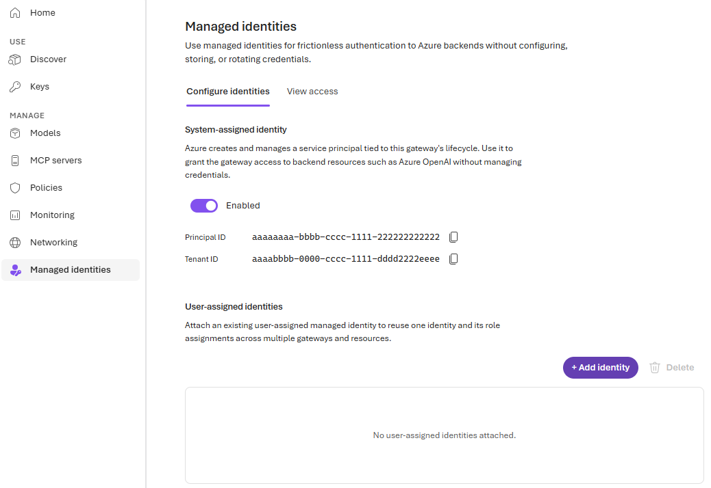

<!--
title: Call backends with managed identities
summary: Let the gateway reach Microsoft Foundry with a managed identity instead of stored keys. Check the system-assigned identity, then create a user-assigned identity you can share across gateways, grant it Foundry User, attach it, and point a model provider at it from the portal, the Azure CLI, or Bicep.
category: security
level: Intermediate
duration: 20
tracks: [portal, cli, iac]
order: 12
illustration: diagrams/identity-boundaries.svg
tags: [managed identity, user-assigned identity, Foundry User, RBAC, keyless, model provider, "403"]
objectives:
  - Explain how the gateway authenticates to backends, separately from how callers authenticate to the gateway
  - Check the gateway's system-assigned identity and the assets that use it
  - Create a user-assigned identity, attach it to the gateway, and grant it Foundry User on a Foundry account
  - Point a Foundry model provider at the user-assigned identity and prove that calls still succeed
  - Decide when a backend needs a stored API key instead
prereqs:
  - 02-first-model-call
-->
<!-- gh:begin nav: generated by "npm run sync" from the metadata, do not edit -->
[AI Gateway labs](../README.md) › [Security & identity](../README.md#security--identity) › Lab 12
<!-- gh:end -->

# Call backends with managed identities

<!-- gh:begin intro: generated by "npm run sync" from the metadata, do not edit -->
> Let the gateway reach Microsoft Foundry with a managed identity instead of stored keys. Check the system-assigned identity, then create a user-assigned identity you can share across gateways, grant it Foundry User, attach it, and point a model provider at it from the portal, the Azure CLI, or Bicep.

| ⏱️ Time | 📶 Level | 🧭 Tracks | ✅ Before you start |
| :-- | :-- | :-- | :-- |
| 20 min | Intermediate | Portal · Azure CLI · Bicep + azd | [02 · First model call](../02-first-model-call/README.md) |

**You'll learn to**

- Explain how the gateway authenticates to backends, separately from how callers authenticate to the gateway
- Check the gateway's system-assigned identity and the assets that use it
- Create a user-assigned identity, attach it to the gateway, and grant it Foundry User on a Foundry account
- Point a Foundry model provider at the user-assigned identity and prove that calls still succeed
- Decide when a backend needs a stored API key instead

**Follow along:** 🌐 [Interactive version](https://azure.github.io/ai-gateway/labs/12-backend-identity/) with your own values filled in · 📁 [Lab files](infra/)

**On this page:** [Before you begin](#before-you-begin) · [How it works](#how-it-works) · [Check the system-assigned identity](#check-the-system-assigned-identity) · [Create a user-assigned identity and give it access](#create-a-user-assigned-identity-and-give-it-access) · [Point the model provider at the identity](#point-the-model-provider-at-the-identity) · [Verify](#verify) · [Go further](#go-further) · [Clean up](#clean-up) · [Troubleshooting](#troubleshooting) · [Next steps](#next-steps)
<!-- gh:end -->

Your platform team runs one gateway per region, and every gateway calls the same Foundry account. Today each
gateway uses its own system-assigned identity, so every new gateway needs a fresh **Foundry User** grant, and
recreating a gateway leaves a stale role assignment behind. The team wants one identity that it owns, grants
once, and attaches to every gateway, with no backend key stored anywhere. In this lab you check the gateway's
system-assigned identity, create a user-assigned identity, give it access to Foundry, and switch a model
provider to it without changing a single client.


## Before you begin

> [!TIP]
> On the **Bicep + azd** track, `azd up` creates its own gateway, model, and key, so you can skip this section. You
> need only [Azure Cloud Shell](https://shell.azure.com), or the Azure Developer CLI (`azd`), the Azure CLI, and Git
> on your machine, and permission to create role assignments, for example **Owner** on the subscription. To check the
> system-assigned identity first, run the track in
> [Create a user-assigned identity and give it access](#create-a-user-assigned-identity-and-give-it-access) up to
> **Read the outputs and the key**, which sets the variables, then come back.

- Complete [Publish a Foundry model and make your first call](../02-first-model-call/README.md). You need a
  gateway with a Foundry model provider that uses a managed identity, a model alias, and a runtime API key.
- The [Azure CLI](https://learn.microsoft.com/cli/azure/install-azure-cli) 2.75 or later, signed in with
  `az login`, and the `aigateway` extension ([install it](../01-provision-gateway/README.md#before-you-begin)).
  Every track uses it at least once: the portal can't change the identity of a model provider that already exists.
- For the Bash commands: [jq](https://jqlang.org/download/), which edits the provider's settings.
- Permissions:
  - Create a managed identity in the resource group, for example **Contributor** or
    **Managed Identity Contributor**.
  - Attach the identity to the gateway: **Contributor** on the gateway and **Managed Identity Operator** on the
    identity. **Contributor** on a resource group that holds both covers this.
  - Create role assignments on the Foundry account, for example **Owner**, **User Access Administrator**, or
    **Role Based Access Control Administrator**.

Managed identities are free. Nothing in this lab adds charges beyond the model calls you make.

Set these variables once. Every track and the **Verify** section reuse them.

<details open><summary>Bash</summary> <!-- gh -->

```bash title="Bash"
export RG="<resource-group>"
export GATEWAY="<gateway>"
export PROVIDER="<provider-name>"                 # the Foundry provider from lab 02, for example foundry-models
export FOUNDRY_RG="<foundry-resource-group>"      # resource group of the Foundry account
export FOUNDRY_ACCOUNT="<foundry-account-name>"   # the account name, not a project or deployment name
export IDENTITY="id-aigateway-backends"           # the user-assigned identity to create

export FOUNDRY_ID="$(az cognitiveservices account show -g "$FOUNDRY_RG" -n "$FOUNDRY_ACCOUNT" --query id -o tsv)"
export AI_GATEWAY_URL="https://$(az aigateway show -g "$RG" -n "$GATEWAY" --query properties.frontend.defaultHostname -o tsv)"
export AI_GATEWAY_MODEL="<model-name>"            # the alias you called in lab 02
# Paste the runtime key from lab 02. Don't commit it or write it to a file.
read -rsp "AI Gateway API key: " AI_GATEWAY_API_KEY && export AI_GATEWAY_API_KEY && echo
```
</details> <!-- gh -->

<details><summary>PowerShell</summary> <!-- gh -->

```powershell title="PowerShell"
$RG              = "<resource-group>"
$GATEWAY         = "<gateway>"
$PROVIDER        = "<provider-name>"              # the Foundry provider from lab 02, for example foundry-models
$FOUNDRY_RG      = "<foundry-resource-group>"     # resource group of the Foundry account
$FOUNDRY_ACCOUNT = "<foundry-account-name>"       # the account name, not a project or deployment name
$IDENTITY        = "id-aigateway-backends"        # the user-assigned identity to create

$FOUNDRY_ID = az cognitiveservices account show -g $FOUNDRY_RG -n $FOUNDRY_ACCOUNT --query id -o tsv
$env:AI_GATEWAY_URL = "https://$(az aigateway show -g $RG -n $GATEWAY --query properties.frontend.defaultHostname -o tsv)"
$env:AI_GATEWAY_MODEL = "<model-name>"            # the alias you called in lab 02
# Paste the runtime key from lab 02. Don't commit it or write it to a file.
$env:AI_GATEWAY_API_KEY = Read-Host "AI Gateway API key" -MaskInput
```
</details> <!-- gh -->

Don't remember the provider name? List the Foundry providers:
`az aigateway model-provider list -g "$RG" --gateway-name "$GATEWAY" --query "[?properties.kind=='Foundry'].name" -o tsv`.

## How it works

Every call crosses two boundaries. **Inbound**, the caller proves who it is to the gateway with a runtime API key
([lab 10](../10-api-keys/README.md)) or a Microsoft Entra token ([lab 11](../11-entra-rbac/README.md)).
**Outbound**, the gateway proves who *it* is to the backend. The caller never sends a backend credential: you
configure it once on the asset, such as a model provider or an MCP server backend.

For Azure backends, use a managed identity. The gateway requests a Microsoft Entra token for the backend's
audience, `https://cognitiveservices.azure.com/` for Foundry, and Azure RBAC on the backend decides what the
identity can do. For Foundry and Azure OpenAI, grant **Foundry User** on the account. Keep backend API keys for
backends that can't accept an Entra token.

| | System-assigned identity | User-assigned identity | Stored backend key |
|---|---|---|---|
| Created by | Azure, with the gateway. The portal enables it by default. | You, as its own Azure resource | The backend's owner |
| Lifecycle | Tied to the gateway. Deleting the gateway deletes it. | Independent. Attach it to many gateways and keep it when a gateway is recreated. | You store it in the gateway and rotate it |
| Best for | One gateway calling Azure backends | Sharing one identity and its role assignments across gateways | Third-party providers and tools without Entra support |
| Foundry provider setting | `managedIdentity` without `clientId` | `managedIdentity.clientId` set to the identity's client ID | `apiKey` |

Attaching an identity to the gateway doesn't change which identity an asset uses. Each asset names its identity,
so you can move assets one at a time.

## Check the system-assigned identity

Lab 02's provider calls Foundry with the gateway's system-assigned identity. See it before you change anything.

<!-- steps -->

### Look at the identity in the portal

1. Open the [AI Gateway portal](https://ai.gateway.azure.com) and select your gateway.
2. Select **Managed identities**. On **Configure identities**, the **System-assigned identity** card shows
   **Enabled** with a **Principal ID** and a **Tenant ID**.
3. Select **View access**. **Backend access** lists the assets that authenticate with a managed identity. Your
   Foundry provider appears with **System-assigned** as its identity and **Foundry User** as its role.



### Check it with the CLI

<details open><summary>Bash</summary> <!-- gh -->

```bash title="Bash"
az aigateway identity show -g "$RG" -n "$GATEWAY" -o json
```
</details> <!-- gh -->

<details><summary>PowerShell</summary> <!-- gh -->

```powershell title="PowerShell"
az aigateway identity show -g $RG -n $GATEWAY -o json
```
</details> <!-- gh -->

The output shows `type`, which includes `SystemAssigned`, and the system-assigned `principalId` and `tenantId`.
If the command reports that no identity is assigned to the gateway, enable the system-assigned identity and grant
the new principal **Foundry User** on the Foundry account. `identity assign` returns when the gateway is ready
again:

<details open><summary>Bash</summary> <!-- gh -->

```bash title="Bash"
az aigateway identity assign -g "$RG" -n "$GATEWAY" --system-assigned true -o none
PRINCIPAL_ID="$(az aigateway show -g "$RG" -n "$GATEWAY" --query identity.principalId -o tsv)"
az role assignment create --assignee-object-id "$PRINCIPAL_ID" --assignee-principal-type ServicePrincipal \
  --role "53ca6127-db72-4b80-b1b0-d745d6d5456d" --scope "$FOUNDRY_ID"
```
</details> <!-- gh -->

<details><summary>PowerShell</summary> <!-- gh -->

```powershell title="PowerShell"
az aigateway identity assign -g $RG -n $GATEWAY --system-assigned true -o none
$PRINCIPAL_ID = az aigateway show -g $RG -n $GATEWAY --query identity.principalId -o tsv
az role assignment create --assignee-object-id $PRINCIPAL_ID --assignee-principal-type ServicePrincipal `
  --role "53ca6127-db72-4b80-b1b0-d745d6d5456d" --scope $FOUNDRY_ID
```
</details> <!-- gh -->

<!-- /steps -->

> [!WARNING]
> Don't turn off the system-assigned identity while assets use it. Disabling it recycles the service principal:
> every backend configured with it fails until you enable it again, and a re-enabled identity gets a new
> principal ID without the old role assignments.

## Create a user-assigned identity and give it access

Pick one track. Each track creates the identity, attaches it to the gateway, and grants it **Foundry User** on
the Foundry account.

<!-- track: portal | Portal -->
<details open><summary><b>🖥️ Portal</b></summary> <!-- gh -->

### Create and attach the identity

1. In **Managed identities** › **Configure identities**, under **User-assigned identities**, select
   **Add identity**.
2. Select **Create new** and enter the **Name** from `$IDENTITY`, for example `id-aigateway-backends`. The portal
   creates the identity in the gateway's subscription, resource group, and region.
3. Select **Add identity**. The new identity appears in the table with its **Principal** and **Client ID**.

To reuse an identity that already exists, select **Use existing** instead, then pick its **Subscription** and
**User-assigned managed identity**.

### Read the identity's IDs

You need the principal ID to grant access and the client ID to point the provider at the identity.

<details open><summary>Bash</summary> <!-- gh -->

```bash title="Bash"
export IDENTITY_ID="$(az identity show -g "$RG" -n "$IDENTITY" --query id -o tsv)"
export IDENTITY_CLIENT_ID="$(az identity show -g "$RG" -n "$IDENTITY" --query clientId -o tsv)"
export IDENTITY_PRINCIPAL_ID="$(az identity show -g "$RG" -n "$IDENTITY" --query principalId -o tsv)"
```
</details> <!-- gh -->

<details><summary>PowerShell</summary> <!-- gh -->

```powershell title="PowerShell"
$IDENTITY_ID           = az identity show -g $RG -n $IDENTITY --query id -o tsv
$IDENTITY_CLIENT_ID    = az identity show -g $RG -n $IDENTITY --query clientId -o tsv
$IDENTITY_PRINCIPAL_ID = az identity show -g $RG -n $IDENTITY --query principalId -o tsv
```
</details> <!-- gh -->

### Grant Foundry User on the Foundry account

Attaching an identity doesn't grant it any access. In the [Azure portal](https://portal.azure.com), open the
Foundry account and select **Access control (IAM)** › **Add** › **Add role assignment**. Select **Foundry User**,
assign access to **Managed identity**, select your identity as the member, then select **Review + assign**.

Or grant the role from the command line:

<details open><summary>Bash</summary> <!-- gh -->

```bash title="Bash"
az role assignment create --assignee-object-id "$IDENTITY_PRINCIPAL_ID" --assignee-principal-type ServicePrincipal \
  --role "53ca6127-db72-4b80-b1b0-d745d6d5456d" --scope "$FOUNDRY_ID"
```
</details> <!-- gh -->

<details><summary>PowerShell</summary> <!-- gh -->

```powershell title="PowerShell"
az role assignment create --assignee-object-id $IDENTITY_PRINCIPAL_ID --assignee-principal-type ServicePrincipal `
  --role "53ca6127-db72-4b80-b1b0-d745d6d5456d" --scope $FOUNDRY_ID
```
</details> <!-- gh -->

> **Checkpoint**
> **User-assigned identities** lists your identity, and the Foundry account's **Access control (IAM)** ›
> **Role assignments** shows it with **Foundry User**.

</details> <!-- gh -->
<!-- track: cli | Azure CLI -->
<details><summary><b>⌨️ Azure CLI</b></summary> <!-- gh -->

### Create the identity

<details open><summary>Bash</summary> <!-- gh -->

```bash title="Bash"
az identity create -g "$RG" -n "$IDENTITY"

export IDENTITY_ID="$(az identity show -g "$RG" -n "$IDENTITY" --query id -o tsv)"
export IDENTITY_CLIENT_ID="$(az identity show -g "$RG" -n "$IDENTITY" --query clientId -o tsv)"
export IDENTITY_PRINCIPAL_ID="$(az identity show -g "$RG" -n "$IDENTITY" --query principalId -o tsv)"
```
</details> <!-- gh -->

<details><summary>PowerShell</summary> <!-- gh -->

```powershell title="PowerShell"
az identity create -g $RG -n $IDENTITY

$IDENTITY_ID           = az identity show -g $RG -n $IDENTITY --query id -o tsv
$IDENTITY_CLIENT_ID    = az identity show -g $RG -n $IDENTITY --query clientId -o tsv
$IDENTITY_PRINCIPAL_ID = az identity show -g $RG -n $IDENTITY --query principalId -o tsv
```
</details> <!-- gh -->

The identity is created in the resource group's region. It can live in any resource group or subscription in
the gateway's tenant.

### Attach it to the gateway

`identity assign` adds your identity and keeps the identities the gateway already has, including the
system-assigned one. It returns when the gateway is ready again.

<details open><summary>Bash</summary> <!-- gh -->

```bash title="Bash"
az aigateway identity assign -g "$RG" -n "$GATEWAY" --user-assigned "$IDENTITY_ID" -o none
```
</details> <!-- gh -->

<details><summary>PowerShell</summary> <!-- gh -->

```powershell title="PowerShell"
az aigateway identity assign -g $RG -n $GATEWAY --user-assigned $IDENTITY_ID -o none
```
</details> <!-- gh -->

### Grant Foundry User on the Foundry account

<details open><summary>Bash</summary> <!-- gh -->

```bash title="Bash"
az role assignment create --assignee-object-id "$IDENTITY_PRINCIPAL_ID" --assignee-principal-type ServicePrincipal \
  --role "53ca6127-db72-4b80-b1b0-d745d6d5456d" --scope "$FOUNDRY_ID"
```
</details> <!-- gh -->

<details><summary>PowerShell</summary> <!-- gh -->

```powershell title="PowerShell"
az role assignment create --assignee-object-id $IDENTITY_PRINCIPAL_ID --assignee-principal-type ServicePrincipal `
  --role "53ca6127-db72-4b80-b1b0-d745d6d5456d" --scope $FOUNDRY_ID
```
</details> <!-- gh -->

Grant the role on the Foundry account itself, the resource that the provider calls.

> **Checkpoint**
> `az aigateway identity show -g "$RG" -n "$GATEWAY" --query userAssignedIdentities -o json` lists your identity,
> with its `clientId` and `principalId`, and
> `az role assignment list --assignee "$IDENTITY_PRINCIPAL_ID" --scope "$FOUNDRY_ID" --query "[].roleDefinitionName" -o tsv`
> prints `Foundry User`.

</details> <!-- gh -->
<!-- track: iac | Bicep + azd -->
<details><summary><b>🏗️ Bicep + azd</b></summary> <!-- gh -->

**What you need:** [Azure Cloud Shell](https://shell.azure.com), in Bash or PowerShell, or [azd](https://aka.ms/azd-install),
the Azure CLI with the `aigateway` extension, and Git on your machine, signed in with `azd auth login` and `az login`.
This track doesn't use your gateway from lab 02: `azd up` creates a new one, so it works on its own.

### Choose what to declare

The templates declare the identity, its **Foundry User** role on the Foundry account, and the gateway's identities.
A deployment that declares the gateway sets its whole identity block, and the gateway keeps only the identities that
the block lists. That's why the other tracks attach the identity with `az aigateway identity assign`, which keeps the
identities the gateway already has. Here azd owns the gateway, so a template can list both the system-assigned
identity and yours.

The Foundry provider keeps the system-assigned identity for now. You point it at your identity in the next section,
which gives the role assignment time to take effect.

### Clone the lab

The lab is a small azd project in the
[`labs/12-backend-identity`](https://github.com/Azure/ai-gateway/tree/main/labs/12-backend-identity) folder of the
GitHub repo. Clone the repo and move into that folder. If you cloned it for an earlier lab, move into
`ai-gateway/labs/12-backend-identity` instead.

<details open><summary>Bash</summary> <!-- gh -->

```bash title="Bash"
git clone https://github.com/Azure/ai-gateway.git
cd ai-gateway/labs/12-backend-identity
```
</details> <!-- gh -->

<details><summary>PowerShell</summary> <!-- gh -->

```powershell title="PowerShell"
git clone https://github.com/Azure/ai-gateway.git
Set-Location ai-gateway/labs/12-backend-identity
```
</details> <!-- gh -->

### Review the templates

`infra/main.bicep` creates the resource group `rg-<environment name>` and calls the quick start's
[resources.bicep](../quickstart/infra/resources.bicep) for the gateway, the Foundry model, its default alias, and the
`app-first-call` key. That provider calls Foundry with the gateway's system-assigned identity. Then `main.bicep` calls
the lab's templates for your identity:

<!-- include: infra/main.bicep -->
<!-- gh:begin include: generated by "npm run sync" from the metadata, do not edit -->
📄 [`infra/main.bicep`](infra/main.bicep)

<details><summary>Show all 89 lines</summary>

```bicep
// Lab 12 with azd: "azd up" creates the resource group rg-<environment name> and the quick start's gateway, Foundry
// model, default alias, and runtime API key. Then it creates a user-assigned identity, grants it Foundry User on
// the Foundry account, and attaches it to the gateway. Set USE_USER_ASSIGNED_IDENTITY to true and run
// "azd provision" to point the Foundry provider at the identity. The runtime API key is never an output.
targetScope = 'subscription'

@description('azd environment name. The resource group is rg-<environmentName>.')
@minLength(1)
@maxLength(60)
param environmentName string

@description('Region for every resource. Pick one where AI Gateway and the lab\'s Foundry models are available. List them with az provider show --namespace Microsoft.ApiManagement (lab 01, Find the available regions).')
@metadata({ azd: { type: 'location' } })
param location string

@description('Name of the user-assigned managed identity. azd reads it from IDENTITY_NAME.')
param identityName string = 'id-aigateway-backends'

@description('Point the Foundry provider at the user-assigned identity. azd reads it from USE_USER_ASSIGNED_IDENTITY.')
param useUserAssignedIdentity bool = false

var suffix = take(uniqueString(subscription().id, environmentName, location), 6)
var tags = { 'azd-env-name': environmentName }

resource rg 'Microsoft.Resources/resourceGroups@2024-03-01' = {
  name: 'rg-${environmentName}'
  location: location
  tags: tags
}

// The quick start's template: a gateway, a Foundry model behind the default alias, and the app-first-call key. Its
// provider uses the gateway's system-assigned identity.
module base '../../quickstart/infra/resources.bicep' = {
  name: 'aigw-base'
  scope: rg
  params: {
    location: location
    tags: tags
    gatewayName: 'aigw-${suffix}'
    foundryName: 'aigw${suffix}'
  }
}

module identity 'backend-identity.bicep' = {
  name: 'aigw-backend-identity'
  scope: rg
  params: {
    identityName: identityName
    location: location
    foundryAccountId: base.outputs.foundryId
  }
}

module gatewayIdentity 'gateway-identity.bicep' = {
  name: 'aigw-gateway-identity'
  scope: rg
  params: {
    gatewayName: base.outputs.gatewayName
    location: location
    tags: tags
    identityId: identity.outputs.identityId
  }
}

module provider 'provider.bicep' = if (useUserAssignedIdentity) {
  name: 'aigw-provider-identity'
  scope: rg
  params: {
    gatewayName: gatewayIdentity.outputs.gatewayName
    providerName: base.outputs.providerName
    foundryAccountId: base.outputs.foundryId
    identityClientId: identity.outputs.clientId
  }
}

output AZURE_RESOURCE_GROUP string = rg.name
output AI_GATEWAY_NAME string = base.outputs.gatewayName
output AI_GATEWAY_ID string = base.outputs.gatewayId
output AI_GATEWAY_URL string = base.outputs.gatewayUrl
output AI_GATEWAY_PROVIDER string = base.outputs.providerName
output AI_GATEWAY_BACKEND_MODEL string = base.outputs.modelName
output AI_GATEWAY_MODEL string = base.outputs.aliasName
output FOUNDRY_ACCOUNT_NAME string = base.outputs.foundryName
output FOUNDRY_ID string = base.outputs.foundryId
output IDENTITY_NAME string = identityName
output IDENTITY_ID string = identity.outputs.identityId
output IDENTITY_CLIENT_ID string = identity.outputs.clientId
output IDENTITY_PRINCIPAL_ID string = identity.outputs.principalId
output PROVIDER_IDENTITY string = useUserAssignedIdentity ? identity.outputs.clientId : 'system-assigned'
```

</details>
<!-- gh:end -->

`infra/backend-identity.bicep` creates the user-assigned identity and calls `infra/foundry-user-role.bicep` in the
Foundry account's resource group to grant it **Foundry User**. The account can be in another resource group or
subscription, so you can also deploy this template on its own with `az deployment group create`, passing
`identityName` and `foundryAccountId`:

<!-- include: infra/backend-identity.bicep -->
<!-- gh:begin include: generated by "npm run sync" from the metadata, do not edit -->
📄 [`infra/backend-identity.bicep`](infra/backend-identity.bicep)

<details><summary>Show all 39 lines</summary>

```bicep
// Creates a user-assigned managed identity for AI Gateway to call its backends with, and grants that identity
// the Foundry User role on an existing Foundry (Azure AI Services) or Azure OpenAI account.
// Attaching the identity to the gateway is a separate step, with az aigateway identity assign or
// gateway-identity.bicep: declaring the gateway here would redeploy the whole gateway resource. Point a model
// provider at the identity afterwards with provider.bicep or az aigateway model-provider update.
// infra/main.bicep calls this template, gateway-identity.bicep, and provider.bicep for azd.
targetScope = 'resourceGroup'

@description('Name of the user-assigned managed identity to create.')
param identityName string = 'id-aigateway-backends'

@description('Region of the identity. Defaults to the resource group region.')
param location string = resourceGroup().location

@description('Resource ID of the Foundry (Azure AI Services) or Azure OpenAI account. It can be in another resource group or subscription.')
param foundryAccountId string

var foundryAccountName = last(split(foundryAccountId, '/'))
var foundrySubscriptionId = split(foundryAccountId, '/')[2]
var foundryResourceGroup = split(foundryAccountId, '/')[4]

resource backendIdentity 'Microsoft.ManagedIdentity/userAssignedIdentities@2023-01-31' = {
  name: identityName
  location: location
}

module foundryUserRole './foundry-user-role.bicep' = {
  name: take('foundry-user-${uniqueString(backendIdentity.id, foundryAccountId)}', 64)
  scope: resourceGroup(foundrySubscriptionId, foundryResourceGroup)
  params: {
    foundryAccountName: foundryAccountName
    principalId: backendIdentity.properties.principalId
  }
}

output identityId string = backendIdentity.id
output clientId string = backendIdentity.properties.clientId
output principalId string = backendIdentity.properties.principalId
output foundryUserRoleAssignmentName string = foundryUserRole.outputs.roleAssignmentName
```

</details>
<!-- gh:end -->

<!-- include: infra/foundry-user-role.bicep -->
<!-- gh:begin include: generated by "npm run sync" from the metadata, do not edit -->
📄 [`infra/foundry-user-role.bicep`](infra/foundry-user-role.bicep)

```bicep
// Grants a managed identity the Foundry User role on a Foundry (Azure AI Services) or Azure OpenAI account, so
// AI Gateway can call the account's model deployments with that identity and no keys.
// Adapted from lab 02's foundry-user-role.bicep, which grants the same role to the gateway's system identity.
targetScope = 'resourceGroup'

@description('Name of the Foundry (Azure AI Services) or Azure OpenAI account.')
param foundryAccountName string

@description('Principal (object) ID of the managed identity that receives the role.')
param principalId string

var foundryUserRoleDefinitionId = '53ca6127-db72-4b80-b1b0-d745d6d5456d'

resource foundryAccount 'Microsoft.CognitiveServices/accounts@2025-04-01-preview' existing = {
  name: foundryAccountName
}

resource foundryUserRoleAssignment 'Microsoft.Authorization/roleAssignments@2022-04-01' = {
  scope: foundryAccount
  name: guid(foundryAccount.id, principalId, foundryUserRoleDefinitionId)
  properties: {
    principalId: principalId
    principalType: 'ServicePrincipal'
    roleDefinitionId: subscriptionResourceId('Microsoft.Authorization/roleDefinitions', foundryUserRoleDefinitionId)
  }
}

output roleAssignmentName string = foundryUserRoleAssignment.name
```
<!-- gh:end -->

`infra/gateway-identity.bicep` deploys the gateway again with both identities. Every `azd provision` deploys the
quick start's gateway with only its system-assigned identity first, then attaches yours again here:

<!-- include: infra/gateway-identity.bicep -->
<!-- gh:begin include: generated by "npm run sync" from the metadata, do not edit -->
📄 [`infra/gateway-identity.bicep`](infra/gateway-identity.bicep)

<details><summary>Show all 39 lines</summary>

```bicep
// Attaches a user-assigned managed identity to an AI Gateway and keeps its system-assigned identity.
// A deployment sets the gateway's whole identity block, so the gateway keeps only the identities listed here. The
// template redeclares the gateway with the SKU, region, and tags of the quick start's template, which
// infra/main.bicep deploys first: every "azd provision" sets the system-assigned identity there, then attaches the
// user-assigned identity again here. On a gateway you created another way, attach the identity with
// az aigateway identity assign instead, which keeps the identities the gateway already has.
targetScope = 'resourceGroup'

@description('Name of the existing AI Gateway (Microsoft.ApiManagement/aigateways) in this resource group.')
param gatewayName string

@description('Region of the gateway.')
param location string = resourceGroup().location

@description('Tags of the gateway.')
param tags object = {}

@description('Resource ID of the user-assigned managed identity to attach.')
param identityId string

#disable-next-line BCP081
resource gateway 'Microsoft.ApiManagement/aigateways@2025-09-01-preview' = {
  name: gatewayName
  location: location
  tags: tags
  identity: {
    type: 'SystemAssigned, UserAssigned'
    userAssignedIdentities: {
      '${identityId}': {}
    }
  }
  sku: {
    name: 'Consumption'
  }
  properties: {}
}

output gatewayName string = gateway.name
output principalId string = gateway.identity.principalId
```

</details>
<!-- gh:end -->

### Deploy with azd up

Create an azd environment named `aigw-lab12` in your current subscription, then provision everything. It takes
about five minutes.

<details open><summary>Bash</summary> <!-- gh -->

```bash title="Bash"
azd env new aigw-lab12 --location eastus2 --subscription "$(az account show --query id --output tsv)"
azd up
```
</details> <!-- gh -->

<details><summary>PowerShell</summary> <!-- gh -->

```powershell title="PowerShell"
azd env new aigw-lab12 --location eastus2 --subscription (az account show --query id --output tsv)
azd up
```
</details> <!-- gh -->

For another region, pick one where AI Gateway and the `gpt-6-luna` model are available, as in [Find the available
regions](../01-provision-gateway/README.md#find-the-available-regions).

### Read the outputs and the key

Set the variables that the next sections, **Verify**, and **Clean up** use from azd's environment values, and read
the key from the gateway, so that it never shows on screen. The last command lists the user-assigned identities
attached to the gateway.

<details open><summary>Bash</summary> <!-- gh -->

```bash title="Bash"
export RG="$(azd env get-value AZURE_RESOURCE_GROUP)"
export GATEWAY="$(azd env get-value AI_GATEWAY_NAME)"
export PROVIDER="$(azd env get-value AI_GATEWAY_PROVIDER)"
export IDENTITY="$(azd env get-value IDENTITY_NAME)"
export FOUNDRY_ID="$(azd env get-value FOUNDRY_ID)"
export AI_GATEWAY_URL="$(azd env get-value AI_GATEWAY_URL)"
export AI_GATEWAY_MODEL="$(azd env get-value AI_GATEWAY_MODEL)"
export IDENTITY_ID="$(azd env get-value IDENTITY_ID)"
export IDENTITY_CLIENT_ID="$(azd env get-value IDENTITY_CLIENT_ID)"
export IDENTITY_PRINCIPAL_ID="$(azd env get-value IDENTITY_PRINCIPAL_ID)"
export AI_GATEWAY_API_KEY="$(az aigateway api-key list-secrets --ids "$(azd env get-value AI_GATEWAY_ID)/apiKeys/app-first-call" \
  --query primaryKey --output tsv)"
az aigateway identity show -g "$RG" -n "$GATEWAY" --query userAssignedIdentities -o json
```
</details> <!-- gh -->

<details><summary>PowerShell</summary> <!-- gh -->

```powershell title="PowerShell"
$RG                     = azd env get-value AZURE_RESOURCE_GROUP
$GATEWAY                = azd env get-value AI_GATEWAY_NAME
$PROVIDER               = azd env get-value AI_GATEWAY_PROVIDER
$IDENTITY               = azd env get-value IDENTITY_NAME
$FOUNDRY_ID             = azd env get-value FOUNDRY_ID
$env:AI_GATEWAY_URL     = azd env get-value AI_GATEWAY_URL
$env:AI_GATEWAY_MODEL   = azd env get-value AI_GATEWAY_MODEL
$IDENTITY_ID            = azd env get-value IDENTITY_ID
$IDENTITY_CLIENT_ID     = azd env get-value IDENTITY_CLIENT_ID
$IDENTITY_PRINCIPAL_ID  = azd env get-value IDENTITY_PRINCIPAL_ID
$env:AI_GATEWAY_API_KEY = az aigateway api-key list-secrets --ids "$(azd env get-value AI_GATEWAY_ID)/apiKeys/app-first-call" `
  --query primaryKey --output tsv
az aigateway identity show -g $RG -n $GATEWAY --query userAssignedIdentities -o json
```
</details> <!-- gh -->

> **Checkpoint**
> `azd up` ended with `SUCCESS`, and the list shows your identity, keyed by its resource ID, with its `clientId` and
> `principalId`.
> `az role assignment list --assignee "$IDENTITY_PRINCIPAL_ID" --scope "$FOUNDRY_ID" --query "[].roleDefinitionName" -o tsv`
> prints `Foundry User`.

</details> <!-- gh -->
<!-- /tracks -->

> [!IMPORTANT]
> Role assignments can take several minutes to take effect. If you switch the provider before then, model calls
> fail with `403` from the backend until the assignment propagates.

## Point the model provider at the identity

The provider still uses the system-assigned identity. Setting `clientId` in its managed identity settings
switches it to your identity. Clients don't change: they keep calling the same alias with the same key or token.

<!-- track: portal | Portal -->
<details open><summary><b>🖥️ Portal</b></summary> <!-- gh -->

### Update the provider's authentication

The portal picks the identity only when you import a Foundry account: the **Authentication method** step offers
**Managed identity** with a choice of the system-assigned identity or any attached user-assigned identity, and
grants the selected identity **Foundry User**. To switch a provider that already exists, run these Azure CLI
commands, for example in [Azure Cloud Shell](https://shell.azure.com). They read the provider's `foundry`
settings, set `clientId`, and write the settings back:

<details open><summary>Bash</summary> <!-- gh -->

```bash title="Bash"
az aigateway model-provider show -g "$RG" --gateway-name "$GATEWAY" -n "$PROVIDER" --query properties.foundry -o json \
  | jq -c --arg c "$IDENTITY_CLIENT_ID" '.authentication.managedIdentity.clientId=$c' > foundry.json
az aigateway model-provider update -g "$RG" --gateway-name "$GATEWAY" -n "$PROVIDER" --foundry @foundry.json \
  --query properties.foundry.authentication
rm foundry.json
```
</details> <!-- gh -->

<details><summary>PowerShell</summary> <!-- gh -->

```powershell title="PowerShell"
$foundry = az aigateway model-provider show -g $RG --gateway-name $GATEWAY -n $PROVIDER --query properties.foundry `
  -o json | ConvertFrom-Json
$foundry.authentication.managedIdentity |
  Add-Member -NotePropertyName clientId -NotePropertyValue $IDENTITY_CLIENT_ID -Force
$foundry | ConvertTo-Json -Depth 10 -Compress | Set-Content foundry.json
az aigateway model-provider update -g $RG --gateway-name $GATEWAY -n $PROVIDER --foundry "@foundry.json" `
  --query properties.foundry.authentication
Remove-Item foundry.json
```
</details> <!-- gh -->

</details> <!-- gh -->
<!-- track: cli | Azure CLI -->
<details><summary><b>⌨️ Azure CLI</b></summary> <!-- gh -->

### Update the provider's authentication

`--foundry` replaces the whole `foundry` object, so a value with only `authentication` fails. Read the current
settings, set `clientId`, and send the whole object back. The endpoint and accounts stay
as they are, and models are separate resources.

<details open><summary>Bash</summary> <!-- gh -->

```bash title="Bash"
az aigateway model-provider show -g "$RG" --gateway-name "$GATEWAY" -n "$PROVIDER" --query properties.foundry -o json \
  | jq -c --arg c "$IDENTITY_CLIENT_ID" '.authentication.managedIdentity.clientId=$c' > foundry.json
az aigateway model-provider update -g "$RG" --gateway-name "$GATEWAY" -n "$PROVIDER" --foundry @foundry.json \
  --query properties.foundry.authentication
rm foundry.json
```
</details> <!-- gh -->

<details><summary>PowerShell</summary> <!-- gh -->

```powershell title="PowerShell"
$foundry = az aigateway model-provider show -g $RG --gateway-name $GATEWAY -n $PROVIDER --query properties.foundry `
  -o json | ConvertFrom-Json
$foundry.authentication.managedIdentity |
  Add-Member -NotePropertyName clientId -NotePropertyValue $IDENTITY_CLIENT_ID -Force
$foundry | ConvertTo-Json -Depth 10 -Compress | Set-Content foundry.json
az aigateway model-provider update -g $RG --gateway-name $GATEWAY -n $PROVIDER --foundry "@foundry.json" `
  --query properties.foundry.authentication
Remove-Item foundry.json
```
</details> <!-- gh -->

</details> <!-- gh -->
<!-- track: iac | Bicep + azd -->
<details><summary><b>🏗️ Bicep + azd</b></summary> <!-- gh -->

### Redeploy the provider with the identity

When `useUserAssignedIdentity` is `true`, `infra/main.bicep` calls [infra/provider.bicep](infra/provider.bicep). It
redeploys the quick start's provider with the same endpoint and account, and adds `clientId` to its managed identity
settings:

```bicep
authentication: {
  kind: 'ManagedIdentity'
  managedIdentity: {
    clientId: identityClientId   // omit clientId to use the system-assigned identity
    resource: 'https://cognitiveservices.azure.com/'
  }
}
```

A deployment replaces the provider's properties, so the template sets all of them, including the display name and
description. Models and aliases are separate resources and aren't touched. You can also deploy
`infra/provider.bicep` on its own to a gateway that lab 02's Bicep track created, with `az deployment group create`,
passing `gatewayName`, `providerName`, `foundryAccountId`, and `identityClientId`. If you created the provider in
the portal or with the CLI, use the **Azure CLI** track's commands instead, which change only the authentication.

<!-- include: infra/provider.bicep -->
<!-- gh:begin include: generated by "npm run sync" from the metadata, do not edit -->
📄 [`infra/provider.bicep`](infra/provider.bicep)

<details><summary>Show all 80 lines</summary>

```bicep
// Points an AI Gateway Foundry model provider at a managed identity.
// Set identityClientId to the client ID of a user-assigned identity that's attached to the gateway and holds
// Foundry User on the account. Leave it empty to switch back to the gateway's system-assigned identity.
// This redeploys the provider that lab 02's Bicep track creates, with the same endpoint and account. Deploying
// replaces the provider's properties, so pass the display name and description you want to keep. Models and
// aliases are separate resources and stay as they are.
targetScope = 'resourceGroup'

@description('Name of the existing AI Gateway (Microsoft.ApiManagement/aigateways) in this resource group.')
param gatewayName string

@description('Name of the existing Foundry model provider in the gateway.')
param providerName string = 'foundry-models'

@description('Resource ID of the Foundry (Azure AI Services) or Azure OpenAI account that the provider serves.')
param foundryAccountId string

@description('Client ID of a user-assigned managed identity attached to the gateway. Empty uses the system-assigned identity.')
param identityClientId string = ''

@description('Display name of the provider.')
param displayName string = 'Foundry models'

@description('Description of the provider.')
param providerDescription string = 'Managed-identity Foundry provider created by the first-model-call lab.'

var foundryAccountName = last(split(foundryAccountId, '/'))
var foundrySubscriptionId = split(foundryAccountId, '/')[2]
var foundryResourceGroup = split(foundryAccountId, '/')[4]
var cognitiveServicesAudience = 'https://cognitiveservices.azure.com/'

#disable-next-line BCP081
resource aiGateway 'Microsoft.ApiManagement/aigateways@2025-09-01-preview' existing = {
  name: gatewayName
}

#disable-next-line BCP081
resource defaultWorkspace 'Microsoft.ApiManagement/aigateways/workspaces@2025-09-01-preview' existing = {
  parent: aiGateway
  name: 'default'
}

resource foundryAccount 'Microsoft.CognitiveServices/accounts@2025-04-01-preview' existing = {
  scope: resourceGroup(foundrySubscriptionId, foundryResourceGroup)
  name: foundryAccountName
}

var foundryEndpoint = foundryAccount.properties.endpoint
var normalizedFoundryEndpoint = endsWith(foundryEndpoint, '/') ? foundryEndpoint : '${foundryEndpoint}/'

#disable-next-line BCP081
resource foundryProvider 'Microsoft.ApiManagement/aigateways/workspaces/modelProviders@2025-09-01-preview' = {
  parent: defaultWorkspace
  name: providerName
  properties: {
    kind: 'Foundry'
    displayName: displayName
    description: providerDescription
    foundry: {
      endpoint: normalizedFoundryEndpoint
      resourceIds: [
        foundryAccountId
      ]
      authentication: {
        kind: 'ManagedIdentity'
        managedIdentity: empty(identityClientId)
          ? {
              resource: cognitiveServicesAudience
            }
          : {
              clientId: identityClientId
              resource: cognitiveServicesAudience
            }
      }
    }
  }
}

output providerName string = foundryProvider.name
output identityInUse string = empty(identityClientId) ? 'system-assigned' : identityClientId
```

</details>
<!-- gh:end -->

azd reads the parameter from `USE_USER_ASSIGNED_IDENTITY`. Set it, provision again, and read the provider's
authentication settings:

<details open><summary>Bash</summary> <!-- gh -->

```bash title="Bash"
azd env set USE_USER_ASSIGNED_IDENTITY true
azd provision
az aigateway model-provider show -g "$RG" --gateway-name "$GATEWAY" -n "$PROVIDER" \
  --query properties.foundry.authentication -o json
```
</details> <!-- gh -->

<details><summary>PowerShell</summary> <!-- gh -->

```powershell title="PowerShell"
azd env set USE_USER_ASSIGNED_IDENTITY true
azd provision
az aigateway model-provider show -g $RG --gateway-name $GATEWAY -n $PROVIDER `
  --query properties.foundry.authentication -o json
```
</details> <!-- gh -->

Each `azd provision` deploys the quick start's gateway and provider first, with the system-assigned identity, then
attaches your identity and points the provider at it again. In between, model calls can fail for a few seconds with
`500`, so don't provision again while the gateway serves real traffic. To switch back, set
`USE_USER_ASSIGNED_IDENTITY` to `false` and run `azd provision`.

</details> <!-- gh -->
<!-- /tracks -->

> **Checkpoint**
> The provider's `authentication` shows `kind: ManagedIdentity` and a `managedIdentity.clientId` equal to
> `$IDENTITY_CLIENT_ID`.

## Verify

<!-- steps -->

### Confirm which identity the provider uses

<details open><summary>Bash</summary> <!-- gh -->

```bash title="Bash"
az aigateway model-provider show -g "$RG" --gateway-name "$GATEWAY" -n "$PROVIDER" \
  --query properties.foundry.authentication.managedIdentity.clientId -o tsv
echo "$IDENTITY_CLIENT_ID"
```
</details> <!-- gh -->

<details><summary>PowerShell</summary> <!-- gh -->

```powershell title="PowerShell"
az aigateway model-provider show -g $RG --gateway-name $GATEWAY -n $PROVIDER `
  --query properties.foundry.authentication.managedIdentity.clientId -o tsv
$IDENTITY_CLIENT_ID
```
</details> <!-- gh -->

Both lines print the same client ID. In the portal, **Managed identities** › **View access** now lists your
provider under your identity's name instead of **System-assigned**. The list reflects the configured binding,
not the live role assignment on the Foundry account, so a missing role still shows up only as a failed call.

### Call the model through the gateway

<details open><summary>Bash</summary> <!-- gh -->

```bash title="Bash"
curl -sS -o /dev/null -w "HTTP %{http_code}\n" "${AI_GATEWAY_URL%/}/default/models/openai/v1/chat/completions" \
  -H "api-key: $AI_GATEWAY_API_KEY" -H "Content-Type: application/json" \
  -d "{\"model\":\"$AI_GATEWAY_MODEL\",\"messages\":[{\"role\":\"user\",\"content\":\"ping\"}]}"
```
</details> <!-- gh -->

<details><summary>PowerShell</summary> <!-- gh -->

```powershell title="PowerShell"
$body = @{ model = $env:AI_GATEWAY_MODEL; messages = @(@{ role = "user"; content = "ping" }) } | ConvertTo-Json -Depth 5
(Invoke-WebRequest -Method Post -Uri "$($env:AI_GATEWAY_URL.TrimEnd('/'))/default/models/openai/v1/chat/completions" `
  -Headers @{ "api-key" = $env:AI_GATEWAY_API_KEY } -ContentType "application/json" -Body $body -SkipHttpErrorCheck).StatusCode
```
</details> <!-- gh -->

Expect `HTTP 200`. A `403` that mentions permissions on the Foundry account means the role assignment hasn't
propagated yet: wait a few minutes and retry.

You called the same alias with the same key as in lab 02. Only the gateway's outbound credential changed, and no
backend key was stored or sent.

<!-- /steps -->

> **Checkpoint**
> The provider names your user-assigned identity, **View access** shows the new binding, and the model still
> answers with `200`.

## Go further

### Use stored credentials when a backend can't take a managed identity

Managed identity needs a backend that accepts Microsoft Entra tokens. When it doesn't, store the backend's own
credential in the gateway, never in the calling app.

| Backend | How the gateway authenticates |
|---|---|
| Microsoft Foundry and Azure OpenAI | **Managed identity** (recommended) or **API key**, chosen in the import's **Authentication method** step |
| OpenAI, Anthropic, AWS Bedrock, Google Vertex AI, and other custom models | The provider's API key, entered when you add the custom model ([lab 03](../03-multi-provider-aliases/README.md)) |
| MCP server backends | **None**, **API key**, **OAuth 2.0**, or **Managed identity**, set per backend ([lab 04](../04-federate-mcp-tools/README.md)) |

- Prefer managed identity whenever the backend supports it.
- The gateway stores backend keys and tokens with the asset or connection and never returns them to clients.
- Rotate backend credentials on their own schedule. They're independent of the runtime keys callers use.

### Drop access the system identity no longer needs

After every asset that calls the Foundry account uses the user-assigned identity, the system-assigned identity's
**Foundry User** assignment on that account is unused. Check **View access** › **Backend access** first: remove
the assignment only if no other asset lists **System-assigned** for that account, because later labs in this
series use it. A call that still returns `200` a few minutes after you remove it also proves that the provider
uses the user-assigned identity.

## Clean up

Pick the track you followed.

<!-- track: cli | Portal and Azure CLI -->
<details open><summary><b>⌨️ Portal and Azure CLI</b></summary> <!-- gh -->

Keep the system-assigned identity and its **Foundry User** role. Later labs use them. Remove the user-assigned
identity in this order, so the provider never points at an identity it can't use.

### Switch the provider back to the system-assigned identity

Removing `clientId` selects the system-assigned identity again. As before, read the `foundry` settings, change
them, and write them back:

<details open><summary>Bash</summary> <!-- gh -->

```bash title="Bash"
az aigateway model-provider show -g "$RG" --gateway-name "$GATEWAY" -n "$PROVIDER" --query properties.foundry -o json \
  | jq -c 'del(.authentication.managedIdentity.clientId)' > foundry.json
az aigateway model-provider update -g "$RG" --gateway-name "$GATEWAY" -n "$PROVIDER" --foundry @foundry.json \
  --query properties.foundry.authentication
rm foundry.json
```
</details> <!-- gh -->

<details><summary>PowerShell</summary> <!-- gh -->

```powershell title="PowerShell"
$foundry = az aigateway model-provider show -g $RG --gateway-name $GATEWAY -n $PROVIDER --query properties.foundry `
  -o json | ConvertFrom-Json
$foundry.authentication.managedIdentity.PSObject.Properties.Remove('clientId')
$foundry | ConvertTo-Json -Depth 10 -Compress | Set-Content foundry.json
az aigateway model-provider update -g $RG --gateway-name $GATEWAY -n $PROVIDER --foundry "@foundry.json" `
  --query properties.foundry.authentication
Remove-Item foundry.json
```
</details> <!-- gh -->

The output no longer shows `clientId`.

### Detach the identity from the gateway

Remove your identity from the gateway. `identity remove` returns when the gateway is ready again:

<details open><summary>Bash</summary> <!-- gh -->

```bash title="Bash"
az aigateway identity remove -g "$RG" -n "$GATEWAY" --user-assigned "$IDENTITY_ID" -o none
```
</details> <!-- gh -->

<details><summary>PowerShell</summary> <!-- gh -->

```powershell title="PowerShell"
az aigateway identity remove -g $RG -n $GATEWAY --user-assigned $IDENTITY_ID -o none
```
</details> <!-- gh -->

This detaches only your identity. The system-assigned identity and any other user-assigned identities stay
attached.

In the portal, select the identity in **User-assigned identities**, select the delete button in the toolbar, then
**Detach**. Detaching removes the identity from this gateway only.

### Remove the role assignment and delete the identity

<details open><summary>Bash</summary> <!-- gh -->

```bash title="Bash"
az role assignment delete --assignee "$IDENTITY_PRINCIPAL_ID" --role "53ca6127-db72-4b80-b1b0-d745d6d5456d" --scope "$FOUNDRY_ID"
az identity delete -g "$RG" -n "$IDENTITY"
```
</details> <!-- gh -->

<details><summary>PowerShell</summary> <!-- gh -->

```powershell title="PowerShell"
az role assignment delete --assignee $IDENTITY_PRINCIPAL_ID --role "53ca6127-db72-4b80-b1b0-d745d6d5456d" --scope $FOUNDRY_ID
az identity delete -g $RG -n $IDENTITY
```
</details> <!-- gh -->

Delete the role assignment first. Deleting the identity alone leaves an orphaned assignment on the account.

> **Checkpoint**
> The model call from **Verify** still returns `200`, and **View access** shows the provider under
> **System-assigned** again.

</details> <!-- gh -->
<!-- track: iac | Bicep + azd -->
<details><summary><b>🏗️ Bicep + azd</b></summary> <!-- gh -->

### Delete everything azd created

In the `ai-gateway/labs/12-backend-identity` folder, delete the resource group with the gateway, the Foundry account,
and the identity with its role assignment. `--purge` also purges the Foundry account, which would otherwise stay
soft-deleted for 48 hours and keep counting against your quota. It takes about ten minutes.

```bash
azd down --purge --force
```

</details> <!-- gh -->
<!-- /tracks -->

`azd down` doesn't touch your gateway from lab 02 or its system-assigned identity, because the Bicep + azd track
created its own gateway.

## Troubleshooting

| Symptom | Likely cause | Fix |
|---|---|---|
| `403` mentioning permissions on the Foundry account right after the switch | The role assignment hasn't propagated, or it's at a different scope than the Foundry account | Wait a few minutes. Check `az role assignment list --assignee "$IDENTITY_PRINCIPAL_ID" --scope "$FOUNDRY_ID" -o table`. |
| Calls fail after the switch and the role is in place | `clientId` holds the principal (object) ID, or the identity isn't attached to the gateway | Use the identity's **Client ID**, and check that `az aigateway identity show -g "$RG" -n "$GATEWAY" --query userAssignedIdentities` lists the identity. |
| `az aigateway identity assign` fails with an authorization error | You can't assign that identity to resources | Ask for **Managed Identity Operator** on the identity. |
| `az aigateway identity show` reports that no identity is assigned to the gateway | The gateway has no managed identity | Enable it with `az aigateway identity assign` in [Check the system-assigned identity](#check-the-system-assigned-identity), then grant it **Foundry User**. |
| Calls fail after you detach an identity or disable the system identity | An asset still uses that identity | Check **View access** › **Backend access** before you remove an identity, and switch those assets first. |
| `AuthorizationFailed` on `roleAssignments` | You can't create role assignments on the Foundry account | Ask for **Role Based Access Control Administrator** on the account, or have an owner grant the role. |

## Next steps

- [Go keyless with Microsoft Entra ID and RBAC](../11-entra-rbac/README.md): remove keys on the inbound side too.
- [Federate MCP tools behind one endpoint](../04-federate-mcp-tools/README.md): set backend authentication for tool servers.
- [Lock down backend traffic with private networking](../18-private-networking/README.md): keep backend traffic off the public internet.
- Docs: [Security and identity](https://ai.gateway.azure.com/docs/security-identity) and
  [Microsoft Foundry and AI Gateway](https://ai.gateway.azure.com/docs/foundry).

<!-- gh:begin footer: generated by "npm run sync" from the metadata, do not edit -->

---

| ⬅️ Previous | 🏠 | Next ➡️ |
| :-- | :-: | --: |
| [11 · Entra ID & RBAC](../11-entra-rbac/README.md) | [All labs](../README.md) | [13 · Monitoring](../13-monitoring/README.md) |

<sub>Learning paths: [Platform engineer](../README.md#learning-paths) (7 of 9)</sub>
<!-- gh:end -->
