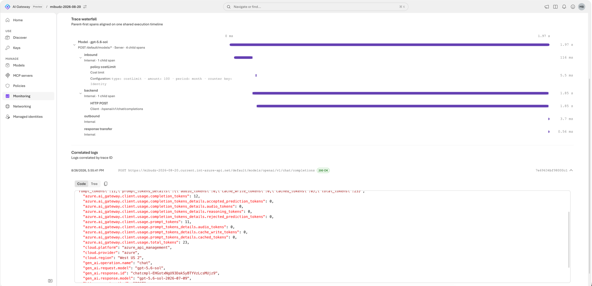

<!--
title: Monitor usage, cost, and traces
summary: Send the gateway's OpenTelemetry metrics, logs, and traces to Application Insights, then use the built-in Monitoring dashboard to see usage, estimated cost per model and API key, policy impact, and gateway-aware traces.
category: observability
level: Beginner
duration: 25
tracks: [portal, iac]
order: 13
illustration: diagrams/observability.svg
tags: [OpenTelemetry, OTLP, Application Insights, traces, estimated cost, KQL, GenAI semantic conventions]
objectives:
  - Explain how the gateway exports metrics, logs, and traces independently over OTLP
  - Connect the gateway to Application Insights in the portal, or provision the destination with Bicep
  - Read health, outcomes, policy impact, tokens, and estimated cost on the Monitoring dashboard
  - Follow one request through the trace waterfall, including its policy child spans
  - Query gateway telemetry in Log Analytics with KQL
prereqs:
  - 02-first-model-call
-->
<!-- gh:begin nav: generated by "npm run sync" from the metadata, do not edit -->
[AI Gateway labs](../README.md) › [Observability & FinOps](../README.md#observability--finops) › Lab 13
<!-- gh:end -->

# Monitor usage, cost, and traces

<!-- gh:begin intro: generated by "npm run sync" from the metadata, do not edit -->
> Send the gateway's OpenTelemetry metrics, logs, and traces to Application Insights, then use the built-in Monitoring dashboard to see usage, estimated cost per model and API key, policy impact, and gateway-aware traces.

| ⏱️ Time | 📶 Level | 🧭 Tracks | ✅ Before you start |
| :-- | :-- | :-- | :-- |
| 25 min | Beginner | Portal · Bicep | [02 · First model call](../02-first-model-call/README.md) |

**You'll learn to**

- Explain how the gateway exports metrics, logs, and traces independently over OTLP
- Connect the gateway to Application Insights in the portal, or provision the destination with Bicep
- Read health, outcomes, policy impact, tokens, and estimated cost on the Monitoring dashboard
- Follow one request through the trace waterfall, including its policy child spans
- Query gateway telemetry in Log Analytics with KQL

**Follow along:** 🌐 [Interactive version](https://azure.github.io/ai-gateway/labs/13-monitoring/) with your own values filled in · 📁 [Lab files](infra/)

**On this page:** [Before you begin](#before-you-begin) · [How it works](#how-it-works) · [Connect Application Insights](#connect-application-insights) · [Generate traffic](#generate-traffic) · [Tour the dashboard](#tour-the-dashboard) · [Follow a request through the trace waterfall](#follow-a-request-through-the-trace-waterfall) · [Query telemetry with KQL](#query-telemetry-with-kql) · [Verify](#verify) · [Go further](#go-further) · [Clean up](#clean-up) · [Troubleshooting](#troubleshooting) · [Next steps](#next-steps)
<!-- gh:end -->

Your gateway now serves several apps. Finance asks what the models cost per team, an app owner reports
intermittent failures, and nobody can tell whether a policy or the backend rejected those calls. In this lab you
send the gateway's OpenTelemetry signals to Application Insights and answer all three questions from the built-in
**Monitoring** dashboard, down to a single request's trace.


<!-- widget: request-lifecycle -->
<!-- gh:begin widget: generated by "npm run sync" from the metadata, do not edit -->
> 🎛️ **Interactive:** try the request lifecycle explorer in the [web version of this lab](https://azure.github.io/ai-gateway/labs/13-monitoring/).
<!-- gh:end -->

## Before you begin

- Complete [Publish a Foundry model and make your first call](../02-first-model-call/README.md). You need a gateway,
  an imported model, a callable alias, and a runtime API key from **Access** › **Keys**.
- Permission to change the gateway, for example **Contributor** on its resource group, **and** permission to
  create role assignments, for example **Owner** or **Role Based Access Control Administrator**. Setup grants the
  gateway's managed identity a role on the telemetry destination. To reuse an existing Application Insights
  resource, you also need **Application Insights Contributor** on it.
- To generate traffic: `curl` (Bash) or PowerShell 7. For the variable block below and the IaC track: the
  [Azure CLI](https://learn.microsoft.com/cli/azure/install-azure-cli) 2.75 or later, signed in with `az login`,
  and the `aigateway` extension ([install it](../01-provision-gateway/README.md#before-you-begin)).

Set these variables once. The tracks and the traffic script reuse them.

<details open><summary>Bash</summary> <!-- gh -->

```bash title="Bash"
export RG="<resource-group>"
export GATEWAY="<gateway>"
export AI_GATEWAY_MODEL="<model-name>"     # a callable alias, for example the one you used in lab 02

export API="api-version=2025-09-01-preview"
export GATEWAY_ID="$(az aigateway show -g "$RG" -n "$GATEWAY" --query id -o tsv)"
export WS="https://management.azure.com$GATEWAY_ID/workspaces/default"
export AI_GATEWAY_URL="https://$(az aigateway show -g "$RG" -n "$GATEWAY" --query properties.frontend.defaultHostname -o tsv)"
# Paste the runtime key you created in Access › Keys. Don't commit it or write it to a file.
read -rsp "AI Gateway API key: " AI_GATEWAY_API_KEY && export AI_GATEWAY_API_KEY && echo
```
</details> <!-- gh -->

<details><summary>PowerShell</summary> <!-- gh -->

```powershell title="PowerShell"
$RG      = "<resource-group>"
$GATEWAY = "<gateway>"
$env:AI_GATEWAY_MODEL = "<model-name>"     # a callable alias, for example the one you used in lab 02

$API        = "api-version=2025-09-01-preview"
$GATEWAY_ID = az aigateway show -g $RG -n $GATEWAY --query id -o tsv
$WS         = "https://management.azure.com$GATEWAY_ID/workspaces/default"
$env:AI_GATEWAY_URL = "https://$(az aigateway show -g $RG -n $GATEWAY --query properties.frontend.defaultHostname -o tsv)"
# Paste the runtime key you created in Access › Keys. Don't commit it or write it to a file.
$env:AI_GATEWAY_API_KEY = Read-Host "AI Gateway API key" -MaskInput
```
</details> <!-- gh -->

> [!IMPORTANT]
> Did you configure monitoring before the 2026-08-28 release? Reconfigure it to get logs, traces, cost metrics, and
> policy spans: on the **Monitoring** page select **Settings**, disable monitoring, and configure it again. You can
> select the same Application Insights resource.

## How it works

The gateway emits three OpenTelemetry signals and exports each one **independently** over OTLP, to Azure Application
Insights or to any OTLP endpoint (for example Datadog, Splunk, Grafana Cloud, or your own collector). Configure only
the signals you need. Telemetry follows the OpenTelemetry GenAI and MCP semantic conventions, such as
`gen_ai.request.model`, `gen_ai.operation.name`, and `mcp.method.name`, and adds gateway attributes such as the API
key, alias, resolved model, and policy type.

When the destination is Application Insights and all three signals are on, the **Monitoring** page turns that data
into a dashboard. Estimated cost is **observed tokens × public pricing**: use it to spot trends and compare callers,
then reconcile with provider billing or Azure Cost Management for financial reporting.

| Signal | What the gateway sends | Where it lands with Application Insights | Dashboard uses it for |
|---|---|---|---|
| Metrics | Token usage and estimated token cost, by model, token type, API key, and caller | Azure Monitor workspace (managed Prometheus) linked to Application Insights | Tokens and **Estimated model cost** |
| Traces | One root span per request, with child spans for each stage and each policy that ran | `OTelSpans` table in the Log Analytics workspace | Calls, outcomes, blocked traces, the trace waterfall |
| Logs | Request records with status, caller, model, and the token usage the backend reported | `OTelLogs` table in the Log Analytics workspace | Correlated logs and caller attribution |

## Connect Application Insights

Pick one track. Both end with the gateway exporting all three signals to an Application Insights resource named
`<gateway>-insights`.

<!-- track: portal | Portal -->
<details open><summary><b>🖥️ Portal</b></summary> <!-- gh -->

### Start the setup

Open the [AI Gateway portal](https://ai.gateway.azure.com) and select your gateway from the gateway switcher. Select
**Monitoring**. If monitoring isn't configured yet, the page shows **Set up monitoring**. Select
**Configure telemetry**. The wizard has three steps: **Destination**, **Authentication**, and **Review and apply**.

### Choose a destination

On **Destination**, select **New Azure Application Insights resource** and keep the suggested name,
`<gateway>-insights`. Select **Next**.

> [!TIP]
> The other choices are **Existing Azure Application Insights resource** (the IaC track uses it) and
> **Custom OpenTelemetry destination**, which takes separate **Metrics endpoint**, **Logs endpoint**, and
> **Traces endpoint** URLs. Leave an endpoint empty to turn that signal off. The built-in dashboard only reads
> Application Insights, so with a custom destination you use your own platform's views.

### Review authentication

On **Authentication**, the gateway exports with its managed identity. If none is enabled, the wizard enables the
system-assigned identity for you. It also assigns the **Monitoring Metrics Publisher** role on the destination's
Data Collection Rule when you apply.

Leave **Include recommended token claims in telemetry** selected. It adds Microsoft Entra caller claims to the
telemetry, which [Attribute tokens and cost with OpenTelemetry](../14-otel-chargeback/README.md) builds on. Select
**Next**.

### Apply the configuration

On **Review and apply**, select **Apply**. The wizard shows each step as it runs: **Register resource providers**,
**Resolve managed identity**, **Provision destination**, **Discover OTLP endpoints**,
**Assign Monitoring Metrics Publisher role**, and **Create telemetry exporter**. If a step fails, fix the cause
shown in the message and select **Retry**. If an Azure Policy assignment blocks a step, check the Activity Log for
the denied operation.

> **Checkpoint**
> The **Monitoring** page shows the **Overview**, **Models**, **Tools**, **Policies**, and **Traces** tabs, with
> **Open in Azure portal** and **Settings** in the header.

</details> <!-- gh -->
<!-- track: iac | Bicep -->
<details><summary><b>🏗️ Bicep</b></summary> <!-- gh -->

### Choose what to declare

A complete monitoring setup declares three resources: a Log Analytics workspace, a workspace-based Application
Insights component, and a gateway telemetry exporter of kind `applicationInsights`. The current portal treats that exporter kind as
**legacy**: it no longer activates the OTLP signals the dashboard needs. The OpenTelemetry exporter that replaces it
depends on OTLP endpoints and a role assignment that Azure creates on the fly, and that wiring isn't documented for
automation yet.

So this template declares the destination exactly as the sample does, and you connect it in the portal in one step.
The sample's exporter block is in the file for reference, switched off by `deployLegacyExporter`.

### Review the template

<!-- include: infra/main.bicep -->
<!-- gh:begin include: generated by "npm run sync" from the metadata, do not edit -->
📄 [`infra/main.bicep`](infra/main.bicep)

<details><summary>Show all 78 lines</summary>

```bicep
// Creates the Application Insights destination for AI Gateway telemetry: a Log Analytics workspace and a
// workspace-based Application Insights component.
//
// After you deploy it, connect the gateway in the portal: Monitoring › Configure telemetry ›
// Existing Azure Application Insights resource. The portal enables OTLP ingestion on the component, grants the
// gateway's managed identity the Monitoring Metrics Publisher role, and creates an OpenTelemetry exporter.

@description('Name of the existing AI Gateway (Microsoft.ApiManagement/aigateways).')
param gatewayName string

@description('Location for the monitoring resources.')
param location string = resourceGroup().location

@description('Application Insights component name. The portal suggests <gateway>-insights for new destinations.')
param appInsightsName string = '${gatewayName}-insights'

@description('Log Analytics workspace that stores the OTelSpans and OTelLogs tables.')
param logAnalyticsWorkspaceName string = take('${gatewayName}-logs', 63)

@description('Tags applied to the monitoring resources.')
param tags object = {}

@description('Also create the sample\'s telemetry exporter (kind applicationInsights). The portal flags this kind as legacy because it no longer activates OTLP signals. Leave false and connect in the portal.')
param deployLegacyExporter bool = false

resource logAnalyticsWorkspace 'Microsoft.OperationalInsights/workspaces@2023-09-01' = {
  name: logAnalyticsWorkspaceName
  location: location
  tags: tags
  properties: {
    retentionInDays: 30
    features: {
      enableLogAccessUsingOnlyResourcePermissions: true
    }
    sku: {
      name: 'PerGB2018'
    }
  }
}

resource appInsights 'Microsoft.Insights/components@2020-02-02' = {
  name: appInsightsName
  location: location
  kind: 'web'
  tags: tags
  properties: {
    Application_Type: 'web'
    WorkspaceResourceId: logAnalyticsWorkspace.id
  }
}

resource gateway 'Microsoft.ApiManagement/aigateways@2025-09-01-preview' existing = {
  name: gatewayName
}

resource defaultWorkspace 'Microsoft.ApiManagement/aigateways/workspaces@2025-09-01-preview' existing = {
  parent: gateway
  name: 'default'
}

// The reference sample's exporter, unchanged. Kept for reference only: see deployLegacyExporter.
resource telemetryExporter 'Microsoft.ApiManagement/aigateways/workspaces/telemetryExporters@2025-09-01-preview' = if (deployLegacyExporter) {
  parent: defaultWorkspace
  name: 'appinsights'
  properties: {
    kind: 'applicationInsights'
    payloadCapture: false
    applicationInsights: {
      connectionString: appInsights.properties.ConnectionString
      resourceId: appInsights.id
    }
  }
}

output appInsightsId string = appInsights.id
output appInsightsName string = appInsights.name
output logAnalyticsWorkspaceId string = logAnalyticsWorkspace.id
output logAnalyticsWorkspaceName string = logAnalyticsWorkspace.name
```

</details>
<!-- gh:end -->

On GitHub, open [infra/main.bicep](infra/main.bicep).

### Deploy it

<details open><summary>Bash</summary> <!-- gh -->

```bash title="Bash"
az deployment group create -g "$RG" \
  --template-file infra/main.bicep \
  --parameters gatewayName="$GATEWAY" \
  --query properties.outputs
```
</details> <!-- gh -->

<details><summary>PowerShell</summary> <!-- gh -->

```powershell title="PowerShell"
az deployment group create -g $RG `
  --template-file infra/main.bicep `
  --parameters gatewayName=$GATEWAY `
  --query properties.outputs
```
</details> <!-- gh -->

The outputs list `appInsightsName` (`<gateway>-insights`) and the Log Analytics workspace ID.

### Connect the gateway to it

In the [AI Gateway portal](https://ai.gateway.azure.com), select your gateway, then **Monitoring** ›
**Configure telemetry**. On **Destination**, select **Existing Azure Application Insights resource**, and pick
`<gateway>-insights` in **Application Insights resource**. The wizard checks OTLP support and tells you it will be
enabled automatically when you apply. Select **Next**.

On **Authentication**, leave **Include recommended token claims in telemetry** selected and select **Next**. On
**Review and apply**, select **Apply** and wait for every step, ending with **Create telemetry exporter**.

> **Checkpoint**
> The **Monitoring** page shows the **Overview**, **Models**, **Tools**, **Policies**, and **Traces** tabs. In
> **Settings**, the destination is your `<gateway>-insights` resource and no legacy exporter warning is shown.

</details> <!-- gh -->
<!-- /tracks -->

## Generate traffic

The dashboard needs data. Send a few requests through the gateway so every view has something to show.

<!-- steps -->

### Run the traffic script

From the lab folder, run the script for your shell. It sends ten chat completions with an `x-correlation-id` header
on each, then one request for an alias that doesn't exist, so you also get a failure to investigate.

<details open><summary>Bash</summary> <!-- gh -->

```bash title="Bash"
./infra/generate-traffic.sh "$AI_GATEWAY_MODEL" 10
```
</details> <!-- gh -->

<details><summary>PowerShell</summary> <!-- gh -->

```powershell title="PowerShell"
./infra/generate-traffic.ps1 -Model $env:AI_GATEWAY_MODEL -Requests 10
```
</details> <!-- gh -->

On GitHub, open [generate-traffic.sh](infra/generate-traffic.sh) or
[generate-traffic.ps1](infra/generate-traffic.ps1).

Expected output: ten `200` rows and a final `error` row with a `4xx` status. Telemetry can take a few minutes to
reach the dashboard.

> [!TIP]
> Sending `x-correlation-id` from your apps makes application-level investigations easier. Never put personal data,
> secrets, prompts, or regulated identifiers in it.

<!-- /steps -->

## Tour the dashboard

Each tab answers a different question. Use the time range buttons (**1H**, **24H**, **7D**, **30D**) to match your
traffic.

<!-- steps -->

### Overview: is the gateway healthy, and what does it cost?

Select **Monitoring** › **Overview**. The cards summarize the range: **Estimated model cost**, **Model calls**,
**Tool calls**, **Trace failure rate**, and **Blocked traces**. Below them, **Model and tool calls over time**
stacks both kinds of traffic, **Top models** ranks models by estimated cost with their 4xx and 5xx error rates, and
**Top tool servers** ranks MCP servers by calls. **Recent traces requiring attention** and
**Top blocking policies** take you straight to problems.


### Models: who uses which model, and how many tokens?

Select **Models**. Each row is a responding model with its **Aliases**, **Calls**, **Input tokens**,
**Output tokens**, **Cached input tokens**, **Token share**, error counts, **Caller identities**, and
**Estimated cost**. **Model usage by caller identity** breaks usage and estimated cost down by API key or Entra
caller. That's your first view of cost by API key and model.

> [!NOTE]
> If you see "Model token and estimated cost data are incomplete until you add a Prometheus access token", follow
> the prompt: run `az account get-access-token --resource https://prometheus.monitor.azure.com --query accessToken -o tsv`
> and paste the value into **Prometheus access token**.

### Tools: which MCP tools are called?

Select **Tools**. You see **Total tool calls**, **Active tool servers**, **Usage by tool server**,
**Top tools within tool servers**, and **Tool usage by caller identity**. It stays empty until agents call tools
through the gateway, as in [Federate MCP tools behind one endpoint](../04-federate-mcp-tools/README.md).

### Policies: what did governance block?

Select **Policies**. The summary shows **Requests blocked**, **Caller identities blocked**, and
**Assets with blocked calls**. The table lists each **Policy type** with **Allowed requests**,
**Blocked requests**, and **Last executed**. After [Throttle tokens per caller](../06-token-limits/README.md), the
token limit's `429` responses show up here.

### Traces: find the failed request

Select **Traces**. Each row shows **Time**, **Assets**, **Outcome**, and **Applied policies**. Find the request
for `does-not-exist` from the script, or use **Search trace ID, asset, policy, or reason**.

<!-- /steps -->

> **Checkpoint**
> **Overview** shows the model calls you sent and a non-zero **Estimated model cost**, **Models** shows your API key
> as a caller identity, and **Traces** lists the failed request.

## Follow a request through the trace waterfall

A gateway-aware trace shows where time went and which policies ran, so you can tell a policy rejection from a
backend failure at a glance.

<!-- steps -->

### Open a successful trace

On **Traces**, select a successful model call. The header shows the **Trace ID**, the number of **Spans**, and the
**Duration**.

### Read the waterfall

**Trace waterfall** draws parent-first spans on one timeline. The root span is the model request, for example
`Model · <model-name>` on `POST /default/models/*`. Under it:

| Child span | What it measures |
|---|---|
| **inbound** | Work before the backend call. Each policy that ran is a child span, such as `policy costLimit` with its configuration. |
| **backend** | The call to the provider, for example `HTTP POST` on `/openai/v1/chat/completions`. |
| **outbound** | Work on the response before it returns to the client. |
| **response transfer** | Sending the response back to the client. |



### Read the correlated logs

Under **Correlated logs**, expand the request log and switch between **Code** and **Tree**. Look for:

- `gen_ai.operation.name` (for example `chat`), `gen_ai.request.model` (the alias you sent), and
  `gen_ai.response.model` (the versioned model that answered).
- `azure.ai_gateway.client.usage.prompt_tokens`, `...completion_tokens`, and `...total_tokens`: the usage the
  backend reported for this one call.

<!-- /steps -->

> **Checkpoint**
> You can point to the policy spans under **inbound**, compare **backend** time with total time, and read the
> token usage of one request in its correlated log.

## Query telemetry with KQL

The dashboard reads the `OTelSpans` and `OTelLogs` tables in the Log Analytics workspace behind Application Insights.
You can query them directly to build your own reports and alerts.

<!-- steps -->

### Open Logs

In the [Azure portal](https://portal.azure.com), open the Log Analytics workspace linked to your Application Insights
resource (`<gateway>-logs` if you used the Bicep template) and select **Logs**. Switch the editor to **KQL mode**.

### Run the starter queries

Copy a query from [infra/queries.kql](infra/queries.kql) and run it. Start with query 2 (calls by alias, resolved
model, and API key) and query 3 (token usage per model and API key).

<!-- include: infra/queries.kql kusto -->
<!-- gh:begin include: generated by "npm run sync" from the metadata, do not edit -->
📄 [`infra/queries.kql`](infra/queries.kql)

<details><summary>Show all 102 lines</summary>

```kusto
// Starting-point KQL queries for AI Gateway telemetry. Adapt them to your traffic before you rely on them.
//
// Where to run them: the Log Analytics workspace behind your Application Insights resource, Logs, KQL mode.
// Select one query and run it.
//
// AI Gateway exports OpenTelemetry (OTLP) signals. Traces land in the OTelSpans table and logs in the
// OTelLogs table; span and log attributes are in the dynamic Attributes column. Attribute names follow the
// OpenTelemetry GenAI and MCP semantic conventions (gen_ai.request.model, gen_ai.response.model,
// gen_ai.operation.name, gen_ai.tool.name, mcp.method.name) plus gateway attributes (azure.ai_gateway.*,
// azure.apim.*). Run `OTelSpans | take 10` first and check the names your data actually carries.
// Token and cost metrics go to the Azure Monitor workspace (Prometheus), not to these tables.

// 1. Model and tool server requests over time, by outcome
OTelSpans
| where TimeGenerated > ago(24h)
| where Kind =~ "Server"
| extend Route = tostring(Attributes["http.route"]),
         Status = coalesce(toint(Attributes["http.response.status_code"]), toint(Attributes["http.status_code"]), toint(ResultCode))
| extend Asset = case(Route contains "/models/", "model", Route contains "/toolservers/", "tool server", "other"),
         Outcome = case(Status between (200 .. 399), "2xx-3xx", Status between (400 .. 499), "4xx", Status >= 500, "5xx", "unknown")
| summarize Requests = count() by bin(TimeGenerated, 15m), Series = strcat(Asset, " ", Outcome)
| render timechart

// 2. Model calls by requested alias, resolved model, and API key, with errors and latency
OTelSpans
| where TimeGenerated > ago(24h)
| where Kind =~ "Server" and tostring(Attributes["http.route"]) contains "/models/"
| extend RequestedModel = tostring(Attributes["gen_ai.request.model"]),
         ResolvedModel = tostring(Attributes["azure.ai_gateway.resolved_model.name"]),
         ApiKeyId = tostring(Attributes["azure.ai_gateway.api_key_id"]),
         Status = coalesce(toint(Attributes["http.response.status_code"]), toint(Attributes["http.status_code"]), toint(ResultCode))
| summarize Calls = count(), Errors4xx = countif(Status between (400 .. 499)), Errors5xx = countif(Status >= 500),
            P95DurationMs = percentile(DurationMs, 95)
    by RequestedModel, ResolvedModel, ApiKeyId
| order by Calls desc

// 3. Token usage reported by the backend, per model and API key (from request logs)
//    Chat Completions reports prompt/completion tokens; the Responses API reports input/output tokens.
//    Cached input tokens are part of the input tokens. Missing usage means "unknown", not zero.
OTelLogs
| where TimeGenerated > ago(24h)
| extend Model = tostring(Attributes["gen_ai.request.model"]),
         ApiKeyId = tostring(Attributes["azure.ai_gateway.api_key_id"]),
         InputTokens = coalesce(tolong(Attributes["azure.ai_gateway.client.usage.prompt_tokens"]), tolong(Attributes["azure.ai_gateway.client.usage.input_tokens"])),
         OutputTokens = coalesce(tolong(Attributes["azure.ai_gateway.client.usage.completion_tokens"]), tolong(Attributes["azure.ai_gateway.client.usage.output_tokens"])),
         CachedInputTokens = coalesce(tolong(Attributes["azure.ai_gateway.client.usage.prompt_tokens_details.cached_tokens"]), tolong(Attributes["azure.ai_gateway.client.usage.input_tokens_details.cached_tokens"]))
| where isnotnull(InputTokens) or isnotnull(OutputTokens)
| summarize Requests = count(), InputTokens = sum(InputTokens), CachedInputTokens = sum(CachedInputTokens),
            OutputTokens = sum(OutputTokens)
    by Model, ApiKeyId
| extend TotalTokens = InputTokens + OutputTokens
| order by TotalTokens desc

// 4. Policy impact: which policies ran, and how often the request ended in 4xx
//    A 4xx on a trace where a policy ran usually means that policy rejected it. Open the trace to confirm.
let requests = OTelSpans
| where TimeGenerated > ago(24h)
| where Kind =~ "Server"
| project TraceId, Status = coalesce(toint(Attributes["http.response.status_code"]), toint(Attributes["http.status_code"]), toint(ResultCode));
OTelSpans
| where TimeGenerated > ago(24h)
| extend PolicyType = tostring(Attributes["azure.apim.policy.type"]), ErrorType = tostring(Attributes["error.type"])
| where isnotempty(PolicyType)
| where PolicyType !in ("forward-request", "set-backend-service", "llm-emit-token-metric", "llm-emit-cost-metric")
| join kind=inner requests on TraceId
| summarize Requests = dcount(TraceId), RequestsEndingIn4xx = dcountif(TraceId, Status between (400 .. 499)),
            ErrorTypes = make_set_if(ErrorType, isnotempty(ErrorType), 5), LastExecuted = max(TimeGenerated)
    by PolicyType
| order by RequestsEndingIn4xx desc

// 5. Slowest model calls: total time versus time spent waiting for the backend
let backend = OTelSpans
| where TimeGenerated > ago(24h)
| where Name == "backend"
| project TraceId, BackendMs = DurationMs;
OTelSpans
| where TimeGenerated > ago(24h)
| where Kind =~ "Server" and tostring(Attributes["http.route"]) contains "/models/"
| project TimeGenerated, TraceId, Model = tostring(Attributes["gen_ai.request.model"]), TotalMs = DurationMs
| join kind=leftouter backend on TraceId
| extend GatewayMs = TotalMs - BackendMs
| project TimeGenerated, TraceId, Model, TotalMs, BackendMs, GatewayMs
| top 20 by TotalMs desc

// 6. MCP tool calls by tool name
OTelSpans
| where TimeGenerated > ago(24h)
| extend Operation = coalesce(tostring(Attributes["gen_ai.operation.name"]), tostring(Attributes["azure.ai_gateway.operation.name"]), tostring(Attributes["mcp.method.name"])),
         ToolName = tostring(Attributes["gen_ai.tool.name"])
| where Operation =~ "tools/call" or Name startswith "tools/call "
| where isnotempty(ToolName)
| summarize Calls = count(), Errors = countif(StatusCode =~ "Error") by ToolName
| order by Calls desc

// 7. Every span of one trace, in order (paste a trace ID from Monitoring › Traces)
let traceId = "<trace-id>";
OTelSpans
| where TimeGenerated > ago(30d)
| where TraceId == traceId
| project TimeGenerated, SpanId, ParentSpanId, Name, Kind, DurationMs, StatusCode,
          PolicyType = tostring(Attributes["azure.apim.policy.type"]), Attributes
| order by TimeGenerated asc
```

</details>
<!-- gh:end -->

On GitHub, open [infra/queries.kql](infra/queries.kql).

These queries are starting points. Attribute names follow the OpenTelemetry GenAI conventions plus gateway
attributes. Run `OTelSpans | take 10` to see what your data carries, and adapt names before you build alerts on
them.

<!-- /steps -->

> **Checkpoint**
> Query 2 returns one row per alias and API key with your call count, and query 3 returns input and output token
> totals that match the order of magnitude on the **Models** tab.

## Verify

<!-- steps -->

### Match the dashboard to your traffic

Run the traffic script once more with five requests, wait a few minutes, and refresh **Monitoring** › **Overview**
with **1H** selected. **Model calls** grows by at least five.

### Confirm all signals are flowing

Open **Settings**. All three signals point at your Application Insights resource, and the dashboard doesn't show
"Enable all telemetry signals".

To check the exporter from the CLI, list the gateway's telemetry exporters. The `aigateway` extension doesn't
manage telemetry exporters yet, so call the Azure Resource Manager REST API with `az rest`:

<details open><summary>Bash</summary> <!-- gh -->

```bash title="Bash"
az rest --url "$WS/telemetryExporters?$API" --query "value[].{name:name, kind:properties.kind}" -o table
```
</details> <!-- gh -->

<details><summary>PowerShell</summary> <!-- gh -->

```powershell title="PowerShell"
az rest --url "$WS/telemetryExporters?$API" --query "value[].{name:name, kind:properties.kind}" -o table
```
</details> <!-- gh -->

The exporter that the portal creates has kind `openTelemetry`. Kind `applicationInsights` is the legacy exporter
from [Troubleshooting](#troubleshooting).

<!-- /steps -->

## Go further

- **Query the token metrics.** Token and cost metrics land in the Azure Monitor workspace linked to Application
  Insights as `azure.ai_gateway.client.token.usage` and `azure.ai_gateway.client.token.cost`, with labels such as
  `gen_ai.request.model` and `gen_ai.token.type`. Docs show PromQL in its underscore form, for example
  `sum by (gen_ai_request_model) (gen_ai_client_token_usage)`. Check which names your backend received before you
  build on them. [Attribute tokens and cost with OpenTelemetry](../14-otel-chargeback/README.md) queries them.
- **Alert on what you can act on.** Start with token usage spikes, backend authentication failures, and telemetry
  export failures. Route each alert to an owner who can investigate the gateway, backend, policy, or destination.
- **Send telemetry somewhere else.** Use **Custom OpenTelemetry destination** to export to any OTLP endpoint. Store
  any credential headers as secrets.
- **Capture payloads carefully.** **Settings** › **Logging** has **Log request and response payloads**. It's off by
  default because prompts and responses can be sensitive and add volume.

## Clean up

Application Insights and Log Analytics bill for ingestion and retention. If you continue with
[Attribute tokens and cost with OpenTelemetry](../14-otel-chargeback/README.md), keep everything.

<!-- track: portal | Portal -->
<details open><summary><b>🖥️ Portal</b></summary> <!-- gh -->

### Disable monitoring

On the **Monitoring** page, select **Settings** › **General** › **Disable monitoring**. This stops the export but
doesn't delete the destination.

### Delete the destination

In the [Azure portal](https://portal.azure.com), delete the `<gateway>-insights` Application Insights resource and its
Log Analytics workspace if nothing else uses them. Enabling OTLP can also create an Azure Monitor workspace and a
Data Collection Rule for the metrics. Check the resource group for them and delete them if they're unused.

</details> <!-- gh -->
<!-- track: iac | Bicep -->
<details><summary><b>🏗️ Bicep</b></summary> <!-- gh -->

### Disable monitoring

On the **Monitoring** page, select **Settings** › **General** › **Disable monitoring**.

### Delete the destination

```bash
az resource delete -g "$RG" -n "$GATEWAY-insights" --resource-type Microsoft.Insights/components
az resource delete -g "$RG" -n "$GATEWAY-logs" --resource-type Microsoft.OperationalInsights/workspaces
```

If OTLP setup created an Azure Monitor workspace and a Data Collection Rule, delete them too if they're unused.

</details> <!-- gh -->
<!-- /tracks -->

Keep the gateway, model, and key. The next labs reuse them.

## Troubleshooting

| Symptom | Likely cause | Fix |
|---|---|---|
| "Enable all telemetry signals" on the dashboard | Metrics, logs, or traces is turned off | Select **Open Monitoring settings** and set all three endpoints, or disable monitoring and configure it again with Application Insights. |
| "This legacy exporter no longer activates OTLP signals" in **Settings** | The exporter has kind `applicationInsights`, for example from the sample's Bicep or a setup before 2026-08-28 | Select **Settings** › **General** › **Disable monitoring**, then **Configure telemetry** again with the same Application Insights resource. |
| **Assign Monitoring Metrics Publisher role** fails | You can't create role assignments on the destination | Ask an **Owner** to grant the role on the Data Collection Rule, or to run the setup. |
| **Discover OTLP endpoints** fails with "Could not resolve the Data Collection Rule" | OTLP support was just enabled and Azure is still provisioning it | Wait a few minutes, then select **Retry**. |
| "Model token and estimated cost data are incomplete until you add a Prometheus access token" | The portal can't read the metrics workspace with your session | Paste a token from `az account get-access-token --resource https://prometheus.monitor.azure.com --query accessToken -o tsv` into **Prometheus access token**. |
| Dashboard and queries are empty | No traffic in the selected range, or ingestion is still catching up | Widen the time range, wait a few minutes, and run the traffic script again. |

## Next steps

- [Attribute tokens and cost with OpenTelemetry](../14-otel-chargeback/README.md): build a chargeback report by tenant, app, and claim.
- [Throttle tokens per caller with token limits](../06-token-limits/README.md): act on what the dashboard shows.
- [Enforce cost budgets with per-caller overrides](../07-cost-budgets/README.md): turn estimated cost into a hard budget.
- Docs: [Observability in AI Gateway](https://ai.gateway.azure.com/docs/observability).

<!-- gh:begin footer: generated by "npm run sync" from the metadata, do not edit -->

---

| ⬅️ Previous | 🏠 | Next ➡️ |
| :-- | :-: | --: |
| [12 · Backend identities](../12-backend-identity/README.md) | [All labs](../README.md) | [14 · OpenTelemetry chargeback](../14-otel-chargeback/README.md) |

<sub>Learning paths: [FinOps & operations](../README.md#learning-paths) (4 of 5)</sub>
<!-- gh:end -->
