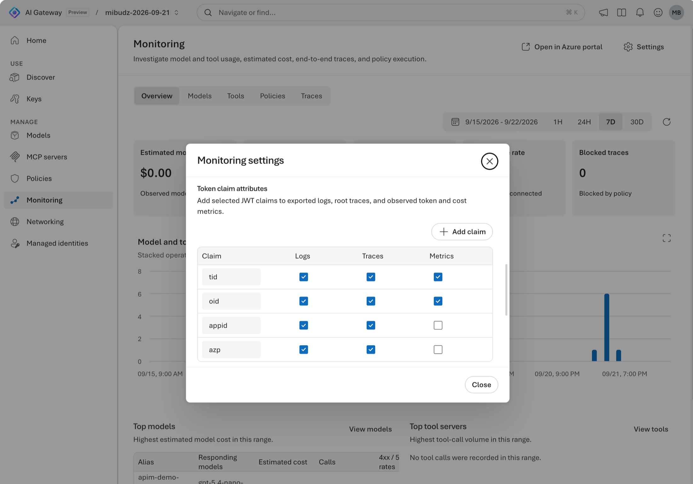

<!--
title: Attribute tokens and cost with OpenTelemetry
summary: Export Microsoft Entra token claims with the gateway's logs, traces, and token metrics, then turn observed tokens into a per-tenant, per-app, and per-key chargeback report with KQL, PromQL, and a small Python script.
category: observability
level: Advanced
duration: 35
tracks: [portal, rest, iac]
order: 14
status: new
illustration: diagrams/observability.svg
tags: [OpenTelemetry, token claims, chargeback, estimated cost, KQL, PromQL, Prometheus, Microsoft Entra ID]
objectives:
  - Choose which JWT claims the gateway exports to logs, root traces, and token and cost metrics
  - Check which claims your callers' tokens actually carry before you rely on them
  - Build a chargeback report from request logs by tenant, client app, and API key
  - Query token and cost metrics with PromQL without double counting token types
prereqs:
  - 13-monitoring
  - 11-entra-rbac
-->
<!-- gh:begin nav: generated by "npm run sync" from the metadata, do not edit -->
[AI Gateway labs](../README.md) › [Observability & FinOps](../README.md#observability--finops) › Lab 14
<!-- gh:end -->

# Attribute tokens and cost with OpenTelemetry

<!-- gh:begin intro: generated by "npm run sync" from the metadata, do not edit -->
> Export Microsoft Entra token claims with the gateway's logs, traces, and token metrics, then turn observed tokens into a per-tenant, per-app, and per-key chargeback report with KQL, PromQL, and a small Python script.

| ⏱️ Time | 📶 Level | 🧭 Tracks | ✅ Before you start |
| :-- | :-- | :-- | :-- |
| 35 min | Advanced | Portal · REST API · Bicep + azd | [13 · Monitoring](../13-monitoring/README.md)<br>[11 · Entra ID & RBAC](../11-entra-rbac/README.md) |

**You'll learn to**

- Choose which JWT claims the gateway exports to logs, root traces, and token and cost metrics
- Check which claims your callers' tokens actually carry before you rely on them
- Build a chargeback report from request logs by tenant, client app, and API key
- Query token and cost metrics with PromQL without double counting token types

**Follow along:** 🌐 [Interactive version](https://azure.github.io/ai-gateway/labs/14-otel-chargeback/) with your own values filled in · 📁 [Lab files](infra/)

**On this page:** [Before you begin](#before-you-begin) · [How it works](#how-it-works) · [Choose the claims to export](#choose-the-claims-to-export) · [Send attributed traffic](#send-attributed-traffic) · [Build a chargeback report](#build-a-chargeback-report) · [Query token and cost metrics with PromQL](#query-token-and-cost-metrics-with-promql) · [Verify](#verify) · [Go further](#go-further) · [Clean up](#clean-up) · [Next steps](#next-steps)
<!-- gh:end -->

Three teams and a partner tenant share your gateway. Some call it with API keys, others with Microsoft Entra ID.
Finance wants a monthly report of who used which model and what it cost. In this lab you export the right token
claims with the gateway's telemetry, send traffic as both kinds of caller, and build that report from the data
Application Insights already collects.


## Before you begin

<!-- setup: tools sign-in extension clone -->
<!-- gh:begin setup: generated by "npm run sync" from the metadata, do not edit -->
🧰 **One-time setup** from the [Setup guide](../SETUP.md), if you haven't done it yet:
[Choose where to run commands](../SETUP.md#choose-where-to-run-commands) ·
[Sign in to Azure](../SETUP.md#sign-in-to-azure) ·
[Install the `aigateway` extension](../SETUP.md#install-the-aigateway-extension) ·
[Clone the labs repo](../SETUP.md#clone-the-labs-repo)
<!-- gh:end -->

> [!TIP]
> On the **Bicep + azd** track, `azd up` creates its own gateway, model, key, Application Insights, and role
> assignment, so you can skip this section. You need only the one-time setup above, and permission to create role
> assignments, for example **Owner** on the subscription. The later sections also use Python 3.10 or later.

- Complete [Monitor usage, cost, and traces](../13-monitoring/README.md) with **Configure telemetry**, so the
  gateway exports all three signals to Application Insights with an OpenTelemetry exporter.
- Complete [Go keyless with Microsoft Entra ID and RBAC](../11-entra-rbac/README.md), or make sure your signed-in
  user has **AI Gateway Models User** (or **AI Gateway User**) on the gateway or on the model alias.
- Permission to change the gateway, for example **Contributor** on its resource group, and **Log Analytics Reader**
  on the workspace behind Application Insights.
- Python 3.10 or later.
- Run the scripts and samples from the lab's folder, `~/ai-gateway/labs/14-otel-chargeback`.

Set these variables once. If you named the Application Insights resource differently in lab 13, change
`$GATEWAY-insights`.

<details open><summary>Bash</summary> <!-- gh -->

```bash title="Bash"
# Name your gateway and the alias to call, and pin the API version of the REST calls
export RG="<resource-group>"
export GATEWAY="<gateway>"
export AI_GATEWAY_MODEL="<model-name>"     # a callable alias
export API="api-version=2025-09-01-preview"
echo "📝 Gateway $GATEWAY in $RG, alias $AI_GATEWAY_MODEL"

# Read the gateway's resource ID, the URL of its default workspace for the REST calls, and its runtime URL
export GATEWAY_ID="$(az aigateway show -g "$RG" -n "$GATEWAY" --query id -o tsv)"
export WS="https://management.azure.com$GATEWAY_ID/workspaces/default"
export AI_GATEWAY_URL="https://$(az aigateway show -g "$RG" -n "$GATEWAY" --query properties.frontend.defaultHostname -o tsv)"
echo "🆔 Gateway: $GATEWAY_ID"
echo "🌐 Runtime URL: $AI_GATEWAY_URL"

# Read your API key without showing it, and export it for the scripts
read -rsp "AI Gateway API key: " AI_GATEWAY_API_KEY && export AI_GATEWAY_API_KEY && echo
echo "🔑 Key: in AI_GATEWAY_API_KEY (${#AI_GATEWAY_API_KEY} characters, not shown)"

# Find the Application Insights resource from lab 13, and the Log Analytics workspace behind it
APPI_ID="$(az resource show -g "$RG" -n "$GATEWAY-insights" --resource-type Microsoft.Insights/components --query id -o tsv)"
LAW_ID="$(az resource show --ids "$APPI_ID" --api-version 2020-02-02 --query properties.WorkspaceResourceId -o tsv)"
echo "🆔 Application Insights: $APPI_ID"
echo "🆔 Log Analytics workspace: $LAW_ID"
```
</details> <!-- gh -->

<details><summary>PowerShell</summary> <!-- gh -->

```powershell title="PowerShell"
# Name your gateway and the alias to call, and pin the API version of the REST calls
$RG      = "<resource-group>"
$GATEWAY = "<gateway>"
$env:AI_GATEWAY_MODEL = "<model-name>"     # a callable alias
$API     = "api-version=2025-09-01-preview"
Write-Host "📝 Gateway $GATEWAY in $RG, alias $env:AI_GATEWAY_MODEL"

# Read the gateway's resource ID, the URL of its default workspace for the REST calls, and its runtime URL
$GATEWAY_ID = az aigateway show -g $RG -n $GATEWAY --query id -o tsv
$WS         = "https://management.azure.com$GATEWAY_ID/workspaces/default"
$env:AI_GATEWAY_URL = "https://$(az aigateway show -g $RG -n $GATEWAY --query properties.frontend.defaultHostname -o tsv)"
Write-Host "🆔 Gateway: $GATEWAY_ID"
Write-Host "🌐 Runtime URL: $env:AI_GATEWAY_URL"

# Read your API key without showing it, and keep it in an environment variable for the scripts
$env:AI_GATEWAY_API_KEY = Read-Host "AI Gateway API key" -MaskInput
Write-Host "🔑 Key: in AI_GATEWAY_API_KEY ($($env:AI_GATEWAY_API_KEY.Length) characters, not shown)"

# Find the Application Insights resource from lab 13, and the Log Analytics workspace behind it
$APPI_ID = az resource show -g $RG -n "$GATEWAY-insights" --resource-type Microsoft.Insights/components --query id -o tsv
$LAW_ID  = az resource show --ids $APPI_ID --api-version 2020-02-02 --query properties.WorkspaceResourceId -o tsv
Write-Host "🆔 Application Insights: $APPI_ID"
Write-Host "🆔 Log Analytics workspace: $LAW_ID"
```
</details> <!-- gh -->

## How it works

Every request already carries its caller. An API key call is attributed by the key's ID
(`azure.ai_gateway.api_key_id`). A Microsoft Entra call carries a validated JWT, and **token claim attributes**
copy the claims you pick into telemetry as `azure.ai_gateway.identity.claims.<claim>`. For each claim you choose the
signals independently: **logs**, **root traces**, and **observed token and cost metrics**.

Logs hold the per-request token usage the backend reported, so they're the best source for a detailed report.
Metrics are cheaper to query over long ranges, but every exported claim value becomes a label, so keep metrics to
claims with a bounded number of values.

Estimated cost is **observed tokens × public pricing**. Treat it as an allocation key and reconcile the total with
provider billing or Azure Cost Management.

| Claim | Identifies | Recommended preset | Use it for |
|---|---|---|---|
| `tid` | The caller's tenant | Logs, Traces, Metrics | Tenant or customer totals. With `oid`, the dashboard's Entra caller. |
| `oid` | The user, service principal, or managed identity | Logs, Traces, Metrics | Per-caller totals |
| `appid` (v1 tokens), `azp` (v2 tokens) | The client application | Logs, Traces | Per-app chargeback. This lab adds Metrics. |
| A custom claim, such as `cost_center` | Whatever your tokens carry | You choose | Team chargeback, if the claim is in the token |

## Choose the claims to export

You keep the recommended preset and add **Metrics** for `appid` and `azp`, so token and cost metrics can also be
split by client app.

<!-- track: portal | Portal -->
<details open><summary><b>🖥️ Portal</b></summary> <!-- gh -->

### Open the token claim attributes

In the [AI Gateway portal](https://ai.gateway.azure.com), select your gateway, then **Monitoring** › **Settings**.
On the **Logging** tab, find **Token claim attributes**: "Add selected JWT claims to exported logs, root traces, and
observed token and cost metrics." Each row is a claim with **Logs**, **Traces**, and **Metrics** checkboxes.



> [!NOTE]
> No **Token claim attributes** section? It's only shown for OpenTelemetry exporters. Reconfigure monitoring as
> in [Monitor usage, cost, and traces](../13-monitoring/README.md). If the table is empty ("No token claims are
> included in exported telemetry"), add `tid`, `oid`, `appid`, and `azp` with **Add claim**.

### Add metrics for the client app

Select **Metrics** for `appid` and for `azp`. Leave `tid` and `oid` on all three signals: the dashboard needs
both on metrics to attribute Entra callers. Changes save automatically while "Saving changes…" is shown. Every
claim needs at least one signal.

> [!TIP]
> **Add claim** adds a row (the placeholder suggests `cost_center`) that starts with **Logs** and **Traces**.
> Only add claims that your callers' tokens carry. The next section shows how to check.

</details> <!-- gh -->
<!-- track: rest | REST API -->
<details><summary><b>🔗 REST API</b></summary> <!-- gh -->

### Read the current configuration

The claim attributes live on the gateway's telemetry exporter. The `aigateway` extension doesn't manage telemetry
exporters yet, so call the Azure Resource Manager REST API with `az rest`. List the exporters and their claims:

<details open><summary>Bash</summary> <!-- gh -->

```bash title="Bash"
# List the gateway's telemetry exporters, with the kind of each one and the token claims it exports
echo "📊 Telemetry exporters and their claims:"
az rest --method get --url "$WS/telemetryExporters?$API" \
  --query "value[].{name:name, kind:properties.kind, claims:properties.telemetry.attributes}"
```
</details> <!-- gh -->

<details><summary>PowerShell</summary> <!-- gh -->

```powershell title="PowerShell"
# List the gateway's telemetry exporters, with the kind of each one and the token claims it exports
Write-Host "📊 Telemetry exporters and their claims:"
az rest --method get --url "$WS/telemetryExporters?$API" `
  --query "value[].{name:name, kind:properties.kind, claims:properties.telemetry.attributes}"
```
</details> <!-- gh -->

Expected output: one exporter of kind `OpenTelemetry`, usually named `appinsights`, whose claims list `tid`, `oid`,
`appid`, and `azp`, each with its `signals`. A kind of `applicationInsights` is the legacy exporter. Reconfigure
monitoring as in [Monitor usage, cost, and traces](../13-monitoring/README.md) first.

### Change it in the portal

Make the change in the portal: open **Monitoring** › **Settings** › **Logging** › **Token claim attributes** and
select **Metrics** for `appid` and `azp`. To automate it, declare the claims in the exporter's
`telemetry.attributes` list, as the **Bicep + azd** track does. Then run the `GET` again. Both claims now list
`metrics` in their `signals`.

</details> <!-- gh -->
<!-- track: iac | Bicep + azd -->
<details><summary><b>🏗️ Bicep + azd</b></summary> <!-- gh -->

**What you need:** only the one-time setup from **Before you begin**. This track doesn't use your gateway from the
earlier labs: `azd up` creates a new one, so it works on its own.

### Choose what to declare

The templates reuse lab 13's and lab 11's. Lab 13's
[monitoring.bicep](../13-monitoring/infra/monitoring.bicep) creates the Application Insights destination with OTLP
ingestion turned on, and its [otel-exporter.bicep](../13-monitoring/infra/otel-exporter.bicep) creates the gateway's
OpenTelemetry exporter. The claim attributes are part of that exporter, in its `telemetry.attributes` list. Each
entry names a claim in `source` (`kind` is `claims`, `value` is the claim name, such as `tid`) and lists the signals
that carry it in `signals`: `logs`, `traces`, and `metrics`.

`infra/main.bicep` passes the recommended preset and adds `metrics` for `appid` and `azp`. It also calls lab 11's
[role-assignment.bicep](../11-entra-rbac/infra/role-assignment.bicep) to grant you **AI Gateway Models User** on
the gateway, for the Entra calls in the next section. As in lab 13, `azure.yaml` grants the gateway's managed
identity **Monitoring Metrics Publisher** on the Data Collection Rule in a `postprovision` hook, because the rule's
managed resource group blocks deployments.

### Review the templates

`infra/main.bicep` creates the resource group `rg-<environment name>` and calls the quick start's
[resources.bicep](../quickstart/infra/resources.bicep) for the gateway, the Foundry model, its default alias, and the
`app-first-call` key. Then it calls lab 13's templates with the claims to export, and lab 11's role assignment for
the identity that runs azd. `azd` passes your object ID in `AZURE_PRINCIPAL_ID`:

<!-- include: infra/main.bicep -->
<!-- gh:begin include: generated by "npm run sync" from the metadata, do not edit -->
📄 [`infra/main.bicep`](infra/main.bicep)

<details><summary>Show all 117 lines</summary>

```bicep
// Lab 14 with azd: "azd up" creates the resource group rg-<environment name>, the quick start's gateway, Foundry
// model, default alias, and runtime API key, then lab 13's Application Insights destination and OpenTelemetry
// exporter with the token claims to export, and lab 11's role so that you can call the model with your Microsoft
// Entra token. The runtime API key is never an output.
targetScope = 'subscription'

@description('azd environment name. The resource group is rg-<environmentName>.')
@minLength(1)
@maxLength(60)
param environmentName string

@description('Region for every resource. Pick one where AI Gateway and the lab\'s Foundry models are available. List them with az provider show --namespace Microsoft.ApiManagement (Setup guide, Find the available regions).')
@metadata({ azd: { type: 'location' } })
param location string

@description('Object ID of the identity that calls the gateway with Entra tokens. azd sets AZURE_PRINCIPAL_ID to the signed-in user or service principal.')
param principalId string

@description('Type of that identity. azd reads it from AZURE_PRINCIPAL_TYPE, User by default.')
@allowed([ 'User', 'Group', 'ServicePrincipal' ])
param principalType string = 'User'

@description('Also export the client app claims, appid and azp, to metrics. azd reads it from CLIENT_APP_METRICS.')
param clientAppMetrics bool = true

var suffix = take(uniqueString(subscription().id, environmentName, location), 6)
var tags = { 'azd-env-name': environmentName }
var allSignals = [ 'logs', 'traces', 'metrics' ]
var clientAppSignals = clientAppMetrics ? allSignals : [ 'logs', 'traces' ]

resource rg 'Microsoft.Resources/resourceGroups@2024-03-01' = {
  name: 'rg-${environmentName}'
  location: location
  tags: tags
}

// The quick start's template: a gateway, a Foundry model behind the default alias, and the app-first-call key.
module base '../../quickstart/infra/resources.bicep' = {
  name: 'aigw-base'
  scope: rg
  params: {
    location: location
    tags: tags
    gatewayName: 'aigw-${suffix}'
    foundryName: 'aigw${suffix}'
  }
}

// Lab 13's destination: a Log Analytics workspace and an Application Insights component with OTLP ingestion on.
module monitoring '../../13-monitoring/infra/monitoring.bicep' = {
  name: 'aigw-monitoring'
  scope: rg
  params: {
    gatewayName: base.outputs.gatewayName
    location: location
    tags: tags
    enableOtlpIngestion: true
  }
}

// Lab 13's OpenTelemetry exporter, with the token claims to export and the signals that carry each one: the
// recommended preset, plus metrics for the client app claims. azure.yaml then grants the gateway's identity
// Monitoring Metrics Publisher on the data collection rule.
module telemetry '../../13-monitoring/infra/otel-exporter.bicep' = {
  name: 'aigw-telemetry'
  scope: rg
  params: {
    gatewayName: base.outputs.gatewayName
    appInsightsName: monitoring.outputs.appInsightsName
    claimAttributes: [
      {
        source: { kind: 'claims', value: 'tid' }
        signals: allSignals
      }
      {
        source: { kind: 'claims', value: 'oid' }
        signals: allSignals
      }
      {
        source: { kind: 'claims', value: 'appid' }
        signals: clientAppSignals
      }
      {
        source: { kind: 'claims', value: 'azp' }
        signals: clientAppSignals
      }
    ]
  }
}

// Lab 11's role assignment: AI Gateway Models User on the gateway, for the Entra calls.
module roleAssignment '../../11-entra-rbac/infra/role-assignment.bicep' = {
  name: 'aigw-role-assignment'
  scope: rg
  params: {
    gatewayName: base.outputs.gatewayName
    principalId: principalId
    principalType: principalType
    role: 'models'
    scope: 'gateway'
  }
}

output AZURE_RESOURCE_GROUP string = rg.name
output AI_GATEWAY_NAME string = base.outputs.gatewayName
output AI_GATEWAY_ID string = base.outputs.gatewayId
output AI_GATEWAY_URL string = base.outputs.gatewayUrl
output AI_GATEWAY_PROVIDER string = base.outputs.providerName
output AI_GATEWAY_BACKEND_MODEL string = base.outputs.modelName
output AI_GATEWAY_MODEL string = base.outputs.aliasName
output FOUNDRY_ACCOUNT_NAME string = base.outputs.foundryName
output APP_INSIGHTS_ID string = monitoring.outputs.appInsightsId
output LOG_ANALYTICS_WORKSPACE_ID string = monitoring.outputs.logAnalyticsWorkspaceId
output TELEMETRY_EXPORTER_NAME string = telemetry.outputs.telemetryExporterName
output AI_GATEWAY_PRINCIPAL_ID string = telemetry.outputs.gatewayPrincipalId
output DATA_COLLECTION_RULE_ID string = telemetry.outputs.dataCollectionRuleId
output AI_GATEWAY_ROLE_ASSIGNMENT_ID string = roleAssignment.outputs.roleAssignmentId
```

</details>
<!-- gh:end -->

`azure.yaml` holds the `postprovision` hook that grants the role on the Data Collection Rule:

<!-- include: azure.yaml -->
<!-- gh:begin include: generated by "npm run sync" from the metadata, do not edit -->
📄 [`azure.yaml`](azure.yaml)

```yaml
# yaml-language-server: $schema=https://raw.githubusercontent.com/Azure/azure-dev/main/schemas/v1.0/azure.yaml.json
# Lab 14: "azd up" creates the quick start's gateway, model, and runtime API key, lab 13's Application Insights
# destination and OpenTelemetry exporter with the token claims to export, and lab 11's role for your Entra calls.
# The lab clones the repo's main branch from GitHub and runs azd up in this folder.
name: aigw-lab14
metadata:
  template: aigw-lab14@1.0.0
infra:
  provider: bicep
  path: infra
hooks:
  # Bicep can't deploy into the data collection rule's managed resource group, so azd grants the gateway's identity
  # Monitoring Metrics Publisher on the rule with the Azure CLI after every provision. Running it again is harmless.
  postprovision:
    posix:
      shell: sh
      run: >-
        az role assignment create --assignee-object-id "$AI_GATEWAY_PRINCIPAL_ID"
        --assignee-principal-type ServicePrincipal --role "Monitoring Metrics Publisher"
        --scope "$DATA_COLLECTION_RULE_ID" --output none
    windows:
      shell: pwsh
      run: >-
        az role assignment create --assignee-object-id $env:AI_GATEWAY_PRINCIPAL_ID
        --assignee-principal-type ServicePrincipal --role "Monitoring Metrics Publisher"
        --scope $env:DATA_COLLECTION_RULE_ID --output none
```
<!-- gh:end -->

### Deploy with azd up

Move into the lab's folder, create an azd environment named `aigw-lab14` in your current subscription, then provision
everything. It takes about four minutes.

<details open><summary>Bash</summary> <!-- gh -->

```bash title="Bash"
# Move into the lab's folder, which holds the azd project
cd ~/ai-gateway/labs/14-otel-chargeback &&
  echo "📂 Lab folder: $(pwd)"

# Create an azd environment in your current subscription, so that azd doesn't prompt you
azd env new aigw-lab14 --location eastus2 --subscription "$(az account show --query id --output tsv)" &&
  echo "📝 azd environment aigw-lab14 deploys to eastus2"

# Provision the gateway, the model, the key, Application Insights, the exporter with its claims, and your role
azd up &&
  echo "🚀 Gateway deployed: $(azd env get-value AI_GATEWAY_URL)"
```
</details> <!-- gh -->

<details><summary>PowerShell</summary> <!-- gh -->

```powershell title="PowerShell"
# Move into the lab's folder, which holds the azd project
Set-Location ~/ai-gateway/labs/14-otel-chargeback
if ($?) { Write-Host "📂 Lab folder: $(Get-Location)" }

# Create an azd environment in your current subscription, so that azd doesn't prompt you
azd env new aigw-lab14 --location eastus2 --subscription (az account show --query id --output tsv)
if ($?) { Write-Host "📝 azd environment aigw-lab14 deploys to eastus2" }

# Provision the gateway, the model, the key, Application Insights, the exporter with its claims, and your role
azd up
if ($?) { Write-Host "🚀 Gateway deployed: $(azd env get-value AI_GATEWAY_URL)" }
```
</details> <!-- gh -->

For another region, pick one where AI Gateway and the `gpt-6-luna` model are available, as in [Find the available
regions](../SETUP.md#find-the-available-regions).

### Read the outputs and the key

Set the variables that the next sections use from azd's environment values, and read the key from the gateway, so
that it never shows on screen. The last command lists the exporter's claims.

<details open><summary>Bash</summary> <!-- gh -->

```bash title="Bash"
# Read the names and URLs that azd up created, and pin the API version of the REST calls
export RG="$(azd env get-value AZURE_RESOURCE_GROUP)"
export GATEWAY="$(azd env get-value AI_GATEWAY_NAME)"
export AI_GATEWAY_MODEL="$(azd env get-value AI_GATEWAY_MODEL)"
export API="api-version=2025-09-01-preview"
export GATEWAY_ID="$(azd env get-value AI_GATEWAY_ID)"
export WS="https://management.azure.com$GATEWAY_ID/workspaces/default"
export AI_GATEWAY_URL="$(azd env get-value AI_GATEWAY_URL)"
echo "📝 Gateway $GATEWAY in $RG, alias $AI_GATEWAY_MODEL"
echo "🌐 Runtime URL: $AI_GATEWAY_URL"

# Read the key from the gateway, so that it never shows on screen or lands in a file
export AI_GATEWAY_API_KEY="$(az aigateway api-key list-secrets --ids "$GATEWAY_ID/apiKeys/app-first-call" \
  --query primaryKey --output tsv)"
echo "🔑 Key: in AI_GATEWAY_API_KEY (${#AI_GATEWAY_API_KEY} characters, not shown)"

# Read the IDs of the Application Insights resource and the Log Analytics workspace behind it
APPI_ID="$(azd env get-value APP_INSIGHTS_ID)"
LAW_ID="$(azd env get-value LOG_ANALYTICS_WORKSPACE_ID)"
echo "🆔 Application Insights: $APPI_ID"
echo "🆔 Log Analytics workspace: $LAW_ID"

# List the gateway's telemetry exporters, with the kind of each one and the token claims it exports
echo "📊 Telemetry exporters and their claims:"
az rest --method get --url "$WS/telemetryExporters?$API" \
  --query "value[].{name:name, kind:properties.kind, claims:properties.telemetry.attributes}"
```
</details> <!-- gh -->

<details><summary>PowerShell</summary> <!-- gh -->

```powershell title="PowerShell"
# Read the names and URLs that azd up created, and pin the API version of the REST calls
$RG                     = azd env get-value AZURE_RESOURCE_GROUP
$GATEWAY                = azd env get-value AI_GATEWAY_NAME
$env:AI_GATEWAY_MODEL   = azd env get-value AI_GATEWAY_MODEL
$API                    = "api-version=2025-09-01-preview"
$GATEWAY_ID             = azd env get-value AI_GATEWAY_ID
$WS                     = "https://management.azure.com$GATEWAY_ID/workspaces/default"
$env:AI_GATEWAY_URL     = azd env get-value AI_GATEWAY_URL
Write-Host "📝 Gateway $GATEWAY in $RG, alias $env:AI_GATEWAY_MODEL"
Write-Host "🌐 Runtime URL: $env:AI_GATEWAY_URL"

# Read the key from the gateway, so that it never shows on screen or lands in a file
$env:AI_GATEWAY_API_KEY = az aigateway api-key list-secrets --ids "$GATEWAY_ID/apiKeys/app-first-call" `
  --query primaryKey --output tsv
Write-Host "🔑 Key: in AI_GATEWAY_API_KEY ($($env:AI_GATEWAY_API_KEY.Length) characters, not shown)"

# Read the IDs of the Application Insights resource and the Log Analytics workspace behind it
$APPI_ID                = azd env get-value APP_INSIGHTS_ID
$LAW_ID                 = azd env get-value LOG_ANALYTICS_WORKSPACE_ID
Write-Host "🆔 Application Insights: $APPI_ID"
Write-Host "🆔 Log Analytics workspace: $LAW_ID"

# List the gateway's telemetry exporters, with the kind of each one and the token claims it exports
Write-Host "📊 Telemetry exporters and their claims:"
az rest --method get --url "$WS/telemetryExporters?$API" `
  --query "value[].{name:name, kind:properties.kind, claims:properties.telemetry.attributes}"
```
</details> <!-- gh -->

Expected output: `azd up` ended with `SUCCESS`, and the list shows one exporter, `appinsights`, of kind
`OpenTelemetry`, whose claims list `tid`, `oid`, `appid`, and `azp`, each with `logs`, `traces`, and `metrics` in
its `signals`.

### Change the claims

Each `azd provision` applies the claims in `infra/main.bicep` again. To go back to the recommended preset, without
metrics for the client app, set `CLIENT_APP_METRICS` to `false` and provision. Then run the `GET` again: `appid` and
`azp` list only `logs` and `traces`. If you try it now, set it back to `true` and provision again before you continue,
so that the PromQL section can split metrics by client app.

<details open><summary>Bash</summary> <!-- gh -->

```bash title="Bash"
# Export the client app claims, appid and azp, to logs and traces only, as in the recommended preset
azd env set CLIENT_APP_METRICS false &&
  echo "📝 CLIENT_APP_METRICS is false"

# Apply the claims in infra/main.bicep to the gateway's exporter again
azd provision &&
  echo "🚀 Provisioned: appid and azp export to logs and traces only"
```
</details> <!-- gh -->

<details><summary>PowerShell</summary> <!-- gh -->

```powershell title="PowerShell"
# Export the client app claims, appid and azp, to logs and traces only, as in the recommended preset
azd env set CLIENT_APP_METRICS false
if ($?) { Write-Host "📝 CLIENT_APP_METRICS is false" }

# Apply the claims in infra/main.bicep to the gateway's exporter again
azd provision
if ($?) { Write-Host "🚀 Provisioned: appid and azp export to logs and traces only" }
```
</details> <!-- gh -->

To export a custom claim, such as `cost_center`, add an entry to the `claimAttributes` list in `infra/main.bicep`
and run `azd provision`. Check that your callers' tokens carry it first, as the next section shows. For the chargeback
report, follow the **REST API** track: it uses the variables you set here.

</details> <!-- gh -->
<!-- /tracks -->

> **Checkpoint**
> `tid` and `oid` export to logs, traces, and metrics, and `appid` and `azp` now export to all three as well.

## Send attributed traffic

<!-- steps -->

### Check what your token carries

A claim only appears in telemetry if the validated token has it. Decode your own token locally and look:

<details open><summary>Bash</summary> <!-- gh -->

```bash title="Bash"
# Get a token for AI Gateway's audience, and decode its claims locally, including the custom cost_center claim
echo "👤 Claims in your token for AI Gateway:"
az account get-access-token --resource https://azure-api.net/aigateway --query accessToken -o tsv \
  | python3 infra/show_claims.py cost_center
```
</details> <!-- gh -->

<details><summary>PowerShell</summary> <!-- gh -->

```powershell title="PowerShell"
# Get a token for AI Gateway's audience, and decode its claims locally, including the custom cost_center claim
Write-Host "👤 Claims in your token for AI Gateway:"
az account get-access-token --resource https://azure-api.net/aigateway --query accessToken -o tsv |
  python infra/show_claims.py cost_center
```
</details> <!-- gh -->

On GitHub, open [infra/show_claims.py](infra/show_claims.py). The script prints `aud`, `ver`, `tid`, `oid`, `appid`,
`azp`, and `idtyp`, plus any claim names you pass. Nothing leaves your machine.

Expected output: `aud` is `https://azure-api.net/aigateway`, `tid` and `oid` are GUIDs, and either `appid` (v1
token) or `azp` (v2 token) holds the Azure CLI's client ID. `cost_center` is `(not in token)`.

> [!IMPORTANT]
> Tokens for AI Gateway are issued for its audience, `https://azure-api.net/aigateway`. Before you add a custom
> claim such as `cost_center` to **Token claim attributes**, decode a real token from that caller and confirm the
> claim is there. If it isn't, map client apps (`appid` or `azp`) to cost centers in your report instead.

### Call the gateway as two callers

Run the script for your shell. It sends five requests with your API key and five with your Entra token, each with an
`x-correlation-id` header.

<details open><summary>Bash</summary> <!-- gh -->

```bash title="Bash"
# Send five requests with your API key and five with your Entra token, and print the status of each one
echo "📊 Requests by caller:"
./infra/send-attributed-traffic.sh "$AI_GATEWAY_MODEL" 5
```
</details> <!-- gh -->

<details><summary>PowerShell</summary> <!-- gh -->

```powershell title="PowerShell"
# Send five requests with your API key and five with your Entra token, and print the status of each one
Write-Host "📊 Requests by caller:"
./infra/send-attributed-traffic.ps1 -Model $env:AI_GATEWAY_MODEL -Requests 5
```
</details> <!-- gh -->

On GitHub, open [send-attributed-traffic.sh](infra/send-attributed-traffic.sh) or
[send-attributed-traffic.ps1](infra/send-attributed-traffic.ps1).

Expected output: ten rows, all `200`, alternating between `api-key` and `entra`. A `401` or `403` on the `entra`
rows means your role assignment is missing or hasn't propagated yet.

### Find your callers in Monitoring

Wait a few minutes, then open **Monitoring** › **Models** with **1H** selected. In
**Model usage by caller identity**, your API key and your Entra identity appear as separate rows with their own
tokens and estimated cost. Entra callers are resolved from `tid` and `oid`. Callers with neither an API key nor
those claims show as **Unattributed**.

Then select **Traces**, open one of the Entra requests, and expand its log under **Correlated logs**. Look for
`azure.ai_gateway.identity.claims.tid`, `...oid`, and `...appid` or `...azp`. An API key request shows
`azure.ai_gateway.api_key_id` instead.

<!-- /steps -->

> **Checkpoint**
> Both callers appear on the **Models** tab, and an Entra request's correlated log shows its claims.

## Build a chargeback report

The report groups the token usage in request logs by owner and prices it with a price list you control. The query
is in [infra/chargeback.kql](infra/chargeback.kql):

<!-- include: infra/chargeback.kql kusto -->
<!-- gh:begin include: generated by "npm run sync" from the metadata, do not edit -->
📄 [`infra/chargeback.kql`](infra/chargeback.kql)

<details><summary>Show all 41 lines</summary>

```kusto
// Chargeback starter: tokens per tenant, caller, client app, API key, and model, from AI Gateway request logs.
// This is a starting point. Check the attribute names in one request's correlated log before you rely on a column.
//
// Where to run it: the Log Analytics workspace behind your Application Insights resource, Logs, KQL mode.
// Then export the result as CSV, or call the query API, and price it with chargeback_report.py.
//
// What it needs:
// - The Logs signal, and each claim you group by enabled for Logs in Monitoring › Settings › Logging ›
//   Token claim attributes. Claims are exported as azure.ai_gateway.identity.claims.<claim>.
// - Token usage that the backend reported, exported as azure.ai_gateway.client.usage.*. Chat Completions reports
//   prompt_tokens and completion_tokens, and cached input tokens are part of the prompt tokens. The input_tokens and
//   output_tokens fallbacks cover APIs that use those names.
// Requests without reported usage, such as calls a policy rejected, aren't counted. Missing usage means "unknown",
// not zero.
let lookback = 30d;
OTelLogs
| where TimeGenerated > ago(lookback)
| extend InputTokens = coalesce(tolong(Attributes["azure.ai_gateway.client.usage.prompt_tokens"]),
                                tolong(Attributes["azure.ai_gateway.client.usage.input_tokens"])),
         CachedInputTokens = coalesce(tolong(Attributes["azure.ai_gateway.client.usage.prompt_tokens_details.cached_tokens"]),
                                      tolong(Attributes["azure.ai_gateway.client.usage.input_tokens_details.cached_tokens"])),
         OutputTokens = coalesce(tolong(Attributes["azure.ai_gateway.client.usage.completion_tokens"]),
                                 tolong(Attributes["azure.ai_gateway.client.usage.output_tokens"]))
| where isnotnull(InputTokens) or isnotnull(OutputTokens)
| extend Tenant = tostring(Attributes["azure.ai_gateway.identity.claims.tid"]),
         ObjectId = tostring(Attributes["azure.ai_gateway.identity.claims.oid"]),
         // v2 tokens carry azp, v1 tokens carry appid. Both identify the client application.
         ClientApp = coalesce(tostring(Attributes["azure.ai_gateway.identity.claims.azp"]),
                              tostring(Attributes["azure.ai_gateway.identity.claims.appid"])),
         // Empty unless you add a custom claim named cost_center and your tokens carry it.
         CostCenter = tostring(Attributes["azure.ai_gateway.identity.claims.cost_center"]),
         ApiKeyId = tostring(Attributes["azure.ai_gateway.api_key_id"]),
         Alias = tostring(Attributes["gen_ai.request.model"]),
         Model = coalesce(tostring(Attributes["gen_ai.response.model"]), tostring(Attributes["gen_ai.request.model"]))
| summarize Requests = count(),
            InputTokens = sum(coalesce(InputTokens, long(0))),
            CachedInputTokens = sum(coalesce(CachedInputTokens, long(0))),
            OutputTokens = sum(coalesce(OutputTokens, long(0)))
    by Tenant, ObjectId, ClientApp, CostCenter, ApiKeyId, Alias, Model
| extend TotalTokens = InputTokens + OutputTokens
| order by TotalTokens desc
```

</details>
<!-- gh:end -->

On GitHub, open [infra/chargeback.kql](infra/chargeback.kql).

<!-- steps -->

### Prepare a price list

Copy [infra/prices.example.json](infra/prices.example.json) to `prices.json`. Replace `<model-name>` with each value
in the report's `Model` column, which is the model that answered (for example a versioned name), and copy current
prices per million tokens from your provider's pricing page or agreement. A versioned name such as
`my-model-2026-01-01` matches the key `my-model`.

> [!CAUTION]
> The example prices are placeholders. Don't publish a report until you've replaced them with real prices.

<!-- /steps -->

<!-- track: portal | Portal -->
<details open><summary><b>🖥️ Portal</b></summary> <!-- gh -->

### Run the query

In the [Azure portal](https://portal.azure.com), open the Log Analytics workspace behind your Application Insights
resource and select **Logs**. Switch to **KQL mode**, paste the contents of `infra/chargeback.kql`, and select
**Run**. You get one row per tenant, object ID, client app, API key, alias, and model.

### Export it

Select **Export** and choose CSV with all columns. Save the file as `usage.csv` in the lab folder.

### Price it

<details open><summary>Bash</summary> <!-- gh -->

```bash title="Bash"
# Price the exported usage with your price list, group it by tenant, client app, and API key, and save the report
echo "📊 Chargeback by tenant, client app, and API key:"
python3 infra/chargeback_report.py usage.csv prices.json --by Tenant,ClientApp,ApiKeyId --out chargeback.csv &&
  echo "📄 Report saved to chargeback.csv"
```
</details> <!-- gh -->

<details><summary>PowerShell</summary> <!-- gh -->

```powershell title="PowerShell"
# Price the exported usage with your price list, group it by tenant, client app, and API key, and save the report
Write-Host "📊 Chargeback by tenant, client app, and API key:"
python infra/chargeback_report.py usage.csv prices.json --by Tenant,ClientApp,ApiKeyId --out chargeback.csv
if ($?) { Write-Host "📄 Report saved to chargeback.csv" }
```
</details> <!-- gh -->

</details> <!-- gh -->
<!-- track: rest | REST API -->
<details><summary><b>🔗 REST API</b></summary> <!-- gh -->

### Run the query

Send the query to the Log Analytics query API through Azure Resource Manager and save the response:

<details open><summary>Bash</summary> <!-- gh -->

```bash title="Bash"
# Wrap the KQL query in a JSON request body, in a file because the query spans many lines
jq -n --rawfile q infra/chargeback.kql '{query: $q}' > query.json &&
  echo "📄 Query body written to query.json"

# Run the query on the Log Analytics workspace through Azure Resource Manager, and save the response
az rest --method post \
  --url "https://management.azure.com${LAW_ID}/query?api-version=2017-10-01" \
  --body @query.json > usage.json &&
  echo "📄 Usage by caller saved to usage.json"
```
</details> <!-- gh -->

<details><summary>PowerShell</summary> <!-- gh -->

```powershell title="PowerShell"
# Wrap the KQL query in a JSON request body, in a file because the query spans many lines
@{ query = Get-Content infra/chargeback.kql -Raw } | ConvertTo-Json | Set-Content query.json
if ($?) { Write-Host "📄 Query body written to query.json" }

# Run the query on the Log Analytics workspace through Azure Resource Manager, and save the response
az rest --method post `
  --url "https://management.azure.com$LAW_ID/query?api-version=2017-10-01" `
  --body "@query.json" | Set-Content usage.json
if ($?) { Write-Host "📄 Usage by caller saved to usage.json" }
```
</details> <!-- gh -->

The response holds a `tables` array with `columns` and `rows`, which the report script reads directly.

### Price it

<details open><summary>Bash</summary> <!-- gh -->

```bash title="Bash"
# Price the usage with your price list, group it by tenant, client app, and API key, and save the report
echo "📊 Chargeback by tenant, client app, and API key:"
python3 infra/chargeback_report.py usage.json prices.json --by Tenant,ClientApp,ApiKeyId --out chargeback.csv &&
  echo "📄 Report saved to chargeback.csv"
```
</details> <!-- gh -->

<details><summary>PowerShell</summary> <!-- gh -->

```powershell title="PowerShell"
# Price the usage with your price list, group it by tenant, client app, and API key, and save the report
Write-Host "📊 Chargeback by tenant, client app, and API key:"
python infra/chargeback_report.py usage.json prices.json --by Tenant,ClientApp,ApiKeyId --out chargeback.csv
if ($?) { Write-Host "📄 Report saved to chargeback.csv" }
```
</details> <!-- gh -->

</details> <!-- gh -->
<!-- /tracks -->

On GitHub, open [infra/chargeback_report.py](infra/chargeback_report.py). It sums requests and tokens per group,
prices uncached input, cached input, and output tokens separately, and lists any model without a price. Group by
any column from the query, for example `--by CostCenter` or `--by ApiKeyId,Model`.

Expected output: a table with one row for your API key (`(none)` in `Tenant` and `ClientApp`) and one for your
Entra identity (your tenant ID and the Azure CLI's client ID), followed by a total.

> [!TIP]
> The report shows IDs. Resolve a client app's name with
> `az ad sp show --id <client-app-id> --query displayName -o tsv`, and an API key's name under **Access** › **Keys**.

> **Checkpoint**
> `chargeback.csv` has a priced row for each caller, and no model is listed under "No price for".

## Query token and cost metrics with PromQL

Token and cost metrics land in the Azure Monitor workspace (managed Prometheus) linked to Application Insights, as
`azure.ai_gateway.client.token.usage` and `azure.ai_gateway.client.token.cost`. They're the same metrics the
dashboard reads, and they carry the claims you enabled for **Metrics** as labels.

<!-- steps -->

### Find the Prometheus endpoint

<details open><summary>Bash</summary> <!-- gh -->

```bash title="Bash"
# Find the Azure Monitor workspace (managed Prometheus) linked to Application Insights, and its query endpoint
AMW_ID="$(az resource show --ids "$APPI_ID" --api-version 2020-02-02 --query properties.AzureMonitorWorkspaceResourceId -o tsv)"
PROM_URL="$(az resource show --ids "$AMW_ID" --api-version 2023-04-03 --query properties.metrics.prometheusQueryEndpoint -o tsv)"
echo "🌐 Prometheus endpoint: $PROM_URL"

# Get a Microsoft Entra token for the Prometheus query API
PROM_TOKEN="$(az account get-access-token --resource https://prometheus.monitor.azure.com --query accessToken -o tsv)"
echo "👤 Token acquired: in PROM_TOKEN (${#PROM_TOKEN} characters, not shown)"
```
</details> <!-- gh -->

<details><summary>PowerShell</summary> <!-- gh -->

```powershell title="PowerShell"
# Find the Azure Monitor workspace (managed Prometheus) linked to Application Insights, and its query endpoint
$AMW_ID     = az resource show --ids $APPI_ID --api-version 2020-02-02 --query properties.AzureMonitorWorkspaceResourceId -o tsv
$PROM_URL   = az resource show --ids $AMW_ID --api-version 2023-04-03 --query properties.metrics.prometheusQueryEndpoint -o tsv
Write-Host "🌐 Prometheus endpoint: $PROM_URL"

# Get a Microsoft Entra token for the Prometheus query API
$PROM_TOKEN = az account get-access-token --resource https://prometheus.monitor.azure.com --query accessToken -o tsv
Write-Host "👤 Token acquired: in PROM_TOKEN ($($PROM_TOKEN.Length) characters, not shown)"
```
</details> <!-- gh -->

### Query token usage for the last day

The metric names contain dots, so the selector uses quoted names. The `microsoft.appresourceid` label limits the
query to your Application Insights resource.

<details open><summary>Bash</summary> <!-- gh -->

```bash title="Bash"
# Select the token usage metric of your Application Insights resource, with quoted names because they contain dots
SELECTOR="{__name__=\"azure.ai_gateway.client.token.usage\",\"microsoft.appresourceid\"=\"$(echo "$APPI_ID" | tr '[:upper:]' '[:lower:]')\"}"

# Query the tokens of the last day, and print one row per model, token type, API key, tenant, and client app
echo "📊 Tokens in the last day, by model, token type, API key, tenant, and client app:"
curl -sS -G "${PROM_URL%/}/api/v1/query" -H "Authorization: Bearer $PROM_TOKEN" \
  --data-urlencode "query=increase(${SELECTOR}[1d])" \
  | jq -r '.data.result[] | [.metric["gen_ai.response.model"], .metric["gen_ai.token.type"],
      (.metric["azure.ai_gateway.api_key_id"] // "-"), (.metric["azure.ai_gateway.identity.claims.tid"] // "-"),
      (.metric["azure.ai_gateway.identity.claims.appid"] // .metric["azure.ai_gateway.identity.claims.azp"] // "-"),
      (.value[1] | tonumber | round)] | @tsv'
```
</details> <!-- gh -->

<details><summary>PowerShell</summary> <!-- gh -->

```powershell title="PowerShell"
# Select the token usage metric of your Application Insights resource, with quoted names because they contain dots
$selector = '{__name__="azure.ai_gateway.client.token.usage","microsoft.appresourceid"="' + $APPI_ID.ToLower() + '"}'

# Query the tokens of the last day from the Prometheus query API
$result = Invoke-RestMethod -Uri "$($PROM_URL.TrimEnd('/'))/api/v1/query" `
  -Headers @{ Authorization = "Bearer $PROM_TOKEN" } -Body @{ query = 'increase(' + $selector + '[1d])' }

# Print one row per model, token type, API key, tenant, and client app
if ($?) { Write-Host "📊 Tokens in the last day, by model, token type, API key, tenant, and client app:" }
$result.data.result | ForEach-Object { [pscustomobject]@{
  Model     = $_.metric.'gen_ai.response.model'
  TokenType = $_.metric.'gen_ai.token.type'
  ApiKeyId  = $_.metric.'azure.ai_gateway.api_key_id'
  Tenant    = $_.metric.'azure.ai_gateway.identity.claims.tid'
  ClientApp = $_.metric.'azure.ai_gateway.identity.claims.appid' ?? $_.metric.'azure.ai_gateway.identity.claims.azp'
  Tokens    = [math]::Round([double]$_.value[1]) } } | Format-Table
```
</details> <!-- gh -->

Expected output: rows per model, token type, and caller. Your Entra rows carry your tenant ID and the client app.

> [!WARNING]
> Don't add up every token type. A model reports totals and details (for example `total_tokens` and
> `prompt_tokens_details.cached_tokens`) next to input and output, so a plain sum double counts. Use the total
> type if there is one, otherwise input plus output. Cached tokens are usually a subset of input tokens.

### Query estimated cost

Replace `azure.ai_gateway.client.token.usage` with `azure.ai_gateway.client.token.cost` and run the query again. Each
series carries `azure.ai_gateway.currency`. Series with `azure.ai_gateway.price_missing="true"` had no public price,
so their cost isn't counted.

<!-- /steps -->

> [!NOTE]
> Counters are cumulative, and `increase()` extrapolates and can miss the first sample of a brand new series, so
> treat short-range metric results as approximate. The docs show PromQL in its underscore form,
> `sum by (gen_ai_request_model) (gen_ai_client_token_usage)`, which is how some OTLP backends store these names.
> If a query returns nothing, list the names your backend stored with `count by (__name__) ({__name__=~".*token.*"})`.

## Verify

<!-- steps -->

### Compare the report with the dashboard

Open **Monitoring** › **Models** with **24H** selected. The input and output tokens of your two callers in
**Model usage by caller identity** are in the same range as their rows in `chargeback.csv`.

### Confirm the client app label

Run the PromQL query again. Your Entra rows show a client app ID, which comes from the **Metrics** signal you
enabled for `appid` and `azp`.

<!-- /steps -->

## Go further

- **Enforce what you measure.** A cost limit can give a different budget to a specific Entra identity or to a
  **Custom token claim combination**, such as an `appid` value. See
  [Enforce cost budgets with per-caller overrides](../07-cost-budgets/README.md).
- **Send telemetry to another backend.** In the setup wizard, **Custom OpenTelemetry destination** takes a
  **Metrics endpoint**, **Logs endpoint**, and **Traces endpoint**, such as a collector, Grafana, Datadog, or any
  OTLP service. Authenticate with **Custom headers** (values are masked and never shown again after saving) or a
  **Managed identity** with a token audience. Claims are exported the same way. The built-in dashboard only reads
  Application Insights, so with a custom destination you build these views in that platform.
- **Fan out with a collector.** To keep claims in one place and send them to several backends, point the gateway at
  your own OpenTelemetry Collector and route from there.
- **Keep metric cardinality in check.** Every distinct claim value is a new series. Put high-cardinality claims such
  as `oid` on logs and traces for detail, and keep metrics to `tid`, client apps, and bounded custom claims.
- **Schedule the report.** Run the REST track monthly from a pipeline with a managed identity that has
  **Log Analytics Reader**, and store `chargeback.csv` with your finance data.

## Clean up

The exported files contain tenant and object IDs. Treat them as personal data.

<!-- track: portal | Portal -->
<details open><summary><b>🖥️ Portal</b></summary> <!-- gh -->

### Restore the preset

In **Monitoring** › **Settings** › **Logging** › **Token claim attributes**, clear **Metrics** for `appid` and
`azp`. Remove any custom claim you added.

### Delete the exported files

Delete `usage.csv`, `prices.json`, and `chargeback.csv` from the lab folder.

</details> <!-- gh -->
<!-- track: rest | REST API -->
<details><summary><b>🔗 REST API</b></summary> <!-- gh -->

### Restore the preset

In **Monitoring** › **Settings** › **Logging** › **Token claim attributes**, clear **Metrics** for `appid` and
`azp`, then run the `GET` from the start of the lab to confirm both claims list only `logs` and `traces`.

### Delete the exported files

<details open><summary>Bash</summary> <!-- gh -->

```bash title="Bash"
# Delete the query, the usage, the price list, and the report, because they hold tenant and object IDs
rm -f query.json usage.json prices.json chargeback.csv &&
  echo "🚮 The exported files are deleted"
```
</details> <!-- gh -->

<details><summary>PowerShell</summary> <!-- gh -->

```powershell title="PowerShell"
# Delete the query, the usage, the price list, and the report, because they hold tenant and object IDs
Remove-Item query.json, usage.json, prices.json, chargeback.csv -ErrorAction SilentlyContinue
Write-Host "🚮 The exported files are deleted"
```
</details> <!-- gh -->

</details> <!-- gh -->
<!-- track: iac | Bicep + azd -->
<details><summary><b>🏗️ Bicep + azd</b></summary> <!-- gh -->

### Delete the exported files

In the `ai-gateway/labs/14-otel-chargeback` folder, delete the files the report created:

<details open><summary>Bash</summary> <!-- gh -->

```bash title="Bash"
# Delete the query, the usage, the price list, and the report, because they hold tenant and object IDs
rm -f query.json usage.json prices.json chargeback.csv &&
  echo "🚮 The exported files are deleted"
```
</details> <!-- gh -->

<details><summary>PowerShell</summary> <!-- gh -->

```powershell title="PowerShell"
# Delete the query, the usage, the price list, and the report, because they hold tenant and object IDs
Remove-Item query.json, usage.json, prices.json, chargeback.csv -ErrorAction SilentlyContinue
Write-Host "🚮 The exported files are deleted"
```
</details> <!-- gh -->

### Delete everything azd created

In the same folder, delete the resource group with the gateway, the Foundry account, the Application Insights
component, the Log Analytics workspace, and your role assignment on the gateway. Azure deletes the component's managed
resource group with it. [`--purge`](../SETUP.md#delete-what-azd-created) also purges the soft-deleted Foundry account.
It takes about ten minutes.

```bash
# Delete everything that azd up created, and purge the Foundry account
azd down --purge --force &&
  echo "🚮 Everything that azd up created is deleted"
```

To keep this gateway for other labs instead, skip `azd down` and restore the preset:
`azd env set CLIENT_APP_METRICS false`, then `azd provision`.

</details> <!-- gh -->
<!-- /tracks -->

Keep monitoring on if you continue: the agent labs use it to show where agent calls went. Otherwise, follow the
clean-up steps in [Monitor usage, cost, and traces](../13-monitoring/README.md). `azd down` doesn't touch the
gateway and monitoring from the earlier labs, because the Bicep + azd track created its own.

## Next steps

- [Enforce cost budgets with per-caller overrides](../07-cost-budgets/README.md): turn the report into budgets per
  key, identity, or claim.
- [Connect agent frameworks to models and tools](../15-agent-frameworks/README.md): give each agent its own key or
  identity so the report shows it.
- [Go keyless with Microsoft Entra ID and RBAC](../11-entra-rbac/README.md): move callers from keys to identities
  that carry claims.
- Docs: [Observability](https://ai.gateway.azure.com/docs/observability)

<!-- gh:begin footer: generated by "npm run sync" from the metadata, do not edit -->

🛟 **Hit an error?** [Troubleshooting](../TROUBLESHOOTING.md#lab-14-opentelemetry-chargeback) lists the errors of this lab, the steps where they happen, and their fixes.

---

| ⬅️ Previous | 🏠 | Next ➡️ |
| :-- | :-: | --: |
| [13 · Monitoring](../13-monitoring/README.md) | [All labs](../README.md) | [15 · Agent frameworks](../15-agent-frameworks/README.md) |

<sub>Learning paths: [FinOps & operations](../README.md#learning-paths) (5 of 5)</sub>
<!-- gh:end -->
