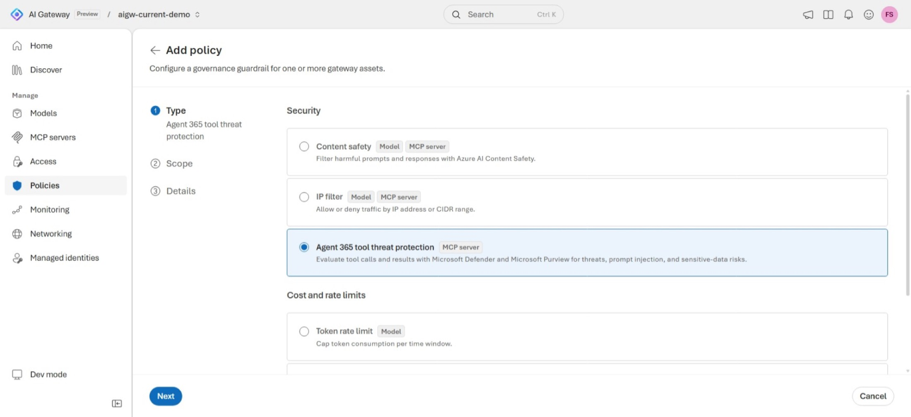

<!--
title: Protect tool calls with Agent 365 threat protection
summary: Have Microsoft Defender and Microsoft Purview evaluate every tool call on an MCP server, before the tool runs, after it returns, or both, and see how a fail-closed denial reaches the caller.
category: production
level: Advanced
duration: 30
tracks: [portal, iac]
order: 19
status: emerging
illustration: diagrams/threat-protection.svg
tags: [Agent 365, tool threat protection, Microsoft Defender, Microsoft Purview, prompt injection, MCP, on-behalf-of, Entra ID]
objectives:
  - Explain what the before-invocation and after-invocation stages evaluate and what each one can and can't prevent
  - Add an Agent 365 tool threat protection policy to an MCP server in the AI Gateway portal or with Bicep and azd
  - Call a protected tool with a delegated Microsoft Entra ID token and read the result
  - Recognize the documented denial codes and why a key-only call fails closed
prereqs:
  - 04-federate-mcp-tools
  - 11-entra-rbac
-->
<!-- gh:begin nav: generated by "npm run sync" from the metadata, do not edit -->
[AI Gateway labs](../README.md) › [Production & emerging](../README.md#production--emerging) › Lab 19
<!-- gh:end -->

# Protect tool calls with Agent 365 threat protection

<!-- gh:begin intro: generated by "npm run sync" from the metadata, do not edit -->
> Have Microsoft Defender and Microsoft Purview evaluate every tool call on an MCP server, before the tool runs, after it returns, or both, and see how a fail-closed denial reaches the caller.

| ⏱️ Time | 📶 Level | 🧭 Tracks | ✅ Before you start |
| :-- | :-- | :-- | :-- |
| 30 min | Advanced | Portal · Bicep + azd | [04 · Federate MCP tools](../04-federate-mcp-tools/README.md)<br>[11 · Entra ID & RBAC](../11-entra-rbac/README.md) |

**You'll learn to**

- Explain what the before-invocation and after-invocation stages evaluate and what each one can and can't prevent
- Add an Agent 365 tool threat protection policy to an MCP server in the AI Gateway portal or with Bicep and azd
- Call a protected tool with a delegated Microsoft Entra ID token and read the result
- Recognize the documented denial codes and why a key-only call fails closed

**Follow along:** 🌐 [Interactive version](https://azure.github.io/ai-gateway/labs/19-tool-threat-protection/) with your own values filled in · 📁 [Lab files](infra/)

**On this page:** [Before you begin](#before-you-begin) · [How it works](#how-it-works) · [Prepare a delegated caller](#prepare-a-delegated-caller) · [Add tool threat protection](#add-tool-threat-protection) · [Understand verdicts and failures](#understand-verdicts-and-failures) · [Verify](#verify) · [Go further](#go-further) · [Clean up](#clean-up) · [Troubleshooting](#troubleshooting) · [Next steps](#next-steps)
<!-- gh:end -->

Your agents call tools that read web pages, tickets, and documents, and any of that content can carry a prompt
injection or leak sensitive data back to the model. Content filters on the model don't see what goes into a tool
or what comes out of it. In this lab you add **Agent 365 tool threat protection** to an MCP server, so Microsoft
Defender and Microsoft Purview evaluate each tool request, each tool result, or both, and the gateway only lets
allowed calls through.


<!-- widget: request-lifecycle -->
<!-- gh:begin widget: generated by "npm run sync" from the metadata, do not edit -->
> 🎛️ **Interactive:** try the request lifecycle explorer in the [web version of this lab](https://azure.github.io/ai-gateway/labs/19-tool-threat-protection/).
<!-- gh:end -->

## Before you begin

> [!TIP]
> On the **Bicep + azd** track, `azd up` creates its own gateway, the `learn` MCP server, your **AI Gateway Tools
> User** role assignment on it, and a key, so you can skip this section except for the Microsoft Defender or
> Microsoft Purview license. You need only [Azure Cloud Shell](https://shell.azure.com), or the Azure Developer CLI
> (`azd`), the Azure CLI, and Git on your machine, signed in as a user, plus `curl` and `jq` for the Bash script.

- Complete [Federate MCP tools behind one endpoint](../04-federate-mcp-tools/README.md). This lab protects the
  `learn` MCP server from that lab. Any MCP server in your gateway works.
- Complete [Go keyless with Microsoft Entra ID and RBAC](../11-entra-rbac/README.md). Tool threat protection
  only works for callers that send a **delegated** Microsoft Entra ID bearer token issued for AI Gateway.
- A **Microsoft Defender or Microsoft Purview license** in your tenant.
- Permission to manage policies on the gateway, for example **Contributor** on its resource group, and permission
  to create role assignments if your user doesn't have a data-plane role yet.
- The [Azure CLI](https://learn.microsoft.com/cli/azure/install-azure-cli) 2.75 or later, signed in with
  `az login` as a **user** (not a service principal), and the `aigateway` extension
  ([install it](../01-provision-gateway/README.md#before-you-begin)).
- For the test scripts and the Bash snippets: `curl` and `jq` (Bash) or PowerShell 7 or later.

> [!NOTE]
> Agent 365 tool threat protection is an emerging capability of the AI Gateway tier preview. Labels and behavior can change; see the
> [release note](https://ai.gateway.azure.com/docs/releases/2026-10-08-tool-threat-protection). AI Gateway itself
> is free during the preview; Defender and Purview are licensed separately.

Set these variables once. The steps and the **Verify** section reuse them.

<details open><summary>Bash</summary> <!-- gh -->

```bash title="Bash"
export RG="<resource-group>"
export GATEWAY="<gateway>"
export MCP_SERVER="learn"                    # the MCP server you protect in this lab

export GATEWAY_ID="$(az aigateway show -g "$RG" -n "$GATEWAY" --query id -o tsv)"
export AI_GATEWAY_URL="https://$(az aigateway show -g "$RG" -n "$GATEWAY" --query properties.frontend.defaultHostname -o tsv)"
# Paste the runtime key you created in Access › Keys. You use it once to see a key-only call fail closed.
read -rsp "AI Gateway API key: " AI_GATEWAY_API_KEY && export AI_GATEWAY_API_KEY && echo
```
</details> <!-- gh -->

<details><summary>PowerShell</summary> <!-- gh -->

```powershell title="PowerShell"
$RG         = "<resource-group>"
$GATEWAY    = "<gateway>"
$MCP_SERVER = "learn"                        # the MCP server you protect in this lab

$GATEWAY_ID         = az aigateway show -g $RG -n $GATEWAY --query id -o tsv
$env:AI_GATEWAY_URL = "https://$(az aigateway show -g $RG -n $GATEWAY --query properties.frontend.defaultHostname -o tsv)"
# Paste the runtime key you created in Access › Keys. You use it once to see a key-only call fail closed.
$env:AI_GATEWAY_API_KEY = Read-Host "AI Gateway API key" -MaskInput
```
</details> <!-- gh -->

## How it works

Tool threat protection is a policy on one MCP server. It covers every tool on that server, whether the server is
backed by remote MCP endpoints, OpenAPI services, or both, and every caller. The gateway first runs its usual
authentication, authorization, and policies. Only requests that pass are sent for evaluation.

For each `tools/call`, the gateway exchanges the caller's delegated token on behalf of the user (OBO) and asks
Microsoft Defender and Microsoft Purview for a verdict on malicious content, prompt injection, and sensitive-data
risks. Discovery and session traffic, such as `initialize`, `tools/list`, and notifications, isn't evaluated.

The evaluation must return a valid **allow**. A denial, timeout, token-exchange failure, malformed verdict, or
unavailable evaluator fails closed: the caller gets a normal tool result over HTTP `200` with `isError: true`, a
denial code, and a correlation ID.

| Stage | What's evaluated | What it prevents | Cost |
|---|---|---|---|
| **Before tool invocation** | The tool name and arguments | The tool never runs, so there are no side effects | One evaluation round trip |
| **After tool invocation** | The tool result, including error results | The result never reaches the agent. The tool **already ran**. | One evaluation round trip |
| **Both** | Both of the above | Requires two allow decisions | Up to two round trips per call |

## Prepare a delegated caller

The policy evaluates each call on behalf of the signed-in user, so you test it with your own user token. Give
your user permission to call tools on the server, then make one call **before** you add the policy. That proves
the token and the role work, so any later failure comes from the policy.

<!-- track: portal | Portal -->
<details open><summary><b>🖥️ Portal</b></summary> <!-- gh -->

### Grant yourself the AI Gateway Tools User role

In the AI Gateway portal, select **Access**, then **Add role assignments**. Choose the **AI Gateway Tools User**
role, scope it to the `learn` MCP server, search for your user, and select **Review + assign**. The
[Entra ID lab](../11-entra-rbac/README.md) walks through this page.

The same assignment with the Azure CLI:

```bash
az role assignment create \
  --assignee-object-id "$(az ad signed-in-user show --query id -o tsv)" \
  --assignee-principal-type User \
  --role "dce03f8d-857f-4e40-a90d-67770fa6ecd2" \
  --scope "$GATEWAY_ID/workspaces/default/toolServers/$MCP_SERVER"
```

```powershell
az role assignment create `
  --assignee-object-id (az ad signed-in-user show --query id -o tsv) `
  --assignee-principal-type User `
  --role "dce03f8d-857f-4e40-a90d-67770fa6ecd2" `
  --scope "$GATEWAY_ID/workspaces/default/toolServers/$MCP_SERVER"
```

If you already have **AI Gateway User** or **AI Gateway Tools User** at the gateway scope, skip this step. Role
assignments can take several minutes to apply.

</details> <!-- gh -->
<!-- track: iac | Bicep + azd -->
<details><summary><b>🏗️ Bicep + azd</b></summary> <!-- gh -->

**What you need:** [Azure Cloud Shell](https://shell.azure.com), in Bash or PowerShell, or [azd](https://aka.ms/azd-install),
the Azure CLI with the `aigateway` extension, and Git on your machine, signed in as a **user** with
`azd auth login` and `az login`, plus `curl` and `jq` for the Bash script. This track doesn't use your gateway or `learn` server from lab 04: `azd up` creates
a new gateway with its own `learn` server, so it works on its own. You still need the Microsoft Defender or
Microsoft Purview license.

### Clone the lab

The lab is a small azd project in the
[`labs/19-tool-threat-protection`](https://github.com/Azure/ai-gateway/tree/main/labs/19-tool-threat-protection)
folder of the GitHub repo. Clone the repo and move into that folder. If you cloned it for an earlier lab, move into
`ai-gateway/labs/19-tool-threat-protection` instead.

<details open><summary>Bash</summary> <!-- gh -->

```bash title="Bash"
git clone https://github.com/Azure/ai-gateway.git
cd ai-gateway/labs/19-tool-threat-protection
```
</details> <!-- gh -->

<details><summary>PowerShell</summary> <!-- gh -->

```powershell title="PowerShell"
git clone https://github.com/Azure/ai-gateway.git
Set-Location ai-gateway/labs/19-tool-threat-protection
```
</details> <!-- gh -->

### Review the templates

`infra/main.bicep` creates the resource group `rg-<environment name>` and calls lab 01's
[gateway.bicep](../01-provision-gateway/infra/gateway.bicep) for a gateway with no model. Then it calls
`infra/protected-tool-server.bicep`, which azd fills from environment values:

| Parameter | azd environment value | Default |
|---|---|---|
| `preInvocation` | `TOOL_THREAT_PRE_INVOCATION` | `false` |
| `postInvocation` | `TOOL_THREAT_POST_INVOCATION` | `false` |
| `principalId` | `AZURE_PRINCIPAL_ID`, which azd sets to the signed-in user | Your user's object ID |

<!-- include: infra/main.bicep -->
<!-- gh:begin include: generated by "npm run sync" from the metadata, do not edit -->
📄 [`infra/main.bicep`](infra/main.bicep)

<details><summary>Show all 63 lines</summary>

```bicep
// Lab 19 with azd: "azd up" creates the resource group rg-<environment name>, a gateway with lab 01's template, then
// the learn MCP server, the AI Gateway Tools User role on it for the signed-in user, and the runtime API key
// app-first-call. The tool threat protection stages are off until you turn them on and run "azd provision".
// The runtime API key is never an output.
targetScope = 'subscription'

@description('azd environment name. The resource group is rg-<environmentName>.')
@minLength(1)
@maxLength(60)
param environmentName string

@description('Region for every resource. Pick one where AI Gateway is available. List them with az provider show --namespace Microsoft.ApiManagement (lab 01, Find the available regions).')
@metadata({ azd: { type: 'location' } })
param location string

@description('Evaluate each tool request before the tool runs. azd reads it from TOOL_THREAT_PRE_INVOCATION.')
param preInvocation bool = false

@description('Evaluate each tool result after the tool returns. azd reads it from TOOL_THREAT_POST_INVOCATION.')
param postInvocation bool = false

@description('Object ID of the user who calls the tools. azd sets AZURE_PRINCIPAL_ID to the signed-in user.')
param principalId string = ''

var suffix = take(uniqueString(subscription().id, environmentName, location), 6)
var tags = { 'azd-env-name': environmentName }

resource rg 'Microsoft.Resources/resourceGroups@2024-03-01' = {
  name: 'rg-${environmentName}'
  location: location
  tags: tags
}

// Lab 01's template: the gateway and its connector gateway, with no model.
module gateway '../../01-provision-gateway/infra/gateway.bicep' = {
  name: 'aigw-gateway'
  scope: rg
  params: {
    gatewayName: 'aigw-${suffix}'
    location: location
    tags: tags
  }
}

module toolServer 'protected-tool-server.bicep' = {
  name: 'aigw-protected-tool-server'
  scope: rg
  params: {
    gatewayName: gateway.outputs.gatewayName
    serverName: 'learn'
    preInvocation: preInvocation
    postInvocation: postInvocation
    principalId: principalId
    apiKeyName: 'app-first-call'
  }
}

output AZURE_RESOURCE_GROUP string = rg.name
output AI_GATEWAY_NAME string = gateway.outputs.gatewayName
output AI_GATEWAY_ID string = gateway.outputs.gatewayId
output AI_GATEWAY_URL string = gateway.outputs.gatewayUrl
output MCP_SERVER string = 'learn'
output MCP_ENDPOINT string = toolServer.outputs.mcpEndpoint
```

</details>
<!-- gh:end -->

`infra/protected-tool-server.bicep` declares the `learn` server of lab 04 with its `learn` backend. Its `policies`
array holds one `toolThreatProtection` policy with `preInvocation` and `postInvocation` when at least one stage is
on, and nothing when both are off. It assigns **AI Gateway Tools User** on the server to `principalId`, as the
portal step does, and creates the `app-first-call` key.

<!-- include: infra/protected-tool-server.bicep -->
<!-- gh:begin include: generated by "npm run sync" from the metadata, do not edit -->
📄 [`infra/protected-tool-server.bicep`](infra/protected-tool-server.bicep)

<details><summary>Show all 90 lines</summary>

```bicep
// Declares the learn MCP server of lab 04 with an optional Agent 365 tool threat protection policy, which has Microsoft
// Defender and Microsoft Purview evaluate each tool request (preInvocation), each tool result (postInvocation), or
// both. It assigns AI Gateway Tools User on the server to a user, so that user can call tools with a delegated token,
// and creates a runtime API key. The key is never an output.
// A deployment sends a PUT, which replaces the whole MCP server, so keep this template as its only source of truth.

@description('Name of the existing AI Gateway (Microsoft.ApiManagement/aigateways).')
param gatewayName string

@description('MCP server name. It becomes part of the endpoint URL and cannot be changed after creation.')
param serverName string = 'learn'

@description('Evaluate the tool name and arguments before the tool runs.')
param preInvocation bool = true

@description('Evaluate the tool result after the tool returns. The tool has already run.')
param postInvocation bool = true

@description('Object ID of the user who gets AI Gateway Tools User on the MCP server. Empty skips the role assignment.')
param principalId string = ''

@description('Runtime API key to create for the key-only test call.')
param apiKeyName string = 'app-first-call'

// AI Gateway Tools User: call the tools of an MCP server with a Microsoft Entra ID token.
var toolsUserRoleId = 'dce03f8d-857f-4e40-a90d-67770fa6ecd2'

#disable-next-line BCP081
resource gateway 'Microsoft.ApiManagement/aigateways@2025-09-01-preview' existing = {
  name: gatewayName
}

#disable-next-line BCP081
resource workspace 'Microsoft.ApiManagement/aigateways/workspaces@2025-09-01-preview' existing = {
  parent: gateway
  name: 'default'
}

#disable-next-line BCP081
resource toolServer 'Microsoft.ApiManagement/aigateways/workspaces/toolServers@2025-09-01-preview' = {
  parent: workspace
  name: serverName
  properties: {
    displayName: 'Microsoft Learn'
    description: 'Search and fetch official Microsoft documentation and code samples.'
    type: 'mcp'
    failureMode: 'failClosed'
    endpoints: [
      {
        namespace: 'learn'
        kind: 'mcp'
        mcp: {
          url: 'https://learn.microsoft.com/api/mcp'
          transport: 'streamableHttp'
        }
        required: true
      }
    ]
    // A tool threat protection policy needs at least one stage.
    policies: preInvocation || postInvocation
      ? [
          {
            type: 'toolThreatProtection'
            preInvocation: preInvocation
            postInvocation: postInvocation
          }
        ]
      : []
  }
}

resource toolsUser 'Microsoft.Authorization/roleAssignments@2022-04-01' = if (!empty(principalId)) {
  name: guid(toolServer.id, principalId, toolsUserRoleId)
  scope: toolServer
  properties: {
    principalId: principalId
    principalType: 'User'
    roleDefinitionId: subscriptionResourceId('Microsoft.Authorization/roleDefinitions', toolsUserRoleId)
  }
}

#disable-next-line BCP081
resource apiKey 'Microsoft.ApiManagement/aigateways/apiKeys@2025-09-01-preview' = {
  parent: gateway
  name: apiKeyName
  properties: {}
}

output toolServerId string = toolServer.id
output mcpEndpoint string = 'https://${gateway.properties.frontend.defaultHostname}/default/toolservers/${serverName}/mcp'
```

</details>
<!-- gh:end -->

> [!WARNING]
> A Bicep deployment sends a `PUT`, which replaces the whole MCP server, including backends and policies that you
> added in the portal. Keep the template as the only source of truth for this server, and change it with
> `azd provision`.

### Deploy with azd up

Create an azd environment named `aigw-lab19` in your current subscription, then provision everything. It takes
three to eight minutes. Both stages are off at first, so you can test your token before you add the policy.

<details open><summary>Bash</summary> <!-- gh -->

```bash title="Bash"
azd env new aigw-lab19 --location eastus2 --subscription "$(az account show --query id --output tsv)"
azd up
```
</details> <!-- gh -->

<details><summary>PowerShell</summary> <!-- gh -->

```powershell title="PowerShell"
azd env new aigw-lab19 --location eastus2 --subscription (az account show --query id --output tsv)
azd up
```
</details> <!-- gh -->

For another region, use its name from [Find the available
regions](../01-provision-gateway/README.md#find-the-available-regions).

### Read the outputs and the key

Set the variables that the next steps, **Verify**, and **Clean up** use from azd's environment values, and read
the key from the gateway, so that it never shows on screen. The last command lists your roles on the MCP server.

<details open><summary>Bash</summary> <!-- gh -->

```bash title="Bash"
export RG="$(azd env get-value AZURE_RESOURCE_GROUP)"
export GATEWAY="$(azd env get-value AI_GATEWAY_NAME)"
export MCP_SERVER="$(azd env get-value MCP_SERVER)"
export GATEWAY_ID="$(azd env get-value AI_GATEWAY_ID)"
export AI_GATEWAY_URL="$(azd env get-value AI_GATEWAY_URL)"
export AI_GATEWAY_API_KEY="$(az aigateway api-key list-secrets --ids "$GATEWAY_ID/apiKeys/app-first-call" \
  --query primaryKey --output tsv)"
az role assignment list --assignee "$(az ad signed-in-user show --query id -o tsv)" \
  --scope "$GATEWAY_ID/workspaces/default/toolServers/$MCP_SERVER" --query "[].roleDefinitionName" -o tsv
```
</details> <!-- gh -->

<details><summary>PowerShell</summary> <!-- gh -->

```powershell title="PowerShell"
$RG                     = azd env get-value AZURE_RESOURCE_GROUP
$GATEWAY                = azd env get-value AI_GATEWAY_NAME
$MCP_SERVER             = azd env get-value MCP_SERVER
$GATEWAY_ID             = azd env get-value AI_GATEWAY_ID
$env:AI_GATEWAY_URL     = azd env get-value AI_GATEWAY_URL
$env:AI_GATEWAY_API_KEY = az aigateway api-key list-secrets --ids "$GATEWAY_ID/apiKeys/app-first-call" `
  --query primaryKey --output tsv
az role assignment list --assignee (az ad signed-in-user show --query id -o tsv) `
  --scope "$GATEWAY_ID/workspaces/default/toolServers/$MCP_SERVER" --query "[].roleDefinitionName" -o tsv
```
</details> <!-- gh -->

> **Checkpoint**
> `azd up` ended with `SUCCESS`, and the last command printed `AI Gateway Tools User`. Role assignments can take
> several minutes to apply.

</details> <!-- gh -->
<!-- /tracks -->

<!-- steps -->

### Call a tool with your user token

The script below gets a token for `https://azure-api.net/aigateway` from the Azure CLI, checks that it's a
delegated user token, runs the MCP handshake, and calls the server's search tool with a harmless question.

<!-- include: infra/call-protected-tool.sh -->
<!-- gh:begin include: generated by "npm run sync" from the metadata, do not edit -->
📄 [`infra/call-protected-tool.sh`](infra/call-protected-tool.sh)

<details><summary>Show all 116 lines</summary>

```sh
#!/usr/bin/env bash
# Calls one tool on an AI Gateway MCP server that has Agent 365 tool threat protection, using the MCP
# Streamable HTTP handshake (initialize -> notifications/initialized -> tools/list -> tools/call).
# Prints whether the tool result came back, or the denial code and correlation ID the gateway returned.
#
# Usage:
#   export AI_GATEWAY_URL="https://<gateway>.eastus2-01.ai.gateway.azure.com"
#   ./call-protected-tool.sh token [server-name] [query]   # delegated Entra token for the signed-in az user
#   ./call-protected-tool.sh key   [server-name] [query]   # runtime key in AI_GATEWAY_API_KEY (no bearer token)
#
# token mode uses AI_GATEWAY_TOKEN when set, otherwise it runs
#   az account get-access-token --resource https://azure-api.net/aigateway
# The script calls the Learn docs search tool (or the first tool whose name contains "search") unless you set
# TOOL_NAME, and sends the query as {"query": "..."}. Use a benign query. Requires curl and jq.
set -euo pipefail

AUTH="${1:?Pass token or key as the first argument}"
SERVER="${2:-learn}"
QUERY="${3:-What is Azure API Management?}"
: "${AI_GATEWAY_URL:?Set AI_GATEWAY_URL to https://<gateway>.eastus2-01.ai.gateway.azure.com}"
command -v jq >/dev/null || { echo "This script needs jq." >&2; exit 1; }
ENDPOINT="${AI_GATEWAY_URL%/}/default/toolservers/${SERVER}/mcp"

case "$AUTH" in
  token)
    TOKEN="${AI_GATEWAY_TOKEN:-$(az account get-access-token --resource https://azure-api.net/aigateway --query accessToken -o tsv)}"
    # Delegated (user) tokens carry an scp claim. App-only tokens carry roles instead and can't be used for evaluation.
    payload="$(printf '%s' "$TOKEN" | cut -d. -f2 | tr '_-' '/+')"
    while [ $(( ${#payload} % 4 )) -ne 0 ]; do payload="${payload}="; done
    scp="$(printf '%s' "$payload" | jq -Rr '@base64d | fromjson | .scp // empty' 2>/dev/null || true)"
    if [ -n "$scp" ]; then
      echo "Delegated token for the signed-in user (scp: $scp)"
    else
      echo "Warning: the token has no scp claim, so it isn't a delegated user token." >&2
    fi
    HEADERS=(-H "Authorization: Bearer $TOKEN") ;;
  key)
    : "${AI_GATEWAY_API_KEY:?Set AI_GATEWAY_API_KEY to a runtime key from Access > Keys}"
    HEADERS=(-H "api-key: $AI_GATEWAY_API_KEY") ;;
  *)
    echo "The first argument must be token or key." >&2; exit 1 ;;
esac
HEADERS+=(-H "Content-Type: application/json" -H "Accept: application/json, text/event-stream")
STATUS="" BODY="" SESSION_ID=""

# post <json>: sends one JSON-RPC message and sets STATUS and BODY (and SESSION_ID when the server returns one).
post() {
  local raw head sid
  raw="$(curl -sS --max-time 120 -D - "$ENDPOINT" "${HEADERS[@]}" --data "$1" | tr -d '\r')"
  if [[ "$raw" == *$'\n\n'* ]]; then head="${raw%%$'\n\n'*}"; BODY="${raw#*$'\n\n'}"; else head="$raw"; BODY=""; fi
  STATUS="$(printf '%s\n' "$head" | awk 'toupper($1) ~ /^HTTP/ {code=$2} END {print code}')"
  sid="$(printf '%s\n' "$head" | awk -F': ' 'tolower($1)=="mcp-session-id" {print $2}')"
  if [ -n "$sid" ]; then SESSION_ID="$sid"; fi
}

# response <id>: prints the JSON-RPC response with that id. The body can be JSON or server-sent events.
response() {
  if printf '%s\n' "$BODY" | grep -q '^data:'; then
    printf '%s\n' "$BODY" | sed -n 's/^data:[[:space:]]*//p'
  else
    printf '%s\n' "$BODY"
  fi | jq -c --argjson id "$1" 'select(type == "object" and .id == $id)' 2>/dev/null || true
}

# require_success <step>: stops with the gateway's answer when the HTTP status isn't 2xx.
require_success() {
  case "$STATUS" in
    2??) ;;
    *) echo "$1 failed with HTTP ${STATUS:-no response}:" >&2; printf '%s\n' "$BODY" >&2; exit 1 ;;
  esac
}

echo "MCP endpoint: $ENDPOINT"

post '{"jsonrpc":"2.0","id":1,"method":"initialize","params":{"protocolVersion":"2025-03-26","capabilities":{},"clientInfo":{"name":"aigateway-labs","version":"1.0"}}}'
require_success "initialize"
PROTOCOL="$(response 1 | jq -r '.result.protocolVersion // empty')"
if [ -z "$PROTOCOL" ]; then echo "initialize returned no result:" >&2; printf '%s\n' "$BODY" >&2; exit 1; fi
HEADERS+=(-H "MCP-Protocol-Version: $PROTOCOL")
if [ -n "$SESSION_ID" ]; then HEADERS+=(-H "Mcp-Session-Id: $SESSION_ID"); fi

post '{"jsonrpc":"2.0","method":"notifications/initialized"}'
require_success "notifications/initialized"

post '{"jsonrpc":"2.0","id":2,"method":"tools/list","params":{}}'
require_success "tools/list"
LIST="$(response 2)"
if [ -z "$LIST" ] || [ "$(printf '%s' "$LIST" | jq 'has("error")')" = "true" ]; then
  echo "tools/list returned an error:" >&2; printf '%s\n' "${LIST:-$BODY}" >&2; exit 1
fi
echo "tools/list: HTTP $STATUS, $(printf '%s' "$LIST" | jq '.result.tools | length') tools (discovery isn't evaluated)"

TOOL="${TOOL_NAME:-$(printf '%s' "$LIST" | jq -r '[.result.tools[].name] |
  ([.[] | select(test("docs_search"; "i"))] + [.[] | select(test("search"; "i"))])[0] // empty')}"
if [ -z "$TOOL" ]; then echo "No tool name contains 'search'. Set TOOL_NAME to the tool to call." >&2; exit 1; fi

echo "tools/call: $TOOL with query: $QUERY"
post "$(jq -cn --arg name "$TOOL" --arg query "$QUERY" \
  '{jsonrpc:"2.0",id:3,method:"tools/call",params:{name:$name,arguments:{query:$query}}}')"
require_success "tools/call"
CALL="$(response 3)"
if [ -z "$CALL" ]; then echo "tools/call returned no JSON-RPC response:" >&2; printf '%s\n' "$BODY" >&2; exit 1; fi

echo "HTTP status: $STATUS"
if [ "$(printf '%s' "$CALL" | jq 'has("error")')" = "true" ]; then
  echo "JSON-RPC error:"; printf '%s' "$CALL" | jq '.error'
elif [ "$(printf '%s' "$CALL" | jq '.result.isError == true')" = "true" ]; then
  echo "isError: true"
  printf '%s' "$CALL" | jq -r '.result._meta["com.microsoft.azure.ai.gateway/denial"] // {} |
    "Denial code: \(.code // "none")\nCorrelation ID: \(.correlationId // "none")"'
  printf '%s' "$CALL" | jq -r '[.result.content[]? | select(.type == "text") | .text] | join("\n")'
else
  echo "isError: false (the result was returned)"
  printf '%s' "$CALL" | jq -r '[.result.content[]? | select(.type == "text") | .text] | join("\n") | .[0:400]'
  echo "..."
fi
```

</details>
<!-- gh:end -->

On GitHub, open [infra/call-protected-tool.sh](infra/call-protected-tool.sh) or
[infra/call-protected-tool.ps1](infra/call-protected-tool.ps1).

```bash
chmod +x infra/call-protected-tool.sh
./infra/call-protected-tool.sh token "$MCP_SERVER"
```

```powershell
./infra/call-protected-tool.ps1 -Auth token -Server $MCP_SERVER
```

```text title="Expected output"
Delegated token for the signed-in user (scp: ...)
MCP endpoint: https://<gateway>.eastus2-01.ai.gateway.azure.com/default/toolservers/learn/mcp
tools/list: HTTP 200, <n> tools (discovery isn't evaluated)
tools/call: learn_microsoft_docs_search with query: What is Azure API Management?
HTTP status: 200
isError: false (the result was returned)
...
```

The tool names and count depend on your server and can change as the Learn server evolves. If `tools/call` fails with HTTP `401` or `403`, fix the token or
the role before you continue.

<!-- /steps -->

> **Checkpoint**
> A tool call with your delegated token returns a result with `isError: false`.

## Add tool threat protection

Pick one track. Both add the same policy to the `learn` server, with both stages turned on. Each MCP server can
have only one tool threat protection policy, and you can't set it at gateway scope or on a single tool.

<!-- track: portal | Portal -->
<details open><summary><b>🖥️ Portal</b></summary> <!-- gh -->

### Start a new policy

Open the [AI Gateway portal](https://ai.gateway.azure.com) and select your gateway from the gateway switcher.
Select **Policies**, then **Add policy**.

### Choose the policy type

On the **Type** step, under **Security**, select **Agent 365 tool threat protection**. Its card carries the
**MCP server** badge and reads "Evaluate tool calls and results with Microsoft Defender and Microsoft Purview
for threats, prompt injection, and sensitive-data risks." Select **Next**.



### Select the MCP server

On the **Scope** step, the wizard notes that this policy applies to individual MCP servers. Select the `learn`
MCP server, then select **Next**.

### Choose the evaluation stages

On the **Details** step, the wizard reminds you that Microsoft Entra ID is required for this policy, because the
evaluation runs on behalf of the caller. Select both stages:

- **Before tool invocation: Evaluate the request payload**
- **After tool invocation: Evaluate the tool output**

You must select at least one stage. Then select **Create**.

</details> <!-- gh -->
<!-- track: iac | Bicep + azd -->
<details><summary><b>🏗️ Bicep + azd</b></summary> <!-- gh -->

### Turn on both stages

Set both stages to `true` and provision again. Only the MCP server changes: the template adds one
`toolThreatProtection` entry to its `policies` array. To evaluate only the requests, leave
`TOOL_THREAT_POST_INVOCATION` at `false`.

<details open><summary>Bash</summary> <!-- gh -->

```bash title="Bash"
azd env set TOOL_THREAT_PRE_INVOCATION true
azd env set TOOL_THREAT_POST_INVOCATION true
azd provision
```
</details> <!-- gh -->

<details><summary>PowerShell</summary> <!-- gh -->

```powershell title="PowerShell"
azd env set TOOL_THREAT_PRE_INVOCATION true
azd env set TOOL_THREAT_POST_INVOCATION true
azd provision
```
</details> <!-- gh -->

</details> <!-- gh -->
<!-- /tracks -->

<!-- steps -->

### Confirm the policy

The new policy appears in the portal's **Policies** overview. The policy is stored on the MCP server, so you can
also read it with `az aigateway mcp show`:

```bash
az aigateway mcp show -g "$RG" --gateway-name "$GATEWAY" -n "$MCP_SERVER" --query properties.policies
```

```powershell
az aigateway mcp show -g $RG --gateway-name $GATEWAY -n $MCP_SERVER --query properties.policies
```

The list includes an entry with `"type": "toolThreatProtection"`, `"preInvocation": true`, and
`"postInvocation": true`. The service adds `"scope": "resource"` when it returns a policy set on the server.

<!-- /steps -->

> **Checkpoint**
> The `learn` MCP server has one `toolThreatProtection` policy with both stages turned on.

> [!CAUTION]
> A post-invocation denial withholds the result, but it can't undo what the tool already did. The gateway doesn't
> retry or reverse the call. Build agents so they **don't automatically retry** a tool call whose result was
> withheld, especially for tools that write, send, or delete. For those tools, keep **Before tool invocation**
> turned on so a risky request never runs.

## Understand verdicts and failures

The gateway doesn't decide what's risky. Microsoft Defender does, in the policy mode your security team sets in
Microsoft Defender. You can't change that mode at the gateway.

| Defender policy mode | Behavior |
|---|---|
| **Disabled** | A permanent fail-open state. No inspection occurs. |
| **Audit** | Tool calls are logged without blocking. If the service lags or drops out, calls fail open. |
| **Block** | Explicit enforcement that fails closed. Withholding a result after invocation requires Block mode. |

When a call fails closed, the caller sees one of these codes in the result's
`_meta["com.microsoft.azure.ai.gateway/denial"].code`:

| Code | Meaning |
|---|---|
| `ToolEvaluationIdentityRequired` | The request has no usable bearer token, or the gateway can't read the token tenant it needs for the OBO exchange |
| `ToolEvaluationDenied` | The evaluation service denied the request or the result |
| `ToolEvaluationInvalidRequest` | The evaluation input isn't valid |
| `ToolEvaluationRequestTooLarge` | The evaluation input exceeds the supported size |
| `ToolEvaluationUnavailable` | Token exchange or evaluation failed, timed out, returned an invalid verdict, or was unavailable |

A denied call looks like this. The HTTP status is still `200`, so clients must check `result.isError`:

```json
{
  "jsonrpc": "2.0",
  "id": 42,
  "result": {
    "isError": true,
    "content": [
      { "type": "text", "text": "Tool 'mcp_tail_logs' requires a validated delegated caller token." }
    ],
    "_meta": {
      "com.microsoft.azure.ai.gateway/denial": {
        "code": "ToolEvaluationIdentityRequired",
        "correlationId": "9f2c1b6e-..."
      }
    }
  }
}
```

> [!TIP]
> Log the `correlationId` with every denial in your agent. It's the value to share when you investigate a
> denial with your security team.

## Verify

<!-- steps -->

### Call the protected tool with your user token

Run the same benign call as before. Allow a few seconds per call, because each enabled stage adds an evaluation
round trip.

```bash
./infra/call-protected-tool.sh token "$MCP_SERVER"
```

```powershell
./infra/call-protected-tool.ps1 -Auth token -Server $MCP_SERVER
```

```text title="Expected output"
...
tools/list: HTTP 200, <n> tools (discovery isn't evaluated)
tools/call: learn_microsoft_docs_search with query: What is Azure API Management?
HTTP status: 200
isError: false (the result was returned)
...
```

A harmless question about Azure is allowed at both stages, so the result comes back as before. If you see
`ToolEvaluationUnavailable` or `ToolEvaluationDenied` instead, see [Troubleshooting](#troubleshooting).

### Call it with a runtime key only

Now call the same tool with the API key and no bearer token. The key still authenticates you to the gateway, so
`initialize` and `tools/list` succeed. The `tools/call` needs an evaluation, and without a delegated token the
gateway can't run one, so it fails closed.

```bash
./infra/call-protected-tool.sh key "$MCP_SERVER"
```

```powershell
./infra/call-protected-tool.ps1 -Auth key -Server $MCP_SERVER
```

```text title="Expected output"
...
tools/list: HTTP 200, <n> tools (discovery isn't evaluated)
tools/call: learn_microsoft_docs_search with query: What is Azure API Management?
HTTP status: 200
isError: true
Denial code: ToolEvaluationIdentityRequired
Correlation ID: <guid>
Tool '...' requires a validated delegated caller token.
```

The denial text can differ. The code is what matters.

### Look for the call in Monitoring

If you set up Application Insights in [Monitor usage, cost, and traces](../13-monitoring/README.md), open
**Monitoring**. The **Tools** tab shows MCP tool executions, and **Traces** shows each request with its policy
steps. Find your calls by time and compare the allowed call with the key-only call.

<!-- /steps -->

> **Checkpoint**
> A delegated call returns its result. A key-only call to the same tool returns `isError: true` with
> `ToolEvaluationIdentityRequired`, while `tools/list` still works.

## Go further

- **Choose stages per server.** Keep **Before tool invocation** on for tools with side effects, such as sending
  mail or changing records. Add **After tool invocation** for tools that return untrusted content, such as web
  pages, tickets, or documents. For read-only tools that only return trusted content, weigh the extra round trip.
- **Move your agents to delegated tokens.** Agents that call tools with runtime keys or app-only tokens, such as a
  managed identity, can't use protected servers. Plan an on-behalf-of flow with the scope
  `https://azure-api.net/aigateway/Data.All` before you protect a server they depend on.
- **Roll out in Audit mode first.** Ask your security team to start Defender in **Audit**, review what it flags,
  and then switch to **Block**. Defender's
  [runtime protection guidance](https://learn.microsoft.com/defender-endpoint/configure-ai-agent-runtime-protection#enable-runtime-protection)
  recommends the same phased rollout, with alerts reviewed in the Microsoft Defender portal.
- **Automate the policy.** The policy is the `toolThreatProtection` entry in the MCP server's
  `properties.policies`, as described in
  [Protect tool calls with Defender and Purview](https://learn.microsoft.com/azure/api-management/ai-gateway-policy-tool-threat).
  The Bicep + azd track declares it in `infra/protected-tool-server.bicep`. With the Azure CLI,
  `az aigateway mcp update --policies` replaces the whole `policies` array, so read the current array first and
  keep any other policies, such as the request rate limits from
  [Control which tools agents can call](../05-mcp-tool-controls/README.md):

  <details open><summary>Bash</summary> <!-- gh -->

  ```bash title="Bash"
  az aigateway mcp show -g "$RG" --gateway-name "$GATEWAY" -n "$MCP_SERVER" --query properties -o json \
    | jq -c '[(.policies // [])[] | select(.type != "toolThreatProtection") | del(.scope)]
        + [{type:"toolThreatProtection",preInvocation:true,postInvocation:true}]' > policies.json
  az aigateway mcp update -g "$RG" --gateway-name "$GATEWAY" -n "$MCP_SERVER" --policies @policies.json \
    --query properties.policies
  rm policies.json
  ```
  </details> <!-- gh -->

  <details><summary>PowerShell</summary> <!-- gh -->

  ```powershell title="PowerShell"
  $p = az aigateway mcp show -g $RG --gateway-name $GATEWAY -n $MCP_SERVER --query properties.policies -o json |
       ConvertFrom-Json
  $p = @($p | Where-Object { $_ -and $_.type -ne 'toolThreatProtection' } | Select-Object * -ExcludeProperty scope) +
       @(@{ type = 'toolThreatProtection'; preInvocation = $true; postInvocation = $true })
  ConvertTo-Json -Depth 10 -Compress -InputObject $p | Set-Content policies.json
  az aigateway mcp update -g $RG --gateway-name $GATEWAY -n $MCP_SERVER --policies "@policies.json" `
    --query properties.policies
  Remove-Item policies.json
  ```
  </details> <!-- gh -->

- **Govern servers centrally.** [Govern MCP servers with Agent 365](../20-agent-365-governance/README.md) adds
  inventory and blocking from the Microsoft 365 admin center on top of this policy.

## Clean up

<!-- track: portal | Portal -->
<details open><summary><b>🖥️ Portal</b></summary> <!-- gh -->

### Delete the policy

In the AI Gateway portal, select **Policies**, select the **Agent 365 tool threat protection** policy, and select
**Delete**. Confirm with **Delete**. Tool calls with a runtime key work again.

### Remove the role assignment

If you added **AI Gateway Tools User** only for this lab, remove it in **Access**, or run:

```bash
az role assignment delete \
  --assignee "$(az ad signed-in-user show --query id -o tsv)" \
  --role "dce03f8d-857f-4e40-a90d-67770fa6ecd2" \
  --scope "$GATEWAY_ID/workspaces/default/toolServers/$MCP_SERVER"
```

```powershell
az role assignment delete `
  --assignee (az ad signed-in-user show --query id -o tsv) `
  --role "dce03f8d-857f-4e40-a90d-67770fa6ecd2" `
  --scope "$GATEWAY_ID/workspaces/default/toolServers/$MCP_SERVER"
```

</details> <!-- gh -->
<!-- track: iac | Bicep + azd -->
<details><summary><b>🏗️ Bicep + azd</b></summary> <!-- gh -->

### Delete everything azd created

In the `ai-gateway/labs/19-tool-threat-protection` folder, delete the resource group with the gateway, the `learn`
MCP server, its role assignment, and the key. `--purge` also purges soft-deleted resources, and `--force` skips
the confirmation. It takes about ten minutes.

```bash
azd down --purge --force
```

To keep this gateway for other labs instead, skip `azd down` and remove the policy:

```bash
azd env set TOOL_THREAT_PRE_INVOCATION false
azd env set TOOL_THREAT_POST_INVOCATION false
azd provision
```

</details> <!-- gh -->
<!-- /tracks -->

Keep the gateway and the `learn` MCP server from lab 04: the next labs reuse them. `azd down` doesn't touch them,
because the Bicep + azd track created its own gateway.

## Troubleshooting

| Symptom | Likely cause | Fix |
|---|---|---|
| Every protected call returns `ToolEvaluationIdentityRequired` | The call has no bearer token, or the token isn't a delegated user token. App-only tokens and runtime keys can't be used for OBO. | Sign in with `az login` as a user, get a token for `https://azure-api.net/aigateway`, and send it as `Authorization: Bearer`. Check that the token has an `scp` claim. |
| `tools/call` returns HTTP `401` or `403` with a bearer token | The user has no data-plane role on the MCP server, or the assignment hasn't applied yet | Assign **AI Gateway Tools User** at the MCP server or gateway scope and wait a few minutes |
| Calls return `ToolEvaluationUnavailable` | The token exchange or the evaluation failed, timed out, returned an invalid verdict, or the evaluator was unavailable | Retry later. If it persists, confirm the Microsoft Defender or Microsoft Purview license and the Defender policy mode with your security team, and share the `correlationId`. |
| A benign call returns `ToolEvaluationDenied` | Defender or Purview flagged the request or the result | Review the call with your security team using the `correlationId`. If the tool already ran (after-invocation stage), don't retry it automatically. |
| You can't add a second tool threat protection policy to the server | Each MCP server can have only one tool threat protection policy | Keep the existing policy, or delete it and add a new one with the stages you want |
| Tool calls got noticeably slower | Each enabled stage adds an evaluation round trip | Keep both stages where you need them, and use only **Before tool invocation** where results are trusted |
| A script stops with HTTP `503` and `{"error":"App port is not ready"}` | The gateway is still starting after `azd up` or `azd provision` | Wait 30 seconds and run the script again. |
| A policy you added in the portal vanished after `azd provision` | A Bicep deployment sends a `PUT`, which replaces the whole MCP server | Change the azd environment values and run `azd provision` instead of editing the server in the portal. |

## Next steps

- [Govern MCP servers with Agent 365](../20-agent-365-governance/README.md)
- [Control which tools agents can call](../05-mcp-tool-controls/README.md)
- [Lock down backend traffic with private networking](../18-private-networking/README.md)
- [Protect tool calls with Defender and Purview](https://learn.microsoft.com/azure/api-management/ai-gateway-policy-tool-threat) on Microsoft Learn

<!-- gh:begin footer: generated by "npm run sync" from the metadata, do not edit -->

---

| ⬅️ Previous | 🏠 | Next ➡️ |
| :-- | :-: | --: |
| [18 · Private networking](../18-private-networking/README.md) | [All labs](../README.md) | [20 · Agent 365 governance](../20-agent-365-governance/README.md) |

<sub>Learning paths: [Security & compliance](../README.md#learning-paths) (6 of 7)</sub>
<!-- gh:end -->
