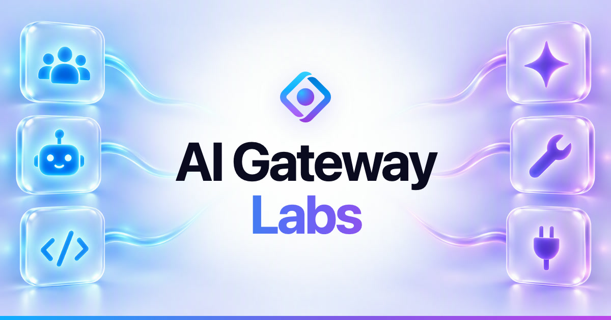

<p align="center">
  <a href="https://azure.github.io/ai-gateway/"></a>
</p>

<!-- gh:begin badges: generated by "npm run sync" from the metadata, do not edit -->
<p align="center">
  <a href="https://azure.github.io/ai-gateway/"></a>
  
  
  
  
</p>
<!-- gh:end -->

# AI Gateway labs

Hands-on labs for the [AI Gateway tier in Azure API Management](https://learn.microsoft.com/azure/api-management/ai-gateway-overview).
Customers and field teams use them to learn the core AI gateway use cases first (models, tools, limits, budgets,
identity, and observability) and then the emerging ones (agents, Agent 365, private networking, and reference
architectures).

> [!TIP]
> **What's new:** the [labs release notes](RELEASE-NOTES.md) map every [AI Gateway product release](https://ai.gateway.azure.com/docs/)
> to the lab where you can practice it.

**Jump to:** [Choose how you learn](#choose-how-you-learn) · [Learning paths](#learning-paths) · [All labs](#all-labs) ·
[Run the notebooks](#run-the-notebooks) · [Use a coding agent](#use-the-labs-with-a-coding-agent) · [Prerequisites](#prerequisites) ·
[Work on the labs](#work-on-the-labs-site) · [Release notes](RELEASE-NOTES.md)

## Choose how you learn

Every lab is one Markdown file, so you get the same steps whichever way you follow it:

| | Where | Best for |
| :-: | :-- | :-- |
| 🌐 | **[Labs site](https://azure.github.io/ai-gateway/)** | Guided reading: set **Your values** once and every command is filled in, try the interactive simulators, and track your progress. |
| 📖 | **Here on GitHub** | Reading next to the code. Each track and each Bash/PowerShell variant is a collapsible section, and included files are shown inline. |
| 📓 | **[Jupyter notebooks](#run-the-notebooks)** | Running a lab end to end from VS Code or Jupyter with Python, the Azure CLI sign-in, and no copy and paste. |
| 🤖 | **[Agent skill](#use-the-labs-with-a-coding-agent)** | Letting GitHub Copilot, Claude Code, or another coding agent pick the right lab, run one track step by step, verify it, and clean up. |
| 🏗️ | **`infra/` folders** | Reusing the Bicep, scripts, and samples in your own pipelines with `az deployment` or `azd`. |

Every lab follows the same structure: a scenario, a diagram of how it works, step-by-step tasks with checkpoints,
a **Verify** section, **Go further** ideas, clean-up, and troubleshooting. Most labs offer several tracks:

| Track | What you use |
|---|---|
| 🖥️ **Portal** | Click-by-click steps in the [AI Gateway portal](https://ai.gateway.azure.com) |
| ⌨️ **CLI** | Azure CLI (`az rest`, `az resource`, `az deployment`) commands for Bash and PowerShell against the `Microsoft.ApiManagement/aigateways` resource |
| 🔗 **REST** | Direct calls to the Azure Resource Manager REST API, for when you script against the API yourself |
| 🏗️ **Bicep** | Infrastructure as code in each lab's `infra/` folder, deployed with `az deployment` or `azd` |
| 🧑‍💻 **Code** | Python, TypeScript, and .NET clients, agent frameworks, and runtime calls |

## Learning paths

New to AI Gateway? Start with the **30-minute quickstart**, then follow the path for your role.

<!-- gh:begin paths: generated by "npm run sync" from the metadata, do not edit -->
| Path | For | Labs, in order |
| :-- | :-- | :-- |
| **30-minute quickstart** | Everyone | [00 How AI Gateway works](00-how-ai-gateway-works/README.md) → [01 Provision a gateway](01-provision-gateway/README.md) → [02 First model call](02-first-model-call/README.md) → [04 Federate MCP tools](04-federate-mcp-tools/README.md) |
| **Platform engineer** | Build the shared AI platform | [01 Provision a gateway](01-provision-gateway/README.md) → [02 First model call](02-first-model-call/README.md) → [03 Multi-provider aliases](03-multi-provider-aliases/README.md) → [22 Priority & weighted routing](22-model-routing/README.md) → [04 Federate MCP tools](04-federate-mcp-tools/README.md) → [09 Gateway-wide baselines](09-gateway-baselines/README.md) → [12 Backend identities](12-backend-identity/README.md) → [18 Private networking](18-private-networking/README.md) → [21 Enterprise reference](21-enterprise-reference/README.md) |
| **App & agent developer** | Ship apps and agents on governed endpoints | [02 First model call](02-first-model-call/README.md) → [03 Multi-provider aliases](03-multi-provider-aliases/README.md) → [22 Priority & weighted routing](22-model-routing/README.md) → [04 Federate MCP tools](04-federate-mcp-tools/README.md) → [15 Agent frameworks](15-agent-frameworks/README.md) → [16 Foundry hosted agent](16-foundry-hosted-agent/README.md) → [17 Coding-agent plugin](17-coding-agent-plugin/README.md) |
| **Security & compliance** | Protect data, identities, and tools | [10 Runtime API keys](10-api-keys/README.md) → [11 Entra ID & RBAC](11-entra-rbac/README.md) → [08 Content safety](08-content-safety/README.md) → [05 Tool allow & block lists](05-mcp-tool-controls/README.md) → [09 Gateway-wide baselines](09-gateway-baselines/README.md) → [19 Tool threat protection](19-tool-threat-protection/README.md) → [20 Agent 365 governance](20-agent-365-governance/README.md) |
| **FinOps & operations** | Control spend and run the gateway | [06 Token limits](06-token-limits/README.md) → [07 Cost budgets](07-cost-budgets/README.md) → [13 Monitoring](13-monitoring/README.md) → [14 OpenTelemetry chargeback](14-otel-chargeback/README.md) |
<!-- gh:end -->

## All labs

Foundations first, then the most common gateway use cases, then the emerging ones.

<!-- gh:begin catalog: generated by "npm run sync" from the metadata, do not edit -->
### Foundations

Concepts, provisioning, and your first governed call.

| # | Lab | Level | Time | Tracks | Notebook |
| :-: | :-- | :-- | --: | :-- | :-: |
| 00 | [How Azure AI Gateway works](00-how-ai-gateway-works/README.md) | Beginner | 20 min | Portal |  |
| 01 | [Provision your AI Gateway](01-provision-gateway/README.md) | Beginner | 15 min | Portal · CLI · Bicep | [📓](01-provision-gateway/01-provision-gateway.ipynb) |
| 02 | [Publish a Foundry model and make your first call](02-first-model-call/README.md) | Beginner | 25 min | Portal · CLI · Bicep · Code | [📓](02-first-model-call/02-first-model-call.ipynb) |

### Models & routing

Publish Foundry and third-party models behind stable aliases.

| # | Lab | Level | Time | Tracks | Notebook |
| :-: | :-- | :-- | --: | :-- | :-: |
| 03 | [Publish models from any provider behind stable aliases](03-multi-provider-aliases/README.md) | Intermediate | 30 min | Portal · REST |  |
| 22 | [Route an alias across models by priority and weight](22-model-routing/README.md) | Intermediate | 25 min | Portal · CLI · Bicep |  |

### MCP & tools

Federate MCP servers, APIs, and connectors behind one endpoint.

| # | Lab | Level | Time | Tracks | Notebook |
| :-: | :-- | :-- | --: | :-- | :-: |
| 04 | [Federate MCP tools behind one endpoint](04-federate-mcp-tools/README.md) | Beginner | 30 min | Portal · CLI · Bicep · Code | [📓](04-federate-mcp-tools/04-federate-mcp-tools.ipynb) |
| 05 | [Control which tools agents can call](05-mcp-tool-controls/README.md) | Intermediate | 20 min | Portal · REST |  |

### Governance & cost

Token limits, budgets, content safety, and gateway-wide baselines.

| # | Lab | Level | Time | Tracks | Notebook |
| :-: | :-- | :-- | --: | :-- | :-: |
| 06 | [Throttle tokens per caller with token limits](06-token-limits/README.md) | Beginner | 25 min | Portal · CLI · REST · Bicep | [📓](06-token-limits/06-token-limits.ipynb) |
| 07 | [Enforce cost budgets with per-caller overrides](07-cost-budgets/README.md) | Intermediate | 30 min | Portal · REST |  |
| 08 | [Screen prompts and responses with content safety](08-content-safety/README.md) | Beginner | 20 min | Portal · CLI · REST |  |
| 09 | [Set gateway-wide policy baselines](09-gateway-baselines/README.md) | Intermediate | 25 min | Portal · REST · Bicep |  |

### Security & identity

API keys, Microsoft Entra ID, RBAC, and backend identities.

| # | Lab | Level | Time | Tracks | Notebook |
| :-: | :-- | :-- | --: | :-- | :-: |
| 10 | [Issue and rotate runtime API keys](10-api-keys/README.md) | Beginner | 15 min | Portal · CLI |  |
| 11 | [Go keyless with Microsoft Entra ID and RBAC](11-entra-rbac/README.md) | Intermediate | 35 min | Portal · CLI · Bicep · Code | [📓](11-entra-rbac/11-entra-rbac.ipynb) |
| 12 | [Call backends with managed identities](12-backend-identity/README.md) | Intermediate | 20 min | Portal · CLI · Bicep |  |

### Observability & FinOps

Dashboards, traces, OpenTelemetry, and chargeback.

| # | Lab | Level | Time | Tracks | Notebook |
| :-: | :-- | :-- | --: | :-- | :-: |
| 13 | [Monitor usage, cost, and traces](13-monitoring/README.md) | Beginner | 25 min | Portal · Bicep |  |
| 14 | [Attribute tokens and cost with OpenTelemetry](14-otel-chargeback/README.md) | Advanced | 35 min | Portal · REST |  |

### Agents

Route agent frameworks, hosted agents, and coding agents through the gateway.

| # | Lab | Level | Time | Tracks | Notebook |
| :-: | :-- | :-- | --: | :-- | :-: |
| 15 | [Connect agent frameworks to models and tools](15-agent-frameworks/README.md) | Intermediate | 30 min | Code |  |
| 16 | [Deploy a Foundry hosted agent behind AI Gateway](16-foundry-hosted-agent/README.md) | Intermediate | 40 min | Portal · CLI · Code |  |
| 17 | [Build on your gateway with coding agents](17-coding-agent-plugin/README.md) | Beginner | 15 min | Code |  |

### Production & emerging

Private networking, Agent 365, threat protection, and reference architectures.

| # | Lab | Level | Time | Tracks | Notebook |
| :-: | :-- | :-- | --: | :-- | :-: |
| 18 | [Lock down backend traffic with private networking](18-private-networking/README.md) | Advanced | 45 min | Portal · CLI · Bicep |  |
| 19 | [Protect tool calls with Agent 365 threat protection](19-tool-threat-protection/README.md) | Advanced | 30 min | Portal |  |
| 20 | [Govern MCP servers with Agent 365](20-agent-365-governance/README.md) | Intermediate | 20 min | Portal |  |
| 21 | [Deploy an enterprise reference architecture](21-enterprise-reference/README.md) | Advanced | 60 min | Bicep |  |
<!-- gh:end -->

## Run the notebooks

Some labs come with a Jupyter notebook that runs the lab end to end from Python. Each notebook deploys the lab's own
Bicep files from its `infra/` folder, the same templates as the Bicep track, then calls the gateway and checks each
result with an assertion. The setup and helpers live in one shared module, [`shared/utils.py`](shared/utils.py), so
every cell stays short.

<!-- gh:begin notebooks: generated by "npm run sync" from the metadata, do not edit -->
| Notebook | Lab | Time |
| :-- | :-- | --: |
| 📓 [`01-provision-gateway.ipynb`](01-provision-gateway/01-provision-gateway.ipynb) | [01 · Provision a gateway](01-provision-gateway/README.md) | 15 min |
| 📓 [`02-first-model-call.ipynb`](02-first-model-call/02-first-model-call.ipynb) | [02 · First model call](02-first-model-call/README.md) | 25 min |
| 📓 [`04-federate-mcp-tools.ipynb`](04-federate-mcp-tools/04-federate-mcp-tools.ipynb) | [04 · Federate MCP tools](04-federate-mcp-tools/README.md) | 30 min |
| 📓 [`06-token-limits.ipynb`](06-token-limits/06-token-limits.ipynb) | [06 · Token limits](06-token-limits/README.md) | 25 min |
| 📓 [`11-entra-rbac.ipynb`](11-entra-rbac/11-entra-rbac.ipynb) | [11 · Entra ID & RBAC](11-entra-rbac/README.md) | 35 min |
<!-- gh:end -->

1. Install [Python](https://www.python.org/downloads/) 3.10 or later, the
   [Azure CLI](https://learn.microsoft.com/cli/azure/install-azure-cli), and
   [VS Code](https://code.visualstudio.com/) with the
   [Jupyter extension](https://marketplace.visualstudio.com/items?itemName=ms-toolsai.jupyter), or JupyterLab. The
   CLI installs Bicep the first time a notebook deploys a template.
2. Sign in with `az login`, and select the subscription with `az account set --subscription <id>`.
3. Clone the repository, open a notebook from its lab folder, select a Python kernel, and select **Run All**. The
   first cell installs the packages it needs.

The notebooks share one gateway, so run them in order: provision the gateway, publish the first model, and then
any of the others. They use these defaults, and you can override them with environment variables before you start
the kernel:

| Setting | Default | Environment variable |
|---|---|---|
| Resource group | `rg-ai-gateway-labs` | `AIGW_RESOURCE_GROUP` |
| Gateway name | `aigw-labs-<6 characters from your subscription ID>` | `AIGW_GATEWAY_NAME` |
| Region | `eastus2` | `AIGW_LOCATION` |
| Foundry account for lab 02 | `aigwlabs<8 characters from your subscription ID>`, created by the notebook | `AIGW_FOUNDRY_ACCOUNT` |
| Foundry account's resource group | the labs resource group | `AIGW_FOUNDRY_RESOURCE_GROUP` |

> [!TIP]
> Each notebook ends with a **Clean up** step. Run it when you're done, or delete the resource group to remove
> everything the labs created.

## Use the labs with a coding agent

The [`azure-ai-gateway-labs`](skills/azure-ai-gateway-labs/SKILL.md) agent skill teaches coding agents how to use
these labs: the catalog, learning paths, and use-case map, how to read a lab and follow one track, the placeholders,
and the AI Gateway facts that the steps rely on. `npm run sync` regenerates its catalog, so it stays current with
the labs.

Install it as a personal skill for GitHub Copilot:

```bash
mkdir -p ~/.copilot/skills/azure-ai-gateway-labs
curl -fsSL https://azure.github.io/ai-gateway/skills/azure-ai-gateway-labs/SKILL.md \
  -o ~/.copilot/skills/azure-ai-gateway-labs/SKILL.md
```

To share it with a project, save it to `.github/skills/azure-ai-gateway-labs/SKILL.md` in that repository instead,
or to `.claude/skills/azure-ai-gateway-labs/SKILL.md` for Claude Code. Then ask your agent something like "Walk me
through the token limits lab with the Azure CLI." Agents without skill support can read the same file from its URL.

## Prerequisites

- An Azure subscription where you can create resources. AI Gateway is in public preview in **East US 2**
  (`eastus2`) and **Sweden Central** (`swedencentral`); each lab lists what it needs under **Before you begin**.
- For the CLI and Bicep tracks: Azure CLI 2.75.0 or later, Bicep, and `jq` for the Bash snippets. Every lab
  creates the dedicated `Microsoft.ApiManagement/aigateways` resource type. The CLI track calls the Azure Resource
  Manager REST API with `az rest`, because the `az aigateway` extension doesn't manage the new `aigateways`
  resource type yet.
- For the Code track: Python, Node.js, or the .NET 8 SDK, depending on the sample. Each lab lists the exact
  versions under **Before you begin**.

> [!NOTE]
> The labs are written against a preview service. Portal labels and API shapes can change; each lab links to the
> product documentation it's based on. If something doesn't match, please open an issue.

## Work on the labs site

Each lab's `labs/<NN-slug>/README.md` is the single source of truth for both views. You write the lab once; the
build turns it into the site in [`docs/`](../docs), which GitHub Pages serves from the `main` branch, and
`npm run sync` adds the GitHub-only navigation, lab header, collapsible tracks, and inline code you see here. The
generated parts sit between `<!-- gh:begin -->` and `<!-- gh:end -->` comments or end with `<!-- gh -->`; don't edit
them, and the site ignores them.

```bash
cd labs
npm install
npm run dev        # build, watch, and serve at http://localhost:4173/ai-gateway/
npm run sync       # refresh the generated GitHub navigation in the lab READMEs and this page
npm run check      # strict build: fails on broken links, anchors, images, front matter, or unsynced READMEs
npm run diagrams   # regenerate the SVG diagrams in assets/diagrams
npm run releases   # list product releases that RELEASE-NOTES.md doesn't cover yet
```

To publish a copy to Azure Static Web Apps (served from `/`), sign in with `az login` and run
`npm run deploy:swa -- [app-name] [resource-group]`. It defaults to `swa-ai-gateway-labs` in `rg-ai-gateway-labs`,
builds into the ignored `labs/.swa` folder, and deploys with the Static Web Apps CLI. `docs/` isn't touched.

Commit both your changes under `labs/` and the regenerated `docs/` folder, and run `npm run check` before you open
a pull request.

| Path | Contents |
|---|---|
| `NN-slug/README.md`, `NN-slug/infra/` | A lab and its scripts, Bicep, and samples |
| `NN-slug/NN-slug.ipynb` | The lab's Jupyter notebook, when it has one |
| `catalog.json` | Categories, learning paths, use cases, and short titles |
| `RELEASE-NOTES.md` | The labs release notes, one section per product release, rendered at `/release-notes/` |
| `assets/` | Portal screenshots, provider logos, illustrations, and generated diagrams |
| `site/` | Page templates, Markdown extensions, the GitHub sync (`github.mjs`), CSS, and JavaScript (including the interactive simulators) |
| `build.mjs`, `tools/` | The site build, local server, diagram generator, and product release checker |

Read [AUTHORING.md](AUTHORING.md) for the metadata block, the directives for tracks, steps, widgets, and includes,
the notebook conventions, and the writing conventions every lab follows.
