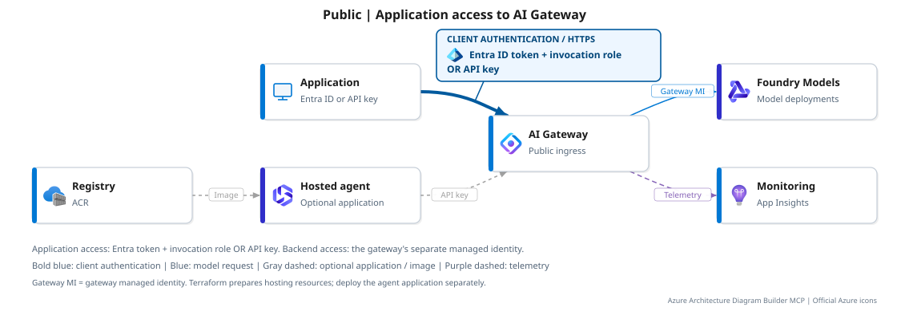
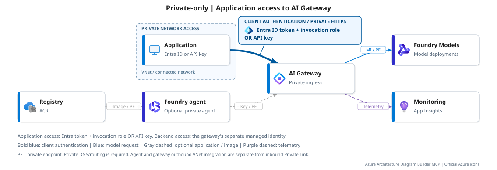

# AI Gateway and Foundry with Terraform

Deploy AI Gateway, Foundry model deployments and infrastructure for a separately
deployed hosted agent. The gateway handles access and policy; the model generates
the answer. This is standalone Terraform, not an `azd` application.

> [!NOTE]
> **Legacy SKU and migration deadline:** This sample uses
> `Microsoft.ApiManagement/service` with SKU `AIGateway`. Microsoft requires
> migration **before January 15, 2027**. This SKU is retained here for the
> private-endpoint scenario: as of October 25, 2026, the newer
> `Microsoft.ApiManagement/aigateways` resource does **not** support private
> endpoints. This is a time-limited preview reference, not a long-term deployment
> target. Plan migration without assuming private-endpoint feature parity;
> this sample does not perform that migration. See Microsoft's
> [migration deadline and limitations](https://learn.microsoft.com/azure/api-management/ai-gateway-resource).

> [!IMPORTANT]
> **Terraform Registry disclaimer (checked October 25, 2026):** No dedicated
> Microsoft-published Registry module was identified for the standalone
> `AIGateway` preview used here. General API Management and community gateway
> modules do exist; this directory is a repository-specific Terraform
> configuration, not an official Registry module. Instead, it uses Microsoft's
> **`Azure/azapi` provider** to manage explicit ARM resource types and preview
> API versions. See [how this is implemented](deployment.md#terraform-implementation)
> for the distinction and validation limits.

## Two networking options

| Configuration | Gateway public access | Model public access |
| --- | --- | --- |
| **Public** (default) | Enabled | Enabled |
| **Private-only** | Disabled | Disabled |

### Public

Clients use an API key or optional Entra token; the gateway authorizes to Foundry
Models using its managed identity. Agent hosting resources are provisioned, but the
container image and agent application are deployed separately.

### Private-only

Private endpoints (PE), DNS and outbound VNet integration connect the private
request path. The optional private agent requires creation-time network injection
and a later application deployment/runtime-role binding. It is part of
Private-only, not a third networking option.

In both diagrams, the **Application** is the caller: it sends an **Entra token
with an invocation role, or an API key** to the gateway. Its hosting location is
your choice; Private-only additionally requires private DNS and a network route.
The optional hosted agent is a separate application, not a required model-call hop.

These are logical flows, not subnet-placement diagrams. The Foundry inbound PE,
agent outbound injection, gateway inbound PE and gateway outbound integration are
separate controls. Identity, control-plane and telemetry traffic are not claimed
to be fully private. Registry/Storage and monitoring are supporting resources,
not extra model-serving hops; registry public access is unchanged by the agent extension.

## Access

Grant identity-based access with **Microsoft Entra ID**, or manage **API keys**.
Access is independent of Public/Private-only.

| Option | Configuration |
| --- | --- |
| Microsoft Entra ID | Add caller object IDs to `gateway_access_principals`; grants **AI Gateway Models User** for all models in this gateway. |
| API keys (existing default) | Leave the map empty. Existing keys remain available even when Entra callers are added. |

The existing agent and private test VM keep their API-key flow. This is additive,
**not an Entra-only switch**. See [Access setup](deployment.md#access) for
post-deployment configuration and `Test-ModelAliases.ps1 -Authentication EntraId`.

**Live-verified over the private route:** both sample models returned **200** with
managed-identity Entra access, **403** without the invocation role, and **401**
for missing/invalid credentials. API-key calls also passed; gateway/backend
traces matched. The temporary grant was removed afterward. This verifies the
managed-identity caller flow, not custom delegated-user applications.

## Deploy

Follow the **[deployment guide](deployment.md)**, next to this README, for prerequisites, inputs,
monitoring bootstrap, the chosen network path, private-agent setup and acceptance.
Keep the selected private profile on all later plans. The retained
`private-connectivity` profile is only an intermediate provisioning stage.

Review preview support, policies, regional availability and costs before applying.
The sample retains the `Microsoft.ApiManagement/service` / `AIGateway` contract;
check its compatibility with your environment. Supporting resources and model
calls incur charges; the gateway preview has no SLA.

| File | Purpose |
| --- | --- |
| [terraform.tfvars.example](terraform.tfvars.example) | Starting inputs for a new environment |
| [variables.tf](variables.tf) / [outputs.tf](outputs.tf) | Complete input and output contract |
| [profiles/private-only.tfvars.json](profiles/private-only.tfvars.json) | Final private gateway/model posture |
| [scripts](scripts) / [tests](tests) | Deployment checks and offline regression tests |

Diagrams generated with Azure Architecture Diagram Builder MCP; specialized
service icons corrected in the SVG export using the
[official Azure icon set](https://learn.microsoft.com/azure/architecture/icons/).
